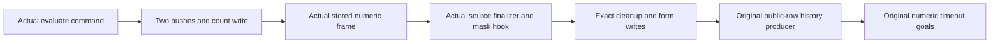

# Timeout counted entry and source finalizers

The actual count prefix produces its stored fiber and saved stack, but the original retry and cleanup goals still need public-row producers.

## Placement

Concept: scope-lifetime-finalization, R11, and translation-simulation, R10.
Question: the actual count-entry and finalizer steps of `Timeout.cleanup_keeps` and `Timeout.retries_declared`.
Consumer: the numeric command-history assertion.
Reach: symbolic stores, actual source callbacks, actual native fibers, and the original fixed command budget.
Limit: source entry, complete predecessor logs, and older saved suffixes remain explicit premises.
Unlock: the history producer can use the counted fiber rather than an arbitrary numeric counter.

## Checked connection

`HostTimeoutNumberEntry.count_prefix_exact` returns the actual machine after both saved pushes and the count write.
The existing `count_prefix`, `count_entry`, and `count_entry_budget` statements remain unchanged.
Their proofs consume the same exact machine equation.

`HostTimeoutNumberFinalizers.attempt_saved` and `form_saved` consume actual captured source names and exact numeric heap phases.
The installed finalizer program retains a fixed class while its captured exit varies.
The native cleanup and form wrappers restore their exact captured exit after the corresponding write.
The actual finalizer installation applies the native mask hook to the actual older suffix.
`cause_strip` and `cause_sanitize` retain every committed numeric cause class under the explicit recorded interruption cut.
No pre-count failure permission is added.

`HostTimeoutNumberCounted.count_prefix_typed` produces the actual stored fiber and its ordered numeric saved stack.
`count_entry_typed` consumes the real evaluate command and its operation-counter reset.
`count_entry_budget_typed` uses the original 2000-command budget as four entry commands and 1996 remaining commands.
The remaining commands stay symbolic.
The source count callback resolves the existing HTTP row at its actual source point.

The frame contract retains an arbitrary completed-exit view.
The public configuration must supply its saved contract for every view that the native interpreter uses.
The store future relation alone supplies no transport between different interpreters.

Proof role: exact source entry and saved finalizer transfer.
Evidence status: checked, conditional.
Scope: actual native count and cleanup fragments under their named entry premises.

## Verification

Base commit: `616da2926`.
Command: `LEAN_NUM_THREADS=3 lake build Test.Dogfood.Proofs.HostTimeoutNumberCounted Test.Dogfood.Scenario.Timeout`.
Result: 1145 jobs succeed.
Command: `LEAN_NUM_THREADS=3 lake env lean docs/research/2026-10-10-goals-packet/codex/TimeoutNumberCountedAudit.lean`.
Result: 195 declarations lie within `[propext, Quot.sound]`, with zero planned goals and zero modulo declarations.
Logs: `/private/tmp/timeout-number-counted-build.log` and `/private/tmp/timeout-number-counted-audit.log`.
`git diff --check` reports no whitespace errors.
No executable source changes, so this slice reaches no additional behavior gate.
No work is pushed.

Changed files:

- `Test/Dogfood/Proofs/HostTimeoutNumberEntry.lean`.
- `Test/Dogfood/Proofs/HostTimeoutNumberFlow.lean`.
- `Test/Dogfood/Proofs/HostTimeoutNumberFinalizers.lean`.
- `Test/Dogfood/Proofs/HostTimeoutNumberCounted.lean`.
- `docs/research/2026-10-10-goals-packet/codex/TimeoutNumberCountedAudit.lean`.
- This receipt.

## Remaining connection

The history producer must connect race launch to the checked count prefix.
It must retain active attempt ownership, actual cleanup completion, and the selected completed-form exit.
It must issue the next retry cursor only after that form returns.
The original numeric goals remain planned.
`Timeout.stale_never_applies` remains proved.

The copied shared modules remain excluded from this commit.
`AnswerFlowFrames` belongs to the coordinator at `ca7d9000d`.
Its SHA256 is `9aaa6491b4bec3fffdd42c5e4884e40ef835467974e3a057937235af1d1d439b`.
`AnswerFlowHooks` belongs to the coordinator at `3f81a9917`.
Its SHA256 is `f15ee783257da579d2120653f43961eb2b741468dd0e4cea4139ee2bfd1b0976`.
The coordinator must import `Test.Dogfood.Proofs.HostTimeoutNumberCounted` from `Test/All.lean`.
