# Timeout selected-form numeric family

The real native form finalizer consumes the actual completed attempt cleanup, but original history closure remains open.

## Placement

Concept: scope-lifetime-finalization, R11, and translation-simulation, R10.
Question: selected-form publication and the next declared predecessor of `Timeout.cleanup_keeps` and `Timeout.retries_declared`.
Consumer: the root race, source retry callback, and numeric public-row history assertion.
Reach: actual stores, actual source points, real selected stack frames, and the actual delivered cause.
Limit: the actual history must produce the typed frame, selected race phase, and plain-script cause origin.
Unlock: the root can save its form finalizer before the race chooses an exit.

## Checked connection

The numeric form class retains an existential attempt cleanup exit.
It chooses that exit from the actual heap when its saved program runs.
The class then retains the exact selected exit published by the source form finalizer.
It does not predict the attempt cleanup interruption flag before race settlement.

`HostTimeoutNumberFormFamily.form_saved` consumes that class at the root's actual saved source finalizer.
Its protected discard clause uses the actual mask hook.
`native_success` and `native_failure` consume shared value and cause selection on the real native evaluator.
The failure reader uses the cause actually delivered after interrupted-handler selection.
Both retain the numeric store and the actual finalizer frame.

`caught_is_published` binds an actual handled typed failure to the form entry already written in the heap.
An interruption cut with no typed failure cannot satisfy that handler premise.
`handled_published` checks the exact source test on an actual singleton tagged failure.
`declared_published` and `next_declared` extend the exact completed predecessor prefix.
The former declared prefix and actual completed-form phase remain explicit premises.

```mermaid
flowchart LR
  Race[Actual race exit] --> Cleanup[Actual attempt cleanup image]
  Cleanup --> Saved[Root saved form callback]
  Saved --> Native[Real native selected-frame finalizer]
  Native --> Published[Exact selected exit in heap]
  Published --> Caught[Actual declared singleton catch]
  Caught --> Prefix[Next declared predecessor prefix]
  Prefix --> History[Original public-row history producer]
```

Proof role: numeric source finalization, native selection, and retry-prefix transfer.
Evidence status: checked, conditional.
Scope: the actual selected form and catch fragments; public-row history remains open.

## Verification

Base commit: `0e7167109`.
Command: `LEAN_NUM_THREADS=3 lake build Test.Dogfood.Proofs.HostTimeoutNumberFormFamily Test.Dogfood.Scenario.Timeout`.
Result: 1148 jobs succeed.
Command: `LEAN_NUM_THREADS=3 lake env lean docs/research/2026-10-10-goals-packet/codex/TimeoutNumberFormFamilyAudit.lean`.
Result: 168 declarations lie within `[propext, Quot.sound]`, with zero planned goals and zero modulo declarations.
Logs: `/private/tmp/timeout-number-family-build.log` and `/private/tmp/timeout-number-family-audit.log`.
`git diff --check` reports no whitespace errors.
No executable source changes, so this slice reaches no additional behavior gate.
No work is pushed.

Changed files:

- `Test/Dogfood/Proofs/HostTimeoutNumberFlow.lean`.
- `Test/Dogfood/Proofs/HostTimeoutNumberFormFamily.lean`.
- `docs/research/2026-10-10-goals-packet/codex/TimeoutNumberFormFamilyAudit.lean`.
- This receipt.

## Dependencies and remaining connection

The copied `AnswerFlow` modules belong to the coordinator at `de348b6b1` and stay excluded from this commit.
The copied migration of `HostTimeoutNumberFinalizers` belongs to that commit and stays excluded too.
The coordinator must integrate that migration before this slice.
The coordinator must import `HostTimeoutNumberFormFamily` from `Test/All.lean`.

Dependency SHA256 values:

- `AnswerFlow`: `adf2034834b928e1caf4a1904dc0ea2bd14e2d15b9b0f1bee228db4ceee8b688`.
- `AnswerFlowFrames`: `8a035537d68e5c4e9ff67f33875a83848ac438ef0d8b6b56de06c7d6942a4244`.
- `AnswerFlowHooks`: `a43b9d0c1fe7b5a7bdfb167881d9d6027ea9a80afa271b4101c3e4e9756dd0f7`.
- `AnswerFlowPop`: `dc84fba61dc0fe3966b431ec0c40a726285ed388022689a2274cd8be982ea698`.
- `AnswerFlowCausePop`: `a65761a1d7f40a61c9430b23a94605e2c85b6175f1280ce52fff0ba7dc472f2b`.

The history invariant must retain concrete root, attempt, timer, and race phases when the count and logs change.
A store future relation supplies no arbitrary current-code weakening.
It must connect actual race launch to the checked count prefix and selected cleanup completion.
The plain-script producer must retain singleton tagged failures or explicit interruption cuts.
The original retry and cleanup goals remain planned.
`Timeout.stale_never_applies` remains proved.
