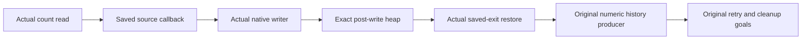

# Timeout numeric callbacks and native writes

The numeric saved callbacks consume exact post-operation heaps, but the original retry and cleanup goals still need reached-history producers.

## Placement

Concept: scope-lifetime-finalization, R11, and translation-simulation, R10.
Question: the saved callback steps of `Timeout.cleanup_keeps` and `Timeout.retries_declared`.
Consumer: the numeric source and command-history assertion.
Reach: actual captured source points, actual reference heaps, actual native fibers, and actual saved stacks.
Limit: explicit numeric phase and interruption premises remain conditional.
Unlock: the original numeric observations can consume the ordered writers once actual history supplies those premises.

## Checked connection

`HostTimeoutNumberCallbacks.cleanup_transfer` connects the real count read, saved count callback, cleanup write, and post-write numeric assertion.
`HostTimeoutNumberCallbacks.completed_transfer` connects the corresponding form read, saved selected exit, actual writer, and completed-form assertion.
Both declarations retain arbitrary captured metadata and the actual source environment.
`HostTimeoutNumberCallbacks.native_reference` consumes all eight reference source inputs on the real native evaluator.

`HostTimeoutNumberFlow.model` instantiates the shared `AnswerFlow` contract with predicates over actual stores and existing source code.
Its finalizer hook reads the actual native finalizer program and installs its actual restore wrapper.
Its saved callback classes distinguish count reads, completed unit writes, and restored exits.
The future relation retains monotone allocated reference and deferred lengths.
The fragment supplies no active-generation or owner permission producer.

The cleanup binder push, count pop, writer push, native write, and restore pop consume those classes.
The completed-form binder push, count pop, and native write consume the same shared saved-stack contract.
`native_get` supplies the exact count from the real heap without changing the saved suffix.
The restored failure class retains either the saved cause or an explicit cause with no typed failure.
The strip and sanitize readers preserve the committed heap for that interruption cut.
`no_typed_catch` checks that the actual retry handler propagates that cut.

Proof role: source callback and native operation transfer.
Evidence status: checked, conditional.
Scope: the numeric cleanup and form fragments; complete public-row closure remains open.

## Verification

Base commit: `968e265dd`.
Command: `LEAN_NUM_THREADS=3 lake build Test.Dogfood.Proofs.HostTimeoutNumberFlow`.
Result: 1074 jobs succeed.
Command: `LEAN_NUM_THREADS=3 lake env lean docs/research/2026-10-10-goals-packet/codex/TimeoutNumberFlowAudit.lean`.
Result: 136 declarations lie within `[propext, Quot.sound]`, with zero planned goals and zero modulo declarations.
Logs: `/private/tmp/timeout-number-flow-build.log` and `/private/tmp/timeout-number-flow-audit.log`.
The separate callback audit checks 20 declarations with the same zero-goal result.
No executable code changes, so this slice reaches no additional behavior gate.

Changed files:

- `Test/Dogfood/Proofs/HostTimeoutNumberCallbacks.lean`.
- `Test/Dogfood/Proofs/HostTimeoutNumberFlow.lean`.
- `docs/research/2026-10-10-goals-packet/codex/TimeoutNumberCallbacksAudit.lean`.
- `docs/research/2026-10-10-goals-packet/codex/TimeoutNumberFlowAudit.lean`.
- This receipt.

## Remaining connection

The public-row invariant must establish the active attempt, saved cleanup return, race cleanup completion, and retry cursor phases.
The original fixed budget must exclude script intervention inside the pre-count entry prefix.
The numeric source classes must then cover the remaining source positions and command producers.
The declared prefix must follow actual complete returned form exits.
`Timeout.stale_never_applies` remains proved; the original retry and cleanup goals remain planned.

The shared `Effect4.Laws.Machine.AnswerFlow` dependency belongs to the machine seat at `ee311112b`.
Its copied file remains excluded from this commit.
Its SHA256 is `d0bd64b637a2dc81addc3b0ef3cb5024ad3d50b22954146bd8aa84f0d7a9aff5`.
The coordinator must import `Test.Dogfood.Proofs.HostTimeoutNumberFlow` from `Test/All.lean`.
