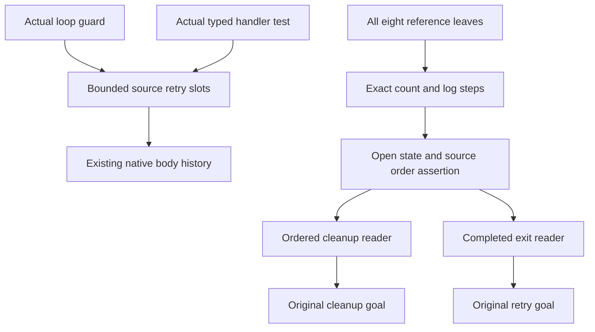

# Timeout count and log source steps

The source retry bound and declared handler test now hold inside the checked native history assertion.
The two remaining original goals still need actual count and log ordering through command histories.
The new numeric readers establish no reached-state ordering by themselves.

## Placement

Concept: translation-simulation, requirement R10, and scope-lifetime-finalization, requirement R11.
Question: the original `Timeout.retries_declared` and `Timeout.cleanup_keeps` propositions.
Proof role: source assertions, exact heap steps, and observation readers.
Reach: all actual Timeout source points, arbitrary lexical payloads, arbitrary compilation fuel, and arbitrary native stores outside the reference fields.
The step equations use the source's exact three allocated handles.
They leave their heap and source-order hypotheses explicit.
They establish no progress, physical deadline, or outside implementation comparison.

## Source assertion

`HostTimeoutSlots.EnvAt` retains `n : Fin 4` at every retry body, entrant, timer, and cleanup source point.
`HostTimeoutNative.loop_next_code` obtains that bound from the actual loop guard.
The complete existing native command and reached-run proof consumes this strengthened assertion.

`HostTimeoutSlots.Retryable` reads the actual source handler test.
`HostTimeoutSlots.caught_retryable` derives that predicate from the actual `caughtErrorValue?` result.
The handler slot and `ValueAt.failed` retain its proof through the saved loop continuation.
This establishes payload selection, not correlation with a prior completed-form log entry.

## Heap steps and readers

`HostTimeoutNumberSteps.refPaths_eq` enumerates all eight reference leaves using the generated source fold.
`count_make`, `cleanup_make`, and `completed_make` establish allocation order and exact handles.
`count_update` increments the actual old heap count.
`cleanup_read` and `completed_read` read that committed count.
`cleanup_note` writes the saved number and the actual interruption query.
`completed_note` writes the saved complete exit.
These operations preserve the other reference cells.

`HostTimeoutNumberLedger.CleanupsAt` records consecutive numbered cleanup entries.
`cleanup_write` preserves that assertion when the saved count equals the next cleanup position.
`count_write` preserves the numeric gap and four-attempt bound when the preceding cleanup is complete and count is bounded by the source cursor.
`FormsAt` retains the exact completed exits.
`completed_write` extends that sequence through the actual source writer.
`completed_exits` connects the original completed-form reader to the actual third cell.
`cleanup_observation` and `retry_observation` discharge the original Boolean observations from explicit order premises.

## Verification

Base: `97f883b82`.
Head: the commit containing this receipt.

Command: `LEAN_NUM_THREADS=3 lake build Test.Dogfood.Proofs.HostTimeoutNumberLedger Test.Dogfood.Scenario.Timeout`.
Result: success, 1136 jobs.

Command: `LEAN_NUM_THREADS=3 lake env lean docs/research/2026-10-10-goals-packet/codex/TimeoutNumberAudit.lean`.
Result: 452 declarations within `[propext, Quot.sound]`, zero planned goals and zero declarations modulo planned goals.
The first audit detected a classical order instance through generic Boolean reflexivity.
The concrete number-list comparison replaces that proof and passes the repeated audit.

Command: `LEAN_NUM_THREADS=3 lake env lean docs/research/2026-10-10-goals-packet/codex/TimeoutFlowAudit.lean`.
Result: groups of 1096, 209, and 68 declarations within `[propext, Quot.sound]`.
Every group reports zero planned goals and zero declarations modulo planned goals.

Command: `LEAN_NUM_THREADS=3 lake env lean docs/research/2026-10-10-goals-packet/codex/TimeoutOriginalAudit.lean`.
Result: 25 declarations within `[propext, Quot.sound]`, two planned goals and one declaration modulo planned goals.
`stale_never_applies` remains proved.
`timeout` rests only on the original cleanup and retry goals.

No executable behavior or original statement changes.
The coordinator owns root import closure and deferred behavior gates.
Copied coordinator dependencies and the unrelated RaceFirst and KernelRfl files remain excluded.
No push runs.

Changed files:

- `Test/Dogfood/Proofs/HostTimeoutSlots.lean`.
- `Test/Dogfood/Proofs/HostTimeoutNative.lean`.
- `Test/Dogfood/Proofs/HostTimeoutNumberSteps.lean`.
- `Test/Dogfood/Proofs/HostTimeoutNumberLedger.lean`.
- `docs/research/2026-10-10-goals-packet/codex/TimeoutNumberAudit.lean`.
- This receipt.

## Open command assertion

The current pure `HeadAt.sync` accepts arbitrary native stores.
It therefore cannot bind the retry cursor to the current counter or serialize the log writers.
The next assertion must retain the active attempt, saved count, completed exit, and cleanup return order.
An unfinished pre-count evaluation retains `running = true`; an external interruption then defers.
That fact alone supplies no complete command-history invariant.
No counterexample or amendment is claimed.
The next slice reuses the shared state-indexed native contract under development by the machine and source seats.
