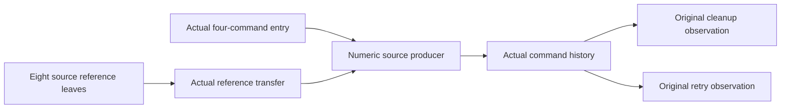

# Timeout numeric state and entry receipt

The original retry and cleanup goals remain open.
The numeric assertion now consumes all eight source reference leaves and the actual four-command count entry.
The actual history must still supply the source phase and callback order.

## Placement

Concept: scope-lifetime-finalization, R11, and translation-simulation, R10.
Question: `Timeout.cleanup_keeps` and the approved `Timeout.retries_declared`.
Consumer: the state-indexed source assertion and its actual command history.
Reach: the existing Timeout program, native evaluator, actual reference heap, and captured source metadata.
The original statements and executable program remain unchanged.

## Checked facts

`HostTimeoutNumberState.Numbers` couples the count, cleanup log, completed log, and decoded exits.
`HeapAt` retains the three allocation stages before the complete heap exists.
`cleanup_heap` reads the original cleanup observation from that assertion.
`retry_ready` reads the original retry observation from its exact completed exits and declared prefix.
`reference_step` covers every reference operation in the generated source census.
`reference_step_point` covers arbitrary captured metadata on those actual source points.
The producer premises retain the source cursor, active attempt, saved count, and completed cleanup order.
They are conditional assertions, rather than added original scenario premises.

`HostTimeoutNumberEntry.attempt_code` computes the actual compiled attempt.
It is `OnExit` around `OnSuccess` around the synchronous count write.
`count_prefix` executes its three charged loop commands on symbolic machine state and a symbolic saved suffix.
`count_entry` includes the actual evaluate command, which resets the operation count.
Its four commands commit the counter before either owed resumes or answer delivery.
`count_entry_budget` splits the original 2000-command budget into that prefix and 1996 remaining commands.
The command residue remains the actual `drainDue`, `deliver`, and supplied suffix.
The source equation retains arbitrary captured point metadata and positive compilation fuel.

Proof role: source transfer and observation consumers.
Evidence status: checked, conditional.
Scope: actual native carriers and fixed scenario entry budget; complete source history remains open.

## Verification

Base commit: `cac397fd3`.
Command: `LEAN_NUM_THREADS=3 lake build Test.Dogfood.Proofs.HostTimeoutNumberEntry Effect4.Laws.Machine.AnswerFlow`.
Result: 1072 jobs succeed.
Command: `LEAN_NUM_THREADS=3 lake env lean docs/research/2026-10-10-goals-packet/codex/TimeoutNumberStateAudit.lean`.
Result: 106 declarations lie within `[propext, Quot.sound]`, with zero planned goals and zero modulo declarations.
Logs: `/private/tmp/timeout-number-entry-build.log` and `/private/tmp/timeout-number-state-audit.log`.
No executable code changes, so this slice reaches no additional behavior gate.

Changed files:

- `Test/Dogfood/Proofs/HostTimeoutNumberState.lean`.
- `Test/Dogfood/Proofs/HostTimeoutNumberEntry.lean`.
- `docs/research/2026-10-10-goals-packet/codex/TimeoutNumberStateAudit.lean`.
- This receipt.

## Remaining connection

The actual fresh entrant must supply the entry premises.
The actual row boundary must rule out script intervention inside the pre-count prefix.
A drive-fuel cut retains a running fiber; scheduler yield instead parks it.
The entry equations make no unconditional claim that those cuts coincide.
The state assertion must retain each actual saved callback, race return, cleanup return, and retry cursor.
The declared prefix must follow the completed timeout form, rather than a host reply receipt.
The retry and cleanup original goals remain planned until that history connection compiles and audits.

The shared `Effect4.Laws.Machine.AnswerFlow` dependency belongs to the machine seat at `ee311112b`.
Its copied file remains excluded from this commit.
Its SHA256 is `d0bd64b637a2dc81addc3b0ef3cb5024ad3d50b22954146bd8aa84f0d7a9aff5`.
