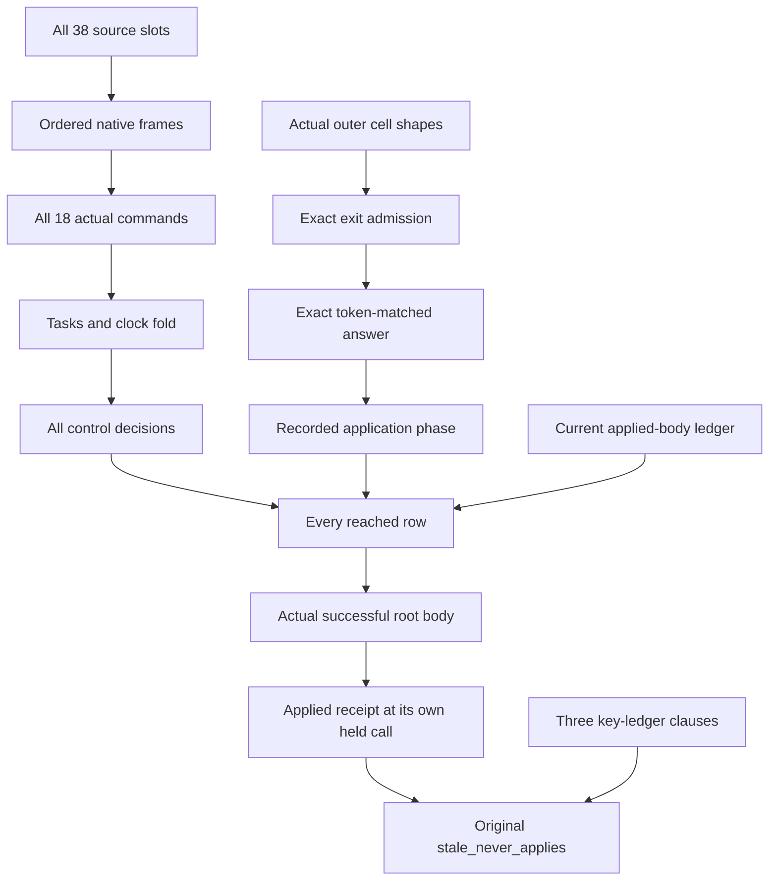

# Timeout stale-reply closure

`Test.Dogfood.Scenario.Timeout.stale_never_applies` is proved at its original statement and placement.
The retry and cleanup goals remain open.
The coordinator must include the new proof modules through Timeout's new import before auditing the integrated tree.

## Placement

Concept: host-session-protocol, requirement R6.
Question: the original `StaleNeverApplies` proposition.
Proof role: preservation through actual source execution and the recorded application ledger.
Reach: every successful fetch build and every script, including raw rows and every fuel frontier.
No plain, funded, at-rest or typed-tape premise is added.
The proof retains arbitrary admitted failure causes.
It establishes no progress, physical deadline or outside implementation comparison.

## Result

`HostTimeoutHistory.returned_body` reads the actual stored root exit of every reached fetch run.
Its body belongs to the same run's current applied-body prefix.
`HostTimeoutHistory.successful_body_seen` consumes the coordinator's `HostAppliedObservation.applied_body_seen` reader.
It proves the original observation's successful-root clause at the same held call.
The original theorem combines that clause with `HostJournal.stale_clauses`, the three previously checked key-ledger clauses.

The command invariant covers all eighteen actual native commands.
The scheduler fold retains drained tasks and their immutable token classes.
Clock replies carry unit at a pending sleeper's actual token.
The clock proof permits a captured batch in the generic timer state.
Each control preserves the same successful-body set.
External preparation retains the exact admitted exit and native stores.
The first live external resume spends its old guard before remaining command fuel runs.
Reserved-key transport prevents that guard from returning during subsequent commands.
An unapplied application frontier therefore leaves this source machine unchanged.
An applied row adds its exact successful receipt body to the current ledger prefix.
The reached-run induction carries one fixed body set containing that prefix.
It never widens the fixed callback assertion after interpreting a saved continuation.

## Pruning

The completed assertion replaces the earlier conditional `FrameLedger` and `ResumeAt` route.
Those unused declarations and their isolated consumers are removed.
The completed native configuration proof also replaces the duplicate outer-heap evaluator chain.
Its isolated helpers are removed from `HostTimeoutHeap`.
The actual delayed-read admission readers remain.
No machine semantics, source program, reply admission or original theorem statement changes.

## Verification

Base: `a1831f1b`.
Head: the commit containing this receipt.

Command: `LEAN_NUM_THREADS=3 lake build Test.Dogfood.Scenario.Timeout`.
Result after pruning: success, 1134 jobs.
The build also checks Timeout's retained finite controls.

Command: `LEAN_NUM_THREADS=3 lake env lean docs/research/2026-10-10-goals-packet/codex/TimeoutFlowAudit.lean`.
Result: audit groups of 1088, 209 and 68 declarations within `[propext, Quot.sound]`.
Every group reports zero planned goals and zero declarations modulo planned goals.

Command: `LEAN_NUM_THREADS=3 lake env lean docs/research/2026-10-10-goals-packet/codex/TimeoutOriginalAudit.lean`.
Result: 25 declarations within `[propext, Quot.sound]`, two planned goals and one declaration modulo planned goals.
`#plan_status` reports `stale_never_applies: proved`.
It reports `timeout` modulo `cleanup_keeps` and `retries_declared` only.

No outside implementation comparison runs in this proof-only slice.
The coordinator owns behaviour gates, generated proof reports and root gate repair.
Copied coordinator dependencies remain excluded, with hashes in the previous driver receipt.
The unrelated RaceFirst edit and KernelRfl helper remain excluded.
No push runs.

Changed files:

- `Test/Dogfood/Proofs/HostTimeoutCommands.lean`.
- `Test/Dogfood/Proofs/HostTimeoutHeap.lean`.
- `Test/Dogfood/Proofs/HostTimeoutState.lean`.
- `Test/Dogfood/Proofs/HostTimeoutScheduler.lean`.
- `Test/Dogfood/Proofs/HostTimeoutControls.lean`.
- `Test/Dogfood/Proofs/HostTimeoutAnswers.lean`.
- `Test/Dogfood/Proofs/HostTimeoutApplication.lean`.
- `Test/Dogfood/Proofs/HostTimeoutHistory.lean`.
- `Test/Dogfood/Scenario/Timeout.lean`.
- `docs/research/2026-10-10-goals-packet/codex/TimeoutFlowAudit.lean`.
- `docs/research/2026-10-10-goals-packet/codex/TimeoutOriginalAudit.lean`.
- This receipt.

## Remaining goals

`retries_declared` needs the completed-form failure and four-attempt source-order invariant.
The approved ruling remains: retry only after the timeout form returns a declared failure.
`cleanup_keeps` needs the actual counter and cleanup-log order invariant.
Body provenance alone establishes neither numeric invariant.
