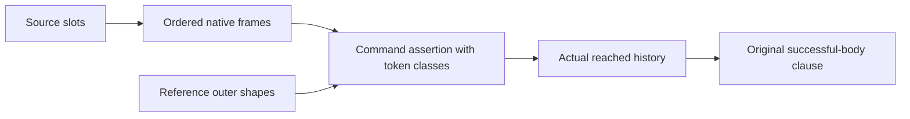

# Timeout native reply and heap custody

The coordinator must import `Test.Dogfood.Proofs.HostTimeoutHeap` from `Test/All.lean`.
The original Timeout goals remain open.
The complete history assertion still needs command closure.

## Placement

Concept: host-session-protocol.
Requirement: R6.
Question: `Timeout.stale_never_applies`, clause four.
Proof role: native transfer laws for the reached assertion.
Evidence status: checked without planned goals.
Scope: actual Timeout source heads, native evaluation, token-matched resume, and reply preparation.
Every theorem retains its stated source or state assertion.
These assertions establish neither progress nor outside implementation agreement.

## Checked transfer

`HostTimeoutFrames.finished_frame` retains the actual exiting current code and the remaining mask frames.
`HostTimeoutEvaluation.IterKind.frame` consumes that terminal custody at the pending finish boundary.

`HostTimeoutCommands.resume_command` follows the actual guard comparison and installs the classified reply under its saved stack.
`prepare_exit` proves exact exit preparation at Timeout's string answer row.
It retains arbitrary failure causes.

`HostTimeoutFlow.SyncAt` now requires number or list outer shapes for reference writes.
`HostTimeoutNative.source_head` discharges these conditions at all six concrete write sites.
The two list allocations use their actual record-field ascription expressions.
The complete thirty-eight-case source expansion remains checked.

`HostTimeoutEvaluation.sync_state_outer` follows actual allocation, read, update and sleep cancellation.
`HostTimeoutHeap.evaluate_native_outer` covers every allowed primitive head and native source interception.

`HostTimeoutHeap.delayed_read_refused` proves refusal at the general row envelope under the heap assertion.
`envelope_exit` and `instance_envelope_exit` extract exact exit completions.
They neither alter reply admission nor restrict failure causes.

The finite admission control accepts a delayed read from a string cell.
The two finite readers refuse delayed reads from number and list cells.
These fixtures establish no reached-state assertion.

## Next command assertion

The proof records each existing token's incoming class in one proof-only list.
The three classes are body, unit and arbitrary data.
The list has the machine's existing `nextToken` length.
Existing Guard freshness and reserved-key laws bound tokens.
Existing Lift world monotonicity transports the list through history.
The machine and program representation gain no field.

A conditional `ResumeAt` alone loses correlation while a race host registers without parking.
The host later parks on its previously allocated race token.
The list retains that token's body class through both states.
It is the single correlation mechanism of the concrete command assertion.

The assertion must cover stored frames, exits, race entrants and accepted exits.
It must cover pending countdowns, timers, dispatcher snapshots and queued resumes.
Its root-body member must feed `HostAppliedObservation.applied_body_seen`.
No original premise strengthens.

## Landing and verification

Base: `0ad34b097`.
Head: the commit containing this receipt.

Changed files:

- `Test/Dogfood/Proofs/HostTimeoutFlow.lean`.
- `Test/Dogfood/Proofs/HostTimeoutNative.lean`.
- `Test/Dogfood/Proofs/HostTimeoutFrames.lean`.
- `Test/Dogfood/Proofs/HostTimeoutEvaluation.lean`.
- `Test/Dogfood/Proofs/HostTimeoutCommands.lean`.
- `Test/Dogfood/Proofs/HostTimeoutHeap.lean`.
- `docs/research/2026-10-10-goals-packet/codex/TimeoutFlowAudit.lean`.
- This receipt.

Command: `LEAN_NUM_THREADS=3 lake build Test.Dogfood.Proofs.HostTimeoutHeap`.
Result: success, 1070 jobs.

Command: `LEAN_NUM_THREADS=3 lake env lean docs/research/2026-10-10-goals-packet/codex/TimeoutFlowAudit.lean`.
Axiom output: 893 declarations within `[propext, Quot.sound]`.
The audit reports zero planned goals and zero declarations modulo planned goals.
`git diff --check` passes.

This slice changes proofs and assertions only.
It changes no runtime, compiler, source program or host reader.
No outside implementation comparison runs in this slice.
The coordinator owns the existing behaviour gates.

The unrelated `RaceFirst.lean` edit and owner's untracked `KernelRfl.lean` stay outside this commit.
No push runs.

## Remaining obligations

The original successful-body clause still requires the complete actual command and history assertion.
The retry clause still requires returned-form provenance and the four-attempt bound.
The cleanup clause still requires exact count and log correspondence.
The checked outer heap assertion establishes no allocation limit or log correspondence.
