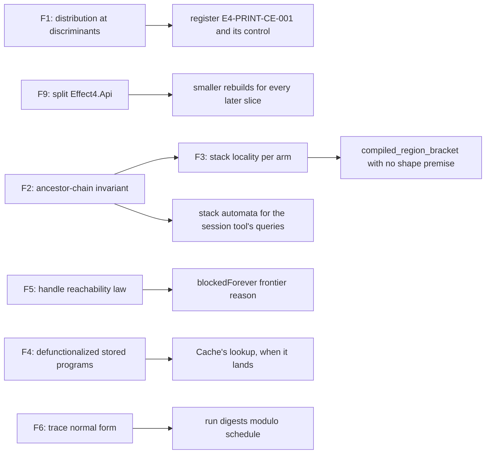

# The machine, the programs and the proof as graphs (2026-10-11)

Status: research note (history, not authority). Base: `734368d17` on `refactor/phase1-phase3`.
The owner asked for a probe of the core from topology and graph theory. Its parts: the fiber
machine, its continuations, programs as data, the type and data system, and the proof itself.
This note records what the probe found, what it measured, and what each finding would unlock.

## 1. The one thing to know first

**A checked program can print TypeScript that tsgo 7 refuses.** The normal form distributes a
pair over a union (DI-15, `Ty.normalize`'s `productMembers`, `src/Effect4/Program/Ty.lean`).
The printer spells every type from its normal form (`Codegen.Types.ofTy`,
`src/Effect4/Codegen/Types.lean`). TypeScript distributes only at a discriminant, a literal
position. So `[number | string, boolean]` is checked and printed as
`readonly [number, boolean] | readonly [string, boolean]`, and tsgo infers the undistributed
tuple. The smallest witness has no stated type at all:

```text
flatMap(true ? succeed(1) : succeed("s"), (a) => succeed(pair(a, true)))
```

The checker admits it, the generator says it reads back, and tsgo 7.0.0-dev.20260629.1 refuses
the module with TS2375 (`probes/emit/control.ts`, `probes/emit/tsgo.out`). DI-55 assumed the two
spellings are mutually assignable. That holds for literal tags and fails for other unions. The
repair is a representation and meaning choice for the owner (§3.6).

The other findings, by kind:

| # | Finding | Kind | Evidence |
| --- | --- | --- | --- |
| F1 | The checker's order of types departs from tsgo at the distributive law, in both directions, and depends on a tuple's arity | critical | finite probe, Lean and tsgo |
| F2 | A fiber's frame stack is a chain of ancestors in the program tree, cut into segments by call sites: with data abstracted, the machine is a pushdown system of order two | understanding, and it unlocks algorithms | finite probe; reading |
| F3 | The region bracket of Effect's mask has an open premise: the well-nesting of that pushdown, one lemma per evaluator arm | useful | reading |
| F4 | Storing a program in a value (row 340 (2), waiting) would end that pushdown property; store it defunctionalized | critical, before it lands | reading; literature |
| F5 | The frontier names no join or deferred wait, and a partial deadlock is invisible; a reachability fixpoint over the heap names both, and each fiber it names never resumes, because no term can forge a handle | useful | reading |
| F6 | A run is a trace: its schedule-free identity is a normal form of the trace, and the schedule space has a topology with a compactness theorem | useful | reading; builds on DET-1 to DET-5 |
| F7 | Levels and absolute reference paths make a subtree's identity depend on its place; a support-recording fold makes pieces position-free | useful for row 336 | reading |
| F8 | The proof graph is an hourglass: one theorem dominates 1,215 of the 4,512 theorems under the claims, and M7's deepest chain ends in the type order's laws | understanding | measured |
| F9 | `Effect4.Api` is a hub that puts the printer and reader under the typed-state proofs; a split halves what a printer edit rebuilds | engineering | measured |

## 2. Sources and method

- **Read:** `Eff` (`src/Effect4/Program/Eff.lean`), the frame machine
  (`src/Effect4/Machine/Frames.lean`), the fiber machine (`src/Effect4/Machine/Fibers.lean`), the
  compile's points and names (`src/Effect4/Program/Compile.lean`), the stores
  (`src/Effect4/Machine/Stores.lean`), the definitions block
  (`src/Effect4/Program/Definitions.lean`), `Ty` and `Ty.sub` (`src/Effect4/Program/TyCore.lean`,
  `src/Effect4/Program/Ty.lean`), the frontier (`src/Effect4/Api/Frontier.lean`,
  `src/Effect4/Laws/Api/Frontier.lean`) and the mask bracket
  (`src/Effect4/Laws/Machine/MaskBracket.lean`, `src/Effect4/Laws/Program/MaskBracket.lean`).
- **Built on:** the schedule independence note
  (`docs/research/2026-10-10-schedule-independence/README.md`), the polarity note
  (`docs/research/2026-10-10-openai-math-type-systems/README.md`), the load paths note
  (`docs/research/2026-10-08-load-paths.md`), the graph and tree audit
  (`docs/research/2026-10-09-graph-tree-audit.md`), and the program parameters and CX notes.
- **Measured:** five probes under `probes/`, listed with their commands in §13.
- **Literature** is cited by author, title and year. None of it is filed, and every citation is
  from memory. No locator is given. Filing a paper needs the owner's word for each download.

## 3. F1: the order of types and the distributive law

### 3.1 The order is a lattice of antichains

A normal type is a union of members, and no member lies below another (`Row.antichain`, DI-15).
`Ty.sub` reads a union on the left member by member and a union on the right as a choice. So
`A ≤ B` exactly when each member of `A` lies below some member of `B`. This is the lower
(Hoare) powerdomain order on antichains, and `Ty.join` is the antichain of maximal members.

The order agrees with inclusion of value sets (membership, `Fits`) only at **join-prime** members.
A member is join-prime when, lying below a union, it lies below one of its parts. A pair whose
first item is a union is not join-prime. Its values are exactly those of the union of the
distributed pairs, and no single distributed pair holds them all.

### 3.2 Which positions may distribute

A type constructor distributes over a union in one position exactly when every value holds one
item at that position. Pairs, tuples, record fields, `Option` and `Exit` do. Lists and maps do
not: a list may mix members. So the set of distributive positions is a fold over each
constructor's shape, like the polarity fold of the previous note. Its values form a small
multiplicity semiring: none, one, many. This note proposes no such fold yet.

### 3.3 What the tree does, and what tsgo does

`Ty.normalize` distributes `prod`, and a two-item tuple, which normalizes to `prod`. It does not
distribute records, options, exits or longer tuples. The checker's order is `sub` on normal
forms (`subN`, `src/Effect4/Laws/Program/TypeAlgebra.lean`).

| Case | Left | Right | raw `sub` | the checker's order | tsgo 7 |
| --- | --- | --- | --- | --- | --- |
| 1 | `["A" \| "B", string]` | `["A", string] \| ["B", string]` | false | true | admits |
| 2 | `{ _tag: "A" \| "B", x: nat }` | the two records | false | false | admits |
| 3 | `[nat \| string, bool]` | `[nat, bool] \| [string, bool]` | false | **true** | **refuses** |
| 4 | `Option<nat \| string>` | `Option<nat> \| Option<string>` | false | false | not run |
| 5 | `Exit<nat \| string, never>` | the two exits | false | false | refuses |
| 6 | `list (nat \| string)` (control) | `list nat \| list string` | false | false | refuses |
| 7 | `[nat \| string, bool, bool]` | the two triples | — | false | not run |

Sources: `probes/TyDistrib.lean` and `probes/tydistrib.out`; `probes/tsgo/distrib.ts` and
`probes/tsgo/distrib.tsgo.out`.

So the checker and tsgo disagree in both directions. Case 3: the checker admits what tsgo
refuses, so a checked program can fail the printed face (O3). Case 2: tsgo admits what the
checker refuses, a sound refusal of the kind `E4-POL-CE-001` registers. Cases 3 and 7 show a
third defect inside the tree: whether a union distributes depends on the tuple's arity.

### 3.4 The end-to-end witness

`probes/EmitProbe.lean` builds three programs and emits each module with the corpus generator
(`Tools.Code.generate`, `tools/Tools/Code/Module.lean`).

| Program | What it does | The generator | tsgo 7 |
| --- | --- | --- | --- |
| `control` | joins `1` and `"s"`, pairs the result with `true` | checked; reads back | TS2375 on `main`'s annotation |
| `viaCursor` | the same, into a loop cursor stated at `[nat \| string, bool]` | checked; "reads back to another program" | TS2322 on the cursor's `let` |
| `viaDecl` | the same, as a definition declared at `[nat \| string, bool]` | checked; "reads back to another program" | TS2375 on the definition's return type |

The generator column is the generator's own verdict. Its two "reads back to another program"
verdicts are the same cause, seen by the reader. A stated type prints in its normal form, so it
reads back distributed. The control program states no type, so the printed annotation alone
carries the distributed form.

### 3.5 Why TypeScript stops at discriminants

TypeScript 3.5 added the decomposition of a source object by its discriminant properties. A bound
on the number of combinations limits it (the release notes call it smarter union type checking;
from memory). A discriminant is a property whose type is a union of unit types. The probe shows
the same behaviour in tsgo 7: cases 1 and 2 pass, cases 3 and 5 fail. The bound keeps the check
from growing exponentially. Semantic subtyping decides every case, at an exponential cost in the
worst case (Frisch, Castagna and Benzaken, 2008).

### 3.6 The repairs, for the owner

Each repair changes a normal form or the order, so each is a representation or meaning choice.

| Repair | What changes | Cost |
| --- | --- | --- |
| A. Distribute at discriminant positions only, for every product-like head | `normalize` distributes a pair, a tuple or a record over a union only where that position's members are all literals | cases 1 and 2 agree with tsgo, case 3 is refused, and the arity defect goes; normal forms of non-literal pairs change, and their goldens move |
| B. Keep the order; print annotations from the written type, not the normal form | the printer's type text | case 3 stays admitted, and the annotation then matches what tsgo infers; DI-15 (3) says every printed type is taken of the canonical form, so it changes that ruling, and `read_exact` needs a normaliser on stated types |
| C. Keep both; refuse case 3 at emission | an emission check | the smallest change, and a checked program may then have no module |

**Recommendation: A.** It is the rule tsgo implements, it is one fold over positions, and it
removes the arity defect. The type order's laws are the deepest layer under M7 (§9.2), so A is a
slice with the order's laws restated generically before any caller moves.

Placement:

| Item | Concept, property | Question | Reach | Does not establish | Serves |
| --- | --- | --- | --- | --- | --- |
| counterexample (proposed id `E4-PRINT-CE-001`) | `subtyping-algebra`; `translation-simulation` | the printed face of a checked program type-checks under tsgo 7 | the three probe programs | any fix | O3; R8 |
| `distribute-at-discriminants` (proposed) | `subtyping-algebra`; `normalize-idem`, `subn-equiv-iff` | normal forms distribute exactly at discriminant positions | every `Ty` | agreement with tsgo beyond the probed cases | O3; R8 |

## 4. F2: the continuation stack is a path in the program tree

### 4.1 Names are addresses

A continuation name (`EffName`, 56 constructors, 33 of them holding a `Point`) stores where the
program goes next as an address in the root program. `interpOf` gives it meaning by compiling
the subterm there, so "the table is the AST" is a definition (`src/Effect4/Program/Compile.lean`).
A frame therefore stores two things: an **ancestor node** of the running code, and a **return
label** inside that node. For `bind` the label is child 1. For a generator it is the program
counter, a path to the next statement list, which is a sibling of the running statement.

### 4.2 The probe

`probes/StackPaths.lean` loads four programs, evaluates the root once, and prints every parked
fiber's frames, top first, with each frame's node path and call string
(`probes/stackpaths.out`).

| Program | The parked root's frames, top first (node path, call string) |
| --- | --- |
| `nested` (bind, catch, onExit, matchCause around a yield) | `[0,0,0,0]`, `[0,0,0]`, `[0,0]`, `[0]`, `[]`, all at call `[]` |
| `genLoop` (a generator around a yield) | `[0,0,0,0]`; the iterator at node `[0]` with label `pc=[1]`; `[]` |
| `withCall` (a definition runs its program parameter, which yields) | `[1,0,0,0]` at `[]`; `[0,0,0]` and `[0,0]` at `[[1,0]]`; `[1]` at `[]` |
| `recur` (a definition calls itself twice, then yields) | `[0,0,1]` at `[[0,0,0,0],[0,0,0,0],[1,0]]`; `[0,0,0]` at `[[0,0,0,0],[1,0]]`; `[0,0,0]` at `[[1,0]]`; `[1]` at `[]` |

Three facts follow, on these programs:

1. Inside one call string, each frame's node is a proper prefix of the node of the frame above it.
2. A call opens a segment whose call string is the call site's path on top of the caller's.
3. A passed program's frames hang off the **call site** (`[1,0,0,0]` extends the invocation at
   `[1,0]`), under the caller's call string, not under the body that runs them. The parameter
   stack `Point.params` is the static chain of an Algol display, as `ArgSite`'s docstring says.

### 4.3 What it is

Abstract the data. Then a fiber's stack is a word over a finite alphabet: node paths of one
program, times name kinds. Each step pushes, pops, or rewrites the top. That is a **pushdown
system**. Definitions add segments, and recursion makes the call strings unbounded, which is the
pushdown's own growth. Program parameters add a link from a segment to a call site. A stack whose
entries link to older entries is the store of a collapsible pushdown automaton of order two
(Hague, Murawski, Ong and Serre, 2008). That automaton runs a recursion scheme of order two.

The two rulings of row 340 keep the order at two. A parameter is second-class, so no value holds
a program. Definitions stand only in the root block, so no definition captures another's
parameters. Each parameter takes a value request, so no parameter takes a program.

### 4.4 What it gives

- **Reachable stacks are a regular language.** The stack contents a pushdown system reaches form
  a regular set (Büchi, 1964). The saturation algorithms compute an automaton for them in
  polynomial time (Bouajjani, Esparza and Maler, 1997; Schwoon, 2002). Questions an agent asks
  become automaton queries. Can this finalizer be on the stack when that host call parks? Which
  handlers can catch a failure raised here? Which addresses are dead? At order two the same
  questions stay decidable by higher-order model checking (Ong, 2006; Kobayashi, 2009).
- **A static stack bound.** On a program whose call graph is acyclic, a stack's depth is bounded
  by the heights of the main program, the bodies and the passed programs along the longest chain
  of calls, read off the tree.
- **The calling-context tree.** A layer key `(path, call)` (`Point.layerKey`) names a node of the
  calling-context tree (Ammons, Ball and Larus, 1997). Under recursion that tree is unbounded, so
  the memo map grows with recursion depth. A frame holds its whole call string, as the probe
  shows. Lean shares the tails in memory, but equality and serialization read each one.
- **The view.** A parked fiber's stack is a highlighted path in the program's own graph, with no
  new data: the names already hold the nodes.

Placement:

| Item | Concept, property | Question | Reach | Does not establish | Serves |
| --- | --- | --- | --- | --- | --- |
| `stack-ancestor-chain` (proposed) | `reactive-scheduling`; machine invariants | each frame's node is an ancestor of the running code within a call segment | every fiber of a compiled program, data abstracted | any typing; liveness | R11, R12; the view |
| `stack-reach-regular` (proposed, a tool) | `translation-simulation` | the reachable stacks of a program's skeleton, as an automaton | programs without passed programs first, then order two | anything of data-dependent control | row 336's queries |

## 5. F3: the mask bracket is the well-nesting of that pushdown

`compiled_region_bracket` (`src/Effect4/Laws/Program/MaskBracket.lean`) takes one premise it
cannot discharge. At a later cut, the stack has the shape `above ++ below`, with `below` the
region's entry stack. Its docstring says no theorem keeps that shape along the fiber machine's
evaluator arms and commands. `step_under` keeps it only for the frame machine's own step.

That premise is the defining property of a **nested word** (Alur and Madhusudan, visibly
pushdown languages, 2004; nested words, 2009). Every step is a push, a pop, or an internal move.
No step reads or writes below the region's base except by popping to it. The proposal is
one lemma, **stack locality**, stated once in the lift's shape and proved once per evaluator arm
and command:

```text
stack-local: if m.fiber f has stack above ++ below, and above is not empty,
then after any step of f the stack is above' ++ below, or the pop has reached below
```

It discharges the bracket's premise for every region. R11's "exactly once, in close order" is
then a well-nesting fact about pushes and pops of `onExit` frames, which a nested-word automaton
checks on a trace.

Placement: concept `scope-lifetime-finalization`, requirement R11. It serves the registry claim
`saved-mask-region-bracket`. It establishes no cleanup count and no liveness. An `AsyncFinalizer`
frame that pushes while it passes is the known exception to a pure pop; the lemma counts it as a
pop followed by a push, as `live_measure_lt` does (`src/Effect4/Laws/Machine/LiveStack.lean`).

## 6. F4: a program in a value would end the pushdown property

Row 340 (2) rules that a parameter is second-class and leaves "a stored function (`Cache`'s
`lookup`)" waiting. That waiting case is the one feature that changes the class of the control
graph.

- **Today a passed program lives only while its call runs.** `Point.params` is a stack, the
  display of §4.2, and every control target is a node of the program.
- **A stored program outlives that call.** If it may run a parameter of the body that stored
  it, the display must outlive its activation. That is the upward funarg problem, which
  second-class parameters exist to avoid (Algol 60's rule). The parameter stack would stop being
  a stack, and the pushdown view of §4 would end.
- **A target read from a cell makes the call graph depend on data.** Abstracting the data turns
  each indirect call into a choice among every site that might have stored a program there.
  Narrowing that choice is a closure analysis: polynomial for 0CFA, and complete for exponential
  time for kCFA with `k ≥ 1` (Van Horn and Mairson, 2008).

**Recommendation, before it lands: store it defunctionalized.** A stored program is a definition
index of the root block and its captured first-order values, the shape `ArgSite` already has. A
definition's body is closed, so a stored program captures no parameter and no display, and the
parameter stack stays a stack. An indirect call's candidates are the definitions whose declared
row fits, read off the types, with no closure analysis. DB-02 already forbids closures in program
content, so this is DB-02 applied to the heap. Clarke's 1979 result marks the same boundary from
the side of Hoare logics. Its five features are procedures as parameters, recursion, static scope,
global variables and nested procedures (from memory; to be filed before any claim rests on it).

## 7. F5: the heap is a capability graph; deadlocks are reachability questions

### 7.1 What the frontier says today

`frontierReasons` (`src/Effect4/Api/Frontier.lean`) has five reasons: command fuel, compile fuel,
a host call, a timer and a pending decision. `Deadlocked` (`src/Effect4/Laws/Api/Frontier.lean`)
is a whole-machine fact. So:

- a deadlocked machine's frontier is the empty list: it names no fiber and no wait
  (`frontier_empty_iff_deadlocked`);
- a **partial deadlock** is invisible. Two children await deferreds that no live fiber can
  succeed or fail, while the root awaits a host call. The frontier says `awaitHost` alone.

### 7.2 The wait-for graph and its marking

The machine's state is first-order data, so its references form a graph:

- **vertices**: fibers, deferred cells, cells, scopes and wake lists;
- **wait edges**: from a parked fiber to what it awaits, read from `ParkKind`, the deferred
  waiter lists and the wake lists;
- **reference edges**: from a fiber's environment, stack, captures and context to every handle
  they hold, and from a cell to the handles it holds;
- **signal edges**: a parent interrupts its children at exit, and a scope's finalizers run at
  its close.

A marking fixpoint answers "can this fiber ever resume". Start from the fibers that can run:
runnable fibers, armed owners' tasks, host and timer waits, and the finalizer captures of open
scopes. Mark every handle they reach. A parked fiber whose awaited object is marked joins the
roots. Repeat until nothing changes. A parked fiber can never resume when neither it nor its
awaited object is marked: no root can interrupt it, and none can complete what it awaits. Go's
runtime reports that all goroutines are asleep this way. A garbage collector can report a partial
deadlock the same way (Saioc, Lee, Møller and Chabbi, 2025; from memory, title and venue
unverified).

### 7.3 Why the marking's verdict holds here

The verdict "never resumes" holds only if no program can make a handle it was not given.

- No term forges a handle: `NativeAtom`'s types compare handles and produce none
  (`src/Effect4/Program/NativeAtom.lean`, the `refOf` and `deferredOf` arms). A handle comes only
  from a row's answer or a fork.
- No host holds an internal handle: row 97's interim rule refuses them in host answers. So the
  host is no root for internal handles.

This is the object-capability law "only connectivity begets connectivity" (Miller, *Robust
Composition*, 2006). Stated for the machine, it is one theorem shape:

```text
handles-reach-monotone: the handles a fiber reaches after a step are those its roots reached
before, those it was handed through an object it reaches, and those the step allocated
```

From it: `unmarked-parked-forever`, the soundness of the marking at every reachable machine.

### 7.4 What it gives

- **R12, "frontiers name what they await"**, for joins and deferreds. A new reason
  `blockedForever fiber object` carries its certificate: a cycle of waits, or an object no root
  reaches.
- **Partial deadlocks**, which `Deadlocked` cannot state.
- **R11 leaks.** An open scope that no root reaches, and no live parent owns, never closes. A
  frontier can name it.
- **A stricter discipline, if wanted.** Promise ownership makes every deadlock a cycle of owners
  (Voss and Sarkar, 2021; from memory). Effect's `Deferred` has no owner, so this is a choice, not
  a transcription.

Placement:

| Item | Concept, property | Question | Reach | Does not establish | Serves |
| --- | --- | --- | --- | --- | --- |
| `handles-reach-monotone` (proposed) | `store-typing` | handle reachability grows only by allocation and by handing over | typed programs; host answers under row 97 | anything of untyped programs or hosts beyond row 97 | R12, R11 |
| `unmarked-parked-forever` (proposed) | `reactive-scheduling` | a parked fiber that the marking leaves out is parked at every reachable machine | every reachable machine of a typed program | that a marked fiber resumes: the marking may keep a fiber that never resumes | R12 (`frontier-names-work`'s next step) |

## 8. F6, F7: runs as traces, schedules as a space, and pieces under motion

### 8.1 A run's identity modulo the schedule

DET's diamond (`docs/research/2026-10-10-schedule-independence/README.md`) names an independence
relation on decisions. A journal modulo that relation is a Mazurkiewicz trace. Each trace
has one canonical journal, its Foata normal form (Cartier and Foata, 1969; Diekert and
Rozenberg, *The Book of Traces*, 1995). That gives:

- **a content address for a run modulo its schedule**: the digest of the normal form, for the
  view's kept runs and for replay caches;
- **the explorer for DET-4's certificate**: optimal dynamic partial-order reduction explores
  exactly one schedule per trace (Abdulla, Aronis, Jonsson and Sagonas, 2014);
- **a one-run certificate** for the fork-join fragment whose fibers share only cells: if one
  run has no determinacy race, no schedule changes the result for that input. Series-parallel
  race detection checks that in one run (Feng and Leiserson, 1997).

The algebra has a name for independence too. The tensor of two effect theories adds the
equations that make their operations commute (Hyland, Plotkin and Power, 2006). The tree proves
the binary sum is not that tensor (`sum_not_tensor`, `src/Effect4/Laws/Effects/Sum.lean`). DET-5's
fragment, disjoint cells and commuting updates, reads as the free model of a tensor of cell
theories. That reading is a proposal; no theorem states it.

### 8.2 The space of decision tapes

A tape of finitely branching decisions is a point of a Cantor space, and a finite journal is a
basic open set. Three classical facts apply.

- **Compactness (König's lemma, the fan theorem).** If every tape reaches a terminal state, the
  tree of tapes is finite. So there is one bound on decisions for every schedule, and an
  exhaustive schedule test is finite.
- **Safety and liveness (Alpern and Schneider, 1985).** A safety property is a closed set and a
  liveness property a dense one. M6 and M7 are safety. R12's fair scheduling is liveness. A
  fuel frontier is a basic open set, never a counterexample: AGENTS.md's rule, in topology.
- **Host answers break compactness.** A reply may be any value, so the space is a Baire space.
  Compactness returns when replies are taken modulo what the program can observe of them, for
  example the arms of a `select`. That is the condition under which a host-driven exhaustive test
  is finite.

The budgeted meanings (`denoteRowsB`) form an inverse system, and the full meaning is its limit.
A theorem "past a budget bound" states that the sequence becomes constant.

### 8.3 Pieces that keep their identity when they move

Variables are levels (positions from the start of the environment, `Var.weaken`,
`src/Effect4/Program/Eff.lean`), and a layer reference is an absolute path (`LayerTerm.ref`). So
a subtree's bytes depend on where it stands, as `docs/STATE.md` says. Row 336 asks for pieces
stored by content address, and for an agent's wrap, extract and inline.

- **Co-de Bruijn form** records at each node the variables its subtree uses, as a thinning (an
  order-preserving embedding) (McBride, 2018). A subtree is then closed up to its thinning and
  has the same bytes anywhere.
- **Hashing modulo alpha** computes such a position-free digest for every subtree as one pass
  (Maziarz, Ellis, Lawrence, Fitzgibbon and Peyton Jones, 2021).
- **Relative layer references** ("up `k`, then down `q`") keep a reference valid when its whole
  enclosing subtree moves, the case `rebaseRefs` would otherwise handle.

The tree's rule is one representation per sort, so this lands as a fold and an exact embedding,
not a second object-language syntax. The piece of an address is `(thinning, closed subtree)`, read
back exactly modulo renaming. `checker-base-natural`
(`src/Effect4/Laws/Program/Typing/Rebase.lean`) then says the checker factors through the piece.

### 8.4 Structured control and folds as automata

`Eff` has no goto: loops are `iterate` and `whileTrue`, exits are `breakLoop`, and handlers are
regions. Control-flow graphs of such programs have small tree-width, and the syntax tree is a
tree decomposition (Thorup, 1998). Two consequences, for later:

- a fold with a finite carrier decides, in linear time, every property of the control graph
  stated in monadic second-order logic (Courcelle, 1990). The generated algebras can host lint
  rules written as formulas;
- path questions over a semiring answer in constant time after linear preprocessing on graphs
  of small tree-width (Chatterjee, Ibsen-Jensen, Goharshady and Pavlogiannis, 2015 to 2018).
  Examples: the effects between two addresses, a cost bound.

The control-flow graphs are reducible, so their back edges are fixed by the loops and do not
depend on a search order (Hecht and Ullman, 1974). The view's loops already draw them so.

## 9. F8: the proof as a graph

### 9.1 Size

`probes/ProofDump.lean` loads `Effect4.Laws` and `Effect4` and writes every authored constant of
an `Effect4` module with its theorem dependencies (through the generated auxiliaries,
`Tools.LoadPaths.directTheorems`) and the definitions its statement names.

| Measure | Value |
| --- | --- |
| authored constants | 26,462: 14,167 theorems, 9,219 definitions, 719 inductives, 2,356 constructors |
| theorem-to-theorem edges | 35,117 |
| tops (the claims of `docs/STATE.md` found by name) | 38 |
| theorems under the tops | 4,512 |

### 9.2 Depth: M7 stands on the type order

The longest chain of theorems under each top (`probes/proofgraph.out`):

| Top | Height |
| --- | --- |
| `exitHandles_valid`, `exits_hasTy` | 47 |
| `m7_proved` | 46 |
| `invoke_arm`, `param_arm` | 28 |
| `session_eq_ref` | 26 |
| `run_eq_ref`, `run_eq_ref_table` | 25 |
| `read_exact`, `read_print` | 24, 23 |
| `denoteRows_eq_session` and its host and loop forms | 15 |
| `run_eq_meaning`, `loopAgreement` | 13, 12 |
| `check_sound`, `check_complete` | 8, 7 |

The longest chain passes, one theorem per module shown, through `exitHandles_valid`,
`clause_loop`, `denoteAt_typed`, `denotesTyped`, `onExit_typed`, `fitsExit_subN`, `sub_le_subN`,
`TyView.sub_eq_args`, `Ty.sub_refl` and `FieldOrder.mem_canonBy`. Its foundation is the type
order. So F1's repair touches the deepest layer under M7, which is why §3.6 asks for the order's
laws first.

### 9.3 Narrow waists

A theorem dominates another when every path from the tops to it passes through it
(Cooper, Harvey and Kennedy's iterative algorithm over the theorem graph, `probes/proofgraph.py`).

| Theorem | Module | Theorems it dominates |
| --- | --- | --- |
| `decision_preserves` | `Laws.Program.Typed.Commands.Clauses.All` | 1,215 |
| `steps_preserve` | the same | 811 |
| `stepAgrees` | `Laws.Program.Simulation.Drive` | 386 |
| `printsBackUpTo` | `Laws.Codegen.ReadPrint` | 275 |
| `fiberClauses` | `Laws.Program.Typed.Commands.Clauses.All` | 253 |
| `evaluate_rel` | `Laws.Program.Simulation.Evaluate` | 244 |
| `code_intro` | `Laws.Program.Intro` | 167 |
| `check_restrict` | `Laws.Program.Signature` | 142 |
| `storeClauses` | `Laws.Program.Typed.Commands.Clauses.All` | 115 |

The graph is an hourglass. About a quarter of the theorems under all tops reach the claims
through one statement, `decision_preserves`. A waist's statement is the cheapest place to freeze
a contract (`Test/contracts/`), and the most expensive place to change one. These are the "deep
modules" of the proof, measured.

## 10. F9: the module graph, and one hub to split

`probes/modgraph.py` parses the imports of 864 modules (713 under `Effect4`).

- The import graph is 78 modules deep. The longest chain to `Effect4.Laws`, weighted by lines,
  is 76 modules and 58,904 lines.
- The carriers sit at the bottom: an edit to `Store.Carrier.Digits` rebuilds 654 modules.
- That chain passes through the printer and the reader: `Codegen.Print`, `Codegen.Read` and the
  generated `Store.Domain.Derived.Program` (3,777 lines) lie under the typed-state proofs.

The cause is one hub. `Effect4.Api` holds the machine's entry points and also imports the
printer, the reader, the schema codecs and the program codec. The law statements name only its
machine half: `Api.Decision` (51 statements), `Api.Machine` (44), `Api.root` (37), `Api.load`
(32), `Api.Outcome`, `Api.replay`, `Api.Inspection`, `Api.run`, `Api.evaluate`, `Api.flush`.
Thirteen law modules import it.

One of them names nothing behind it. `Laws.Program.Means` imports `Effect4.Api`, and no constant
of `Means` names any of the 75 modules that import alone brings in (`probes/importuse.out`).

A split of `Effect4.Api` into a machine half and an emit half, simulated on the import graph
(`probes/split.py`, `probes/split.out`):

| Measure | As is | Split |
| --- | --- | --- |
| modules an edit to `Codegen.Print` rebuilds | 283 | 146 |
| of them, typed-state law modules | 44 | 2 |
| of them, simulation law modules | 8 | 0 |
| longest chain to `Laws.Program.Typed.Commands.Clauses.All` | 58,506 lines | 57,063 lines |

The critical path barely moves: the proofs themselves dominate it. The rebuild cascade halves.
This changes no meaning or representation, so it is the coordinator's to decide. The other
candidate unused imports in `probes/importuse.out` are found by constants only. An import used
only while Lean elaborates (notation, an attribute, a rule set) leaves no constant, so each
needs a build.

## 11. Order, and what the owner decides



- **Now, cheap:** register F1's counterexample with its probe as a battery control; split
  `Effect4.Api` (F9) and drop `Means`' import.
- **Next, by slice:** F1's repair after the owner's choice; F2 and F3 as one slice in
  `src/Effect4/Laws/Machine/`; F5's reachability law, then the frontier reason.
- **Before row 340's stored function:** F4's ruling.
- **Later, as tools:** the stack automata (F2), the trace normal form (F6), pieces modulo
  position (F7), folds as automata (§8.4).

The owner decides:

1. **F1's repair** (representation and meaning): A, B or C of §3.6. Recommendation: A.
2. **F4** (representation): a stored program is a definition index and captured values.
   Recommendation: yes.
3. **F5's frontier reason** (an observation's alphabet): `blockedForever` with its certificate.
   Recommendation: yes, after the reachability law.

## 12. What this note does not establish

- **F1** rests on seven type pairs, three emitted programs and one tsgo build. No theorem states
  agreement between the checker's order and tsgo's assignability, and none can: tsgo is outside.
- **F2** rests on four programs and on the stacks of parked fibers only. A stack inside one
  command loop is not observed. No invariant is stated.
- **F3, F4, F5, F6, F7 and §8.4** are readings and proposals. No lemma is stated or proved.
- **F8** counts edges from proof terms. A lemma an `aesop` bank used appears only through the
  term the search built. The tops are matched by name, not read from the semantics registry.
- **F9** is a simulation on the import graph. The split is not built, and the unused imports
  are not checked by a build.
- **Every literature citation** is from memory and unfiled.

## 13. Evidence

All commands run from the repository root at `734368d17`. `S` is the session scratch folder;
the probe files there are copied into `probes/`.

| Item | Command | Result |
| --- | --- | --- |
| order of types | `LEAN_NUM_THREADS=3 lake env lean probes/TyDistrib.lean` | exit 0, `probes/tydistrib.out` |
| tsgo on the type pairs | `tsgo -p probes/tsgo/tsconfig.json` (`ts/eff/node_modules/.bin/tsgo`, 7.0.0-dev.20260629.1) | exit 1, errors at cases 3, 4 (record), 5, 6 of the file; `probes/tsgo/distrib.tsgo.out` |
| emitted modules | `LEAN_NUM_THREADS=3 lake env lean --run probes/EmitProbe.lean $S/emitprobe` | three modules, `probes/emit/` |
| tsgo on them | `tsgo -p $S/emitprobe/tsconfig.json`, with the prelude copied from `harness/truth` | exit 1, three errors; `probes/emit/tsgo.out` |
| stacks of parked fibers | `LEAN_NUM_THREADS=3 lake env lean --run probes/StackPaths.lean` | exit 0, `probes/stackpaths.out` |
| proof graph dump | `LEAN_NUM_THREADS=3 lake env lean -M8192 --run probes/ProofDump.lean $S/proofgraph.tsv` | exit 0, 26,462 constants, 2 min 9 s, about 2.1 GB |
| proof graph analysis | `python3 probes/proofgraph.py $S/proofgraph.tsv .` | `probes/proofgraph.out` |
| module graph | `python3 probes/modgraph.py .` | `probes/modgraph.out` |
| unused import candidates | `python3 probes/importuse.py . $S/proofgraph.tsv.uses` | `probes/importuse.out` |
| the hub split | `python3 probes/split.py .` and `python3 probes/codegenroutes.py . $S/proofgraph.tsv.uses` | `probes/split.out`, `probes/codegenroutes.out` |

The type-pair file numbers its cases differently from §3.3. Its fourth case is a record whose
union is in a non-literal field. tsgo refuses it, and the checker's order was not run on it.
