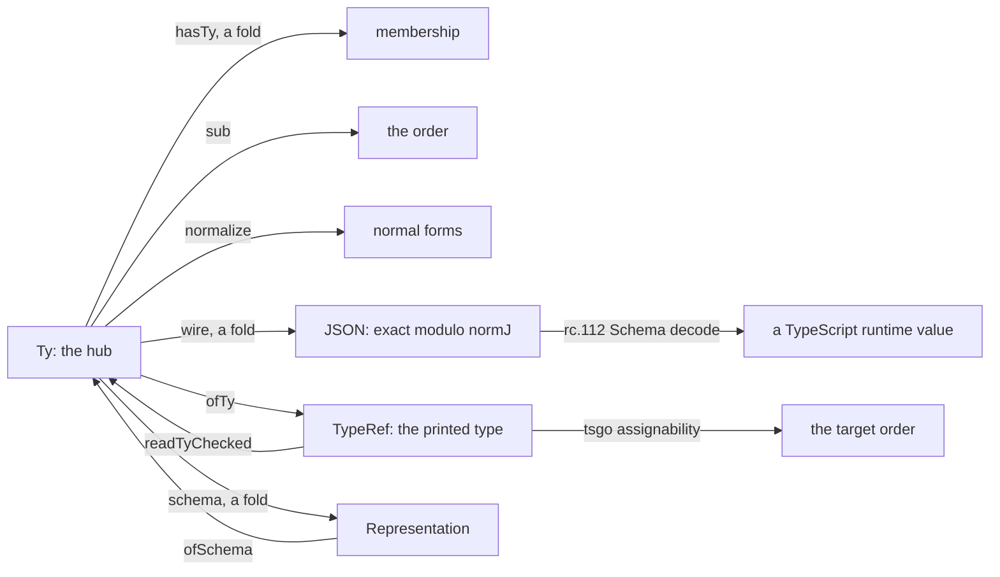
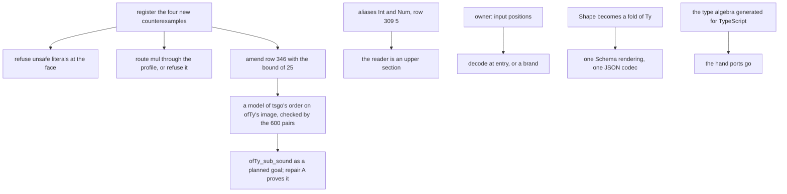

# The type interface between Lean, TypeScript and OCaml (2026-10-11)

The owner, 2026-10-11, asked for the type interface between TypeScript, OCaml and the Lean types.
Find its errors and tighten it. Understand what the representation is. Consolidate it, and make the
APIs more expressive and solid, for agents and for the TypeScript and Effect community.

**First, what to know.** `Ty` is the one hub. Every other type language and value carrier should be
an image of it by a fold, with its interface law stated once. The JSON codec meets that standard.
The printed TypeScript type, the second Schema language and the OCaml route do not. Five places give
a wrong answer today, and four of them are new:

- a natural literal of 2^53 or more prints as a different JavaScript number;
- `mul` has three answers above 2^53: Lean's exact product, rc.112's rounded one, OCaml's saturated
  one;
- the ruled repair of `E4-PRINT-CE-001` (row 346) misses tsgo's bound of 25 combinations;
- an exported printed function accepts `number` where the model needs a natural;
- the OCaml engine admits a negative natural from a host answer.

The method is the handles note's (`../2026-10-11-handles/README.md`): one relation per signature,
one abstraction theorem, and every boundary an exact embedding or a named widening.

## 1. The census

Measured on `refactor/phase1-phase3` at `9d8b20aee` by three read-only surveys and this session's
probes. The probes are scratch evaluations, quoted where they decide a point.

### 1.1 Type languages

| Language | Home | Constructors | Membership | Order | Maps out |
| --- | --- | --- | --- | --- | --- |
| `Ty` | `src/Effect4/Program/TyCore.lean` | 28 | `Val.hasTy`; `Fits` (world-indexed) | `Ty.sub`, `subN`; `CTy` a join-semilattice | JSON (`Codec.wire`); TypeRef (`ofTy`); Schema (`Bridge.schema`); text (`Ty.renderRaw`); Lean types (`Model.CarrierAt`) |
| `EffTy` | `src/Effect4/Program/Typing/Rules.lean` | answer, error, requirement | `FitsExit`, `ExitOk` | `fitsExit_subN` | `declarationType` |
| `Representation` | `src/Effect4/Schema/Representation.lean` | 22 | none | none | `ofSchema` (partial, to `Ty`); TypeScript text |
| `Store.Shape` | `src/Effect4/Store/Domain/Shape.lean` | 14 | `ShapeDoc.accepts` | none | `OfShape.render` (no law); JSON (`ShapeDoc.print`) |
| `TypeRef` | lean4-typescript, `TypeScript/TypeRef.lean` | 6 | none | none (tsgo is the oracle) | `readTyChecked` |

`Ty.handle` and `Row.typeArgs` also hold TypeScript text, parsed back by `Types.parseLegacy`.

### 1.2 The images of `Ty`, and their laws

| Image | A fold? | Exact? | Order law | Value law |
| --- | --- | --- | --- | --- |
| JSON codec, `wire t` | yes, `cata_ty wireAlgebra` | modulo `normJ` (`decode_iff`) | `encode_sub`: a coercion is the identity | `hasTy_decode` |
| TypeScript type, `ofTy t` | no, a hand recursion | no; the kernel collapses `nat`, `int`, `number` | none stated | none stated |
| Schema, `Bridge.schema t` | yes, `schemaAlg` | modulo `normS`, on `closed ∧ reservedFree` (`ofSchema_exact`) | none | none |
| OCaml, through LCNF | no; Lean's compiler, then 22 translation rules and 107 builtin rows | bounded by `int` | — | a finite differential among OCaml engines |

### 1.3 The gates that see the interface

| Gate | What it compares | Its inputs |
| --- | --- | --- |
| `check-target` | `Ty.renderRaw` spellings against tsgo; `sub` against tsgo assignability | 600 pairs in `generated/assignability.tsv`: 594 agree, 6 cut |
| `check-corpus`, `check-tsdiag` | printed modules typecheck and run on rc.112; the checker's refusals against tsgo's codes | 400 generated programs, no data-wave type |
| `check-ts-reader` | `ts/eff/read.ts` against Lean's reader | the corpus and the truth modules |
| `check-schema-codec` | Lean's JSON against rc.112's `toCodecJson` | host schemas written by hand in `harness/truth/schema-codec/check.ts` |
| `check-ocaml`, `check-compiler` | 89 goldens; three OCaml engines against one another; four roots on 13 vectors | no machine run compared with Lean |

## 2. The model

### 2.1 The hub and its three structures

- **Membership.** `Val.hasTy v t` is a fold (`Val.hasTy.eq_cata`), and it denotes a set of values.
- **The order.** `Ty.sub` is a preorder, sound for membership (`hasTy_sub`,
  `src/Effect4/Laws/Program/Admits.lean`), proved as one condition on the membership algebra.
- **Normal forms.** DI-15 rules that type identity is mutual subtyping. `Ty.normalize` picks a
  representative of each class (`CTy`).

### 2.2 The order follows the target, not the model's membership

Two probes show the principle:

- `unit` and `undefined` have the one member `Val.unit`, and `sub unit undefined` is false.
- `null` and `option never` have the one member `Val.none`, and neither is below the other.

So the order is not complete for membership, and that is right. tsgo refuses `void` at
`undefined`, and `null` and `Option.none()` are different runtime values. A sub rule justified by
membership alone would make the printed program fail. Row 178 takes `hasTy_sub`, subtyping sound for
membership, as its criterion for a new rule. The criterion needs a second half: the rule holds in tsgo's order too.

### 2.3 An image is exact when three laws hold

1. **Monotone.** The image of the order lies in the target's order. Otherwise the checker accepts a
   program whose printed form the target refuses.
2. **An upper section on reading.** `print (read τ) = τ` on the printer's image, and
   `t ⊑ read (print t)`. Then print-then-read loses precision, never values. This is a Galois
   insertion of the target's spellings into the types (Cousot and Cousot, 1977).
3. **Value coherence.** A value's image inhabits the type's image. For TypeScript: the JSON image
   of `v`, decoded by rc.112's Schema of `t`, is a runtime value of the type `ofTy t`.

The JSON codec meets all three in its own terms. `ofTy` states none, and `TypeRef` has no order in
which to state law 1.

### 2.4 One relation per signature, again

A cross-language value relation is a logical relation indexed by `Ty`. `HostSpec.Rep : Ty → Val →
HostVal → Prop` (`src/Effect4/Program/Profile.lean`) is its declared shape, and `LawfulHostSpec`
asks one law of it, the scalar bound. Define it as a fold with one field per `Ty` constructor, as
`Rel` is for handles (`src/Effect4/Laws/Store/Names.lean`). Then subtyping coherence and membership
adequacy are proved once for the signature, and each new constructor owes one field.

## 3. Findings

Each finding names its evidence. "Wrong" means a run gives an answer that the model does not.

### 3.1 Wrong

1. **The projection is not monotone, and the ruled repair misses a bound.** `E4-PRINT-CE-001`:
   `Ty.normalize` distributes a product over a union, and tsgo does not. Row 346 rules repair A:
   distribute only at a literal or discriminant position. tsgo's rule, read from its source at the
   pinned build's date (`sources/tsgo-discriminated-decomposition.go.txt`):
   - a property of a target union is a discriminant when its types differ across the constituents
     and at least one is a literal (`isDiscriminantProperty`);
   - the decomposition refuses when the product of the source's member counts at its discriminant
     properties exceeds 25 (`typeRelatedToDiscriminatedType`);
   - `countTypes` counts a union's members, so `boolean` counts two.

   A normal form distributed over three positions of three literals has 27 combinations, and tsgo
   refuses it. Repair A needs the bound inside the normal form.
2. **A natural literal of 2^53 or more prints as another number.** `printLit` writes any natural in
   decimal (`src/Effect4/Codegen/PrintLeaf.lean`), and no formation rule bounds it. Under bun,
   `9007199254740993` reads as `9007199254740992`. DI-56 rules that a face refuses outside its
   profile. Lean's round trip `readLiteral_print` holds, because Lean reads the decimal exactly.
3. **`mul` has three answers above 2^53.** Lean's `eval` computes `a * b`
   (`src/Effect4/Machine/Term.lean`), without row 321's `Profile.grow` mark. The TypeScript prelude
   is `(a: number, b: number): number => a * b`, which rounds. The OCaml route lowers to
   `lcnf_nat_mul`, which saturates at `max_int` (`ocaml/gen/api_gen.ml`). Row 309 says no
   multiplication enters, yet the atom resolves, and `Test/Dogfood/P1HttpCache.lean` uses it.
4. **Printed input positions accept values outside the model.** The printed module has
   contravariant positions, though `Ty` has none: `printDef` prints parameters
   (`src/Effect4/Codegen/Print.lean`), and the constants are exported. At those positions:
   - `nat` and `int` print as `number`, so a caller can pass `-1` or `1.5`;
   - `refOf nat` prints as `Ref.Ref<number>`, and rc.112's `Ref<in out A>` lets a holder write
     `-1` into the cell (row 342 records only the checker's side);
   - a record prints as an object type, which tsgo keeps open; `record []` prints `{}`, which
     admits every non-nullish value.

   The model's theorems hold for inputs in the type's members, so these callers get no guarantee.
5. **The OCaml engine takes a natural that Lean cannot hold.** `E4_engine.answer_async_success`
   builds `Val_nat n` from any OCaml `int`, and the generated `program_val__has_ty` admits any
   `Val_nat` (`ocaml/engine/e4_engine.ml`). `Val_float of int` holds only the positive doubles
   below 2, and nothing refuses another float at a boundary.

### 3.2 Imprecise or duplicated

6. **The reader picks the bottom of each fibre.** `readNamed ["number"] = some .nat`
   (`src/Effect4/Codegen/Classes.lean`), and `ts/eff/read.ts` does the same. Law 2 fails: an `int`
   printed and read back admits no negative value. The foreign ingest reads
   `Deferred.make<number, never>()` as `deferredOf nat never`, a narrowing at an invariant argument
   (row 144, open). Row 309 (5) already rules aliases for `int` and `number` (`Int`, `Num`), "when
   the ledger's error class needs them". With them, the fibre of `number` is `nat` alone.
7. **Two type languages over one carrier.** `Ty.prod` reads the `.list [x, y]` frame and
   `Shape.pair` the `.pair` frame (probe: `hasTy (.pair (nat 1) (str "a")) (prod nat string)` is
   false). `Ty.record` stores its names; `Shape.struct` is positional. No map joins them.
   `OfShape.render` and `Bridge.schemaAlg` write different Schemas for unit, nat, option and bytes.
8. **Six `Val → JSON` images**, two with exactness and one with a retraction. Row 10 counts four.
9. **Four printers of a type:** `Ty.renderRaw`, `ofTy`, the TypeScript mirror `targetType` and
   `parseLegacy`. `check-target` checks `renderRaw`'s spelling, which no module prints.
10. **About 2,700 lines of TypeScript re-implement Lean by hand.** `ts/eff/read.ts` (2,307 lines)
    ports `Codegen/Read.lean` clause for clause. `ts/eff/target-types.ts` (381) ports `Ty.key`,
    `sub`, `normalize`, `ofTy` and `parseLegacy`. Repair A must then be made twice.
11. **The codec's totality holds by definition.** `isCodecValue t v := (encode t v).isSome`. No
    condition on membership is shown to imply codec admission. `null`, `undefined`, `bytes`, `app` and
    `unknown` refuse every value (`wireAlgebra`). At `Option<string> | null` the JSON `null` is
    refused (probe), so a TypeScript value of that type does not cross.
12. **Profile support is five folds with no theorem between them:** `Codec.isSupported`,
    `Bridge.reservedFree`, `ReadableTy`, `Model.refusal` and `shapeDecides`.
13. **A tagged payload record has three runtime forms.** It prints as a `Data.TaggedError` class,
    the Schema face decodes it to a plain object, and `harness/truth/records.ts` spreads it.

### 3.3 Unstated

14. **No gate compares an OCaml machine run with Lean's.** `test_diff.ml` compares three OCaml
    engines, and the comparison with Lean's recorded runs is reported, not gated. The generator
    disables warning 8 (`src/OCaml5/Tools/LcnfGen.lean`), so a pruned arm is a latent
    `Match_failure`. A 63-bit host is assumed and asserted nowhere.
15. **The emitted module needs `exactOptionalPropertyTypes`.** A field flag means rc.112's
    `optionalKey`, and `b?: B` has that meaning only under the flag. Only the lane tsconfigs pin it.

### 3.4 Stale authority text

- `docs/core/semantics.md` §2.5 says the bridge refuses `record` and cites line numbers.
- DB-15 says `.int` stays uninhabited and `Ty` has no record. DB-11 says admission needs no `int`.
- Decisions row 3 says `Ty` has no `app`; row 6 calls exactness unproved, though row 128 landed it.
- `ocaml/eff/README.md` calls wire tags positional and says "48 programs"; 89 goldens exist.

## 4. Recommendations

1. **R-T1, now (coordinator).** Register `E4-PRINT-CE-002` (the literal), `E4-RUN-CE-047`
   (`mul`'s three answers), `E4-PRINT-CE-003` (input positions) and `E4-OCAML-CE-001` (the
   negative natural). Amend row 346 with the bound. Repair the literal at the face: a
   module-printing refusal for a literal outside the profile.
2. **R-T2, `mul`.** Either mark it like `add`, or remove the atom as row 309 says. The mark is
   `Profile.grow`'s pattern: the OCaml row through `E4_clock.to_profile_nat`, and the TypeScript
   `inProfile` helper of row 321 (4). The dogfood program that uses the atom decides which.
3. **R-T3, the target order as data.** Write `Assignable : TypeRef → TypeRef → Prop` for the image
   of `ofTy`, transcribing tsgo's rules with their sources. `check-target`'s 600 pairs become its
   finite check, printed through `ofTy` rather than `renderRaw`. State
   `ofTy_sub_sound : subN a b → ofTy a = some x → ofTy b = some y → Assignable x y` as a planned
   goal under concept `subtyping-algebra`. Repair A, with the bound, is its proof.
4. **R-T4, the number tower's names now.** Print `int` as `Int` and `number` as `Num`, aliases of
   `number`, as row 309 (5) rules. Then `ofTy` is injective on the tower, and the reader is an
   upper section there.
5. **R-T5, input positions (the owner decides).** Either each exported entry decodes its inputs
   with the printed Schema (`Schema.decodeUnknown`, Effect's own idiom), or refined types print as
   brands (rc.112 `Schema.brand`, `Brand.ts`). Decoding keeps call sites plain; brands put the
   check in tsgo. Recommendation: decode at entry, and brand only `Ref` arguments, which are
   invariant.
6. **R-T6, one data language.** Make `Shape` a fold of `Ty`, after one product frame is chosen.
   Then one Schema rendering (`Bridge.schema`) and one JSON codec, written as the interpretation
   of the Schema, remain. Lower `null`, `undefined`, `number`, `bytes` and `app` into the Schema.
7. **R-T7, one implementation of the type algebra.** Generate the TypeScript `sub`, `normalize`
   and `ofTy` from Lean, as `ocaml/gen` is generated. The route already exists: LCNF to OCaml, and
   js_of_ocaml is pinned in the switch. Until then, generate them from the tables.
8. **R-T8, the OCaml interface.**
   - Turn warning 8 back on, and assert a 63-bit host.
   - Refuse a negative natural and an unrepresentable float at every ingress.
   - Gate the Lean-to-OCaml run comparison on the corpus.
   - Give the type rows a contract column.
9. **R-T9, the stale text** of §3.4, in the coordinator's next documents slice.

## 5. Placement

- **Concepts.** `subtyping-algebra` (law 1, repair A); `exact-codecs` (laws 2 and 3, the Schema
  and JSON images); `translation-simulation` (the printed module and the OCaml route).
- **Questions.** `ofTy_sub_sound` (proposed, R-T3); the existing `profile-plus-exact` extended to
  `mul` (R-T2); decisions rows 28 (a), 108, 144, 309, 342 and 346.
- **Reach.** The census reads the tree at `9d8b20aee`. The probes are finite evaluations. The tsgo
  rule is read from source, not run; the bound of 25 is a quotation, not a measurement.
- **Limits.** Nothing here proves a law. Lean has no model of tsgo's order or of OCaml's
  semantics, so laws 1 and 3 cannot be stated until R-T3 writes one.
- **Unlocks.** R8 (the printed face type-checks), M7's printed half, and the third determinism
  route's host side. For agents: a printed API whose types say what the model proves.

## 6. Reading list

Named from memory, not filed, except the tsgo excerpt in `sources/`.

- J. C. Reynolds, "Types, abstraction and parametric polymorphism", IFIP 1983.
- P. Cousot and R. Cousot, "Abstract interpretation", POPL 1977 (Galois connections).
- G. Morrisett, D. Walker, K. Crary and N. Glew, "From System F to typed assembly language", TOPLAS
  1999 (type-preserving translation).
- A. Ahmed, "Verified compilers for a multi-language world", SNAPL 2015.
- A. Frisch, G. Castagna and V. Benzaken, "Semantic subtyping", JACM 2008.
- G. Bierman, M. Abadi and M. Torgersen, "Understanding TypeScript", ECOOP 2014.
