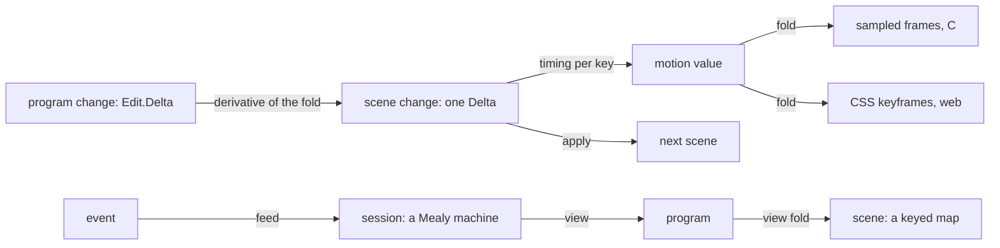

# The view, its motion and its sessions: one change structure (2026-10-11)

The owner, 2026-10-11: keep our side's representations clean for the animation, the view layer and
the session APIs. The PC seat meanwhile lands the SVG grammar. This note is the model-first
census of that layer (`../2026-10-11-tokens-in-places/model-first.md`, the loop).

**First, what to know.** The view layer is a fold of the program, and it changes when the program
changes. Each level of the stack writes its own change type:

- a program edit, `Edit.Delta`;
- a scene's patch, `Retained.Patch`;
- a frame-to-frame join, `Motion.Join`;
- a motion, sampled by one function per element kind, with row 354's motion value not yet landed.

They are one structure: a change structure on keyed values, and the derivative of a fold.
Sessions are one structure too: a Mealy machine with `open`, `feed` and `view`. The repairs are
one change type for scenes, one motion value over it, and one session interface.

## 1. The census

Measured on `refactor/phase1-phase3` at `73d2e0659`. `tools/Tools/View/` holds 27 modules and
9,866 lines.

| Structure | Copies | Where |
| --- | --- | --- |
| a scene | `List (Keyed Call)`; `Retained.Scene` (objects by `ObjId`, groups, painting order); `Page` (lines, panels) | `Picture.lean`, `Retained.lean`, `Page.lean` |
| a change between two scenes | `Motion.Join` (enter, update, exit by key); `Retained.Patch` (`put`, `move`, `drop`, `shift`); `Motion.fresh` (a line's text) | `Motion.lean`, `Retained.lean` |
| a program change | `Edit.Delta` (`unchanged`, `spliced`, `rechecked`) | `src/Effect4/Program/Edit.lean` |
| a motion | `sampleLines`, `sampleLaid`, `sample`: one sampler per element kind; `Look.Transition`, `Choreography` | `Motion.lean`, `Look.lean` |
| incremental view | `Inc.Memo` with the text law `linesWith_eq`; the flow along an edit checked at every step | `Inc.lean`, `LiveChecks.lean` |
| a session | `Api.HostSession` (`start`, `bindCall`, `submit`, `applyReply`, `advance`, `inspect`); `EditSession` (`open`, `feed`); the tool's `Live.State` | `src/Effect4/Api/HostSession.lean`, `src/Effect4/Program/Edit.lean`, `tools/Tools/View/Live.lean` |
| names | two `Frame` structures (a page after a request in `Build.lean`; a box in `Flow.lean`); `Key := String` twice (`Picture.lean`, `Place.lean`); `Live` names both the tool's view and row 326's API face | |

Laws that exist: `apply_diff` (a scene patched by the diff to another is the other), `of_flatten`,
`join_new`, `join_old`, `sampleLines_end`, `sampleLaid_end`, `Ease.at_start`, `Ease.at_end`,
`linesWith_eq`, `next_valid`. Checks that stand where a law could: the flow along an edit
(`LiveChecks`), and C's retained store against Lean's (a byte comparison in
`tools/view/scene_test.c`).

## 2. The model

### 2.1 Scenes are keyed maps

A scene is a finite map from keys to marks. It is a fold of the program: `Picture` is the list
form, and `Retained.Scene` the map form with its order of painting. Keys are names in the sense of
`../2026-10-11-handles/README.md`. The join's update pairs are a partial bijection between the old
scene's keys and the new one's.

### 2.2 Changes: a change structure

A change structure on a set `A` gives each value `a` a set of changes `Δa`. It has an update
`a ⊕ da` and a difference `b ⊖ a`, with the law `a ⊕ (b ⊖ a) = b`. The source is Cai,
Giarrusso, Rendel and Ostermann, "A theory of changes for higher-order languages" (PLDI 2014).

- `Retained.apply_diff` is this law for scenes, read through `flatten`, at well-formed scenes.
- `Motion.join` is the key classification that every `⊖` on keyed maps computes: enter, update,
  exit.
- `Retained.Patch` is a change with geometry: a kept key moves or is replaced.

So one keyed change type, `Delta`, with `diff` and `apply` and the one law, serves both. The
join and the patch become two readings of it.

### 2.3 The live view is a derivative

A fold `view : Program → Scene` has a derivative `view'` when
`view (p ⊕ dp) = view p ⊕ view' p dp`. The live view computes `view'` instead of `view`. `Inc`'s
text law `linesWith_eq` is the derivative law for the lines. The flow's waits have no derivative
yet. A wait reads a binder outside its subtree, so its derivative needs a record of what each wait
read (Codex's review LV-OW-01). Until then `LiveChecks` checks the flow at every step. The model
says what to prove instead: the derivative law for each fold of the view, one per fold.

### 2.4 A motion is a timing of a change

A motion between two scenes is a change with a transition per key. Row 354 already rules its
representation as one first-order value: the end scene and per-key tracks. A track is a translate,
a scale about a point, a clip inset or an opacity, each with a `Transition`. Sampled frames and CSS keyframes are two
folds of it, and they agree by laws. With `Delta` the tracks come from the change: an entering key
gets a reveal, an exiting key a fade, a moved key a translate. Then:

- one sampler replaces `sampleLines`, `sampleLaid` and `sample`;
- the end law is proved once: the sample at the end is the change applied;
- the start law is proved once: the sample at the start is the old scene, with entering keys
  hidden.

Elliott and Hudak's functional reactive animation (ICFP 1997) reads a motion as a function of time.
D3's data join (Bostock, Ogievetsky and Heer, InfoVis 2011) is the key classification.

### 2.5 Sessions are Mealy machines

A session is a state with an event alphabet. `feed` takes one event and answers a verdict and the
next state. `view` answers a first-order record. That is a Mealy machine, a coalgebra (Rutten,
"Universal coalgebra", 2000). Replaying a journal is the fold of `feed`: the monoid action that
the dictionary already names. Row 326 rules this face for the host route: `Live.open`,
`Live.start`, `Live.feed`, `Live.view`. `EditSession` already has `open` and `feed`, with
`Edit.Delta` as its verdict. `HostSession` has six operations of other shapes.

The live view composes two machines: the edit session, then the view's derivative. Its output per
event is a scene change, and the player plays it as a motion. The docs player is the same
composite over a run's steps.

## 3. Recommendations, in order

1. **R-V1. One scene change.** `Delta` over keyed maps, with `diff`, `apply` and `apply_diff`.
   `Retained.Patch` and `Motion.Join` become readings, each with a connector, then the copies go.
2. **R-V2. The motion value on it** (row 354, slice D3). One sampler and the two endpoint laws;
   the per-kind samplers go. The CSS fold and the C fold are proved to agree with the sampler.
3. **R-V3. Derivative laws.** State `view (p ⊕ dp) = view p ⊕ view' p dp` per fold. Lines are
   done. The flow's waits need their read sets first (LV-OW-01).
4. **R-V4. One session interface.** A structure with the state, the event type, the verdict and
   the view; `replay` as the fold of `feed`. `EditSession` is an instance now. Row 326's `Live`
   face is the host route's instance, with `HostSession`'s six operations as its events.
5. **R-V5. Names.** One `Key` alias. The two `Frame` structures get distinct names, because the
   dictionary's "frame" is the machine's. The tool's `Live` gets a name that is not the API face's.

## 4. Placement

- **Concept.** `initial-algebras-folds`: the view is a fold, and its derivative is a fold's law.
  R14 is the live authoring loop. Row 354 rules the motion value, and row 326 the session face.
- **Reach.** The view tool's laws are a tool's, not registry claims (decisions row 334, point 3).
  The session interface touches the API (`src/Effect4/Api/`), whose claims are registered.
- **Limits.** This note proves nothing. It reads the tree and the existing laws. No count here
  predicts lines removed.
- **Unlocks.** Live motion with laws doing the work; the docs player (row 354, D3 and D4); one
  `Live` face for the host route and for authoring.

## 5. Reading list

Named from memory, not filed.

- Y. Cai, P. G. Giarrusso, T. Rendel and K. Ostermann, "A theory of changes for higher-order
  languages: incrementalizing λ-calculi by static differentiation", PLDI 2014.
- U. A. Acar, "Self-adjusting computation", PhD thesis, Carnegie Mellon University, 2005.
- C. Elliott and P. Hudak, "Functional reactive animation", ICFP 1997.
- M. Bostock, V. Ogievetsky and J. Heer, "D3: Data-Driven Documents", IEEE InfoVis 2011.
- J. J. M. M. Rutten, "Universal coalgebra: a theory of systems", *Theoretical Computer Science*,
  2000.
