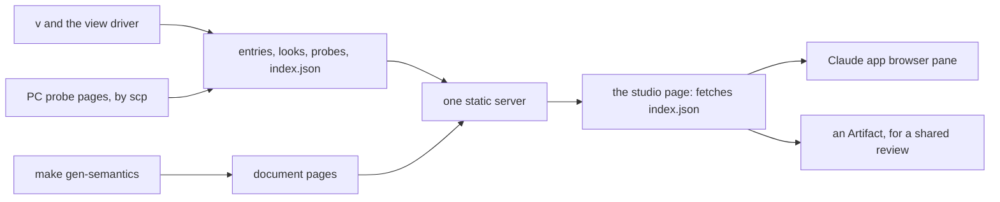

# The designer's loop: new output, diffs, motion and documents in sight (2026-10-12)

Status: research note (history, not authority). Base `82978dbbb` on `refactor/phase1-phase3`. A
read-only seat: no `lake`, `make`, `tools/view/v` or build ran. Counts come from `du`, `find`,
`wc`, `lsof`, `ps`, `brew info` and short Python counts. The web was read on 2026-10-12.

> "i want to be working like a designer as well … i dont have anything open to continuously see
> new output, diffs, animations, docs, etc.. i feel sort of blind" (the owner, 2026-10-12)

Two additions followed the same evening. The first asks for Mac software on a wide screen. The
second asks for "the best setup" for a deep programmer and web designer, ready to use.

**Evidence labels.** [reading]: read in the named source, with no run. [measured]: the output of a
named command on 2026-10-12. [inference]: reasoned from the cited facts. [web]: read on the cited
page on 2026-10-12. [web, second hand]: a third-party page. [unverified]: searched, not confirmed.

## 1. Know this first

1. **The pieces exist, and nothing ties them together.** At 19:01 the coordinator wrote three gallery
   entries and the looks page, and copied the PC's four probe pages into `tools/view/out/probes/`
   [measured: file times]. At 19:02 the Claude app started two static servers: `.lake/gen` on port
   8781 and `tools/view/out` on port 8782 [measured: `lsof`, `ps`]. No page links the others, and
   no page reloads itself. Nothing compares an output with an earlier one [reading].
2. **The keyed diff already exists in Lean.** `Retained.diff` (`tools/Tools/View/Retained.lean`)
   computes the patch between two pictures, and `apply_diff` proves that the patch rebuilds the
   second. A drawing of that patch is the structural diff the owner asks for. A mark's `data-key`
   is no identity alone. One picture has 67 keyed elements under 15 keys, and 41 elements with no
   key, 16 of them texts [measured: pFork built, picture 007]. The identity is `Retained.ObjId`.
3. **A live surface needs no new server and no file watcher.** The `view-runs` server serves the
   gallery already. A page that fetches one small file every two seconds reloads itself. Python's
   server answers an unchanged file with 304 [web]. `fswatch`, `entr` and `watchexec` are absent
   [measured].
4. **Motion review waits on P5** (row 360). Until then a step is a flipbook of 19 whole pictures,
   and pFork's build is 246 files [measured]. After P5 a step is one picture with CSS tracks. The
   PC's probe pages show the review form already: the browser's animation beside five moments of
   the kit's own reading [reading: the probe's README].
5. **The owner's "visual checks" are three different things.** A law of the tool (row 334 (3)). A
   test at write: the content model, a look's refusals, `v -c`. A review, where a person accepts a
   change. Only the review lacks a surface: P2's landing was looked at "by eye", in the
   coordinator's session [reading: `docs/research/2026-10-12-probe-svg-adoption.md`].
6. **On the Mac: one hub, one terminal, one layout file.** The Claude app holds the chat, the
   browser pane and the diff pane. Ghostty replaces WezTerm, and Hammerspoon places the windows
   when the wide screen connects. libghostty parses terminal bytes into state and draws nothing
   yet. So it fits as an oracle of the terminal output, not as the painter.

## 2. Inventory: every visual output today

`v` is `tools/view/v`, and `out/` is `tools/view/out/`, which git ignores. A gallery entry is a
folder `out/runs/TIME-NAME-MODE/`. The view's README calls it a run, a word the dictionary keeps
for a program's execution. A view frame is one picture of a sequence, not a machine frame.
"Shown" means a surface updates with no person acting. "Compared" means a tool compares the output
with an earlier one.

| Output | Command | Lands in | Form | Shown | Compared |
| --- | --- | --- | --- | --- | --- |
| a program built, in a window | `v NAME` | an entry; the `play` window | SDL3 window over streams | while the window is open | no |
| a program's run, step by step | `v -r NAME` | an entry | window | as above | no |
| the console | `v -t NAME` | `frames.txt` | characters | no | no |
| PNG pictures | `v -p NAME` | `NNN.png`, `NNN-TTT.png`, at ratio 2 | PNG | no | no |
| an entry's page | `v -H NAME` | `runs/ID/index.html`; opens the system browser at a file URL | HTML, an SVG flipbook | no | no |
| the gallery | `v -G`; rewritten by each entry | `out/index.html` | HTML | served on 8782; no reload | no |
| the looks side by side | `v -L` | `out/looks/` | HTML, SVG, PNG, CSS | served; no reload | `look-round-trip`: a look against its own written file |
| specimens and session files | `v -g`, `v -F`, `v -f FILE` | entries | as an entry | no | no |
| the live loop | `v -w NAME` | `play --live` | patch rows on a retained store | yes, one patch per edit | inside: the patch law `apply_diff` |
| the retained store's comparison | `v -c NAME` | `out/NAME-live/` | streams, patches | no | C's store against Lean's stream, byte for byte [tested] |
| a window's pixels | `play DIR --shot N FILE` | a BMP | image | no | no |
| the key under a pixel; row counts | `draw --pick`, `--picks`, `--count` | standard output | text | no | no |
| the generated TypeScript | `lake env lean --run tools/Drivers/Emit.lean OUT` | `OUT/corpus/NAME.ts`, `NAME.tree.txt` | text | no | tsgo, in `make check-target` |
| the semantics page | `make gen-semantics` | `.lake/gen/semantics-report/` | HTML, 1.27 MB, written 19:02 | served on 8781; no reload | only `generated/semantics.md`, by `make check-gen` |
| the architecture map | `make gen-architecture` | `.lake/gen/architecture-map.html` | HTML; d3 from a CDN | served; written 2026-10-07, stale | no |
| the design studies | drawn by hand, committed | `docs/design/design-language/index.html` | HTML, six SVG | no | git |
| the CSS motion probe | `probe/css_motion.py` (2026-10-11) | `.lake/gen/design-probe/` | CSS-animated SVG | served | no |
| the PC's motion probes | the seat's `workshop/*Probe.lean`, on the PC | the PC; a copy in `out/probes/` | HTML: CSS tracks, five stills | served (the copy) | Chrome against the kit at five moments [tested, on the PC] |
| videos | `tools/view/make_videos.py`, untracked, 236 lines | `out/videos/`: 18 MP4 (2026-10-10) | MP4, by ffmpeg | no | no |
| Mermaid in notes | none | `docs/**/*.md` | text; GitHub draws it after a push | no | git |

Sizes [measured: `du`, `find`, `sips`, `df`]:

- `out/` holds 172 MB in 4,560 files: 1,209 PNG, 1,613 SVG and 1,620 streams.
- 22 folders predate the gallery, and the gallery does not list them. It lists three entries.
- A PNG picture at ratio 2 is 3104 by 960 pixels and about 120 KB.
- pFork's run takes 6.5 MB as PNG, 952 KB as SVG and 408 KB as streams.
- The Mac's data volume is 97% full, with 16 GiB free.

## 3. The gaps, made concrete

### 3.1 A continuous view

- Nothing reloads by itself, and the gallery links no looks page, probe page or document. `v -H`
  and `v -G` open a file URL [reading: `browse` in `tools/view/v`]. When an agent runs them, a
  browser window appears on the owner's screen.
- The Claude app's browser pane shows a file page in light only, and a served page in either
  scheme [reading: this session's browser tool documentation]. The dark base look needs a server.
- pFork's build entry wrote its first picture 10 seconds after its start and its last at 16 seconds
  [measured: file times]. That includes a no-op `lake build` and the interpreter's start [inference].

### 3.2 Diffs

- **Structural.** `Retained.diff` sorts every object of two scenes: kept, moved (`move`), redrawn or
  new (`put`), and dropped (`drop`), with group shifts and the painting order. A drawing of the
  patch is an onion skin: old places as ghosts, new marks in full ink, kept marks faint.
- **Reading an older entry.** `Dev.row` (`tools/Tools/View/Output.lean`) writes stream rows, and no
  Lean code reads them back. A reader's law is a retraction: a read row gives back its call and key.
  It holds for keys with no tab and no line break, since `oneLine` replaces both.
- **Pixels.** One machine with one set of typefaces paints one stream to the same pixels
  [inference], so an exact count suffices there. Playwright's docs warn that pixels differ across
  systems and hardware [web]. A pixel diff answers one question: did the painter or a typeface
  change? Its files are `paint.h` and `replay.h`.

### 3.3 Motion

- `writeFrames` writes 19 pictures between two view frames (`--motion 20`). The page swaps ``
  sources by script, and P plays every step [reading]. Nothing scrubs or slows a step.
- Row 354 (5) asks for playback on demand, the view frames beside it as small multiples, no loop,
  and end frames under reduced motion. The player meets only the first rule [inference].
- After P5, `Whatwg.Html.Node.SvgMotion` writes the CSS, and the kit's `Track.at` gives any moment.
  The PC's `pfork.html` shows a step above five stills at 0, 250, 500, 750 and 1000 per mille.
- An agent reads a page's animations through `document.getAnimations()`, `pause()` and
  `currentTime` [web: MDN]. The PC seat compared Chrome's values with the kit's reading this way.

### 3.4 Documents

- The semantics page is fresh (19:02). The architecture map dates from 2026-10-07, and
  `make gen-architecture` depends on the whole build [reading: `Makefile`].
- The docs page takes two looks, both Lean values: the dark base `{}` and `Look.paper`
  (`tools/Tools/View/Look.lean`). No token file holds the base. A `#guard` in
  `tools/Tools/View/Tokens.lean` ties `Look.paper` to `tools/view/looks/paper.tokens.json`. So a
  change to either look is a Lean edit and a build [reading].
- The page is one file with an inline stylesheet and no script (`tools/Tools/Document/Html.lean`).
  `make gen-semantics` builds `Effect4.Laws` and the batteries that the report reads. Its time is
  unmeasured.
- GitHub alone draws the notes' Mermaid, after a push. Row 354 (8) plans a Lean reader of the
  Mermaid subset (slice D5). D1, the design language's authority in `docs/core/`, has not landed.

### 3.5 The PC kit

- The PC answers only `ssh pc`, over a Tailscale name [measured: `~/.ssh/config`]. Its probe pages
  reached the Mac by copy at 19:01. They carry no reduced-motion rule [measured].

### 3.6 The owner's "visual checks": a law, a test at write, or a review

| Property | Kind | Where today | Evidence |
| --- | --- | --- | --- |
| a device call keeps its key | law | `lower_key` | proved |
| a move by whole pixels commutes with the lowering | law | `lowerCall_move` | proved |
| boxes stand apart; edges descend | law and test | `place_apart`, `place_descends`; the driver's `graph-boxes-apart`, `graph-edges-descend` lines | proved; tested |
| a step ends at the next view frame | law | `sample_end` | proved |
| a patch rebuilds the next scene | law | `apply_diff` | proved |
| kept things never overlap during a step | law of the kit | `Kept.moment`; its premise read with the look (row 360 (6)) | proved in the kit; enters with P5 |
| a width reads as a share | law of the kit and a refusal | `Branch.wobbleRoom`; a larger noise refused (row 360 (7)) | proved in the kit; the refusal is ruled |
| a page and a picture are well formed | test at write | `Content.explain`, `renderXml?` in `SvgOut.fileText` | tested at each write |
| a look comes back from its own file | test at write | `look-round-trip` | tested |
| C's store equals Lean's stream | differential | `v -c` | tested |
| the browser's animation equals the kit's reading | browser reading | the PC's probe, five moments | tested in one browser |
| each colour stands apart from its ground | proposed refusal at look reading | the round-3 palette validator, outside the tree | none |
| a text fits its room | proposed test | `shown` cuts a long text, silently | none |
| a change is the intended one | review | no surface | none |
| balance, density, legibility, staging; a mark's meaning reads | review | no surface | none |

## 4. Survey: how others see their work at once

Sources are in section 10. Each row names what transfers, and nothing else.

| Practice | What it does | What transfers here |
| --- | --- | --- |
| Component workshops: Storybook, Ladle, Histoire | one component in one state is a story; a catalogue of states; Histoire shows variants in a grid; Ladle reloads a story on save | a story is a program, a step and a look. The corpus and the specimens are our stories, `v -L` is the grid, and DS-1's polling is the reload |
| Screenshot assertions: Playwright `toHaveScreenshot` | committed PNG baselines named by browser and platform; `--update-snapshots`; a threshold | baselines bind to one machine; text baselines (streams, SVG) avoid that caveat |
| Review services: Chromatic, Percy | baselines follow git ancestry; a change becomes a baseline only when a person accepts it | the gallery's commit labels give the ancestry; an accept is the review event that a named baseline records |
| Pixel diffs: pixelmatch, odiff, reg-suit | count changed pixels, mark them, pass over anti-aliasing; reg-suit keys image sets by git hash | one machine paints one stream the same way, so an exact count suffices; mark changes by tone, not hue |
| The immediate connection: Victor; Observable Framework; Livebook's Kino; Glamorous Toolkit; ProofWidgets | the picture follows each edit; time made visible; each object with its own views; widgets in Lean's infoview | the live loop answers each edit already; the studio extends it to each landing; an inspector by key (the visual pipeline note, §6a) is a moldable view; ProofWidgets could show our SVG beside the Lean source |
| Motion review: DevTools' Animations panel, onion skins, Rive and Lottie previews, Heer and Robertson's staging, Tufte's small multiples, `prefers-reduced-motion` | scrub, slow, replay; ghosts of the neighbour frames; stage a complex change; panels at one scale | a scrubber, a 0.25× rate, a strip of moments, ghosts of old places, and end frames under reduced motion |
| Design tokens: the W3C format 2025.10, Style Dictionary, Figma variables, Penpot | one token source and many outputs; modes such as light and dark; themes made of sets | the look is this already: a token file, CSS properties, the stream's rows. Looks are modes. The format has no spring type, so the look keeps one in `$extensions` |
| Example galleries: d3's | forkable examples, the code beside the picture | each entry shows the program's TypeScript beside its tree already |
| Live reload: server-sent events, Vite's module replacement, polling | push, or poll; replace CSS in place | polling one small file suffices while entries arrive minutes apart; push waits for a live authoring stream (requirement R14) |

Bret Victor's essay *Learnable Programming* states the first rule in three words: "Show the data."

## 5. Options for this repo

### 5.1 The studio

- **The studio is the gallery, grown.** `galleryPage` in `tools/Drivers/View.lean` writes the
  gallery at each entry already. It gains the newest entries grouped by title, with the last two of
  a title side by side. It links the looks, the probes, the documents and the status screen. This
  improves `v` and its driver in place, with no new command, script or server.
- **Reload by polling.** The driver writes `index.json`, the list of entries, beside `index.html`.
  The page fetches it every two seconds with `cache: "no-cache"`. A new entry appears first, with a
  mark, and a "follow" switch opens it.
- **One origin.** A page on port 8782 cannot fetch a file from port 8781 without a CORS header, and
  Python's server sends none [inference]. So `v` writes under `.lake/gen/view/`, and one server
  serves `.lake/gen`. Reports are build artifacts under `.lake/gen` already (the owner, 2026-10-03).
- **No pop-up for agents.** `browse` opens a page only when standard output is a terminal.
  Otherwise it writes the served address to its output.
- **One page for two readers.** The owner sees the pane, and the agent can navigate it, read its DOM
  and take its screenshot. The page is served, since a file page shows in light only there.
- **A tool page, not a document.** The studio carries a short script to poll, scrub and copy a key.
  Generated documents stay scriptless (rows 353 and 354 (5)). Question Q2 asks the owner.

### 5.2 Diffs

- **Against what.** By default, the previous entry with the same program, mode and look. A named
  baseline replaces it when one is set (DS-6). Both are free, since entries keep their commit labels.
- **The keyed diff picture** (DS-4). Kept marks stand at the secondary tone. Entered and changed
  marks stand in full ink, outlined. Dropped marks are ghosts at their old places, and moved marks
  keep a ghost of their old outline. Counts stand beside each picture. There is no hue: row 354 (2)
  keeps hue for the four agents.
- **The pixel diff** (DS-7) answers a change of the painter or of a typeface only.
- **Documents.** A `Block.part` carries a key, so the same sorting would diff two documents part by
  part [inference]. It waits for a need.

### 5.3 Motion review

- **Before P5** (DS-2). The entry page gains a scrubber over a step's 19 pictures and a 0.25× rate.
  It shows the view frames as a strip of small multiples, and five moments of the current step.
  Under `prefers-reduced-motion` it shows end frames and plays nothing.
- **After P5** (DS-8). The scrubber drives the CSS animations through `getAnimations()` and
  `currentTime`. The five moments come from the kit's `Track.at`. The agent compares the two in the
  pane, as the PC seat did in Chrome.
- **Nothing loops** (row 354 (5)). A step plays when the reader asks.

### 5.4 Looks side by side, and feedback by key

- An SVG inside `` does not take the page's CSS, so a look switch needs the SVG inline
  [inference: the HTML image model]. The studio fetches an SVG's text and places it in the page.
- `looks.css` (`v -L`) then restyles it by `data-look`. Dark and paper stand side by side, with no
  Lean run (DS-3).
- Only colours and typeface families switch safely this way. A size changed by CSS would leave the
  boxes that Lean measured for the old size [inference].
- A click on a mark copies `title · picture · key` for the chat. The program, the graph and the
  code share that key, so a remark names one place in all three.

### 5.5 Baselines: local or committed

- **Local.** A named baseline per title, in `baselines.json` beside the entries, set by `v` (DS-6).
  It moves freely and never enters git.
- **Committed.** The streams or SVG of a small specimen set, under a new `Test/fixtures/view/`, with
  a named promotion command. A diff there is a review event, as for DI-47's baselines. It needs an
  authority-map line, since `Test/fixtures/baseline/` holds descriptions and alphabets only.
- **Text, not PNG.** A PNG weighs about 7 times its SVG and 16 times its stream [measured: pFork's
  run], and the disk is 97% full.

### 5.6 Where Artifacts fit, and the PC's pages

- The pane is local and continuous. An Artifact is a private page on claude.ai that every device
  of the owner's account opens. Its comments reach Claude [reading: the Artifact tool's docs]. So an
  Artifact carries a review snapshot, such as a landing's diffs. A page stays under 16 MB, and one
  flipbook entry is 3.8 MB today [measured].
- The CSS probe's six steps took 173 KB against 2.4 MB of flipbook (the design language note).
- **The PC's pages.** A pull copies a probe's pages by `scp` when the seat lands one, as at 19:01.
  A live view needs the PC to serve its folder and `ssh -L` to bring it to a local port. That
  standing tunnel is standing configuration, so it is the owner's choice (Q10).

## 6. The best setup on the Mac

Measured on this Mac:

- macOS 26.2 (build 25C56); only the built-in 2560 by 1664 Retina display is connected;
- Claude 2.31226.1, VS Code 1.141.0 with the Lean extension 0.0.240, Chrome 155, Paper 0.1.13;
- WezTerm 20240203-110809-5046fc22, with Fira Code and Catppuccin Mocha;
- fish 4.0.1, with fisher, fzf.fish, z and vi key bindings.

### 6.1 The loop of a deep programmer and web designer here

| Change | Fastest path | It waits for | It shows in |
| --- | --- | --- | --- |
| a colour, a typeface family | a `--e4-*` property in the browser's developer tools on the served page; then the value into the look's source | nothing | the page, at once |
| any look token: timing, stroke, curve | `v -l FILE -H NAME` | the interpreter: about 16 s an entry [inference: file times] | the studio, by itself |
| the document fold or its stylesheet | a narrow build, then the document specimen (DS-5) | one narrow build [unmeasured] | the studio |
| a view fold (`tools/Tools/View/*.lean`) | a narrow build of the module and its dependents, then `v -H NAME` | one narrow build | the studio, with its keyed diff |
| the whole semantics report | `make gen-semantics` | its builds [unmeasured] | the documents on the studio's origin |

The loop for the docs page, in order:

1. Open the document specimen in the studio, the dark look beside the paper look.
2. Try a colour or a typeface in the browser's developer tools.
3. Write the chosen value into the look's source: its token file, or `Look.lean` for the base.
4. Ask the agent for the narrow build; the specimen rewrites, and the studio shows it.
5. Read any refusal: the content model names a bad node's path, and a look names a bad token.
6. Accept the diff in the studio, then regenerate the whole report once.

The view's loop is the same, with `v -l FILE -H NAME` in step 4 and the keyed diff in step 6.

**Where proof work fits.** A look or page edit touches no theorem: the tool's laws hold for every
look and every easing (`Ease.at_end`, `sample_end`). Proof work starts when a fold changes shape,
or when a kit law is ported. Then the infoview matters (6.5). For design work it is secondary.

### 6.2 The wide screen

The monitor's model and resolution are unknown, and it is not connected now [measured]. The
layout assumes about 3440 points across.

| Region | Width | Window | What it shows |
| --- | --- | --- | --- |
| left | about 60% | the Claude app | the chat beside the browser pane (the studio); the diff pane under the chat during a review |
| right | about 40% | Ghostty | `v`, `git log -p` through delta, chafa previews, the build's output |
| right, lower part, when open | 40% by 40% | `play` | the C player and the live loop |
| the laptop screen | all | VS Code, or Neovim in Ghostty | proofs with an infoview; Paper while sketching |

The pick is **Hammerspoon**, with **Rectangle** as the alternative.

| Tool | State on 2026-10-12 | Fit |
| --- | --- | --- |
| macOS 26 tiling | built in: edges, Fill, Arrange, halves and quarters [web, second hand] | no saved layout; thirds unconfirmed |
| Rectangle | 2.0.3 [measured]; free, MIT; thirds, fourths, sixths by keys; macOS 14 or later [web] | the alternative: keys, no layout file; Pro's layouts unconfirmed |
| Moom | 4.6.0 [measured]; Moom 4 cost $15 in 2024 [web] | saved layouts through its interface |
| Raycast | 2.7.2.0 [measured]; window commands free, custom layouts in Pro [web] | a launcher first |
| AeroSpace | public beta, a TOML file, no SIP change, macOS 13 or later [web] | tiling by workspaces; breaking changes before 1.0 |
| yabai, Amethyst | yabai needs SIP partly off, macOS 26 unverified; Amethyst 0.24.3 [web, second hand] | not recommended |
| Hammerspoon | 1.1.1, 2026-02-26 [web]; `hs.layout` places apps by named screen and unit rectangle [web] | the pick: one Lua file, applied on connect and on a key |
| BetterDisplay | 5.1.1 [measured]; version 5 needs macOS 26 on Apple silicon [web, second hand] | only if the wide screen's text looks soft |

Hammerspoon's reasons: the layout is data in one file, as the terminal's configuration is.
`hs.screen.watcher` calls the layout when a monitor connects [web], so the layout appears by
itself. It needs one Accessibility grant.

### 6.3 The terminal

The pick is **Ghostty**. The alternative is WezTerm on its nightly channel.

| | Ghostty | WezTerm | kitty |
| --- | --- | --- | --- |
| version | 1.3.1, 2026-03-13; 1.4 reported for October [web; web, second hand] | stable 20240203 installed; nightlies through 2026 [measured; web] | 0.49.2 [measured] |
| macOS feel | native tabs and splits; Metal [web] | its own tab bar [inference] | its own tab bar [inference] |
| images | the kitty graphics protocol [web] | the iTerm2 protocol and `imgcat`; kitty's by an opt-in setting [web] | its own protocol, `kitten icat` |
| quick terminal | built in; a global key needs Accessibility [web] | none | none |
| configuration | `~/.config/ghostty/config`, `key = value`, reloaded by Cmd-Shift-comma [web] | Lua | a conf file |
| fish | integration injected; prompt marks; a click moves the cursor from fish 4.1 [web] | not read | not read |
| scripting | AppleScript, a preview in 1.3 [web] | Lua | remote control |

Ghostty's reasons: native on macOS 26, kitty's protocol for pictures, a quick terminal, and a plain
file with live reload. It is also libghostty's first consumer, which the owner wants to learn.
WezTerm's last stable release dates from 2024-02, which matches the owner's sense of weakness.

### 6.4 The shell

- Upgrade fish from 4.0.1 to 4.9.3: Ghostty's click-to-move needs 4.1 [measured; web].
- Add starship 1.26.0: `starship init fish | source` ends `config.fish` [web]. It wants a Nerd
  Font, and `font-fira-code-nerd-font` keeps the owner's Fira Code.
- Keep fisher, fzf.fish, the vi bindings and elan's `conf.d/elan.fish` [reading].

### 6.5 Code review and proofs

- **Commits as they land.** `git log -p` and `git show` through delta 0.20.1, released 2026-10-04
  [web]: side by side, with changes marked within a line.
- **difftastic adds little here.** Its language list names neither Lean nor Markdown [web].
- **The coordinator's working changes.** The Claude app's diff pane opens by Cmd-Shift-D. A comment
  on a line returns to Claude as one request [web: the Claude Code desktop docs].
- **A wide reader.** Zed 1.23.2 [measured] shows a branch's diff as one editable view [web]. Its
  Lean extension (0.1.0, third party) gives the language server and a grammar, and no infoview [web].
- **Proofs.** VS Code keeps its infoview. Neovim 0.12.5 with lean.nvim is the terminal's
  counterpart: an infoview in a split [web]. In a kitty-graphics terminal it shows ProofWidgets
  images and SVG inline, and SVG needs resvg [web]. In Ghostty, a goal and a picture then stand
  beside the code.
- **A git GUI** (Fork 2.70.2, Sublime Merge 2132, Tower, GitButler) or lazygit 0.66.0 in the
  terminal adds a commit graph [measured]. Nothing in this loop needs one beside delta and the diff
  pane [inference].
- **Kaleidoscope 7.0.1** [measured] compares text, folders and images, with a slider over two
  pictures, by subscription [web, second hand]. The studio's diffs cover pictures, so it is optional.

### 6.6 Visual output on the Mac

- **The studio carries the pictures, the motion and the diffs.** Gapplin redraws an SVG when its
  file changes, on macOS 26 [web]. An entry is a new folder each time, so a file viewer cannot
  follow the newest one [inference].
- **Pictures in the terminal.** chafa 1.18.3 [measured] writes the kitty protocol [web], after
  `rsvg-convert` (installed) turns an SVG into PNG. WezTerm's `imgcat` binary sits inside the app,
  not on the `PATH` [measured].
- **Motion captured.** The system's Screenshot app records a selected window on macOS 26
  (Shift-Command-5) [web: Apple]. CleanShot X 5.0.1 [measured] is the alternative. Kap 3.6.0 is
  free, with no 2026 release confirmed [measured; web]. An exact video comes from the view's own
  pictures through ffmpeg (Q6), not from a screen capture.
- **Several schemes at once.** The studio's inline pictures cover dark and paper (DS-3). Polypane
  31.0.0 [measured], about $9 a month [web, second hand], shows any page in synced panes. Each pane
  has its own scheme and reduced-motion setting [web]. Responsively 1.18.0 is a free alternative.
  Sizzy's maintenance is disputed [web, second hand].
- **Notes with Mermaid.** Marked 3.2.18 [measured] follows a file on each save, with Mermaid built
  in [web, second hand]. It costs a subscription or a permanent unlock [web]. Typora 1.14.10 is a
  one-time editor with inline Mermaid [web, second hand]. QLMarkdown 1.5.7 is a free Quick Look view.
  Obsidian 1.14.4 draws a Mermaid block only after the cursor leaves it [web, second hand].
- **Paper.** `Paper.app` is Paper Desktop of paper.design. Its updater is `@paperdesktop-updater`,
  and its URL schemes are `paper` and `paper-dev` [measured]. Its vendor says every element of a
  design is real HTML and CSS. Opening a file starts an MCP server that reads and writes that file, and "Add to
  Claude" connects Claude Code [web].
- **How Paper fits.** It is a sketchpad for a page's layout: the docs page, or the design language's
  authority. The agent reads the sketch by MCP and writes it as Lean's document fold. The look stays
  the only source of a value (row 354 (1)). Its docs describe no import of an HTML page. A design
  syncs through `*.paper.design`, so it leaves the Mac [web].

### 6.7 Ambient status

- **The pick: the studio's status strip** (DS-3). `scripts/status.py` also writes its screen to
  `.lake/gen/status.txt`, and the studio shows its head. This improves `make status` in place.
- **The alternative: SwiftBar 2.1.1** [measured]. Its plugin is a file in the owner's home that runs
  `make status` on a schedule [web]. It is a wrapper by form, outside the repository, with an
  unmeasured cost per call. `make status` starts no `lake` [reading: `scripts/status.py`].
- xbar's and Übersicht's maintenance in 2026 is unverified [web].

### 6.8 What the Claude app gives on a wide screen

[web: the Claude Code desktop docs; measured: version 2.31226.1]

- The panes are chat, diff, browser, terminal, file, plan, tasks and subagent. A pane moves by its
  header and resizes by its edge, from version 1.2581.0. A pane such as the diff or the terminal
  pops into its own window for a second screen. The docs do not say so of the browser [unverified].
- Cmd-click on a session in the sidebar opens it beside the current one.
- Cmd-Shift-B opens the browser pane, and a click on an HTML, image or video path in the chat opens
  it there. `.claude/launch.json` names the servers, and git ignores it [measured].

### 6.9 libghostty: a design option for the grill

What is public [web: the Ghostty README; the 1.3.0 notes; "Libghostty Is Coming", 2025-09-22]:

- libghostty-vt parses terminal sequences and keeps terminal state: cells, cursor, styles and
  wrapping. It draws nothing.
- It is C and Zig, for macOS, Linux, Windows and WebAssembly, under MIT, with no dependency.
- The app proves its core in daily use, but its API changes, and no version is tagged. Ghostty
  1.3.0 made it a Zig module, with a C API in progress.
- Later libraries are planned for keyboard input and for GPU drawing onto a surface the embedder
  provides. Neither is public.
- Others bind it: a Rust crate (0.2.2, 2026-09-28), Go (`go-libghostty`, by Ghostty's author), and
  Swift packages around the app's own embedding [web]. The README names no embedder.

How it fits the view:

- Row 336 (4): Lean computes the page, and C draws it. The terminal is one more output of the same
  calls. libghostty-vt draws nothing, so it cannot be the painter.
- **Fit 1, an oracle for the terminal output.** Lean's page becomes terminal bytes, libghostty-vt
  turns them into a cell grid, and the grid is compared with Lean's characters. That is a
  differential against an outside implementation, as tsgo is for the TypeScript print.
- The terminal bytes are `frames.txt` today, plain. With styles they would come from termbox2,
  vendored and unused [measured: `grep`]. termbox2 writes and libghostty-vt reads: a round trip.
- **Fit 2, a terminal pane in the C player.** A process's bytes become cells through libghostty-vt,
  and the painter's `cells` rows draw them. Lean keeps the layout, and C keeps the drawing.
- **Not now:** drawing pictures with libghostty, or replacing SDL3 and cairo.
- **A first probe.** Pin a Ghostty commit and build libghostty-vt with Zig. Link a C program of about
  50 lines that reads one entry's `frames.txt` and writes the grid. Compare it with `pageText`.
- Its downloads, Ghostty's source and Zig's toolchain, go on row 336 (5)'s named list. Each waits
  for the owner's yes.

### 6.10 The install and configuration plan

Run after the grill, one pick per need. Names and versions are Homebrew's metadata on this Mac
[measured: `brew info`].

1. Install the terminal: `brew install --cask ghostty`.
2. Upgrade the shell: `brew upgrade fish`.
3. Install the prompt, the pager and the image tool: `brew install starship git-delta chafa`.
4. Install the font: `brew install --cask font-fira-code-nerd-font`.
5. Install the layout tool: `brew install --cask hammerspoon`.
6. If M2 takes Neovim, install `brew install neovim resvg`, then lean.nvim by a plugin manager.
7. If notes stay outside the studio (Q12), install `brew install --cask marked-app`.

| File | What it holds |
| --- | --- |
| `~/.config/ghostty/config` | the font; a dark and a light theme; the quick terminal and its global key; split keys |
| `~/.config/fish/config.fish` | one more line at its end: `starship init fish | source` |
| `~/.config/starship.toml` | a short prompt: directory, branch, a dirty mark, the last command's time |
| `~/.gitconfig` | delta as the pager and the diff filter, side by side, with navigation |
| `~/.hammerspoon/init.lua` | the wide layout and the laptop layout, a screen watcher, one key |
| `.claude/launch.json` (git ignores it) | one server for `.lake/gen`, once DS-1 moves the view's output there |

The owner's own steps, since each is a security or configuration setting:

1. Grant Hammerspoon Accessibility in System Settings, Privacy & Security.
2. Grant Ghostty Accessibility, if the quick terminal's global key is wanted.
3. Grant Screen Recording to CleanShot X, if chosen. The built-in recorder asks on first use.
4. Approve each new app's first launch.
5. Connect Paper to Claude Code by its "Add to Claude" button, if M5 says so.

## 7. The slices, ranked

Sizes are estimates. Each slice lands by explicit paths after a narrow build. None touches the
checker, the machine, the codec or the printed TypeScript, so no behaviour gate is owed.

| Slice | Files | Size (estimate) | What the owner sees | Its test |
| --- | --- | --- | --- | --- |
| **DS-1** the studio and its reload | `tools/Drivers/View.lean` (`galleryPage`, `writeGallery`, `index.json`); `tools/view/v` (`browse`, the output folder); `tools/view/README.md`; `.claude/launch.json` | 100 lines of Lean, 15 of shell | one page in the pane that shows each new entry by itself, with looks, probes and documents a click away | the agent writes an entry; the pane shows it within two seconds (tested in the pane) |
| **DS-2** strips, scrubber, reduced motion | `playerPage` in `tools/Drivers/View.lean` | 50 lines | a step scrubbed and slowed; its five moments and every view frame as small multiples | the agent reads the DOM: one strip picture per view frame |
| **DS-3** inline pictures, a look switch, a copied key, the status strip | `tools/Drivers/View.lean`; `scripts/status.py` | 60 lines | dark beside paper; a click copies the key; the status screen's head | the copied key equals `draw --pick` at the same point |
| **DS-4** the keyed diff | new `tools/Tools/View/Diff.lean`; the driver's `diff OLD NEW OUT`; `v -D` | 300 lines | each entry beside its predecessor, with ghosts, moves and counts | laws: the stream reader's retraction, and each object sorted once (from `join_new`, `join_old`); controls: a picture against itself is all kept, against a moved copy all moved |
| **DS-5** the document specimen | `tools/Drivers/Semantics.lean`; a token file for the base look; `Look.paper` and the base read from their files | 80 lines | every block and status mark of the docs page, dark beside paper, after one narrow build; a token edit with no Lean build | the content model at write; the specimen holds all five status shapes |
| **DS-6** named baselines | `tools/Drivers/View.lean`; `v -B ENTRY` | 40 lines | a baseline mark per title, and diffs against it | a baseline against itself shows no change |
| **DS-7** the pixel diff | `tools/view/draw.c` (`--diff`) | 80 lines of C | changed pixels in full ink over a faint picture, with a count | `draw A --diff A` counts 0; one moved fill counts more; strict warnings and sanitizers |
| **DS-8** motion on CSS tracks | inside P5 (row 360) | 40 lines more | each step animated on demand, scrubbed, beside the kit's five moments | the agent reads the animations at five moments and compares them with `Track.at` |
| **DS-9** a smaller disk | `tools/Drivers/View.lean` (`--keep N` per title) | 20 lines | a gallery that stays small | no title holds more than N entries and its baseline |

DS-1 comes first: it ends the blindness at the lowest cost. DS-4 then brings the most value. A
compiled view driver could cut the 16 seconds an entry. `lakefile.toml` is the coordinator's, and
the interpreter's share of that time needs a measurement first.

DS-9 asks the owner two things. May the 22 old folders go? And what of the untracked
`make_videos.py`, which wraps `v`, `draw` and ffmpeg (Q6)?

## 8. Questions for the owner

Each question is of meaning, domain or representation. The first option is the recommendation.

**Q1. The always-open surface** (domain).
- A: the studio, served locally and open in the Claude app's browser pane; Artifacts carry shared
  snapshots.
- B: the studio in Chrome on the wide screen, where the agent cannot see it.
- C: the C player as the daily surface, as row 336 (4) ruled the first surface.
- Why: section 2; the pane shows a served page in both schemes. An agent-first language wants the
  owner and the agent to read one page. C stays the native fold.

**Q2. The studio's standing** (representation).
- A: a tool page that the view driver writes, with a short script. Documents stay scriptless.
- B: a scriptless `Tools.Document`, which the agent reloads after each landing.
- Why: polling, scrubbing and copying a key need a script. Row 354 (5) governs documents.

**Q3. What a diff compares against** (meaning).
- A: the previous entry of the same program, mode and look; a named baseline when one is set.
- B: the outputs of the last commit, rebuilt.
- C: what the owner last looked at.
- Why: entries keep their commit labels, an old commit costs a long build, and no record of a look
  exists. A is free and incremental, as the owner's rule on gates asks.

**Q4. What a visual change is** (meaning).
- A: a change of an object under `Retained.ObjId` (group, key, run rank), sorted as `Retained.diff`
  sorts it. Pixels count only for a painter's change.
- B: pixels first, or lines of SVG text.
- Why: 67 keyed marks share 15 keys in one picture, and R-V1 asks for one change type. A keyed
  change names what changed in the program's terms. Row 354 (4)'s motion rests on the same sorting.

**Q5. Visual baselines in git** (representation).
- A: not yet. Local named baselines now; a committed specimen set after D1, as text, under
  `Test/fixtures/view/`, with a promotion command.
- B: commit the corpus builds' streams now.
- C: never commit them.
- Why: no committed file pins SVG or page text today, and the disk is 97% full. The design language
  moves through D1 to D5, so a committed picture would change at each slice.

**Q6. Motion review and the video** (representation).
- A: CSS tracks in the browser after P5, beside the kit's five moments. The C player keeps the
  sampled fold. A video becomes a mode of `v` from the same pictures, and `make_videos.py` goes.
- B: the C player only.
- C: the flipbook and the script as they are.
- Why: rows 354 (4), 354 (5) and 360 (1); 173 KB against 2.4 MB; the owner's rule against wrapper
  scripts. One motion value, with folds that laws relate, and one producer per output.

**Q7. What becomes a law, a test or a review** (meaning).
- A: the split of section 3.6, plus two refusals when a look is read. One refuses a colour too close
  to its ground. One refuses a text cut in the specimen set. Taste and staging stay reviews.
- B: A without the two refusals, or more tests such as pixel goldens of the specimens.
- Why: row 360 (6) and (7) moved two meanings into the look's reading already. A refusal with a path
  stops a false picture at its source, and a review judges what no rule states.

**Q8. Row 334 (3) and the owner at the window** (representation).
- A: the view stays a tool whose laws are tests, and the studio is no face. Revisit when an agent
  authors through the view (R14).
- B: the owner's daily use counts as "a person uses the window", and the layout's laws become
  registry claims of a view concept.
- Why: a claim costs a concept and a placement, and no consumer needs the layout's laws as claims.

**Q9. What a landing that changes a picture owes** (domain).
- A: one gallery entry of the program it changes, from the look the landing takes already
  (`v -H NAME`). No new gate.
- B: nothing. Entries come only on request.
- Why: P2's landing was looked at out of the owner's sight. The studio shows only what it receives.

**Q10. The PC kit's pages** (domain).
- A: pulled by `scp` into the probes folder when the seat lands a probe.
- B: a standing `ssh -L` tunnel to a server on the PC.
- Why: the copy of 19:01 worked. A pull keeps nothing running and leaves the seat's files as they are.

**Q11. How design feedback returns** (domain).
- A: in the chat, by the key that the studio copies. Values come as token file edits, and code
  remarks as line comments in the diff pane.
- B: comments on a published Artifact.
- C: sketches in Paper, which the agent reads by MCP.
- Why: a key is the project's own name for a place in the program, the graph and the code. A token
  file is a look's one source.

**Q12. Research notes with Mermaid** (representation).
- A: read in a Markdown previewer on the Mac until D5 draws Mermaid in the look.
- B: drawn in the studio now by mermaid.js from a CDN.
- Why: row 354 (8) plans the reader, and mermaid.js draws in its own style. One design language.

**M1. The terminal** (domain).
- A: Ghostty, with fish 4.9, starship and chafa.
- B: WezTerm on its nightly channel.
- C: kitty.
- Why: section 6.3. Native on macOS 26, kitty's protocol for pictures, a quick terminal, and
  libghostty's own consumer.

**M2. Editors: review and proofs** (domain).
- A: review in the Claude app's diff pane and delta; proofs in VS Code with its infoview.
- B: as A, with proofs in Neovim and lean.nvim inside Ghostty.
- C: Zed for review and editing.
- Why: the owner finds the infoview secondary for building, and review fills most of the design loop.
  lean.nvim shows widgets and SVG inline. Zed's Lean extension has no infoview.

**M3. The window layout** (domain).
- A: one Hammerspoon file, applied when the wide screen connects and on one key.
- B: Rectangle: thirds by keys, and no file.
- C: AeroSpace: tiling by workspaces.
- Why: section 6.2. A layout that follows the monitor appears by itself, and a file keeps it as data.

**M4. libghostty as a probe** (representation).
- A: yes, after DS-1 to DS-4: an oracle for the terminal output, its downloads on row 336 (5)'s list.
- B: not now.
- C: a terminal pane inside the C player.
- Why: section 6.9. The probe measures an output we write already, the way the project treats every
  outside implementation.

**M5. Paper Desktop** (domain).
- A: a sketchpad that the agent reads by MCP. The look's token files stay the only source of a value.
- B: not used.
- C: the design source, with values flowing from Paper into the tokens.
- Why: section 6.6 and row 354 (1). A value has one hand input, and a sketch is welcome as the input
  of a fold.

## 9. Placement and limits

- **Concept.** None of the ten in `docs/core/semantics.md`. No registry claim moves. The view's laws
  are a tool's (row 334 (3)).
- **Rows that bound it.** 334 (3); 336 (4) and (5); 337 (5); 353; 354 (1) to (6) and (8); 358; 360
  (1), (6) and (7).
- **What it serves.** Requirement R14's live loop gets a surface. Row 354's player (D3) and R-V1's
  change type get a reader. The owner's reviews become events with a record.
- **What it does not establish:**
  - no `v`, `lake` or `make` ran, and every duration comes from file times;
  - every size is an estimate, and no slice is built;
  - versions are Homebrew's metadata on this Mac and the cited pages, on 2026-10-12;
  - prices from third-party pages are second hand;
  - unverified: the browser pane's pop-out, Ghostty's global key on 1.3.1, QLMarkdown's Mermaid,
    xbar's and Übersicht's maintenance, and thirds in macOS tiling;
  - libghostty's C API may change, and no version is tagged;
  - the wide monitor's model is unknown;
  - that one machine paints one stream to the same pixels is an inference.

## 10. Sources

Read on 2026-10-12. "Named" marks a source cited and not read.

| Topic | Sources |
| --- | --- |
| visual tests | [Playwright](https://playwright.dev/docs/test-snapshots) · [pixelmatch](https://github.com/mapbox/pixelmatch) · [odiff](https://github.com/dmtrKovalenko/odiff) · [reg-suit](https://github.com/reg-viz/reg-suit) · [Chromatic](https://www.chromatic.com/docs/) and its [baselines](https://www.chromatic.com/docs/branching-and-baselines/) · [Percy](https://www.browserstack.com/docs/percy/overview/visual-testing-basics) |
| workshops | [Storybook](https://storybook.js.org/docs/get-started/why-storybook) · [Ladle](https://ladle.dev/) · [Histoire](https://histoire.dev/guide/) |
| the immediate connection | Victor, *Inventing on Principle* (2012), named, [link](https://worrydream.com/InventingOnPrinciple/) · Victor, *Learnable Programming* (2012), [link](https://worrydream.com/LearnableProgramming/) · Observable Framework, named (the site refused the fetch), [link](https://observablehq.com/framework/) · [Kino](https://kino.hexdocs.pm/Kino.html) · [Glamorous Toolkit](https://gtoolkit.com/) · [ProofWidgets4](https://github.com/leanprover-community/ProofWidgets4) |
| motion | [DevTools Animations](https://developer.chrome.com/docs/devtools/css/animations) · [onion skinning](https://en.wikipedia.org/wiki/Onion_skinning) · [Rive](https://rive.app/docs/editor/animate-mode/timeline) · [LottieFiles](https://lottiefiles.com/preview) · Heer and Robertson, *Animated Transitions in Statistical Data Graphics* (2007), [link](https://idl.uw.edu/papers/animated-transitions) · Tufte, *Envisioning Information* (1990), named, as quoted [here](https://www.uxmatters.com/mt/archives/2005/12/small-multiples-within-a-user-interface.php) |
| the web platform | MDN on [`prefers-reduced-motion`](https://developer.mozilla.org/en-US/docs/Web/CSS/@media/prefers-reduced-motion), [`getAnimations`](https://developer.mozilla.org/en-US/docs/Web/API/Document/getAnimations) and [server-sent events](https://developer.mozilla.org/en-US/docs/Web/API/Server-sent_events/Using_server-sent_events) · [Vite](https://vite.dev/guide/features#hot-module-replacement) · [Python `http.server`](https://docs.python.org/3/library/http.server.html) |
| tokens and galleries | [the format 2025.10](https://www.designtokens.org/tr/2025.10/format/) · [Style Dictionary](https://styledictionary.com/) · [Figma variables](https://help.figma.com/hc/en-us/articles/15339657135383-Guide-to-variables-in-Figma) · [Penpot](https://help.penpot.app/user-guide/design-tokens/) · [d3](https://d3js.org/getting-started) |
| windows | Apple on [tiling](https://support.apple.com/guide/mac-help/mchlef287e5d) and [screen recording](https://support.apple.com/102618) · [MacMost](https://macmost.com/mastering-window-tiling-and-resizing-keyboard-shortcuts.html) · [Rectangle](https://github.com/rxhanson/Rectangle) · [Rectangle Pro's price](https://www.ifun.de/fenstermanager-rectangle-jetzt-auch-als-rectangle-pro-erhaeltlich-187052/) · [Moom 4](https://manytricks.com/blog/?p=6385) · [Raycast](https://raycast.com/core-features/window-management) and its [billing](https://manual.raycast.com/billing) · [AeroSpace](https://github.com/nikitabobko/AeroSpace) · [yabai](https://github.com/asmvik/yabai/issues/2634) · [Hammerspoon 1.1.1](https://www.hammerspoon.org/releasenotes/1.1.1.html), its [guide](https://www.hammerspoon.org/go/) and [`hs.screen.watcher`](https://www.hammerspoon.org/docs/hs.screen.watcher.html) · [BetterDisplay](https://github.com/waydabber/betterdisplay) |
| review and editors | [Zed](https://zed.dev/releases/stable/1.11.3) and its [Lean extension](https://zed.dev/extensions/lean4) ([source](https://github.com/owlx56/zed-lean4)) · [difftastic](https://difftastic.wilfred.me.uk/languages_supported.html) · [delta](https://github.com/dandavison/delta/releases) · [lean.nvim](https://github.com/Julian/lean.nvim) · [Kaleidoscope](https://cloud.kaleidoscope.app/store) and a [review](https://www.macworld.com/article/562248/kaleidoscope-review-mac-gems.html) |
| the terminal | Ghostty's [features](https://ghostty.org/docs/features), [configuration](https://ghostty.org/docs/config), [shell integration](https://ghostty.org/docs/features/shell-integration), [keybinds](https://ghostty.org/docs/config/keybind), [1.3.0](https://ghostty.org/docs/install/release-notes/1-3-0) and [1.3.1](https://ghostty.org/docs/install/release-notes/1-3-1) · [WezTerm's images](https://wezterm.org/imgcat.html) · [starship](https://starship.rs/guide/) · [chafa](https://hpjansson.org/chafa/) |
| libghostty | [the repository](https://github.com/ghostty-org/ghostty) · [Libghostty Is Coming](https://mitchellh.com/writing/libghostty-is-coming) · [the Rust crate](https://lib.rs/crates/libghostty-vt) |
| output on the Mac | [Gapplin](https://apps.apple.com/app/id768053424) · [QLMarkdown](https://github.com/sbarex/QLMarkdown) · [Marked](https://markedapp.com/pricing.md) · [Polypane](https://polypane.app/features) · [SwiftBar](https://github.com/swiftbar/SwiftBar) · [Paper's MCP](https://paper.design/docs/mcp) and its [vendor's words](https://daringfireball.net/linked/2026/07/19/paper) · [Kap](https://github.com/wulkano/kap) · [Typora](https://rywalker.com/research/typora) · [Obsidian's Mermaid](https://forum.obsidian.md/t/preview-mermaid-diagram-while-typing/48677) · [Sizzy's reviews](https://appsumo.com/products/sizzy/reviews/abandoned-324981/) · [Claude Code desktop](https://code.claude.com/docs/en/desktop) |

## 11. The owner's rulings (2026-10-12, five rounds)

Decisions row 362 records them. Every recommendation was taken but M5: Paper Desktop is not used,
since it is paid. The studio is built for the agent's reading in the browser pane instead: stable
data attributes, a JSON index, and text beside each picture. The Mac's core list (section 6.10,
steps 1 to 5, without chafa) was installed on the owner's yes. libghostty becomes a probe after
DS-1 to DS-4.
