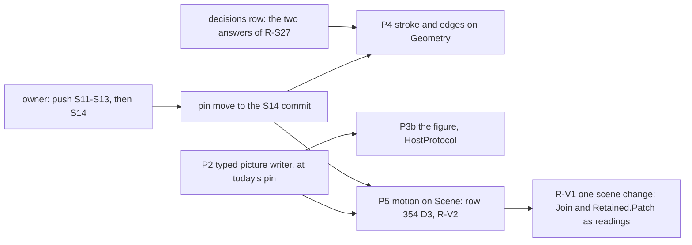

# Pre-probe: what Effect4 owes to align with the PC's SVG seat (2026-10-12, evening)

Status: research note (history, not authority). It is a read-only pre-probe for the owner's
grill. Base `73be90c46` on `refactor/phase1-phase3`. No `lake` ran. The PC was read with
`git log`, `git status`, `git show --stat` and `tar` over `ssh pc` into the session scratchpad.
Nothing on the PC was changed. The seat's uncommitted files were copied and not touched.

It follows the [SVG adoption probe](2026-10-12-probe-svg-adoption.md), whose slice P1 landed
(row 358). Inputs: the seat's hand-off note `docs/research/2026-10-12-svg-seat-to-effect4.md`
(sections 11 and 12), rulings R-S24 to R-S28 of its `COORDINATION.md`, its motion-probe
`README.md`, and the heads of its uncommitted S14 modules.

## Know this first

- **One thing lands on the PC: the SVG seat** (`C:\Users\kokok\Dev\lean4-whatwg-svg`, branch
  `html/svg`). The other PC checkouts are unchanged since 2026-10-01 or are not git trees.
- **The seat is three slices past Effect4's pin, and a fourth is in progress.**
  - Effect4 pins `1365738` (S10, row 358).
  - `99b8c81` (S11), `76098c5` (S12) and `621051d` (S13) are committed and **not pushed**:
    `html/svg` is three ahead of `origin/html/svg`.
  - S14 is uncommitted: `Whatwg/Svg/Scene/Plan.lean` (SV-77), `Metrics.lean` (SV-75),
    `Scale.lean` (SV-78) and `workshop/BranchProbe.lean`.
- **The seat already ported three of Effect4's view modules**, as restated copies in its own
  test tree. Each reads Effect4 at `707b9a01e`:

  | Effect4 module | The seat's port | Lines |
  | --- | --- | --- |
  | `tools/Tools/View/Output.lean`, the SVG half | `WhatwgTest/Html/SvgKit.lean` | 93 for the writer, 72 for the structure proof |
  | `Organic.lean` and the edge code of `Graph.lean` | `WhatwgTest/Html/SvgStroke.lean` | 443, from 851 before S12 moved the stroke into the kit |
  | the easing section of `Look.lean`, and `Motion.lean` | `WhatwgTest/Html/SvgMotion.lean` | 585; 20 theorems within `propext` and `Quot.sound` |

  Effect4 is 334 commits past `707b9a01e`. In those files, only `Look.lean` changed: the
  default noise is 0, and the paper look is new (D2, `2d32a9112`). `Motion.lean`,
  `Organic.lean`, `Graph.lean` and `Output.lean` are as the seat read them.
- **The owner already answered two of Effect4's questions, in the seat's session** (R-S27 (a)):
  - "yes to both";
  - a module of Effect4 that computes curves may take the ordinary three axioms;
  - Effect4's expected output may change where a stage rounds once.

  Effect4's register does not hold either answer. Row 334 (3) and row 358 are silent on them.
- **Slice P3a of the adoption probe is done another way.** D2 marks each status by a shape in
  the stylesheet, so no inline SVG mark is owed.
- **The two layers of the kit have two ceilings.**
  - `Whatwg.Svg.Scene` (motion, join, tree, between, branch, score) is strict: `propext` and
    `Quot.sound`, by whatwg's own gate.
  - `Whatwg.Svg.Geometry` computes in core `Rat`, and `Rat.add` reaches `Classical.choice`.

  So a motion port keeps Effect4's view laws at `[propext, Quot.sound]`, and a stroke port does
  not. No registry claim is in the way. The two tool claims (`dependency-summary-exact`,
  `view-reachability-summary-exact`) point into `Tools.View.FlowReach`, and its imports reach
  `Flow*` alone, not `Organic`, `Graph` or `Motion`.

## What the kit now gives each Effect4 module

| Effect4 | The kit | What Effect4 deletes |
| --- | --- | --- |
| `Output.lean`: `Dev.svg`, `svg` | S10: `SvgBuild`, `SvgNest`, `Print.Picture`, `Print.Xml`; S11: `Svg.cubics`, `Svg.loops` | the string writer (adoption slice P2) |
| `Organic.lean` (521 lines): `Cubic`, `Grow.*`, the stroke, noise, collars | S11–S12: `Vec`, `Cubic` with `between`, `split` and `velocity`; `Root.sqrtDown`; `Stroke.stroke`, `Stroke.organic`, `Noise`, `Stroke.collar`, `Stroke.arrowhead`, `Cubic.revealed` | its own geometry and stroke; nine of its lemmas are the kit's |
| `Graph.lean` (769 lines): edges, `stepDown` | `Curve.bumpY`, `Curve.cubics`; `Stack.ports`, so branches leave a node side by side | the edge geometry; the layered layout stays Effect4's |
| the stroke cache's law (`lowerCall_move`, `cachedStroke_eq`, `stroke_from_origin`) | `Moves`, `Commutes.stored`, `Commutes.from_origin`; `Grid`, so rounding commutes with a move by whole pixels (`Stroke.commutes_onGrid`) | the hand proofs, after an instance `Moves IVec` for Effect4's types |
| `Motion.lean` (245 lines): `Join`, `join_new`, `join_old`, `sample`, `sample_end` | `Join` with 20 laws; `Track`, `Motion`, `Motion.arriveWith`, `Motion.delayed`, `Motion.depart`; `Plan` in S14 | the join and the samplers; the end law becomes the kit's `sample_end` |
| `Look.lean`'s easing section: `Ease`, `tableAt`, `Transition` | `Easing` (`stops`, `cubic`), `Easing.of`, `Transition`; the tables become `.stops` | `Ease.at`, `tableAt`, `Transition.at`; the look keeps the numbers |
| the browser page: a flipbook of `N - 1` pictures a step (`--motion N`, default 20) | `SvgMotion`: one picture and its tracks as CSS `@keyframes`; `Motion.attrsAt` gives the poses of one moment with no animation | the flipbook; the C player samples the tracks |

Two kit modules have no Effect4 module yet:

- `Tree.spans` puts each node over the middle of its leaves.
- `Between`'s `Kept.moment` says that a gap of both pictures is a gap of every moment between
  them. Its premise is one timing for the kept things and an easing in range.

Effect4's choreography already meets that premise. Kept things all move by `move`, eased by
`settle`, which never passes 1000 (`Look.lean`). Only the entrance `expand` overshoots, on
`spring`. So adopting the kit proves that no two kept things overlap during a step unless they
overlap at an end.

## What the seat found in Effect4's code

- **The transition reading.** `Transition.at` rounds its progress to a thousandth before the
  easing. A browser does not. On a spring the two differ by up to the slope over a thousandth:
  0.416 against the browser's 0.419 (debt D120, closed in the kit by `Easing.of`).
- **The easing `out`.** Effect4 writes `1000 - (1000 - p)³ / 10⁶`. That rounds up where the
  cubic rounds down. The kit's reading is one less at 990 moments of 1001.
- **Moving nodes.** An edge between two nodes that move differently must change its shape
  (`Change.morph`), or it leaves its nodes. Effect4 shifts every kept thing by one `moved`
  offset, so this does not arise today. It arises once a layout moves things differently.
- **Width by share.** At the old default wobble of 350 per mille, a branch drew wider than its
  trunk. D2 set the default noise to 0, so this holds now only for the `organic` look.
  `Branch.wobbleRoom` bounds the wobble at 171 per mille at Leonardo's exponent.

Each is a finite probe or a guard of the seat's port, read in one browser (Chrome 152) where a
browser is named. No theorem relates Effect4's writer to the kit's.

## The slices, on Effect4's side

| Slice | Files | Owed by the landing rule |
| --- | --- | --- |
| **P2** typed picture writer | `tools/Tools/View/SvgOut.lean` (new); `tools/Drivers/View.lean`; then the SVG half of `Output.lean` goes | `lake build Tools.View.SvgOut Tools.View.LiveChecks Drivers.Live`; `tools/view/v -H pFork` by eye; `v -c pFork` after the cut. It needs nothing past S10 |
| **pin move** | `lakefile.toml`, `lake-manifest.json`; row 358 amended | the narrow build of `Tools.Document.Html` and `Drivers.Semantics`; `make gen-semantics` and `cmp` the page |
| **P4** geometry | `Organic.lean`, the edge code of `Graph.lean`, the `Moves IVec` instance; `LiveChecks` stroke guards repinned | `v -c pFork` (the C store equals Lean's stream); `LiveChecks`. Control points move by at most a thousandth |
| **P5** motion | `Motion.lean` and `Look.lean`'s easing section onto `Scene`; the driver's page writes CSS; the C player reads the tracks | `LiveChecks`; `v -c pFork`; `v -H pFork` in a browser. The view laws stay at `[propext, Quot.sound]` |
| **P3b** the figure | as in the adoption probe | as in the adoption probe |

Sizes are from the seat's ports, not from an Effect4 build. P4 and P5 edit disjoint files, so
two seats could run them at once after the pin move.

## Questions for the grill

Each is the owner's by kind. The first option is the recommendation.

1. **Who owns the motion value of row 354 (4)?** (representation)
   - Recommended: the kit owns the mechanism (types, laws, the CSS writer). Effect4's design
     language owns what each change means, and the look owns the numbers. Effect4 deletes its
     copies.
   - Or: Effect4 keeps its own motion and borrows only laws.
2. **The pin cadence.** (representation)
   - Recommended: P2 now, at today's pin, then one pin move at the S14 commit. S14's `Plan` is
     the shape the port wants (debt D124), and one move stales the markers once.
   - Or: move to S13 now, and again at S14.
3. **The seat's next work.** (domain)
   - Recommended: S14 finishes. Then the seat builds what Effect4's ports ask for (D124-style
     debts) before more of the craft note's sixteen modules.
   - Or: the seat continues the craft modules in the note's order.
4. **Who writes the port.** (domain)
   - Recommended: the Mac, from the seat's three ports. The seat keeps the kit, and edits no
     Effect4 file.
   - Or: the seat writes Effect4's port on the PC, given a fresh Effect4 checkout.
5. **The PC's Effect4 checkout.** It is 334 commits behind, on `refactor/phase1-phase3`, with
   untracked `ocaml/link/` and `tools/viewer/`. A fast-forward by `git bundle` is a git
   operation on the PC, so it is the owner's say. Recommended: fast-forward it, so the seat
   reads current code.
6. **Record R-S27's two answers in a decisions row.** (representation; already answered, only
   the record is owed) Recommended: amend row 334 (3) in a new row.

## Placement and limits

- Concept: none of the ten. Row 353 makes documents presentation, and the view's laws are tool
  laws (row 334 (3)). No registry claim moves. The consumers are the docs' figures and player
  (row 354, D3 and D4) and the live view (R14's authoring loop).
- Evidence kinds: the seat's ports are restated copies, checked by whatwg's build, not
  Effect4's. Browser readings are host observations of one profile. Line counts are `wc -l`
  and the seat's own counts.
- Not established: that the ports elaborate inside Effect4 on Effect4's own types; any build or
  link time; what S14 changes once it is committed; that the PC's working copy is final.

## The owner's rulings (2026-10-12, two rounds)

Every recommendation was taken. Decisions row 360 records them:

1. The kit owns the motion's mechanism; Effect4's design language owns its meaning, and the look
   its numbers.
2. P2 lands at today's pin; the pin moves once, at S14.
3. After S14, the seat builds what Effect4's ports ask for first.
4. The coordinator writes the port on the Mac.
5. The PC's Effect4 checkout is fast-forwarded by bundle.
6. Kept things never overshoot: reading a look checks the `move` easing's range and the one
   timing, so `Kept.moment` holds.
7. Reading a look refuses a noise above `Branch.wobbleRoom`.
8. R-S27 (a)'s two answers are recorded for Effect4.
