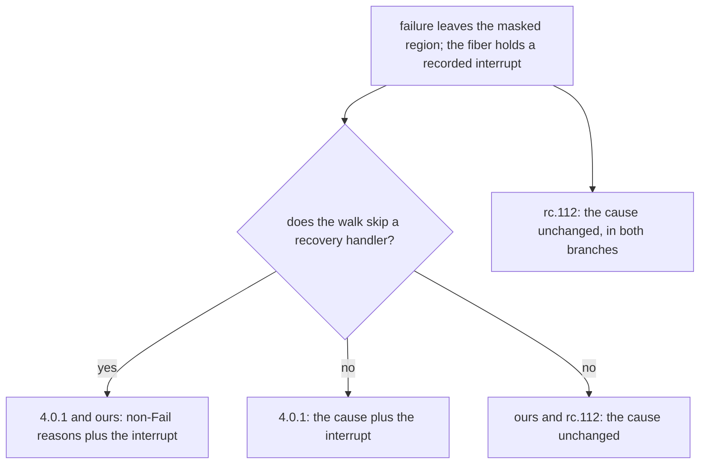

# 2026-10-12 probe: the outcomes that 4.0.1 changes in our fragment

Status: research note (history, not authority). A read-only probe. Base `68856e778` on
`refactor/phase1-phase3`. No build ran, no program ran, and nothing was committed.

## Know this first

Three changes alter an exit, a cause or a finalizer run that our machine reaches on ordinary
paths.

1. **The failure walk.** In 4.0.1 an interrupted fiber whose masked region fails exits with the
   interrupt added to its cause, with or without a handler above. Our `U-01` rule adds the
   interrupt only where the walk skips a handler. So on the plain case, interrupt a fiber inside
   `uninterruptible` and let the region fail, our machine answers rc.112's `Fail(42)`. The
   runtime answers `Fail(42), Interrupt`.
2. **`Scope.close` masks its finalizers in 4.0.1.** In rc.112 and in our machine, an interrupt
   of the closing fiber stops a waiting finalizer. The scope is already closed, so the remaining
   finalizers never run.
3. **Two leaks close.** A race loser that starts while the race settles is now interrupted. An
   interrupt now ends `awaitAllChildren` at once instead of waiting for every child.

The other changes move operation counts, touch corners that need a budget yield at one exact
step, or sit outside our fragment.

## Question

Which runtime behaviours differ between the pin (`effect@4.0.0-rc.112`) and the release
(`effect@4.0.1`)? Which of them change a reachable outcome of a program that our machine models?
The ranking is by outcome, not by the size of the diff (owner, 2026-10-12).

## What was read

All vendor locators below are under `vendor/effect-4.0.0-rc.112/src/` for rc.112 and under
`vendor/effect-4.0.1/src/` for 4.0.1. Each was read in the file this probe opened.

- `diff -u` over the runtime core. Lines changed, counted as `+`/`-` lines of the diff:
  `internal/effect.ts` 1409, `Effect.ts` 1138, `Queue.ts` 790, `PubSub.ts` 416, `Pool.ts` 292,
  `Layer.ts` 168, `internal/core.ts` 126, `Fiber.ts` 40, `Context.ts` 35, `Scheduler.ts` 31,
  `Scope.ts` 23, `Semaphore.ts` 14, `Deferred.ts` 12, `Cause.ts` 4. `Exit.ts`, `Latch.ts`,
  `Ref.ts`, `References.ts` and `Runtime.ts` have no changed line.
- The release audit of 2026-10-05 (`docs/research/2026-10-05-seat-A401/audit.md`). Its probes
  (`docs/research/2026-10-05-seat-A401/probes/`) are finite runs on bun 1.4.2, on both builds.
  This note quotes their outputs and reruns none of them.
- The migration plan (`docs/research/2026-10-05-claude-lead/migration-plan.md`) and the build
  ledger (`harness/truth/build-ledger.tsv`).
- The restore-slot scout, in the worktree of the typed-context landing
  (`/Users/pooks/Dev/lean4-effect4-land-context/docs/research/2026-10-12-restore-slot-scout.md`).
- The Lean declarations named in the table, read as text.

This note adds three things to the audit: the ranking by outcome, the reach of each change in
our source language (`Eff`), and changes the audit did not list because no declaration cites
them (`timeoutOrElse`, `cached`, `partition`, `catchReason`, the concurrent `forEach`, `Pool`).

## Classes

| Class | Meaning |
| --- | --- |
| a | Changes an exit value, a cause, a finalizer run or its order, an interruption, or the context seen, for a program in our modelled fragment |
| b | Changes only operation counts or where a budget yield lands |
| c | Outside our fragment: no `Eff` constructor or machine declaration reaches it |
| d | No behaviour change: types, names, object shapes, stack text, caching of reads |

"Our machine" names the declaration that transcribes rc.112's line. "Aligned" means our model
already follows the release.

## The changes, ranked by outcome

### Class a: in our fragment

| # | Change | rc.112 | 4.0.1 | Our machine | Class | Outcome example |
| --- | --- | --- | --- | --- | --- | --- |
| 1 | The failure walk adds the interrupt where it skips no handler | `internal/core.ts:539-545` | `internal/core.ts:591-605` | `skippedCause` (`src/Effect4/Machine/Frames.lean`), `Cause.sanitize` (`src/Effect4/Machine/Cause.lean`), the term walk in `src/Effect4/Laws/Program/EvaluateR.lean`: the release's rule at a skipped handler only (`U-01`) | a, ordinary path | A child awaits a latch inside `uninterruptible`, is interrupted, then fails with 42, with no handler above. rc.112 and ours: `Fail(42)`. 4.0.1: `Fail(42), Interrupt` (probe `poisonNoHandler`). A defect with no handler gives `Die` against `Die, Interrupt` (by reading) |
| 2 | `Scope.close` enters an uninterruptible region before its finalizers | `internal/effect.ts:3775-3776` | `internal/effect.ts:3929-3935` | `storesCloseScope` (`src/Effect4/Machine/Stores.lean`), reached from source by `ActionTerm.closeScope` (`src/Effect4/Program/Eff.lean`); the finalizers run at the closer's mask | a | A forked fiber closes a scope whose finalizer yields twice, and is interrupted at the first yield. rc.112 and ours: the finalizer stops and the scope stays closed, so no later finalizer runs. 4.0.1: it finishes (probe `closeInterruptedMidFinalizer`) |
| 3 | The race reads its loser set at its own exit | `internal/effect.ts:1509-1514`, `:1554-1559` | `internal/effect.ts:1617-1620`, `:1671-1673` | `launchEntrant` (`src/Effect4/Machine/Fibers.lean`), `raceCompleteFirst` (`src/Effect4/Machine/Supervision/FirstExit.lean`): rc.112's order, the observer enrolled after the immediate run | a | Entrant B completes a Deferred that entrant A awaits, during B's own start. A wins before B joins the set. rc.112: B runs on and is never interrupted. 4.0.1: B is interrupted (probe `r1`). Our machine wakes a Deferred waiter inline (`WakeMode.now`, `src/Effect4/Machine/Wake.lean`), so the case is reachable, by reading |
| 4 | `awaitAllChildren` awaits interruptibly when its fiber was interruptible | `internal/effect.ts:5314-5334` | `internal/effect.ts:5569-5591` | `FinName.awaitNewChildren`, `ProgName.awaitAllNew` (`src/Effect4/Machine/Stores.lean`); source `ActionTerm.snapshotChildren`, `ActionTerm.awaitNewChildren` | a, liveness | Interrupt a fiber in `awaitAllChildren` while a child runs. rc.112: the fiber stays live until the child ends. 4.0.1: it exits with `Interrupt` at once (probe `r2`) |
| 5 | Concurrent `forEach`: its cancel returns a sibling's failure, and a late sibling failure is kept | `internal/effect.ts:4839-4842`, `:4862-4876` | `internal/effect.ts:5105-5110`, `:5127-5137` | `EffThunk.awaitAllFailFast`, `mergeContextsK` (`src/Effect4/Program/Compile.lean`), `mergeContextsR` (`src/Effect4/Laws/Program/DenoteR.lean`); not read against either build | a, corner | `Layer.mergeAll` builds through this `forEach` (`Layer.ts:1597`). The parent is interrupted, and a sibling's release dies while it is interrupted. rc.112: `Interrupt`. 4.0.1: `Interrupt, Die`, through row 6. By reading only |
| 6 | A failing cancel effect is merged into the interrupt cause | `internal/effect.ts:1155-1159` | `internal/effect.ts:1197-1201` | `Prim.asyncFinalizer`, `cancelThenFail` (`src/Effect4/Machine/Frames.lean`) | a, reached only through row 5 today | A callback whose cancel dies. rc.112: `Die`. 4.0.1: `Interrupt, Die` (probe `r3`). The cancels this probe traced are store actions that answer unit (`clearTimeout`, `dropObservers`, `cancelRace`). A host cancel that fails was not traced |
| 7 | A forked scope links by a parent pointer, holds no removal finalizer, and an emptied scope returns to `Empty` | `internal/effect.ts:3834-3845` | `internal/effect.ts:4001-4009`, `:3942-3944`, `:4053-4066` | `FinName.closeChildScope`, `FinName.detachFromParent` (`src/Effect4/Machine/Stores.lean`) | a on one case, b otherwise | `Scope.close(child)` where the child holds one finalizer of value 7: rc.112 `undefined`, 4.0.1 `7`, ours `undefined`, because `U-02` voids it (probe `forkedChildOne`). A parallel close forks one fiber fewer, so later fiber ids shift by one (ledger rows `pProvideMerge`, `pProvideTwice`, `pMergeAll`: schedule only) |
| 8 | `scoped` pushes its restore frame in the step that switches the context | `internal/effect.ts:3938-3948` | `internal/effect.ts:4100-4111` | `Eff.scoped` (`src/Effect4/Program/Eff.lean`): rc.112's window. The provide region already switches under a mask (`updateContextR`, per the restore-slot scout) | a, corner at a budget yield | A budget yield lands right after `scoped` entry, and an outside interrupt arrives. rc.112 and ours: the inner scope stays in the fiber's context and never closes. Its finalizer set is still empty, so only a later `addFinalizer` through that context is lost. 4.0.1: no window |
| 9 | The memo map counts and registers an observer in one step, and installs the exit handler before it publishes an entry | `Layer.ts:241-250`, `:390-420`, `:445-457` | `Layer.ts:243-265`, `:430-456` | `FinName.memoEntry`, `FinName.memoDone` (`src/Effect4/Machine/Stores.lean`), `EffThunk.memoLookup` (`src/Effect4/Program/Compile.lean`) | a, corner at a budget yield | A sibling of `Layer.mergeAll` is interrupted between `observers++` and its finalizer's registration. rc.112: the shared layer's scope never closes, so its finalizers never run. The first builder interrupted before its `onExit` frame strands every other observer on the Deferred. 4.0.1 has neither gap |

### Class b: counts and yield placement

| # | Change | rc.112 | 4.0.1 | Our machine | Class | Outcome example |
| --- | --- | --- | --- | --- | --- | --- |
| 10 | `succeedWith` passes a value to the next continuation inside the step, counts it, and returns to the loop every 32nd call | none | `internal/effect.ts:701-707` | the budget, census row `rule.budget-per-runloop-entry`: rc.112's counts | b | 300 maps at a budget of 64: rc.112 yields after steps 5, 67, 129, 191, 253; 4.0.1 after 6, 67, 128, 189, 250 (probe R5). `scoped` and `provideService` charge one operation fewer, `acquireUseRelease` one more (probe R4) |
| 11 | `updateContext` and `scoped` restore in the same step | `internal/effect.ts:2092`, `:3943` | `internal/effect.ts:2194`, `:4105` | as row 8 | b | The region's exit takes fewer loop steps (restore-slot scout) |

A class b change alters an outcome only where an interleaving depends on the step at which a
budget yield lands. The default budget is 2048 operations.

### Class c: outside our fragment, with outcome changes for real programs

| # | Change | rc.112 | 4.0.1 | Our machine | Outcome example |
| --- | --- | --- | --- | --- | --- |
| 12 | `timeoutOrElse` and `timeout` go through `timeoutOption` | `internal/effect.ts:3677-3705`, `:3725` | `internal/effect.ts:3825-3853`, `:3856` | not modelled: `Effect.timeout` is only a row of `duals` (`src/Effect4/Codegen/Forms.lean`). The dogfood timeout races a sleep (`Test/Dogfood/Proofs/HostTimeoutSource.lean`), which is rc.112's shape | `timeoutOrElse(sleep(150).as(1), { duration: 100, orElse: () => sleep(100).as(2) })`. rc.112: `1`, because the body still races `orElse`. 4.0.1: `2`, and the body's finalizers run before `orElse` starts. `TimeoutError` now carries a message. By reading |
| 13 | `cached`, `cachedWithTTL`, `cachedInvalidateWithTTL` run the body in a forked fiber | `internal/effect.ts:4229-4292` | `internal/effect.ts:4424-4540` | not modelled | The first caller is interrupted mid-run. rc.112 caches that interrupt for the time to live, which `cached` makes infinite. 4.0.1 never caches an interrupt (`:4499`), and abandons the run when every caller leaves. By reading |
| 14 | `Array.partition`, `Array.separate` and `Effect.partition` swap their pair | `Array.ts:8052`, `:8161`; `internal/effect.ts:4425` | `Array.ts:8103`, `:8212`; `internal/effect.ts:4701` | not modelled | `const [a, b] = Array.partition(xs, f)`: rc.112 gives failures then successes, 4.0.1 successes then failures. tsgo refuses the mismatch unless both element types agree |
| 15 | `catchReason`, `catchReasons`: a reason that no case names passes the cause on unchanged | `internal/effect.ts:3101`, `:3111` | `internal/effect.ts:3203-3206`, `:3216` | not modelled | rc.112 catches the error and fails again with a fresh `fail(e)`, so a parallel cause loses its other reasons and the original annotations. 4.0.1 keeps the whole cause |
| 16 | `Pool`: failed slots are skipped or replaced; every release wakes a waiter; a return joins the front; idle time is recorded | `Pool.ts:631-639`, `:677-680` | `Pool.ts:613-626`, `:695-698` | `Effect4.Pool.Model` (`src/Effect4/Library/Pool/Model.lean`): one lease per item, no failed acquisition, and a return joins the front (decisions row 269), as in 4.0.1 | rc.112 hands a failed item's exit to its borrower. At two leases per item, two returns at once wake one waiter in rc.112 and two in 4.0.1. Our model has neither case |
| 17 | Transactions: the retry wait checks the read set, and a commit wakes only for written cells | `Effect.ts:24337`, `:24344` | `Effect.ts:24895`, `:24917` | not modelled | rc.112 can wait for ever on a stale read, and wakes on a plain read (TX1, TX2 of the transactions note) |
| 18 | Host only: the timer falls back to a microtask; a parked fiber re-enters inside a node `AsyncResource`; `tryPromise` runs its `catch` on the fiber; a throwing finalizer, `onExit` callback or `use` becomes a defect | `internal/effect.ts:1062`, `:4201-4215` | `Scheduler.ts:107-113`; `internal/effect.ts:469-478`, `:1094`, `:3956-3964`, `:4164`, `:4396-4408` | not modelled: our programs store no host closure | A `use` function that throws: rc.112 skips the release, 4.0.1 runs it |

### Aligned: the library models already follow the release

| Area | 4.0.1 behaviour | Our model |
| --- | --- | --- |
| `Queue` | The P2, P3 and P4 repairs. `shutdown` of a finished queue answers `false` (`Queue.ts:1446-1449`; rc.112 answers `true`, `Queue.ts:1193-1194`) | `Effect4.Queue.Model.shutdown` (`src/Effect4/Library/Queue/Model.lean`) answers `false` on `done`, and the contract follows the release |
| `PubSub` | The bounded single-subscriber hub | `src/Effect4/Library/PubSub/Model.lean` cites 4.0.1 |
| `Pool` | A return joins the front (`Pool.ts:695-696`) | decisions row 269, as row 16 notes |

### Class d: no behaviour change (by reading)

The fiber's cached context fields become one shared object (`internal/effect.ts:740`). The
`Context` flatten threshold changes (`Context.ts:693`). `Deferred.makeUnsafe` uses a
constructor. `causeCombine` moves to `internal/core.ts:306` over `dedupeReasons` (`:282`). Its
union and order equal rc.112's whenever `Hash` agrees with `Equal` (audit F9). `causeSquash` gives
the same answers. `internalCall` wrappers go, which changes stack text only. A child leaves its
parent's set by `_parent` (`internal/effect.ts:5536`), before its observers. In rc.112 the
removal observer is the child's first observer (`internal/effect.ts:5279-5282`), so the order is
the same. `Semaphore.ts` changes in comments only.

## The top row, drawn

The diagram shows the cause each walk hands on when a failure leaves a masked region of an
interrupted fiber. It claims no agreement beyond the probe's rows.

## Recommendations, ranked by outcome impact and then by cost

A cost here is a proxy: the files under `src/` and `Test/` that name the changed declaration
(`grep -rl`), and the witnesses that the audit counts for the census row (audit F11).

1. **Close the failure walk's last gap (migration slice M5).** Add the interrupt reasons where
   the walk skips no handler. Impact: the exit of every interrupted fiber whose masked region
   fails. Cost: one rule in `skippedCause`, and its twin in the term walk. 22 files name
   `skippedCause` or `sanitize`. Census rows `op.Failure` (4 witnesses) and
   `checkpoint.exit-failcause-skip` (5) move, and the `U-01` divergence retires.
2. **Mask `Scope.close` (part of M2).** Impact: finalizers of a directly closed scope survive an
   interrupt of the closer. `scoped`, `acquireRelease` and layer scopes close inside a masked
   `onExit` finalizer already, so they do not change. Cost: the close action enters the mask;
   16 files name `storesCloseScope`.
3. **Make the await of `awaitAllChildren` interruptible (part of M3).** Impact: liveness of an
   interrupted fiber. Cost: the `awaitNewChildren` finalizer runs under `interruptible` when the
   entry flag was interruptible, which `getInterruptible` already reads. The census row
   `fork.await-all-children` has 13 witnesses.
4. **Interrupt race losers at the race's exit (part of M3).** Impact: a loser that starts while
   the race settles keeps running in rc.112 and in ours. Cost: the highest of the four. The
   census row `fork.race-all` has 33 witnesses, and 62 files name the launch declarations.
5. **Rule on `U-02` for forked scopes, then move the scope link (rest of M2).** Impact: one
   answer of `Scope.close(child)`, and fiber ids after a parallel close. Cost: the scope rows,
   their four registry claims and the three ledger lines.
6. **Record, then measure, before any slice:** row 5 (read `awaitAllFailFast` against both
   builds first), row 6, row 8 and row 9. Each needs a budget yield at one step, a dying
   release under interrupt, or a cancel that fails.
7. **Leave the budget (M6) for last.** It moves no outcome except an interleaving at a budget
   yield, and every agreement that counts operations re-proves.
8. **Before admitting any class c area, transcribe 4.0.1, not rc.112.** Rows 12 to 17 change
   the answer of plain programs, and the dogfood timeout already composes rc.112's shape.

The cheapest step comes first. Four of the audit's probes become truth programs with ledger
lines on both builds: `poisonNoHandler`, `closeInterruptedMidFinalizer`, `r1` and `r2`. Each
turns a reading of this note into a measured line, and none needs a Lean change.

## What this does not establish

- **No proof and no new run.** Every behaviour statement is a reading of both vendor trees, or
  a finite probe on bun 1.4.2 that seat A401 recorded on 2026-10-05.
- **Reachability in our machine is by reading.** No program ran on the Lean machine for rows 3,
  5, 8 or 9. Row 5 is not read against our merge's decomposition at all.
- **A class is this probe's judgment,** with the same limits as the audit's: only the hunks of
  the files listed above were read.
- **The `U-01` rule of the release may add a second interrupt reason** when the fiber carries a
  stack frame, because the walk annotates the cause before it combines. That is not probed, and
  our machine refuses stack-frame annotations (`FRAME-FB-STACK-ANNOTATION`,
  `src/Effect4/Machine/Frames.lean`).
- **File counts are a rough proxy for cost.** They include tests and doc comments, and they do
  not follow the proof graph.
- **The host boundary stays where `docs/core/host-boundary.md` puts it.** Row 18 is host
  behaviour only.
