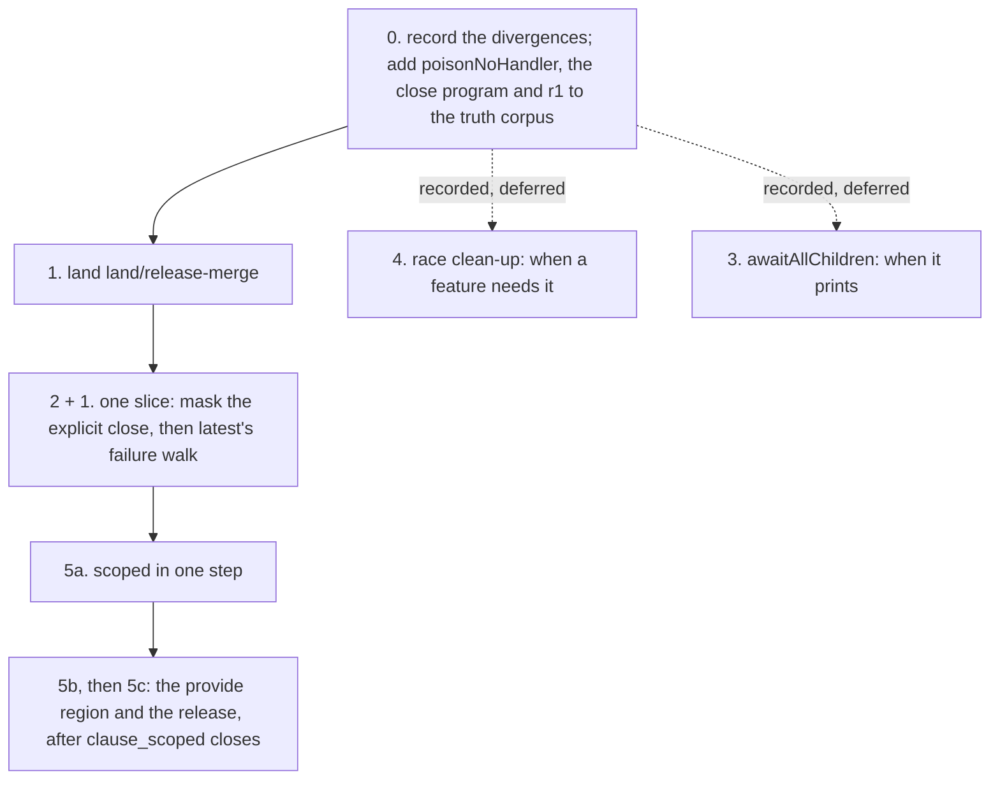

# Probe: costed slice plans for five alignments with latest (2026-10-12)

Status: research note (history, not authority). A read-only probe. Base `afd8c6f48` on
`refactor/phase1-phase3`, which holds the typed-context landing and `c2a1cdda4`. Branch
`land/release-merge` (`f6bcfa591`) is not merged. No `lake` ran, nothing was built, and nothing
was committed. Every count below comes from a command in the appendix.

Inputs: `docs/research/2026-10-12-probe-4.0.1-delta.md` (the delta note),
`docs/research/2026-10-12-probe-op-counts.md` (the op-count note) and
`docs/research/2026-10-12-probe-scoped-window.md` (the window note). "Latest" is Effect 4.0.1
(`vendor/effect-4.0.1/`); the pin is rc.112. Decisions row 331 lets a declaration transcribe
latest, and rows 248 and 253 move the pin only when a feature needs it.

## Know this first

- **Item 2 first: mask an explicit `Scope.close`.** It is the smallest change with the largest
  outcome. Today an interrupt of the closer loses every later release of a closed scope. R11's
  "exactly once over closed scopes" cannot hold for explicit closes until it lands.
- **Item 1 can share item 2's slice.** Both turn one rc.112 rule into latest's at an interrupt
  that meets a masked region. Both pay the same whole-tree rebuild and reach the same gates.
- **Defer items 3 and 4; record each as a divergence.** No printed program reaches item 3: the
  printer refuses its two source heads. Item 4 reshapes the race protocol (L) for one corner, and
  it re-proves two proved typed claims.
- **Split item 5 three ways.** 5a (`scoped` in one step) closes the `scoped` window and moves only
  a planned goal's plan. 5b (the provide region in one step) re-proves the proved typed-context
  nodes as clause work, of the shape of the open `clause_scoped`. 5c (the release) waits on 5b and
  on `land/release-merge`.
- **Three prerequisites.**
  - Land `land/release-merge` before items 2 and 5c, because both edit `clause_closeScope`.
  - The truth harness signs only `U-01` and `HC-2`, by name, in `scripts/check-truth.py` and
    `harness/truth/run-truth.ts`. The first slice that leaves rc.112 on a new program must
    generalize that list.
  - The runtime census has no build column: M1 of the migration plan has not landed. Each
    moved row either records a signed divergence that cites latest, or its slice carries M1.
- **Every item edits a low core module.** One edit rebuilds 390 to 708 modules of the core and the
  law graph, and 337 to 407 batteries at a sweep. The table gives the module for each item.

## Summary

Effort scale. **S**: one or two declarations and at most about ten proof files, one arm each.
**M**: a few declarations, ten to thirty proof files, or one typed clause re-proved. **L**: a
protocol reshaped, thirty or more proof files, or proved registry claims re-proved.

| # | Change | Outcome it changes (shape) | Machine declarations (frame / reference) | Proof files that move | Census rows (join witnesses) | Truth program first | Effort | Rebuild (transitive importers) | Recommendation |
| --- | --- | --- | --- | --- | --- | --- | --- | --- | --- |
| 1 | Failure walk: add the recorded interrupt where no handler is skipped | An interrupted fiber whose masked region fails with no handler above: `Fail(42)` becomes `Fail(42), Interrupt`; a finalizer reached after the skip sees the combined cause | `FrameFiber.skippedCause`, `FrameFiber.popFrom` / `popR` | simulation: `Simulation/Walk.lean`; frame laws: about 9; typed walk: 3 files and one new lemma | `op.Failure` (4), `checkpoint.exit-failcause-skip` (5, divergence `U-01`), `rule.interrupt-bypasses-handlers` (4) | `poisonNoHandler` (printable) | M | `Effect4.Machine.Frames`: 1,135 (core 139, Laws 536, Test 405) | second, in one slice with 2 |
| 2 | Mask an explicit `Scope.close` | A closer interrupted mid-close loses later releases and leaks the captured context; latest runs the close to its end | `FiberCore` (a mask field), the `WithFiberAction.closeScope` arm, `FiberAction.closeScope`, `RunInterp.closeScope`, `storesCloseScope` / the term `FiberCore` instance, `closeScopeR` | simulation: 6 files; per-arm splits of `evaluatePrim.withFiber`: 30 files; typed: `clause_closeScope` | none spans `:3775-3776`; `scope.close-parallel` (9) is re-read | `closeInterruptedMidFinalizer`, a printable variant | S–M | `Effect4.Machine.Fibers`: 1,115 (core 137, Laws 524, Test 399) | first, after `land/release-merge` |
| 3 | `awaitAllChildren` awaits interruptibly when its entry was interruptible | An interrupted fiber in `awaitAllChildren` stays live until its children end (liveness); no printed program reaches it | `FinName.awaitNewChildren`, `Name.snapshotThen`, `ProgName.awaitAllNew`, `finProgram` / `denoteFin` | about 5 frame-law files; typed: none at the `FinName` level | `fork.await-all-children` (13, mostly unchanged) | `r2` cannot run: the printer refuses the heads | S | `Effect4.Machine.Stores`: 1,035 (core 118, Laws 473, Test 393) | record; defer |
| 4 | Race clean-up at the race's exit | An entrant that wakes the winner during its own start runs on after the race; latest interrupts it | `beginRace`, `Cmd.registrationDone`, the race observer, `RunInterp.raceSettle`, `RaceAllState.cleanupNeeded`, `raceSettleProgram` / `denoteRaceSettle` | about 46 files name the race commands; typed: 9 command files; proved claims `step-registration-done-preserves`, `step-launch-preserves` | `fork.race-all` (33) | `r1` (printable) | L | `Effect4.Machine.Supervision`: 1,175 (core 173, Laws 535, Test 407) | record; defer |
| 5 | Op counts: the provide region and `scoped` in one stateful entry, the release through the region | 5a: the `scoped` window (an inner scope never closes). 5b, 5c: where budget yields land, at the default budget 2048 for checked programs | 5a `enterScoped` / the `.scoped` arm; 5b `updateContextAt`, `updateThenK`, `contAOf`, `withFiberOf`, `evaluateNative`, `exitScoped` / `updateContextR`, `contextEntryR`, `restoreRegionR`, `FiberOp`; 5c `EffName.releaseUnder`, `EffThunk.releaseMasked` / `denoteFin` | 5a: 18 files; 5b: 30 + 41 files, and proved typed-context nodes; 5c: 38 files | `rule.budget-per-runloop-entry` (7), `scope.scoped` (15), `scope.acquire-release` (14), `op.OnExit` (12) | none: the op-count probe measured Effect; a Lean count probe first | L (5a M, 5b L, 5c M) | `Effect4.Program.Compile`: 754 (core 20, Laws 370, Test 337) | 5a after 1+2; 5b and 5c after `clause_scoped` closes |

## Item 1: the failure walk

### The runtime

- **rc.112** `exitFailCause[evaluate]` (`vendor/effect-4.0.0-rc.112/src/internal/core.ts:529-547`).
  While the fiber is interrupted and interruptible, it pops `contE` continuations. The cause passes
  on unchanged.
- **Latest** (`vendor/effect-4.0.1/src/internal/core.ts:580-608`). After the first `getCont`, an
  interrupted interruptible fiber skips every continuation. It drops `Fail` reasons only when a
  skipped continuation is a primitive (`identifier in cont`). It always combines the recorded
  interrupt (`causeCombine(cause, interruptedCause)`). A mask's restoring replacement has no
  identifier.
- **Ours.** `FrameFiber.skippedCause` (`src/Effect4/Machine/Frames.lean`) applies `Cause.sanitize`
  (`src/Effect4/Machine/Cause.lean`) only at a skipped frame with a `contE` arm. `popR`
  (`src/Effect4/Laws/Program/EvaluateR.lean`) does the same at a `.resume` slot. This is signed
  divergence `U-01`.

### The outcome, by program shape

1. A masked region fails after an interrupt was recorded, and no handler is above it (the delta
   note's `poisonNoHandler`). rc.112 and ours answer `Fail(42)`; latest answers `Fail(42),
   Interrupt`. The mask's restoring frame substitutes the interrupt, and the walk skips that
   replacement. A defect gives `Die` against `Die, Interrupt`.
2. The same region inside `onExit`: the finalizer's exit carries `Fail(42)` in ours and
   `Fail(42), Interrupt` in latest. The `onExit` frame masks, so the walk stops there in both.
3. A failing step on an interruptible fiber with a recorded interrupt and no answering frame.
   Latest combines the interrupt and ours does not. This is a reading only.

Every observer of the exit sees the difference: `causeIsInterrupt`, a join that re-raises the
child's cause, and a finalizer that reads its exit. A walk that skips a handler already agrees
with latest (`pInterruptEscape`).

### Declarations

- **Frame machine.** `FrameFiber.skippedCause`: the arm without a handler combines the recorded
  interrupt into the carried cause, where it now returns the cause unchanged. `FrameFiber.popFrom`:
  its `[]` arm combines when it skips and the fiber is interrupted (shape 3). `FramePop.deliveredExit`,
  `FrameFiber.resumeCause`, `evaluatePrim.finalizerOr` (`src/Effect4/Machine/Fibers.lean`) and
  `exitScoped` (`src/Effect4/Program/Compile.lean`) read the carried cause and need no edit.
- **Reference machine** (the term machine). `popR`: the `.restoreMask` and `.finalizerMask` arms
  on a failing exit combine when the slot makes an interrupted fiber interruptible. The `[]` arm
  combines under the same test. The `.resume` skip arm keeps `Cause.sanitize`. A second combine
  after `Cause.sanitize` adds nothing, because `Cause.combine` removes duplicates.

### Proofs that move

- **Simulation.** `src/Effect4/Laws/Program/Simulation/Walk.lean` (24 hits on the walk's cause
  names): `walkExit_pass` takes the premise `hc` that a passed restoring mask leaves the cause
  alone. That premise fails with a pending interrupt, so the mask case and the `[]` case of the
  walk relation re-prove. `Simulation/Deliver.lean` has one hit. `run_eq_ref` keeps its statement.
  `run_eq_meaning` runs at the tape `[evaluate, flush]`, and `Straight` excludes every mask
  (`src/Effect4/Program/Fragment.lean`), so no case of it moves (reading).
- **Frame-machine laws** that compute the carried cause under a pending interrupt:
  `AnswerFlowFamilyPop.lean`, `AnswerFlowCausePop.lean`, `AnswerFlowFamily.lean`, `AnswerFlow.lean`,
  `AnswerFlowFrames.lean` and `PopTrace.lean` (`src/Effect4/Laws/Machine/`);
  `ReleaseCustody/CausePop.lean` and `Guard/FrameOwned.lean` (`src/Effect4/Laws/Program/`). The
  theorem `resumeClosedScope_failure_pending` (`src/Effect4/Laws/Machine/ScopeRestoration.lean`)
  names the row in its docstring and states the unchanged cause, so its statement changes. It is
  not in the row's witness list. Lemmas whose premise is
  `interruptedCause = none` stand: `popFrom_carriedCause_no_pending`, `getCont_no_pending`.
- **Typed state.** The walk's typing at the mask slot and at `[]`: `ambient_popR_typed`
  (`Typed/AmbientMachine.lean`), `popR_typed` (`Typed/Stack.lean`), `popR_hostTyped` and
  `ambient_popR_hostTyped` (`Typed/HostWalk.lean`). They need one new lemma: an `ExitOk` failure
  stays `ExitOk` after its recorded interrupt is combined in. `sanitize_clean_exit` and
  `noShapeDefect_sanitize` are its models. The claims `step-deliver-preserves` and
  `step-loop-preserves` keep their statements, still modulo the five goals.

### Batteries, contracts and registers

- `Test/Counterexamples/Machine/Runtime/ScopeRestorationBoundary.lean` (`E4-RUN-CE-025`, `-026`):
  the `#guard`s on `failedClose` and `singleEmpty` with no handler move. `failureCause` becomes
  `Cause.combine failureCause pending`, and `⟨[]⟩` becomes `pending`.
- `Test/Machine/Runtime/ScopeRestorationContract.lean`;
  `Test/Counterexamples/Machine/Semantics/InterruptEscape.lean`, `InterruptCarrier.lean`,
  `InterruptDelivery.lean` (`E4-SCHED-CE-006` to `-009`); `Test/Program/TypedStack.lean`;
  `Test/Machine/MaskBracket.lean`; `Test/Dogfood/Proofs/HostTimeoutNumberFlow.lean`, whose
  `CauseAt` cases over `Cause.sanitize` gain a combine case.
- The frozen contract `Test/contracts/scope-restoration.contract.md` says "the original failure
  enters the remaining frame step". Under latest the combined cause enters it. A contract edit is a
  review event.
- `docs/UPSTREAM-BACKLOG.md`, row `U-01` and its note under the 2026-10-05 candidates.

### Census, truth and gates

- **Census.** `op.Failure` (4 witnesses), `checkpoint.exit-failcause-skip` (5; disposition
  divergence, `U-01`), `rule.interrupt-bypasses-handlers` (4). Each row spans rc.112
  `core.ts:528-547`. The divergence against rc.112 stays. Its sentence changes from "a skipped
  catch strips `Fail`" to "the machine follows latest's walk".
- **Truth program first: `poisonNoHandler`.** It prints with `fork`, `Effect.uninterruptible`,
  `Deferred.await`, a helper fiber's interrupt and the atoms `causeIsFail` and `causeIsInterrupt`.
  Today ours agrees with rc.112, and the ledger expects `no` on latest, slice M5. After the slice
  the rc.112 lane disagrees, so `scripts/check-truth.py` must sign the program.
  `pInterruptEscape` does not move.
- 31 of the 91 truth programs print `Effect.uninterruptible`. This probe read only `pMaskWait`
  and `pMaskedRestore`: both end their masked regions on the success path. `check-truth` decides
  the rest.
- **Gates:** `check-compiler`, `check-native` and `check-ocaml` after `make gen-lcnf`;
  `check-truth`; `check-truth-release` with `make gen-truth-ledger`; `check-host-protocol`;
  `check-corpus`. A generated program that interrupts a failing masked fiber would move a corpus
  row, and that row needs a policy name.

### Placement

- **Concepts.** `translation-simulation`: the claim `run-eq-ref` is kept. R9 (`ExitOk`): the claim
  `step-deliver-preserves` is kept, modulo.
- **New lemma.** The combine lemma above. Its consumer is `ambient_popR_typed`. No new claim.
- **Not established.** Latest annotates the cause with a stack frame before it combines, and so
  may add a second interrupt reason. Our machine refuses stack-frame annotations
  (`FRAME-FB-STACK-ANNOTATION`, `src/Effect4/Machine/Frames.lean`).
- **Unlock.** Nothing on the M5 → M6 → M7 spine. The gain is an outcome. `U-01` turns into
  "latest's rule".

**Effort: M.** The code is two declarations in two files. The proofs are about 9 frame-law files,
the walk simulation, 3 typed-walk files and one lemma. There are 8 batteries and one contract.

## Item 2: mask an explicit `Scope.close`

### The runtime

- **rc.112** `scopeClose` (`vendor/effect-4.0.0-rc.112/src/internal/effect.ts:3775-3776`):
  `suspend(() => scopeCloseUnsafe(self, exit_) ?? void_)`, at the closer's interruptibility.
- **Latest** `scopeClose` (`vendor/effect-4.0.1/src/internal/effect.ts:3929-3935`): a `withFiber`
  that runs the unsafe close. It answers `void_` when nothing is closed. Otherwise it calls
  `fiberEnterUninterruptibleUnsafe` (`:4584-4589`), which masks the fiber and pushes the restoring
  frame, and then returns the close.
- **Ours.** `ActionTerm.closeScope` (`src/Effect4/Program/Eff.lean`), printed `Scope.close`, runs
  `storesCloseScope` (`src/Effect4/Machine/Stores.lean`) at the closer's interruptibility. Its
  `_closerInterruptible` argument is unused.

### The outcome, by program shape

A fiber closes a scope by `Scope.close` while it is interruptible. The scope holds at least one
finalizer that takes more than one step. Another fiber, or the tape, interrupts the closer during
the close.

- **rc.112 and ours.** The scope is `Closed` first, the running finalizer stops at its next
  checkpoint, and no later finalizer runs. The closer exits with the interrupt.
- **Latest.** The close runs to its end under the mask. The restoring frame then fails the closer
  with the interrupt.
- **The context window.** A captured release (`FinName.foreign`) switches the context two
  checkpoints before it masks (`EffName.releaseUnder`, `EffThunk.releaseMasked`). An interrupt at
  either checkpoint leaves the captured context current for the unwinding handlers. The mask
  closes this window too (the window note).
- **Evidence.** The window note's scan: on rc.112 the release is lost at T=24, 25 and 26; on latest
  at no T. Our machines are a reading.

Internal closes are already masked: the `scoped` exit, child scopes, layer scopes and the memo
entry all close inside a finalizer. They do not change.

### Declarations

- **Frame machine** (`src/Effect4/Machine/Fibers.lean`):
  - `FiberCore` gains a field that masks an interruptible fiber and pushes its restoring frame
    (latest's `fiberEnterUninterruptibleUnsafe`). `frameCore` answers `FrameFiber.uninterruptible`.
  - The `WithFiberAction.closeScope` arm of `evaluatePrim.withFiber`, and `FiberAction.closeScope`,
    enter the mask when the close returns a finalizer program.
  - `RunInterp.closeScope` answers an optional program, as `storesCloseScopeUnsafe` does: none for
    `void_`. The cheaper choice masks every close. It differs from latest by one restoring frame
    around `void`, with no checkpoint between.
- **Stores and the native route.** `storesCloseScope` (`src/Effect4/Machine/Stores.lean`), the
  stores interpreter's `closeScope` field, and the native interpreter's `closeScope` field
  (`interpOf`, `src/Effect4/Program/Compile.lean`).
- **Reference machine.** The term `FiberCore` instance (`src/Effect4/Laws/Program/InterpR.lean`)
  pushes `.restoreMask true` and clears the flag, as the `.mask` arm of `evaluateFiberR` does.
  `closeScopeR` (`InterpR.lean`) answers the optional program. The `.closeScope` arm of
  `evaluateFiberR` calls `FiberAction.closeScope` and needs no edit.
- **Comment.** The docstring of `EffThunk.releaseMasked` (`Compile.lean`) claims that every path
  that runs a release is masked. After this item it holds.

### Proofs that move

- **Simulation.** `closeScope_rel` and `storesOk_closeScope` (`Simulation/Actions.lean`, 16 hits);
  `frame_closeScope` (`Simulation/Evaluate.lean`, 7); `Simulation/Hooks.lean` (10),
  `Simulation/Deliver.lean` (10), `Simulation/Pending.lean` (1), `Agreement.lean` (1). The stack
  relation needs a `Prim.setInterruptible true` frame paired with a `.restoreMask true` slot above
  the answer slot. The `.mask` arm already uses that pair.
- **Per-arm frame proofs.** 30 files under `src/Effect4/Laws` and `Test` split
  `evaluatePrim.withFiber` by position. Each has a `closeScope` case. A case that reads the stack
  or the flag takes the lemma the `setInterruptible … false` arm already uses: for example
  `uninterruptible_maskChain` in `withFiber_keepsMask` (`src/Effect4/Laws/Machine/MaskRuns.lean`).
  `withFiber_closeScope` and `withFiber_closeScope_unknown` (`src/Effect4/Laws/Machine/Clauses.lean`)
  restate.
- **Typed state.** `clause_closeScope` (`Typed/Commands/Evaluate.lean`) is a planned goal at
  `afd8c6f48`; `247d9efc0` on `land/release-merge` proves it. It re-proves with the restoring slot
  over the saved answer frame. `Typed/Adequacy.lean`, `Denotation.lean` and `Residual.lean` name
  the action, but they type the action and not its step: no change expected.

### Batteries, census, truth and gates

- **Batteries.** `Test/Program/RuntimeRContract.lean` (`frame_closeScope`); `Test/Program/DenoteRContract.lean`
  and `RuntimeRReference.lean` (close terms); the `w6` replays of `ProgName.closeScopeOf` at an
  interruptible root in `src/Effect4/Laws/Machine/Witnesses.lean`. Their exits do not change
  (reading), and the kernel checks them again.
- **Census.** No row spans rc.112 `:3775-3776`. `scope.close-parallel` (9 witnesses) says the
  parallel walk's daemons inherit the closer's mask. After the item a nonempty close always
  passes a masked closer, as in latest. Record a signed divergence from the pin's `:3775-3776`
  that cites latest's `:3929-3935`.
- **Truth program first: a printable `closeInterruptedMidFinalizer`.** Use `Effect.scoped` with
  an `acquireRelease` whose release yields twice. Read the scope with `Effect.service(Scope.Scope)`
  (`.scopeService`, `src/Effect4/Codegen/PrintLeaf.lean`) and close it from a forked fiber.
  Interrupt the closer after one yield of the main fiber. Answer the release's log. `pScope`, the
  one truth program that prints `Scope.close`, closes an empty scope and does not move.
- **Gates:** the same as item 1. `harness/truth/corpus.json` records `frames` for each run, so
  run `make gen-truth`. `Test/Program/Gen.lean` generates `closeScope` actions for `check-corpus`.

### Placement

- **Concept.** `scope-lifetime-finalization`. **Requirement.** R11, whose open part reads "exactly
  once in close order over closed scopes".
- **Proposed claim.** An explicit close runs its walk masked: after the `closeScope` arm with a
  finalizer program, the fiber is not interruptible, and the restoring frame sits over the
  caller's stack. Consumer: R11's exactly-once statement for explicit closes.
- **Kept.** `clause_closeScope` (an R9 goal), `saved-mask-chain-runs`, `saved-mask-region-bracket`.
- **Not established.** Progress of the close: a finalizer that parks for ever still parks, now
  masked. The host boundary stays where `docs/core/host-boundary.md` puts it.

**Effort: S–M.** The code is about nine declarations in four files. Most of the 30 per-arm cases
are one line; the simulation case and `clause_closeScope` are the real work.

## Item 3: `awaitAllChildren` awaits interruptibly

### The runtime

- **rc.112** `awaitAllChildren` (`vendor/effect-4.0.0-rc.112/src/internal/effect.ts:5314-5334`)
  awaits the new children inside `onExit`'s masked finalizer.
- **Latest** (`vendor/effect-4.0.1/src/internal/effect.ts:5569-5591`) records the entry flag, and
  it wraps the await in `interruptible` when the entry was interruptible.

### The outcome, by program shape

This is a liveness change. A fiber in `awaitAllChildren` is interrupted while a child runs. In
rc.112 and ours it stays live until the child ends. In latest it exits with `Interrupt` at once
(probe `r2`). The child keeps running in both.

- **Reach in our language.** The source heads `snapshotChildren` and `awaitNewChildren` are
  machine-only (`machineOnlyHeads`, `src/Effect4/Program/Binders.lean`). The printer refuses both
  (`Test/Codegen/PrintContract.lean`). So no printed program reaches the change. The raw stores
  program `ProgName.awaitAllNew` reaches it (`src/Effect4/Laws/Machine/Witnesses.lean`).

### Declarations

- **Stores and frame machine** (`src/Effect4/Machine/Stores.lean`). `FinName.awaitNewChildren`
  gains the entry flag. `Name.snapshotThen` and `ProgName.awaitAllNew` capture it at the snapshot
  step. `finProgram` wraps the await in `ActionName.setInterruptible _ true` when the flag is
  true. The snapshot must answer the flag, or a mask read must precede it. That costs one or
  three counted operations; latest's costs none.
- **Reference machine.** The `.awaitNewChildren` arm of `denoteFin`
  (`src/Effect4/Laws/Program/DenoteR.lean`) puts a `.mask true` region around the await.
- **Source route.** No machine change. An authoring form `awaitAllChildren` would compose the
  snapshot, the saved mask (decisions rows 245 and 246) and a restore site around the await.

### Proofs, batteries, census, truth and gates

- **Frame laws.** The `FinName` arms of `src/Effect4/Laws/Machine/Handles.lean`,
  `Laws/Program/Handles/Alphabet.lean` and `Laws/Program/ReleaseCustody/Names.lean`; the
  `denoteFin` agreement in `Simulation/Hooks.lean`. `Simulation/Actions.lean` (8 hits),
  `Evaluate.lean` (2) and `Pending.lean` (4) name the actions; the actions do not change.
- **Typed state.** None, as long as the change stays at `FinName`: the typed fragment reads source
  programs. The 21 hits in `Typed/Commands/Clauses/Park.lean` are the source action.
- **Census.** `fork.await-all-children` (13 witnesses). Most state the countdown walk, which does
  not change.
- **Truth.** `r2` cannot run on the truth lane, because the printer refuses the heads. A printable
  form comes first: an `Effect.awaitAllChildren` template and a source region (M by itself).
- **Gates:** `check-compiler`, `check-native`, `check-ocaml` (`FinName` is in
  `ocaml/gen/api_gen.ml`).

### Placement

- **Concept.** `reactive-scheduling`. **Requirement.** R12, frontiers name what they await.
- **Claims.** No claim needs the change. It changes liveness only, and no theorem states progress.

**Effort: S.** The cost is low, and so is the value. Record a divergence and defer until
`awaitAllChildren` becomes a printable form. Transcribe latest then.

## Item 4: race clean-up at the race's exit

### The runtime

- **rc.112** `raceAll` (`vendor/effect-4.0.0-rc.112/src/internal/effect.ts:1477-1532`) and
  `raceAllFirst` (`:1535`, `:1554-1559`). The winner's callback resumes with
  `flatMap(uninterruptible(fiberInterruptAll(fibers)), () => exit)` when it saw a live entrant.
  The callback's cancel interrupts the live set.
- **Latest** (`vendor/effect-4.0.1/src/internal/effect.ts:1603-1655`, `:1657`). Before the
  callback, the race pushes an `onExitUnsafe` frame on the parent (`:4219-4224`). That finalizer
  interrupts the live set as it stands at exit. The settle resumes with the exit alone, and the
  callback has no cancel.

### The outcome, by program shape

Entrant B, during its own start, completes a Deferred that entrant A awaits. A wins before B joins
the live set.

- **rc.112 and ours.** B runs on after the race (probe `r1`).
- **Latest.** B is interrupted at the race's exit.
- **Shapes.** Any race whose entrants signal each other at once: a Deferred, a Queue offer, a
  latch. Our machine wakes a Deferred waiter at once (`WakeMode.now`,
  `src/Effect4/Machine/Wake.lean`), so the case is reachable (reading). None of the 91 truth
  programs prints `Effect.raceAll`.

### Declarations

- **The shared command loop** (`src/Effect4/Machine/Fibers.lean`). `beginRace` pushes the
  clean-up frame, which needs a new `FiberCore` push of an `onExit` frame or slot.
  `Cmd.registrationDone` parks with no race cancel frame. The race observer's settle (the
  `Observer.raceCallback` arm of `fireObserver`) and `Cmd.registrationDone` resume with the exit.
  `RunInterp.raceSettle` loses its clean-up argument, and `RunInterp.raceCancelName` may go.
- **Supervision.** `RaceAllState.cleanupNeeded` and `raceComplete`
  (`src/Effect4/Machine/Supervision.lean`), and `raceCompleteFirst`
  (`src/Effect4/Machine/Supervision/FirstExit.lean`). The theorems "at the frozen observation
  boundary" there restate.
- **Stores and the native route.** `raceSettleProgram` and the race arm of `cancelProgram`
  (`Stores.lean`). A `finalizerProgram` arm for the clean-up name, in the native interpreter
  (`Compile.lean`) and the stores interpreter.
- **Reference machine.** `denoteRaceSettle` and the race arm of `denoteStoreCancel`
  (`InterpR.lean`). The `.raceCleanup` body of `bodyR` (`EvaluateR.lean`) becomes the clean-up
  slot's program.

### Proofs that move

- **Name counts.** `registrationDone` is named in 46 files, `enrollRace` in 42, `raceSettle` in 33,
  and `cancelRace` or `raceCancelName` in 48.
- **Simulation.** `Simulation/Drive.lean` (28 hits), `Actions.lean` (10), `Hooks.lean` (9),
  `Evaluate.lean` (7), `Pending.lean` (5).
- **Frame laws.** The race witnesses of `src/Effect4/Laws/Machine/Clauses.lean`; `Handles.lean`;
  `EditObserverWords.lean`; `Guard/RegistrationDone.lean`, `Guard/Race.lean`, `Guard/Core.lean`;
  `ReleaseCustody/CommandRaceDebit.lean`; `src/Effect4/Laws/Api/Supervision.lean`.
- **Typed state.** `Typed/Commands/Bookkeeping.lean` (51 hits), `Race.lean` (18),
  `Registration.lean` (16), `Evaluate.lean` (12), `Observe.lean` (11), `Finish.lean` (10),
  `Launch.lean` (6); `Typed/Scheduler.lean` (12), `Typed/Assembly.lean` (12). The proved claims
  `step-registration-done-preserves` and `step-launch-preserves` re-prove. `step-deliver-preserves`
  and `step-loop-preserves` re-prove modulo.

### Batteries, census, truth and gates

- **Batteries.** `Test/Dogfood/Proofs/HostTimeoutRace*.lean` and
  `HostTimeoutNumberFlow.lean`: the dogfood timeout races a sleep. Also `Test/Api/TraceOrigin.lean`,
  `Test/Program/RuntimeRContract.lean`, the handles contract and `Test/Program/H2PartOne.lean`.
- **Census.** `fork.race-all` (33 witnesses, rc.112 span `:1476-1532`). The `raceAllFirst` hunk
  `:1554-1559` lies outside every row.
- **Truth program first: `r1`.** It prints with `Effect.raceAll`, a Deferred and a log through
  `onExit`. Today ours agrees with rc.112.
- **Gates:** the same as item 1.

### Placement

- **Concepts.** `reactive-scheduling` and `scope-lifetime-finalization`.
- **Claims.** No claim states the outcome. A new claim would be "a race's exit leaves no entrant of
  its live set running". Re-proved: the four claims above.

**Effort: L.** Record a signed divergence. Defer until a feature needs the race's exit clean-up.
Latest's timeout goes through `timeoutOption` (row 12 of the delta note); a timeout slice would
read the race again then.

## Item 5: operation counts and the region shape

### The runtime and ours

| Construct | rc.112 | Latest | Ours (the op-count note) |
| --- | --- | --- | --- |
| Provide region, entry | 2, with one checkpoint between the switch and the push (`effect.ts:2073-2096`) | 1, switch and push in one step (`:2175-2201`, `onExitUnsafe` `:4219-4224`) | 12, masked from the switch to the push, so no window |
| Provide region, exit | 1 | 1 | 4: a finalizer program over `EffThunk.setCtx` |
| `scoped`, entry | 2, with the same checkpoint (`:3938-3948`) | 1 (`:4100-4112`) | 2, with rc.112's checkpoint |
| Release at a close, one finalizer | 6, or 3 for an exit value (`:2196`) | 5, or 3 | 16 for both |

### The outcome, by program shape

1. **The `scoped` window (5a).** A budget yield lands at the checkpoint after `scoped` entry, and
   an outside interrupt follows. The inner scope stays in the fiber's context and never closes. A
   finalizer that an unwinding handler adds through `Effect.scope` is lost. The scan measured it
   on rc.112 at T=5. Ours behaves as rc.112 (reading). Checked programs meet the budget only at
   2048, because the checker refuses a budget provision.
2. **Yield placement (5b, 5c).** Every operation between a fiber's entry and a program point moves
   that point's yield. A loop with one provide region per round spends 13 more operations per
   round than Effect, so another fiber runs earlier in our machine. Its reading of a cell can then
   differ.
3. **Yields inside a release (5c).** The release has 10 extra loop tops, each a yield point inside
   a finalizer.

None of these changes the set of reachable schedules when the budget is free.

### 5a: `scoped` in one step

- **Frame machine.** `enterScoped` (`src/Effect4/Program/Compile.lean`) pushes
  `Prim.onExit body (.scopedExit previous scope) false` onto the stack and sets the body current.
- **Reference machine.** The `.scoped` arm of `evaluateFiberR` (`EvaluateR.lean`) pushes the
  `.resume (.onExit false)` slot with `saveR` and sets the body, bound to `unguard`, current.
- **Effect.** The window closes. Entry costs latest's 1 operation, one fewer than rc.112: a signed
  divergence.
- **Proofs.** `enterScoped` is named in 18 files, with the lemmas `enterScoped_eq`, `_ok`,
  `_moves`, `_minted`, `_state` and `_step`. The `.scoped` step of the simulation
  (`Simulation/Evaluate.lean`) moves. `clause_scoped` is a planned goal: only its plan changes, and
  no proved node moves.
- **Census.** `scope.scoped` (15 witnesses).
- **Effort: M.**

### 5b: the provide region in one step

- **Shape.** One stateful entry, like `enterScoped`: read the context, switch, push
  `Prim.onExit (regionCode body) (EffName.restoreCtx previous) false`, and continue with the body.
  A pop of `restoreCtx` frames inside `evaluateNative`, like `exitScoped`: restore the context
  inline and continue with `Prim.ofExit exit`. This is latest's shape: entry 1, exit 1, no window.
  The five-operation mask of `c2a1cdda4` is then not needed.
- **Frame machine** (`src/Effect4/Program/Compile.lean`). `updateContextAt`, `updateThenK`; the
  `.provideMask`, `.updateThen` and `.bodyThen` arms of `contAOf`; the `EffThunk.captureMask`,
  `.provideMasked`, `.restoreRegion` and `.setCtx` arms of `interpOf.withFiberOf`;
  `evaluateNative` and `exitScoped`.
- **Reference machine.** `updateContextR`, `contextEntryR`, `restoreRegionR` (`DenoteR.lean`);
  `Body.contextEntry` and `FiberOp` (`src/Effect4/Laws/Program/Sched.lean`), where a new stateful
  operation moves the answer gate's count of 42; `evaluateFiberR` and an analogue of
  `prepareScopedExitR` (`EvaluateR.lean`); `denoteBody` (`InterpR.lean`).
- **Proofs.** The provide region's names appear in 30 files. `exitScoped` is named in 41 files,
  with about 40 lemmas, one per invariant (`exitScoped_ok`, `_footprint`, `_interference`,
  `_parking`, and the rest); each gains a `restoreCtx` case. `evaluateNative` is named in 71
  files.
- **Typed state.** `contextEntry_ambient` and `restoreRegion_ambient` (`Typed/Body.lean`), the
  typing of `updateContextR` (`Typed/Context.lean`), `Typed/LayerArm.lean`, `Typed/Residual.lean`,
  and `BodyTyped.contextEntry` (`Typed/Admission.lean`) are proved today. A stateful entry turns
  them into a fiber clause of `clause_scoped`'s shape, and `clause_scoped` is still a planned
  goal. So proved R5 and R9 nodes would become clause work.
- **Batteries.** The Semaphore, Pool and Queue traces re-pin again: entry −11 and exit −3 against
  today. They were re-pinned twice on 2026-10-12 (`d4e1c55ff`, `46e2744bc`). Also
  `Test/Program/RuntimeRContract.lean`'s lockstep shapes; the Atomic writer chain
  (`Test/Dogfood/Scenario/Atomic/WriterPhase.lean`, `WriterCallbacks.lean`, `WriterSource.lean`),
  whose `contAOf` case numbers move; the `frames` of the 11 truth programs that print a provide
  region; and the engine fixtures (`make gen-fixtures`), where a moved fuel or exit line is a
  finding.
- **Effort: L.**

### 5c: the release through the region

- **Prerequisites.** `land/release-merge` and 5b.
- **Change.** Route `EffName.releaseUnder`, `EffName.releaseBody` and `EffThunk.releaseMasked`
  (`Compile.lean`), and the `.foreign` arm of `denoteFin` (`DenoteR.lean`), through 5b's entry.
  Test the release's code with `asExit?`, as `provideLayerBodyK` does (latest `:2301`). This
  removes 9 operations, or 12 for an exit-value release. The counted `Prim.suspend` of
  `finProgram` stays.
- **Proofs.** The release's names appear in 38 files. `foreignFinalizer_ambient` and
  `clause_closeScope` (goals at `afd8c6f48`, proved on `land/release-merge`) re-prove.
- **Effort: M.**

### Census, truth and gates (all of item 5)

- **Census.** `rule.budget-per-runloop-entry` (7 witnesses), `scope.scoped` (15),
  `scope.acquire-release` (14), `op.OnExit` (12), `frame-arm.OnExit` (7),
  `layer.provide-effect-scope` (10), `layer.build-with-memo-map-service` (5). No row spans
  `updateContext` (rc.112 `:2073-2096`).
- **Truth.** No program comes first. The evidence is the op-count probe, which measured Effect
  under bun, and the window note's scan. The op-count note asks for a `lake env lean` probe of our
  twelve-step entry and four-step exit before 5b starts. The truth lane cannot place a yield at
  one checkpoint, because the checker refuses a budget provision.
- **Gates:** the same as item 1, with `make gen-truth`, because 19 truth programs print
  `Effect.scoped` and 11 print a provide region.

### Placement

- **Concepts.** `translation-simulation` (`run-eq-ref`, kept); `scope-lifetime-finalization` (5a:
  R11's structured regions); `context-requirements` (5b: R5, the region's typing).
- **Unlock.** 5a gives `clause_scoped` and `Evaluating.settle_callback` a plan with no window.
- **Not established.** No outcome changes at a free budget.

## Recommended order



1. **Record, then add three truth programs.** No Lean file changes. Today the three programs agree
   with rc.112, and each turns a reading into a ledger line on both builds.
2. **Land `land/release-merge`.** Its work is done, and it proves `clause_closeScope` and
   `foreignFinalizer_ambient`, which items 2 and 5c edit.
3. **Item 2.** The smallest change with the largest outcome: no release is lost, and R11 needs it.
4. **Item 1.** One rule, and the exit of every interrupted masked failure that no handler catches.
5. **Item 5a.** It closes the `scoped` window; only a planned goal's plan moves.
6. **Items 5b, then 5c.** Counts only, at L. Land them after `clause_scoped` and
   `Evaluating.settle_callback` close, so that no proved typed-context node moves mid-flight.
7. **Item 4: defer.** L for a corner; no truth program yet.
8. **Item 3: defer.** No printed program reaches it.

## Which items can share a slice

- **Items 1 and 2: one slice.** Both rewrite one rc.112 rule at an interrupt that meets a masked
  region, and both follow latest under row 331. `Effect4.Machine.Fibers` imports
  `Effect4.Machine.Frames`, so one rebuild of Frames' 1,135 importers covers both. They reach
  the same gates and need the same generalization of the truth harness's signed list. One receipt
  can propose both decisions rows.
- **Items 5a, 5b and 5c: one rule for three regions,** as the op-count note recommends. They give
  one re-pin of every trace window and one corpus regeneration. 5a can land alone first if the
  owner wants the window closed now.
- **Items 2 and 5a: a fallback pair** if item 1 waits. Both serve R11, both are small, and both
  edit the scope lifetime.
- **Items 3 and 4: keep them apart.** Both fall under the migration plan's M3, but they share only
  the census reading, not code.

## What this does not establish

- **No build and no run.** Every statement about our machines is a reading of the named
  definitions. Every statement about Effect is a reading of the vendored trees, or a finite probe
  that the input notes recorded on bun 1.4.2.
- **File counts are a proxy.** A name count includes comments and tests. A per-arm count says
  which proofs case on the arm, not how hard each case is. The import closure comes from a parser
  of `import` lines, not from Lake.
- **The witness counts** come from the lists in `Test/Audit/RuntimeCoverage.lean`. No coverage
  number moves here, and none is quoted outside the coverage report's block.
- **The typed-state estimates** assume the release merge of `land/release-merge`. At `afd8c6f48`,
  the release replaces the context, and the explicit-close window can drop a key of the caller's
  row (the window note).
- **The truth programs are designs.** Whether each schedule reproduces on the host without a tape
  is unchecked.
- **No proof obligation is placed in the registry.** Each placement above is a proposal for the
  slice's brief.

## Appendix: the commands behind the counts

Every command ran from the repository root at `afd8c6f48`.

- **Name counts per file.** For example:

  ```sh
  grep -rc "skippedCause" src Test --include='*.lean' | grep -v ':0$'
  grep -rl "registrationDone" src Test --include='*.lean' | wc -l
  grep -rl "unfold evaluatePrim.withFiber\|evaluatePrim.withFiber," src/Effect4/Laws Test --include='*.lean' | wc -l
  ```

- **Census witnesses.** A Python regular expression over `Test/Audit/RuntimeCoverage.lean` counts
  the names in each row's `witnesses` list. The scan is in the session scratchpad, not tracked.
- **Import closures.** A Python walk of every `import` and `public import` line under `src`,
  `Test`, `harness` and `tools`, reversed, then closed from the named module. It is in the session
  scratchpad, not tracked.
- **Truth programs.** A Python count over `harness/truth/corpus.json`'s `programs`, by the
  printed `expr` and `decl` fields.
- **Vendor lines.**

  ```sh
  grep -n "export const scopeClose = \|export const exitFailCause\|export const raceAll = \|export const awaitAllChildren = " \
    vendor/effect-4.0.0-rc.112/src/internal/*.ts vendor/effect-4.0.1/src/internal/*.ts
  ```
