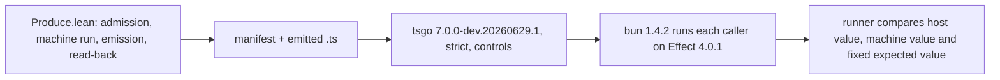

# 2026-10-12 Probe: the seven unwired harness packets (backlog B4)

Status: research note (history, not authority). Base: `223da2f59` on `refactor/phase1-phase3`.
The commits up to `af702e009` touch no Lean source and no harness file. A read-only probe: it
changes no tracked file, runs no `lake` and builds nothing.

## Know this first

1. **All seven ran without a build. Six pass and one fails.** `module-catalogue` fails at tsgo
   with `TS2375` on `streamIndependent`. Its README and its 2026-10-09 receipt record the same
   failure. It is the mechanism of `E4-PRINT-CE-001` (DI-15), not rot.
2. **The passes are tested on the 2026-10-11 build, not at HEAD.** The main checkout's object
   files date from 2026-10-10 21:58 to 2026-10-11 22:52. They predate the merges of 2026-10-12
   at 07:25 (`ebb78c9ea`) and 14:11 (`10b4b0196`, the typed context).
3. In each producer's import closure, 26 to 87 modules now have a source that differs from the
   one their object file was built from. Eight new law modules are not built at all.
4. **No packet shows rot by reading.** No producer matches exhaustively on a type that the
   merges extended, the shape that broke `harness/truth/Truth.lean` (`20f6293f1`). The freshness
   script finds no `Effect4.Api` module changed since the build.
5. The source changes in the closures concern the context constructors, the `mul` profile check
   and two dead machine fields. No packet program names a context constructor (`grep`). The same
   results at HEAD are expected by reading, not tested.
6. **`--skip-build` trusts its caller.** A receipt records HEAD's commit and HEAD's source hashes
   whatever the object files are. Here `codegen-bindings`' `results.json` records `223da2f59` over
   the 2026-10-11 build. Wiring through `build_imports` removes that mislabel.
7. **Wiring is cheap.** One `Makefile` rule builds 13 modules beyond `make build` and the truth
   gate's imports, all in the `Test.All` closure. The host part took 2 to 7 s per packet here.

## Question

Backlog item B4 (`docs/research/2026-10-12-probe-backlog-queue.md`) asks for one run of each
packet. The owner then decides for each packet: keep, wire into a `make` target, or retire.

## What was read or run (each with its evidence word)

- **reading**: each packet's `run.py`, `README.md` and producer, `harness/ts_packet.py`, the
  `Makefile` rules `$(GEN)/truth`, `$(CHK)/truth` and `$(CHK)/truth-release`, and `lakefile.toml`.
- **tested**: each runner once, with `--skip-build`, from the main checkout, at 2026-10-12
  14:25 to 14:26. Every output directory was new, under the session scratchpad.
- **tested**: `authoring-branches/check-helper.py` (no Lean) and `harness/test_ts_packet.py`,
  the shared helper's unit tests, which no target runs either.
- **tested**: the freshness of each producer's object files, by the script in the evidence
  folder (below).

Every runner, under `--skip-build`, still calls `lake env lean --run <producer> <out>`. That
call builds nothing, but the brief forbids `lake`. So a stand-in named `lake` came first on
`PATH` (`tools/lake-shim.sh` in the evidence folder). It serves only `lake env`. It runs the
toolchain's `lean` 4.33.1 with the `LEAN_PATH` that Lake records in this checkout's traces. It
refuses every other subcommand with exit 97. Its log holds the seven `lake env lean` calls and
one refusal control, `lake build Foo`, and nothing else.

No `lake` process ran in the main checkout during the runs. The running `lake` processes were in
`.claude/worktrees/loving-heyrovsky-c198ad` and `lean4-effect4-land-context`. Nothing ran there.

The evidence folder is `docs/research/2026-10-12-probe-harness-packets-evidence/` (untracked).
It holds the receipts, the logs, the module-catalogue failure, the freshness script and its output.

### The common pipeline



`codegen-bindings` stops after tsgo and pins Effect 4.0.0-rc.112. `check-helper.py` starts at
tsgo.

## Findings (each with its evidence)

### Runs

The install for the six 4.0.1 packets is `ts/release/node_modules`: `effect` 4.0.1 and
`@typescript/native-preview` 7.0.0-dev.20260629.1. `codegen-bindings` uses `ts/eff/node_modules`
(`effect` 4.0.0-rc.112, the same tsgo). Bun 1.4.2 resolves `effect` from the symlinked install
(`import.meta.resolve`, tested). Node v22.23.2 runs tsgo.

| Packet | What it checks | Consumer module(s) its build names | Exit | Time | Key output | Versions it prints or pins | Class |
| --- | --- | --- | --- | --- | --- | --- | --- |
| `ref-catalogue` | 21 callers of the 13 effectful Ref operations; four compiler refusals at their lines; a stored-state mutant that tsgo accepts and the host detects; the `Ref.set` raw-reply boundary | `Test.Program.RefFaces` | 0 | 6 s | `Produced 21 checked Ref callers`; `PASS Ref catalogue: 21 checked callers on Effect 4.0.1; tsgo 7.0.0-dev.20260629.1; stored-state mutant detected` | effect 4.0.1, tsgo 7.0.0-dev.20260629.1, bun 1.4.2 | passes (2026-10-11 build) |
| `pull-protocol` | 8 numeric Pull callers over the Chunk/End protocol; 2 wrong-catch controls (99 against 42); read-back of every module | `Test.Program.Pull` | 0 | 6 s | `PASS: 8 numeric callers and 2 wrong-catch controls; Effect 4.0.1; tsgo 7.0.0-dev.20260629.1` | effect 4.0.1, tsgo as above, bun 1.4.2 | passes (2026-10-11 build) |
| `codegen-bindings` | 5 string-map callers through emission, structured admission, program equality and `Tools.Code.generate`; no `Readonly` or `Record` import; 4 false imports refuse (`TS2305`); 2 type-as-value uses refuse (`TS2693`); no execution | `Tools.Code.Module` | 0 | 3 s | `Five unchanged emitted callers pass; four false imports and two type-as-value uses refuse.` | effect 4.0.0-rc.112, tsgo as above; no bun | passes (2026-10-11 build) |
| `partitioned-bookkeeping` | 13 scalar bookkeeping callers through Effect's Ref; a wrong-update control (`[5, 5, 0]` against `[5, 0, 0]`); read-back | `Test.Program.PartitionedSemaphoreFaces` | 0 | 5 s | `PASS: 13 scalar callers and wrong-update control; Effect 4.0.1; tsgo 7.0.0-dev.20260629.1` | effect 4.0.1, tsgo as above, bun 1.4.2 | passes (2026-10-11 build) |
| `module-catalogue` | 11 public Stream and SynchronizedRef callers and a wrong-sticky control; 9 exact read-backs and 3 frozen definition refusals; selected 4.0.1 observations | `Test.Program.StreamArray`, `Test.Program.SynchronizedRef` | 1 | 7 s | Lean side: `Produced 12 admitted module callers with explicit read-back results`. tsgo: `streamIndependent.ts(6,14): error TS2375`, the one diagnostic | effect 4.0.1, tsgo as above | fails: a real divergence, known (`E4-PRINT-CE-001`) |
| `authoring-branches` | 11 `ifElse` modules with answer, error and service columns; read-back; fuel 10000 | `Test.Program.BranchAuthoring` | 0 | 3 s | `PASS: 11 authored branches; read-back; Effect 4.0.1; tsgo 7.0.0-dev.20260629.1` | effect 4.0.1, tsgo as above, bun 1.4.2 | passes (2026-10-11 build) |
| `authoring-branches` helper | `ifCase` columns under strict tsgo; three wrong helpers compile and fail their runtime control; the restored helper passes | none (no Lean) | 0 | 2 s | `PASS: strict helper columns and three rejected wrong helpers; Effect 4.0.1; tsgo 7.0.0-dev.20260629.1` | effect 4.0.1, tsgo as above, bun 1.4.2, node v22.23.2 | passes (no build involved) |
| `channel-transforms` | 8 Channel callers; 2 wrong-transform controls (30 against 10, 43 against 42); the reader's `shape "definition"` refusal per module | `Test.Program.Channel` | 0 | 3 s | `PASS: 8 numeric callers and 2 wrong-transform controls; Effect 4.0.1; tsgo 7.0.0-dev.20260629.1` | effect 4.0.1, tsgo as above, bun 1.4.2 | passes (2026-10-11 build) |
| `harness/test_ts_packet.py` | the shared helper's five failure-retention controls | none | 0 | 2 s | `Ran 5 tests in 1.251s`, `OK` | the install given in `EFFECT4_TS_INSTALL` | passes |

The command shape for the five runners on `ts_packet.py` and for `ref-catalogue`:

```sh
PATH=<shim>:$PATH LEAN_NUM_THREADS=3 python3 harness/<packet>/run.py --skip-build \
  --install /Users/pooks/Dev/lean4-effect4/ts/release/node_modules --out <new directory>
```

`codegen-bindings` took `--install /Users/pooks/Dev/lean4-effect4/ts/eff/node_modules`. The helper
took no `--skip-build`, since it has no Lean step.

### The module-catalogue failure

tsgo infers `Effect<readonly [Chunk | End, Chunk | End], never, never>` for `streamIndependent`.
The printed annotation is the union of the four pairs, so tsgo refuses the assignment (`TS2375`).
The checker's type is a product over a union, and `Ty.normalize` distributes it (DI-15).
`E4-PRINT-CE-001` (`Test/Counterexamples/REGISTER.md`, SEEDED 2026-10-11) registers that
mechanism on `pairOf`. Its forced repair is the topology note's repair A.

The packet's README, section "Current public emission limit", records this failure. So does
`docs/research/2026-10-09-module-catalogue-integration-receipt.md`. The packet has no passing
receipt. Everything before tsgo holds: program admission, the twelve machine observations, nine
exact read-backs and three frozen refusals (tested, on the 2026-10-11 build).

### Freshness of the object files

A Lake trace that Lake wrote itself records the source's hash. For those modules the script
computes Lean's string hash of the current source and compares (exact). A trace restored from
Lake's artifact cache records no source hash. For those modules, a source older than its trace is
current. A newer source is compared with its blob at the commit that the HEAD reflog names at the
trace's time.

| Packet | Direct consumer object file, modified | Its source's last commit | Closure modules | Differ from the build | Not built | Last commit on the closure |
| --- | --- | --- | --- | --- | --- | --- |
| `ref-catalogue` | `Test.Program.RefFaces`, 2026-10-11 18:17 | `dcd175acb`, 2026-10-08 | 178 | 28 | 0 | `8da469a1c`, 2026-10-12 12:35 |
| `pull-protocol` | `Test.Program.Pull`, 2026-10-11 18:23 | `19eb80829`, 2026-10-09 | 403 | 85 | 8 | same |
| `codegen-bindings` | `Tools.Code.Module`, 2026-10-11 19:32 | `6c3108d50`, 2026-10-11 18:27 | 136 | 26 | 0 | same |
| `partitioned-bookkeeping` | `Test.Program.PartitionedSemaphoreFaces`, 2026-10-11 18:17 | `98e5d6f84`, 2026-10-08 | 236 | 30 | 0 | same |
| `module-catalogue` | `Test.Program.StreamArray` and `Test.Program.SynchronizedRef`, 2026-10-10 21:58 | `2eedf034c` and `f26348bd8`, 2026-10-08 | 468 | 87 | 8 | same |
| `authoring-branches` | `Test.Program.BranchAuthoring`, 2026-10-11 18:16 | `e3eda3b2e`, 2026-10-09 | 202 | 33 | 0 | same |
| `channel-transforms` | `Test.Program.Channel`, 2026-10-10 21:58 | `e3eda3b2e`, 2026-10-09 | 200 | 29 | 0 | same |

`8da469a1c` is the merge of this branch into `land/typed-context`. It reached this branch by the
fast-forward of 2026-10-12 14:11. The differing modules include `Effect4.Program.Eff`, `Ty`,
`Typing`, `Checker` and `Effect4.Codegen.Print`, `PrintLeaf`, `Read`, `Templates` and `Types`.
The eight unbuilt modules are new law modules of the typed context, such as
`Effect4.Laws.Program.Typed.Context`.

Lean loads an object file's recorded imports, not the current source's. So the old object graph
still loads, and the runs observe the 2026-10-11 code. The source diff since the build
(`git diff a99b4d686 HEAD`, reading) changes these things only:

- `getContext` becomes `context`, with `provideContext` and `Ty.contextOf`;
- `mul` routes through `Profile.scale`, and its prelude through `inProfile`;
- `Dispatcher.armed` and `Pending.waitingOn` are removed.

No packet program or producer names a context constructor (`grep`).

### Rot, by reading

The producers use `.toOption`, catch-all arms or two-constructor matches. The one exhaustive match
on an outside type is `TypeScript.Import` in `harness/codegen-bindings/Emit.lean`. It has two
constructors in the pinned `typescript` package. The freshness script finds no `Effect4.Api`
module and no packet `Test/Program` source changed since the build. The last commit on
`tools/Tools/Code/Module.lean` predates its object file. No renamed declaration was found.

## Proposals (not rulings)

| Packet | Proposal | Why | Wiring cost |
| --- | --- | --- | --- |
| `ref-catalogue` | keep and wire | the truth lanes' modules (`harness/truth/generated`) call only `make`, `get`, `set`, `update` and `modify` (`git grep`); this is the only 4.0.1 run of the other eight, with a mutant and compiler refusals | 2 modules; 6 s |
| `pull-protocol` | keep and wire | no truth program uses Pull, Channel or Stream (`grep` over `harness/truth/Truth.lean` and its `Test` inputs); the only host run of emitted Pull handlers | 1 module (its closure reaches `Effect4.Laws`, which `make build` builds); 6 s |
| `partitioned-bookkeeping` | keep and wire | cheap; a wrong-update control that only the host run detects | 2 modules; 5 s |
| `channel-transforms` | keep and wire | the only host run of the Channel transforms, as for Pull | 1 module; 3 s |
| `authoring-branches` | keep and wire, both runners | the module runner reads back 11 branch modules; `check-truth` and `check-truth-release` run `if-case.test.ts`, but the three wrong helpers run only here | 1 module; 5 s |
| `codegen-bindings` | keep and wire, on the pinned install | no wired gate runs tsgo over an emitted string-map caller (`grep`: no map atom in `Test/Program/Gen.lean` or `harness/truth/Truth.lean`); its Lean half is also in `Test/Codegen/SourceBindingsContract.lean` | 4 tool modules; 3 s |
| `module-catalogue` | keep, and wire with the repair of `E4-PRINT-CE-001` | red by design until DI-15's repair lands; it is that counterexample's reproduction on a real caller | the register line can cite it now; the wiring is the same rule later |
| `harness/test_ts_packet.py` | keep and wire with the packets | the shared helper's failure controls | no module; 2 s |

The proposed home is one target beside `$(CHK)/truth-release`, outside `check-full`. Its
reason is the release lane's reason: no tracked recipe installs Effect 4.0.1.
`EFFECT4_RELEASE_NODE_MODULES` selects the install, and a sweep runs the target.
`check-full` would make every landing that reaches the 13 modules owe it.

A sketch of the rule, for the owner's choice (not a tracked edit):

```make
PACKETS := ref-catalogue pull-protocol partitioned-bookkeeping authoring-branches channel-transforms
$(CHK)/packets: $(LEAN_INPUTS) harness/ts_packet.py harness/test_ts_packet.py \
    $(foreach p,$(PACKETS),$(wildcard harness/$(p)/*)) \
    $(addprefix harness/truth/,prelude-atoms.gen.ts records.ts tuples.ts control.ts) \
    $(CHK)/truth-release-install
	$(call build_imports,$(foreach p,$(PACKETS),harness/$(p)/Produce.lean))
	for p in $(PACKETS); do out=$$(mktemp -d) && \
	  $(PY) harness/$$p/run.py --skip-build --install $(EFFECT4_RELEASE_NODE_MODULES) \
	    --out $$out/evidence || exit 1; done
	$(PY) harness/authoring-branches/check-helper.py --install $(EFFECT4_RELEASE_NODE_MODULES) \
	  --out $$(mktemp -d)/helper
	cd harness && EFFECT4_TS_INSTALL=$(EFFECT4_RELEASE_NODE_MODULES) $(PY) -m unittest test_ts_packet
	@mkdir -p $(CHK) && touch $@
```

`codegen-bindings` takes the same two lines with `ts/eff/node_modules`. The runners need no
change. Each refuses an occupied output directory, so the rule passes a new one. The cost to keep:
a release repin moves two constants, `EFFECT` in `harness/ts_packet.py` and in
`harness/ref-catalogue/run.py`. `ref-catalogue` predates the shared helper and repeats its setup.
Moving it onto `ts_packet.py` is optional and small.

An alternative is to fold the packets' callers into the truth harness's corpus, so that
`check-truth` and `check-truth-release` cover them with no new rule. The compiler refusals and
the mutant controls have no place in that corpus's shape, so that fold costs more.

## What this does not establish

- No result at HEAD. The runs observe the 2026-10-11 object files. A result at HEAD needs the
  13 modules and the changed closure modules built first.
- Each run is a finite probe of named callers on one host: Effect 4.0.1 (or rc.112), bun 1.4.2
  and tsgo 7.0.0-dev.20260629.1. None is a simulation or a theorem about TypeScript execution.
- The freshness verdict is exact only where Lake wrote the trace. For a cache-restored trace it
  assumes that the tree was clean at the trace's time.
- The rot check is a reading. It covers renamed declarations and exhaustive matches, not
  Lean elaboration at HEAD.
- The build time of the 13 modules is not measured. No build ran.
- The proposals are proposals. The owner rules keep, wire or retire for each packet.
