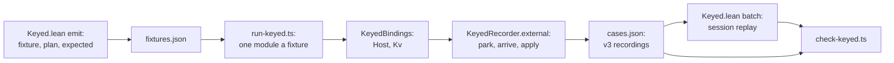

# Probe: the nine HC-2 host fixtures move to the keyed lane (2026-10-12)

Backlog item B1 (`docs/research/2026-10-12-probe-backlog-queue.md`). This is a read-only probe at
`f61184319` on `refactor/phase1-phase3`. It plans option (b) of decisions row 343 (8): the truth
lane's nine host fixtures move to the keyed lane. No Lean was built. Two host probes ran on the
pinned rc.112 under bun, from the session's scratchpad.

## Know this first

- **The exits already agree.** All nine settle with rc.112's exit in the truth lane today.
  `signedHostPark` (`harness/truth/run-truth.ts`) signs the schedule and the sync entry only.
  The move gains exactness. It gains no new exit comparison.
- **The exactness gained is real.** In the keyed lane rc.112 answers all 27 calls of the nine.
  Lean's session then replays those answers. Today Lean reads 5 of the 27 answers from
  `Truth.lean` itself: `acquireHandleAnswers` and the two answers of `L.first` in `hostInputs`.
  The legacy tapes record each request, and `tapeAnswer` never reads it (DI-58). The keyed
  recorder refuses a call whose row or request differs from Lean's plan.
- **A host prototype ran all nine under parked calls.** It used `KeyedRecorder` as it is, with
  prototype bindings. Every call matched a written plan, on one runtime fiber, and every
  recording finished with no pending reply. Eight exits equal the truth lane's exits.
  `pSqlOrDie` dies with the pair `["UnknownError", "no such table: missing"]`. Neither face's
  keyed exit writer has that case today.
- **One new Lean module builds, and nothing else.** The nine programs live in
  `harness/truth/Truth.lean`, a script that `Keyed.lean` cannot import. They move to a new
  leaf module, `Test/Api/HostFixtures.lean`. No core, law or battery module rebuilds.
- **The pin of the four fixture families holds.** `CASES_SHA256`
  (`scripts/check-host-protocol.py`) digests the whole `cases.json`. The plan digests the four
  families' entries only. Python's `json.dumps` with `separators=(',', ':')` and
  `ensure_ascii=False` writes the file byte for byte, so the pin `dca8595e…` stays.
- **Retiring HC-2 drops one check.** `signedHostPark` compares each schedule after it removes
  one park, resume and start per call. The keyed lane compares no schedule. After the move no lane
  compares the nine's schedules. The ruled option (b) carries this cost, which the ruling does not name; the receipt names it.
- **Recommendation.** Land K1 (the keyed lane runs the nine), then K2 (the truth lane retires
  HC-2), in one sitting. Keep the six legacy tapes as host-only pins in K2. A later K3 retires
  them with the release lane's tape comparison.

## 1. The nine fixtures

Each is signed `HC-2` today, and `scripts/check-truth.py` requires exactly these nine. Each runs
on one fiber on both faces (`harness/truth/corpus.json`, `harness/truth/result.json`). Each is
admitted at its table: `Test.Api.HostList.run` admits before it runs, and it ran all nine.

| Fixture | Table | Calls, in order | Lean's answers today | rc.112's exit | What the keyed lane needs |
| --- | --- | --- | --- | --- | --- |
| `pAcquireHandle` | `acquireHandleTable` | `Host.acquire`, `Host.close` (the release), `Host.read` | written in `Truth.lean` (`acquireHandleAnswers`) | `[{"handle":0}, 1]` | a resource binding; `Host.close` is row 1 here and row 2 of the stream table |
| `pSqlite` | `Packages.sqliteBun` | `Sql.open`, three `unsafe`, `Sql.close` | tape `pSqlite.jsonl` | `[[["a","7"], ["b","\"x\""]]]` | a SQL binding and a finite statement model |
| `pKv` | `Packages.keyValueStoreMemory` | `Kv.make`, `set`, `get`, `has`, `remove` | tape `pKv.jsonl` | `[{"some":"1"}, true]` | `has` and `remove` on `RecordedKv`; a store model |
| `pSqlFail` | `Packages.sqliteBun` | `Sql.open`, `unsafe` (fails), `Sql.close` | tape | fail with the pair | the SQL binding |
| `pSqlCatch` | `Packages.sqliteBun` | as `pSqlFail` | tape | `"recovered"` | the SQL binding |
| `pSqlExit` | `Packages.sqliteBun` | as `pSqlFail` | tape | the failed exit, reified | the SQL binding; the nested exit has no annotations (measured) |
| `pSqlOrDie` | `Packages.sqliteBun` | as `pSqlFail`, inside a layer's build | tape | die with the pair | the SQL binding; a die pair in both exit writers |
| `pJoinedFirstNumber` | the runtime instance of `joinedFirstTable` (`fixtureRuntimeTable`) | `L.first` | written in `Truth.lean` (`hostInputs`) | `{"some":1}` | an `L` binding; the typed print `L.first<number \| string>`; the instance table in the session |
| `pJoinedFirstString` | as above | `L.first` | written in `Truth.lean` | `{"some":"negative"}` | as above |

The pair is `["UnknownError", "no such table: missing"]`. The calls total 27. `pAcquireHandle`
makes 3, `pSqlite` and `pKv` make 5 each, and the four SQL error fixtures make 3 each. Each
`pJoinedFirst*` makes 1.

## 2. How the keyed lane binds a service today



- **Lean plans each fixture.** `fixture` (`harness/truth/session/Keyed.lean`) names a program
  and a table. `emitFixture` admits the program and prints it with `Api.print`. `plan` runs the
  session and answers each call from `modelReply`, an independent finite model. The plan lists
  each call (`callId`, fiber, token, row, request) and the model's completion. `expected` is the
  model's exit.
- **The runner writes one module a fixture.** `run-keyed.ts` writes
  `export const build = ({Host, Kv}: KeyedBindings) => <expression>`. Its imports are `Effect`,
  `Fiber`, `Ref` and `pair`.
- **A binding wraps rc.112's own operation.** It calls `KeyedRecorder.external(row, request,
  work)`, and the call parks in `Effect.callback`. The recorder refuses a call whose row or
  request differs from the plan's next call. It holds runtime fibers to machine fibers one to one.
- **The runner answers each call in two acts.** `arrive` runs the operation
  (`Effect.runPromiseExit`) and records the reply. `apply` resumes the parked fiber. The reply of
  an allocation row is the handle's index. The recorder tests "allocation" by fixture name today.
- **Three checks compare.** The runner requires rc.112's exit to equal `expected`. Lean's `batch`
  replays each recording. `check-keyed.ts` requires every record accepted, the host's exit, no
  pending reply, no open call and the exact application order.
- **The bindings hold rows as numbers.** `Host` holds `wait` (row 0 of the scalar table) and
  `open`, `pull`, `close` (rows 0 to 2 of the stream table). `Kv` holds `make`. Its store,
  `RecordedKv`, holds `get` (row 1) and `set` (row 2).
- **One pin.** `CASES_SHA256` digests `cases.json`, the recordings of `two`, `shared`, `kv`,
  `concurrentStreams` and the 48 stream fixtures.

## 3. The new declarations

### 3.1 The shared module (Lean, new): `Test/Api/HostFixtures.lean`

- Namespace `Test.Api.HostFixtures`. Imports `Effect4.Api` and `Test.Program.BoundsControls`.
  `Truth.lean` already imports both, so both are built wherever `check-truth` ran.
- Move these definitions from `harness/truth/Truth.lean`, unchanged, with the guards beside them:
  - the resource fixture: `acquireHandleTable`, `pAcquireHandle`;
  - W1's fixtures: `joinedFirstTable`, `joinedCall`, `joinedFirstInput`, `joinedFirst`;
  - W1's programs and instance: `pJoinedFirstNumber`, `pJoinedFirstString`, `fixtureRuntimeTable`;
  - the package helpers: `strs`, `pairT`, `sqlMissing`, `sqlClient`, `kSql`, `sqliteFixtures`;
  - the package programs: `pSqlite`, `pKv`, `pSqlFail`, `pSqlCatch`, `pSqlExit`, `pSqlOrDie`.
- Add the one list that both lanes read:

```lean
/-- The truth lane's host fixtures whose runs the keyed lane compares (decisions row 343 (8),
option (b)): each name, program and typing table. -/
def keyed : List (String × Api.Program × RowTable) :=
  [ ("pAcquireHandle", pAcquireHandle, acquireHandleTable)
  , ("pSqlite", pSqlite, Packages.sqliteBun), ("pKv", pKv, Packages.keyValueStoreMemory)
  , ("pSqlFail", pSqlFail, Packages.sqliteBun), ("pSqlCatch", pSqlCatch, Packages.sqliteBun)
  , ("pSqlExit", pSqlExit, Packages.sqliteBun), ("pSqlOrDie", pSqlOrDie, Packages.sqliteBun)
  , ("pJoinedFirstNumber", pJoinedFirstNumber, joinedFirstTable)
  , ("pJoinedFirstString", pJoinedFirstString, joinedFirstTable) ]
```

- In `Truth.lean`, import the module and `open Test.Api.HostFixtures` inside `OCaml5.Truth`.
  Delete each moved definition. `hostInputs`, `acquireHandleAnswers`, `joinedModify` and the
  corpus list stay. Move each definition; a copy left in both files makes every use ambiguous.
- In `Test/All.lean`, add `import Test.Api.HostFixtures` beside `Test.Api.HostSessionContract`.

### 3.2 `harness/truth/session/Keyed.lean`

- Import `Test.Api.HostFixtures` and `Effect4.Codegen.PrintTyped`. Name the fixtures with their
  namespace (`HostFixtures.pSqlite`); an `open` beside `KeyedTool.pair` invites ambiguity.
- Add `inductive Model | scalar | kv | stream | sql | resource | first` in `KeyedTool`.
- `Fixture` gains `model : Model := .stream` and `typedAt : Option RowTable := none`. Rewrite
  the anonymous constructors in `fixture` as structure instances, which take the defaults.
- `fixture`: `two` and `shared` take `.scalar`, and `kv` takes `.kv`. A name of
  `HostFixtures.keyed` takes its program and typing table, and its model by table: `sqliteBun`
  is `.sql`, `keyValueStoreMemory` is `.kv`, `acquireHandleTable` is `.resource`. The two
  `pJoinedFirst*` take `.first`, the table `HostFixtures.fixtureRuntimeTable name p table`
  (refuse `none`), and `typedAt := some table`.
- `ModelState` gains `minted : Nat := 0`, `store : List (String × String) := []`,
  `rows : List Val := []` and `released : Bool := false`.
- `modelReply` dispatches on `f.model`. The current body becomes the `.stream` arm, without its
  two table tests. The `.kv` arm becomes a store, and the `kv` fixture's answers do not change.
- `reasonJson` gains `| .die (.error (.tagged tag msg)) _ => Json.mkObj [("die", toJson [tag, msg])]`.
  `decodeReason` gains its inverse: a `die` of two strings reads as `.die (.error (.tagged a b))`.
- `emitFixture` prints with `Program.printTyped (nativeSignature typing) [] f.program` when
  `f.typedAt = some typing`, and with `Api.print f.program f.table` otherwise. The typed print
  is the one that the truth lane's `joinedOutput` makes, so the expression is the corpus's `expr`.
- `main`'s `emit` list appends `HostFixtures.keyed.map (·.1)` after the streams, so the first 57
  cases keep their order.

A sketch of the new arms (not compiled):

```lean
def sqlReply (s : ModelState) (text : String) (params : List Val) :
    Except String (Answer × ModelState) := do
  let ok (v : Val) (t : ModelState) : Answer × ModelState := (.ofExit (.success v), t)
  if text = "CREATE TABLE t (a INTEGER, b TEXT)" then return ok (.list []) s
  if text = "INSERT INTO t (a, b) VALUES (?, ?)" then
    let [a, b] := params | throw "unexpected insert parameters"
    return ok (.list []) { s with rows := s.rows ++ [.list [.list [.str "a", a], .list [.str "b", b]]] }
  if text = "SELECT a, b FROM t" then return ok (.list s.rows) s
  if text = "SELECT a FROM missing" then
    return (.ofExit (.failure (Cause.fail (.tagged "UnknownError" "no such table: missing"))), s)
  throw "a statement outside the finite SQL model"

-- in modelReply, with `mint` answering `.nat s.minted` and counting it:
  | .scalar, _, request => return ok request s
  | .kv, .external 0, _ => return mint
  | .kv, .external 1, .list [_, .str k] => return ok (match s.store.lookup k with
      | some v => .some (.str v) | none => .none) s
  | .kv, .external 2, .list [_, .list [.str k, .str v]] =>
      return ok .unit { s with store := (k, v) :: s.store.filter (·.1 ≠ k) }
  | .kv, .external 3, .list [_, .str k] => return ok .unit { s with store := s.store.filter (·.1 ≠ k) }
  | .kv, .external 4, .list [_, .str k] => return ok (.bool (s.store.lookup k).isSome) s
  | .sql, .external 0, .str ":memory:" => return mint
  | .sql, .external 1, .list [_, .list [.str text, .list params]] => sqlReply s text params
  | .sql, .external 2, _ => return ok .unit s
  | .resource, .external 0, _ => return mint
  | .resource, .external 1, _ => return ok .unit { s with released := true }
  | .resource, .external 2, _ => return ok (.nat (if s.released then 1 else 0)) s
  | .first, .external 0, .list vs => return ok (match vs with | [] => .none | v :: _ => .some v) s
  | .stream, _, _ => streamReply f s bound
  | _, _, _ => throw "unexpected model request"
```

The SQL model holds each cell's text equal to its parameter's text. That holds for canonical
JSON parameters: the host binds `JSON.parse(p)` and crosses each cell as `JSON.stringify(cell)`.

### 3.3 `harness/truth/session/keyed-recorder.ts`

```ts
/** The row of the fixture's table that a binding spells. */
rowOf(spelling: string): number {
  const row = this.fixture.table.findIndex(entry => (entry as { spelling?: unknown }).spelling === spelling)
  if (row < 0) throw Error(`${this.fixture.name}: no row is spelled ${spelling}`)
  return row
}
/** Whether a row answers a handle: its reply is the handle's allocation index. */
allocates(row: number): boolean {
  return (this.fixture.table[row] as { answer?: { _tag?: unknown } } | undefined)?.answer?._tag === "handle"
}
```

- `arrive`: replace the test by fixture name with `this.allocates(waiting.call.row)`. The four
  families' bytes stay: `kv` and the streams allocate at row 0, and `two` and `shared` never do.
- `exitJson`: a die whose defect is two strings writes `{ die: [a, b] }`. Any other non-scalar
  defect still throws.

### 3.4 `harness/truth/session/keyed-bindings.ts`

The new bindings wrap the truth prelude's own adapters (`harness/truth/prelude.ts`): one
package call, one parameter decoding and one error projection (`toPair`) serve both lanes.

```ts
import * as Prelude from "../prelude.ts"
export class RecordedResource implements ExternalHandle {
  constructor(readonly session: string, readonly index: number, readonly inner: Prelude.HostResource) {}
}
export class RecordedSql implements ExternalHandle {
  readonly session: string
  closes = 0
  constructor(private readonly recorder: KeyedRecorder, readonly index: number, readonly inner: Prelude.SqlHandle) {
    this.session = recorder.session
  }
  unsafe(text: string, params: ReadonlyArray<string>) {
    return this.recorder.external(this.recorder.rowOf("unsafe"), [{ handle: this.index }, [text, [...params]]],
      this.inner.unsafe(text, params))
  }
}
// In KeyedBindings. `minted` is the machine's allocation index: one count over the handles of a run.
private minted = 0
readonly sql: RecordedSql[] = []
// Host gains two members, and `close` takes either handle:
acquire: () => this.recorder.external(this.recorder.rowOf("Host.acquire"), null,
  Effect.map(Prelude.Host.acquire(), inner => new RecordedResource(this.recorder.session, this.minted++, inner))),
read: (resource: RecordedResource) =>
  this.recorder.external(this.recorder.rowOf("Host.read"), { handle: resource.index }, Prelude.Host.read(resource.inner)),
close: (resource: StreamHandle | RecordedResource) => resource instanceof RecordedResource
  ? this.recorder.external(this.recorder.rowOf("Host.close"), { handle: resource.index }, Prelude.Host.close(resource.inner))
  : /* the stream close of today, at this.recorder.rowOf("Host.close") */,
readonly Sql = {
  open: (filename: string) => this.recorder.external(this.recorder.rowOf("Sql.open"), filename,
    Effect.map(Prelude.Sql.open(filename), inner => {
      const handle = new RecordedSql(this.recorder, this.minted++, inner)
      this.sql.push(handle)
      return handle
    })),
  close: (handle: RecordedSql) => this.recorder.external(this.recorder.rowOf("Sql.close"), { handle: handle.index },
    Effect.suspend(() => { handle.closes++; return Prelude.Sql.close(handle.inner) }))
}
readonly L = {
  first: <A>(xs: ReadonlyArray<A>): Effect.Effect<Option.Option<A>> =>
    this.recorder.external(this.recorder.rowOf("L.first"), valueJson(xs), Prelude.L.first(xs))
}
```

- `RecordedKv` gains `remove` and `has`, each with the request `[{ handle: this.index }, key]`
  and the error projection of `get`. Take their rows by `rowOf("remove")` and `rowOf("has")`.
- `Kv.make` takes `this.minted++` in place of the constant index 0. The `kv` fixture's bytes do
  not move, since it mints one store.
- Streams keep `this.resources.length` as their index. No fixture mixes a stream with another
  handle kind; state that in the class's comment.
- `dispose` closes the scope of each `RecordedSql` that a failed run left open.

### 3.5 `harness/truth/session/run-keyed.ts`

- The header takes its names from the truth lane's lists: `effectNames`
  (`harness/truth/module-imports.ts`) from `effect`, and `atomNames` (`ts/eff/profile.gen.ts`)
  from the prelude. The parameter becomes `({ Host, Kv, Sql, L }: KeyedBindings)`. The tsconfig
  sets no `noUnusedLocals`, so an unused import is no error.
- `allocation` in the arrival loop becomes `recorder.allocates(call.row)`, per call.
- Orders: run `BA` only when some planned call is made by a fiber other than 0. This reproduces
  today's orders: the streams run `AB` alone, and the four forking fixtures run both. The nine
  run `AB` alone, since each has one call outstanding at a time.
- After `recorder.finish()`, compare each reply with the model, by `callId`:

```ts
const planned = new Map(fixture.plan.flatMap(entry => "answerFor" in entry ? [[entry.answerFor, entry.completion] as const] : []))
for (const record of recording.records) if (record.kind === "reply")
  deepStrictEqual(record.completion, planned.get(record.callId as number),
    `${name}: rc.112's reply to call ${record.callId} versus the finite Lean model`)
```

- Require each `RecordedSql` closed once, as the streams are today.

The per-reply check covers every non-scripted fixture. A failure on one of the four families is
a finding. The stream or store model then differs from rc.112 at a reply that the exit hides. Report
it, and only then narrow the check to the nine.

### 3.6 `scripts/check-host-protocol.py`

```python
SCENARIOS = [..., 'Tools.ProfileJson', 'Test.Api.HostFixtures']
FAMILIES = ('two', 'shared', 'kv', 'concurrentStreams')
# ...
cases = json.loads((host / 'cases.json').read_bytes())
pinned = [case for case in cases if case['recording']['header']['program'] in FAMILIES
          or case['recording']['header']['program'].startswith('stream-')]
digest = hashlib.sha256((json.dumps(pinned, separators=(',', ':'), ensure_ascii=False) + '\n')
                        .encode()).hexdigest()
```

`SCENARIOS` feeds both `lake build` and `native_libraries`. The comment above the pin names the
four families' entries, not the file.

### 3.7 Red controls: `harness/truth/session/prepare-keyed-controls.ts`

Four refusals, each on a fresh recording of the nine:

| Control | Recording | Mutation | Why Lean must refuse |
| --- | --- | --- | --- |
| `allocation-index` | `pAcquireHandle-AB` | the first reply becomes `{"success":1}` | `externalValue` admits only the next allocation index |
| `instance-answer` | `pJoinedFirstNumber-AB` | the reply becomes `{"success":{"some":true}}` | a Boolean is outside `option (union nat string)` |
| `sql-rows` | `pSqlite-AB` | the `SELECT` reply becomes `{"success":[["a","7"]]}` | a cell is not a `(column, cell)` pair |
| `kv-has` | `pKv-AB` | the `has` reply becomes `{"success":"yes"}` | the column is `bool` |

## 4. What changes in `check-truth`, and what rebuilds

**K1 changes nothing in `scripts/check-truth.py`.** `Truth.lean` loses definitions and gains an
import. `corpus.json`, `result.json`, `result.md`, the generated modules and the tapes must stay
byte for byte: the existing drift checks are the regression test of the move. The lane's tsgo
step also type-checks `harness/truth/session/*.ts`, so it sees the new bindings.

**K2 retires HC-2 in the truth lane.**

- `Truth.lean`: `entry` writes `("keyed", true)`, `"run": null` and `"runSync": null` for a name
  of `HostFixtures.keyed`. The other entries keep their bytes. `fixtureRun` loses its list-host
  branch, and the import of `Test.Api.HostList` goes. `hostInputs` keeps the table and loses
  the answers, with `acquireHandleAnswers` and `exitsOf`. `readTapes`, `tapeAnswer`,
  `tapeAnswers`, their guards and the `--tapes` argument go. Guards that run the nine through
  `hostInputs` skip them. The manifest's `regenerate` text loses `--tapes`.
- `run-truth.ts`: `Entry` gains `keyed?: true`, and `run` and `runSync` become nullable. A keyed
  entry still writes its module and runs both host entries, so its tape, the widening controls
  and the target lane keep their inputs. It compares nothing: its row carries `keyed: true`,
  three `null` verdicts and a note that names the keyed lane. Delete `HOST_PARK_SIGNED`,
  `withoutParks`, `signedHostPark`, the ten `host park` controls and `"HC-2"` in `Row`. The
  summary counts the keyed rows apart from the signed ones.
- `scripts/check-truth.py`: replace the HC-2 block. Refuse any row with `exception == 'HC-2'`.
  Require the rows marked `keyed` to equal the manifest's keyed entries, nonempty, each with
  `run` null. Drop `'--tapes', str(tapes)` from the `Truth.lean` call. The tape drift check stays.
- `Makefile`: drop `--tapes harness/truth/tapes` from the `$(GEN)/truth` recipe's Lean line.
- `make gen-truth` rewrites `corpus.json`, `result.json` and `result.md`. The generated modules
  and the tapes do not move.

| Step | Lean modules built | Scripts that the gates elaborate | Gates owed by reach |
| --- | --- | --- | --- |
| K1 | `Test.Api.HostFixtures` (new, one module) | `Keyed.lean` (six runs in `check-host-protocol`), `Truth.lean` | `check-host-protocol`, `check-truth` |
| K2 | none | `Truth.lean` | `check-truth` after `gen-truth`; `check-target` and `check-ts-reader` (their inputs `corpus.json` and `result.json` move); `check-corpus` (it runs `run-truth.ts`) |

- `Test/All.lean` gains one import and is not built in the slice. The module-closure gate reads
  it at the next sweep.
- The new file under `Test/` stales every `make` marker keyed on `$(LEAN_INPUTS)`. The runs owed
  are the ones the change reaches, listed above.
- Audit the new module with `#axiom_audit Test.Api.HostFixtures`. It holds no theorem.
- The release lane (`scripts/check-truth-release.py`) is no `check-full` gate. Its ledger reads
  the keyed rows' `null` verdicts as `n/a` (`scripts/lib/truth_ledger.py`), and its committed
  ledger then differs: re-promote it with `make gen-truth-ledger` at a sweep.

## 5. Risks, and how the comparison stays exact

- **SQLite file paths: none.** Every fixture opens `":memory:"`, so no path enters a request or
  a reply. Each `Sql.open` makes a fresh database, and no state crosses runs. A later fixture
  with a file must take a path relative to the run's folder.
- **SQLite's version.** On this Mac bun loads the system library, version 3.51.0 (measured). The
  message `no such table: missing` and the column order are stable across 3.x. A change fails
  loudly at the model's `expected` and at the per-reply check; the model is the one place to edit.
- **No timing enters.** None of the nine sleeps. The program's fiber runs under
  `Rc112ClockBoundary` as today. Each operation runs in its own `Effect.runPromiseExit`, outside
  the boundary, and `bun:sqlite` answers synchronously.
- **Finalizers on the root.** rc.112 runs each release on the root fiber: the prototype saw one
  runtime fiber a run. A release on another fiber fails loudly: "fiber association is not bijective".
- **Allocation indices.** Each run mints at most one handle, and `minted` counts per run.
  `externalValue` (`src/Effect4/Program/Compile.lean`) admits only the index that equals the
  allocations so far.
- **The tape seam is shared.** The prelude's adapters post to a process-global sink that only
  `run-truth.ts` installs. In the keyed lane the sink is `null`.
- **Arrival orders.** The nine run `AB` alone. A `BA` run of one fiber replays the same records.
- **The joined two run at a finite instance.** The session runs at `fixtureRuntimeTable`'s
  instance, as the truth lane's list host does. That adapter states no substitution law.

What the keyed lane compares, each exactly:

1. Each call's row, request and fiber against Lean's plan, at the call (`KeyedRecorder.external`).
2. rc.112's exit against the model's `expected` (`run-keyed.ts`).
3. Each reply against the model's planned completion, by `callId` (new, section 3.5).
4. Lean's replay of rc.112's recording: every record accepted, the host's exit, no pending
   reply, no open call, and the exact application order (`check-keyed.ts`).
5. The four new refusal controls and the existing ones (section 3.7).

It compares no schedule and no sync entry. Its evidence is tested: finite host runs on one
fiber, rc.112 on bun 1.4.2. No theorem is established, and no registry claim moves. The related
planned statement is DI-57's `session_eq_ref`; this lane is no instance of it.

## 6. Is it worth it?

Yes for K1, and K2 as ruled.

- **For.** Five of the 27 answers stop being written by hand in `Truth.lean`. All 27 calls gain
  the row and request check that DI-58 asks for. The keyed lane gains both canonical package
  tables, all eight rows, a handle that outlives its scope, a layer's failed build and UNGUARD
  W1's instance. The truth driver stops reading the list host (DI-23's owed order). The truth
  lane keeps one signed divergence, U-01, and loses about 100 lines of HC-2 code and ten controls.
- **Against.** No exit outcome changes: the exits agree today. The schedules of the nine lose
  their comparison modulo parks. The six legacy tapes stay as host-only pins until K3.
- **Size.** K1 is about 350 lines over nine files, one new module and no rebuild cascade. K2
  deletes about 200 lines and adds about 40. One seat lands both in one sitting.
- **Order.** It ranks where the backlog put it: after A1 (`scripts/status.py`).

## The seat's order of work

1. Start a worktree from the coordinator's base, and clone the packages copy-on-write.
2. Create `Test/Api/HostFixtures.lean` and move the definitions. Build it alone.
3. Edit `Truth.lean` and `Test/All.lean`. Run `make check-truth`; require no artifact to move.
4. Edit `Keyed.lean`. Run `lake env lean --run harness/truth/session/Keyed.lean emit`.
5. Read the nine plans and `expected` values in that output. Compare them with section 1.
6. Edit the four TypeScript files and `check-host-protocol.py`. Run `make check-host-protocol`.
7. Run `#axiom_audit Test.Api.HostFixtures`. Commit K1 by explicit paths.
8. Edit for K2. Run `make gen-truth`, then `check-truth`, `check-target`, `check-ts-reader` and `check-corpus`.
9. Commit K2. Write the receipt; propose the text of row 343 (8) and DI-23.

## How this was measured

| Command | Result |
| --- | --- |
| `git rev-parse --short=9 HEAD` | `f61184319` |
| a read of `harness/truth/result.json` | `PASS: 81 programs agree on exits, schedules and sync exits; 10 signed divergence(s)`; effect 4.0.0-rc.112, bun 1.4.2; the nine rows `HC-2`, exits agreeing, schedules not |
| a read of `harness/truth/corpus.json` | each of the nine on one fiber, each with an `expr` |
| `python3 -I` over `harness/truth/session/.work/latest/host/cases.json` (the run of 2026-10-10) | 57 cases; the file's digest is the pin; `json.dumps` with the two options writes it byte for byte |
| `bun run` of a scratchpad probe: the nine's SQL shapes on the pinned rc.112 | effect 4.0.0-rc.112, bun 1.4.2, SQLite 3.51.0; the nested exit of `pSqlExit` has no annotations; `pSqlOrDie` dies with the pair as a two-string array |
| `bun run` of a scratchpad prototype of section 3.4 over `KeyedRecorder` | nine runs; every call matched a written plan; one runtime fiber a run; `finish` passed; eight exits equal the truth lane's; `exitJson` throws on `pSqlOrDie`'s defect |

Both probes are finite probes of the host side. The prototype's plans were written by hand with
tokens equal to call numbers, and Lean's replay did not run. The admission of each fixture is
read from the truth lane's list host, which admits before it runs; no `start` ran here.
