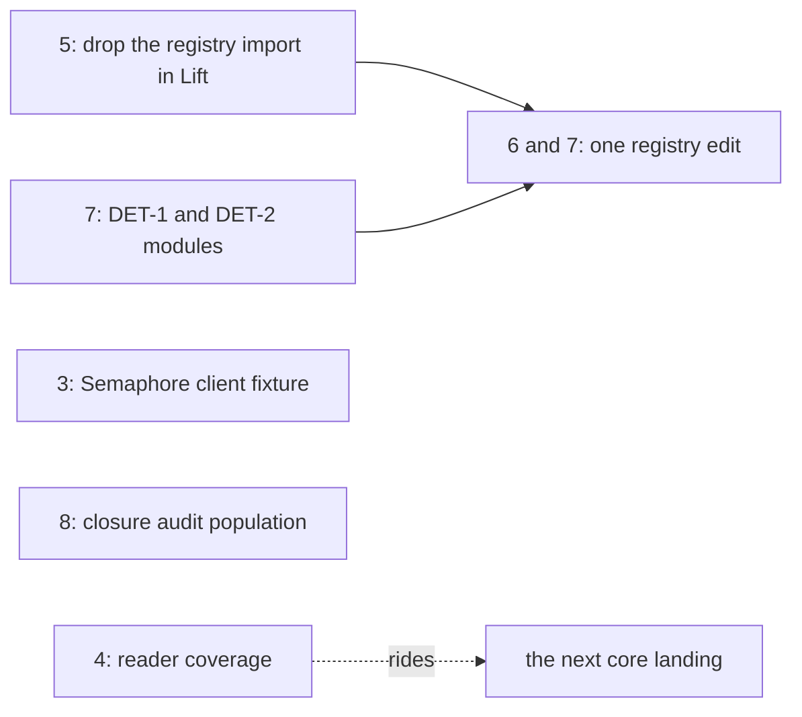

# Backlog queue: the open asks of the 2026-10-10 reviews and the 2026-10-11 receipts (2026-10-12)

Status: research note (history, not authority). A read-only scout at `6ddf148f4` on
`refactor/phase1-phase3`. No `lake` ran, nothing was built, and nothing was committed.

Scope: the 2026-10-10 reviews and notes, the goals packet
(`docs/research/2026-10-10-goals-packet/`), and the 2026-10-11 Codex and timeout receipts. Out of
scope: `2026-10-11-machine-models` and the other 2026-10-11 design notes. Also out: the restore
slot, the typed context, the release merge, the proof-style ratchet, and the `Scope.close` and
failure-walk slice.
This note repeats nothing that `2026-10-12-probe-backlog-queue.md` or
`2026-10-12-probe-alignment-plans.md` holds. Those cover the HC-2 fixtures (B1), the open planned
goals (B2 and the goal table) and seat FC's two rulings (B3, B8).

## Know this first

- **Most asks landed.** About forty asks were checked against HEAD. Eleven stay open, beside one
  large tracked line (item 12). Two need no Lean build (D1, D2); one is a document lag (D3).
- **The truth runner passes a service client that never ran** (`CO6B-CLIENT`). An entry with a
  `client` and no printable module gets no `clientAgree`, so the runner exits zero. One line of
  TypeScript repairs it (D1). The full `check-truth` still catches the case by its artifact
  comparison, so this is a standalone-runner gap.
- **Three Make rules ignore the build pins** (`BUILD-PINS`). The corpus trace, the engine fixtures
  and the proof-style marker list `$(LEAN_SOURCES)` without `$(BUILD_PINS)`. A toolchain or package
  bump can reuse output of the previous compiler (D2). The review named two rules; this scout found
  the engine fixtures' rule too.
- **Two of Codex's five service findings stay open** (`CO6B-ALIASES`, `CO6B-SEMAPHORE-CAPTURE`).
  `docs/STATE.md` says "Codex's three service findings repaired", which is true, and names neither
  open one (D3).
- **One unused import makes every semantics registry edit rebuild 24 extra modules.**
  `src/Effect4/Laws/Program/ReleaseCustody/Lift.lean` imports `ProofGraph.Registry` and names
  nothing from it. The semantics registry's reverse import closure is 105 modules; without that edge it is
  81. Cut it before the next claim placement (items 5 to 7).
- **The 2026-10-11 timeout and Codex receipts are landed or in the goals lane.** Their root
  imports are in `Test/All.lean`. Rows 351 and 352 record the timeout ruling and the first-exit
  race. The R2 messages landed, and `E4-RUN-CE-046` is REPAIRED. Their open proofs are the planned
  goals the backlog queue already lists.

## Ranked table

Impact names the owner's two tests first: an outcome of a real run, then the proof graph. Rebuild
counts are reverse import closures over `src/`, `Test/`, `tools/` and `harness/`, measured by a
header scan (see the last section).

| # | Item | The ask (quote, path) | Evidence it is open at HEAD | Impact | Cost (files; Lean build) | Ruling |
| --- | --- | --- | --- | --- | --- | --- |
| 1 | `CO6B-CLIENT`: the runner passes a client that never ran | "reject a client-bearing entry when no module can run." (`2026-10-10-service-client-overwatch/README.md`) | In `harness/truth/run-truth.ts`, the branch where `moduleFor(entry)` is `null` pushes a row with no `clientAgree`. The disagreement filter counts only `clientAgree === false`. | Release readiness: a gate run can report agreement for a client it never executed | `harness/truth/run-truth.ts`, one line; **no Lean**; reaches `check-truth` | none |
| 2 | `BUILD-PINS`: three rules ignore `lean-toolchain`, `lakefile.toml`, `lake-manifest.json` | "use `LEAN_INPUTS` for `CORPUS_TRACE`, and add `BUILD_PINS` to the proof-style marker." (`2026-10-10-service-client-overwatch/README.md`) | `Makefile`: `$(CORPUS_TRACE): $(LEAN_SOURCES) …`, `$(GEN)/fixtures: … $(LEAN_SOURCES) scripts/generate.py`, `$(CHK)/proof-style: $(filter src/Effect4/%,$(LEAN_SOURCES)) …`. `LEAN_INPUTS` already exists beside `LEAN_SOURCES`. | Release readiness: after a pin bump, `check-corpus`, the `ts-reader` and `ingest` lanes and the OCaml engine fixtures can judge old output | `Makefile`, three prerequisites; **no Lean** | none; the proof-style line sits in the excluded ratchet slice, so its owner may defer it |
| 3 | `CO6B-SEMAPHORE-CAPTURE`: the Semaphore client cannot tell shared state from fresh state | "The smallest production change strengthens `semaphoreProgram` in `Test/Codegen/ServicesPrint.lean`." (`2026-10-10-service-repair-overwatch/README.md`) | `semaphoreModule` (`Test/Codegen/ServicesPrint.lean`) and `semaphoreServiceClient` (`harness/truth/Truth.lean`) still call `take(1)`, `takeIfAvailable(5)`, `release(1)`. `harness/truth/result.md` reads `success [1,false,2]`. | Runtime outcome evidence: the one Semaphore service comparison accepts an implementation that gives each method fresh state | `Test/Codegen/ServicesPrint.lean` (3 importers), `harness/truth/Truth.lean`; narrow build, then regenerate truth (and target, corpus rows naming `pSemaphoreService`) | none |
| 4 | `CO6B-ALIASES`: the reader drops a second method of one definition | "The smallest repair checks all service information before accepting reconstruction." (`2026-10-10-service-repair-overwatch/README.md`) | `roleOf` (`src/Effect4/Codegen/Read.lean`) takes the first method a definition names. `serviceInfo` lives only in `src/Effect4/Laws/Codegen/Services.lean`; no core comparison exists. | Runtime outcome: a module tsgo accepts and rc.112 runs loses an exported method after `readModule`; R5 | `src/Effect4/Codegen/Read.lean` and a core copy of `serviceInfo`; about 750 modules rebuild, so ride the next core landing | coordinator: place the proposed reader-coverage claim (`exact-codecs`, R5) first |
| 5 | The unused `import ProofGraph.Registry` in `ReleaseCustody/Lift.lean` | none: found by this scout, under build-overwatch's dependency-scope finding | `Lift.lean` names nothing from the registry, and its other imports reach `Effect4.Laws.Auto.Semantics`. No module the edge pulls in names a registry declaration. | Hygiene, build time: 20 release-custody law modules and 4 batteries leave every registry edit's rebuild | one line; a one-time rebuild of `Lift` and its 38 importers | none |
| 6 | `keys-once`: a proved law without its claim | "The coordinator places the proposed `keys-once` property and registry claim." (`2026-10-11-host-goals-receipt.md`) | No `id := "keys-once"` in `tools/ProofGraph/Registry.lean`; no property in `docs/core/semantics.md`. `Effect4.Run.session_keys_once` (`src/Effect4/Laws/Run/Journal.lean`) is proved, placed at R6, and its docstring names the claim. | Proof graph: an R6 preservation law is not counted as a claim | `Registry.lean`, `docs/core/semantics.md`, then `make gen-semantics`; 81 to 105 modules rebuild | coordinator (registry) |
| 7 | DET-1 and DET-2: random descent and its battery | "DET-1 and DET-2 cost hours and change no behaviour; they can land now." (`2026-10-10-schedule-independence/README.md`) | No `src/Effect4/Laws/Machine/Descent.lean`, no `Test/Machine/Runtime/ScheduleIndependence.lean`, no commit naming DET. The probes `probes/RandomDescent.lean` and `probes/Tapes.lean` compile. | Proof graph: the abstract half of DB-03's third determinism route; R12 | two new modules; anchors in `src/Effect4/Laws.lean` (6 importers) and `Test/All.lean`; the claim rides item 6's registry edit | none for DET-1 and DET-2; owner for the third route itself (DET-4 onward) |
| 8 | `CLOSURE-POP`, `CLOSURE-ERASURE`: the closure audit's population and its proof bindings | "give the runtime audit a computational-definition population." (`2026-10-09-report-overwatch/README.md`, carried open by the 2026-10-10 overwatches) | `tools/ProofGraph/ClosureAudit.lean` is unchanged since `294c89cde`. It skips names `isAuxiliary` drops, private names among them. `letsBeforeClosure.bound` records every `letE`, proofs included. | Hygiene: a table built per call in a private definition escapes `#closure_audit`; a proof-only `let` is refused | `ClosureAudit.lean` (one importer, `Test/Audit/ClosureAudit.lean`); tools build | none |
| 9 | The source view refuses an admitted layer reference | "Repair source annotation through an explicit relation to expansion and its lexical context." (`2026-10-10-live-graph-support/README.md`) | Source inspection, not re-run: `Program.Typing.Annotate` checks a raw `.ref` node with `Checker.checkLayer`, which throws `layerReference`; admission expands references first. | Usability: an author sees no type and no marker at a valid reference | theory first (`2026-10-10-live-graph-support/THEORY.md`), then `Annotate` and its laws | none |
| 10 | CX1a's exact parameter bridge for `Part.bodyAt_sig` | "A bridge could identify that list with the scope lookup" (`2026-10-10-cx1a-review/README.md`) | `Part.bodyAt_sig` (`src/Effect4/Laws/Program/Typing/Parts.lean`) still returns an existential parameter list. `spineParams` stands in `src/Effect4/Laws/Program/Typed/Scope.lean`. | Proof graph: consolidation for R14; no consumer waits | one lemma in a new module (editing `Typing/Parts` rebuilds 225) | none |
| 11 | Seat FC's `view-forest-components` | "`view-forest-components`, by the route above." (`2026-10-10-seat-FC-receipt.md`) | Decisions row 345 says it "stays open: no Lean statement exists yet". | Tool law of the view | tools only | none (row 345) |
| 12 | Host meaning beyond straight and looped rows; the packet's proposed claims | "Give `scoped` and `acquireRelease` an independent host meaning" (`2026-10-10-host-meaning-widening/README.md`) | No resource or fork meaning beside `denoteRowsB`. STATE's "Also open" holds row 329's S1 to S4. The packet lists 29 proposed claims that need no ruling. | Runtime outcome for agents' programs that fork, scope or interrupt (R2 C2) | large, many slices | per slice |

Two asks touch history only and are not worth a slice. ML2-OW-02 qualifies the `otherScope` row
of the scope table in `2026-10-10-layer-scopes.md`. DET-OW-01 adds the `Equivalence R` premise to
the summary in `2026-10-10-schedule-independence/README.md`. DET-1's module carries the
premise in its statement, which settles the second.

## Do now, no Lean build

### D1. The runner refuses a client that never ran (item 1)

- **File.** `harness/truth/run-truth.ts`.
- **Change.** In the loop over `manifest.programs`, the branch `if (module === null)` pushes a row
  and continues. Add `...(entry.client === undefined ? {} : { clientAgree: false }),` to that row
  object, before its `notes` field. The review's `runner-repair.patch` holds the same line.
- **Verification.**
  1. Type check under the pinned tsgo, with `GOMAXPROCS=3`:
     `ts/eff/node_modules/.bin/tsgo --noEmit --strict --target es2022 --module esnext
     --moduleResolution bundler --allowImportingTsExtensions --skipLibCheck --types bun
     --typeRoots ts/eff/node_modules/@types harness/truth/run-truth.ts`. Report the version.
  2. A mutation control, after `check-repair.py` in
     `docs/research/2026-10-10-service-client-overwatch/`. Copy `harness/truth/corpus.json` to the
     scratchpad. In the copy, set `decl` and `expr` of `pQueueService` to `null`. Make an `--out`
     directory in the scratchpad with links to `harness/truth/*.ts`, `harness/truth/session` and
     `harness/truth/node_modules`. Run `bun run harness/truth/run-truth.ts --manifest <copy>
     --out <dir> --timeout 100 --only pQueueService`. Expect a nonzero exit and
     `rows[0].clientAgree == false` in `<dir>/result.json`.
  3. The green control: the same run on an unmodified copy exits zero with `clientAgree == true`.
     Read the `effect` field of `result.json`; it must name `4.0.0-rc.112` (the host probe trap).
  4. The coordinator runs `make check-truth` at its sweep. Nothing in the committed artifacts
     changes, because no committed entry takes the branch.

### D2. Three Make rules depend on the build pins (item 2)

- **File.** `Makefile`.
- **Change.**
  - `$(CORPUS_TRACE): $(LEAN_SOURCES) $(wildcard …)` becomes `$(CORPUS_TRACE): $(LEAN_INPUTS) $(wildcard …)`.
  - `$(GEN)/fixtures: … $(LEAN_SOURCES) scripts/generate.py` becomes `… $(LEAN_INPUTS) scripts/generate.py`.
    `generate.py --only fixtures` writes the fixtures from Lean, so the compiler is an input.
  - With the ratchet owner's consent: add `$(BUILD_PINS)` to the prerequisites of `$(CHK)/proof-style`.
- **Caveat for the coordinator.** `CORPUS_TRACE` is Lake's own trace file. After a pin edit that
  changes nothing for `Drivers.Corpus`, Lake leaves the trace alone. Make then reruns the no-op
  `lake build Drivers.Corpus` at each call until Lake rewrites the trace. Make compares the trace's
  time after the recipe, so `$(CORPUS)/index.tsv` should not be regenerated for nothing. Confirm
  that once at a real run.
- **Verification**, dry runs only, after `check-build.py` in
  `docs/research/2026-10-10-build-overwatch/`:
  1. In a scratchpad directory, create empty copies of every path the three rules list. They are the
     `src/` and `Test/` Lean sources, `tools/Tools/*.lean`, `tools/Drivers/*.lean`,
     `tools/TestSupport/*.lean`, `scripts/generate.py`, `ocaml/engine/test/*/*.txt` and their
     writers, the proof-style fixtures and the three pins. Give them an old time.
  2. Copy the edited `Makefile` there. Create the targets `.lake/build/lib/lean/Drivers/Corpus.trace`,
     `.lake/gen/fixtures` and `.lake/check/proof-style` with a newer time.
  3. For each target and each of `lean-toolchain`, `lakefile.toml` and `lake-manifest.json`, run
     `make -n -W <pin> -o .lake/gen/fixtures-inventory -o .lake/check/inventory <target>`.
     Expect the recipe (`lake build Drivers.Corpus`, `generate.py --only fixtures`,
     `Test/Audit/ProofStyle.lean`). With no `-W`, expect none.
  4. The same runs against the HEAD `Makefile` show no recipe under `-W <pin>`: the red control.

### D3. STATE names the two open service findings (items 3 and 4)

- **File.** `docs/STATE.md`, "Next, in order", item 0.
- **Change.** After "Codex's three service findings repaired.", add: "Two later findings stay open
  ([the overwatch](research/2026-10-10-service-repair-overwatch/README.md)). The reader drops an
  aliased service method, and the Semaphore's client cannot tell shared state from fresh state."
  The cited note is tracked.
- **Verification.** `python3 -I scripts/check-docs.py` passes. The coordinator may fold this into
  the backlog queue's A3, which edits the same page.

## Small Lean items, in order

1. **Item 5.** Delete `import ProofGraph.Registry` from
   `src/Effect4/Laws/Program/ReleaseCustody/Lift.lean`. Build `Effect4.Laws.Program.ReleaseCustody.Lift`
   and its importers, then `#axiom_audit` over `Lift`. No statement changes.
2. **Item 7.** Land `probes/RandomDescent.lean` as `src/Effect4/Laws/Machine/Descent.lean`, with all
   three premises (`Equivalence R`, `Bisim step R`, `Diamond step R`). Land `probes/Tapes.lean` as
   `Test/Machine/Runtime/ScheduleIndependence.lean`: finite evaluations and the two red controls.
   The brief (`2026-10-10-schedule-independence/brief.md`) names the files and the connector.
3. **Items 6 and 7, one semantics registry edit.** Add `keys-once` (`host-session-protocol`, preservation,
   pointer `Effect4.Run.session_keys_once`) and `random-descent` (`reactive-scheduling`). Add their
   properties to `docs/core/semantics.md`, then run `make gen-semantics`.
4. **Item 3.** Change `semaphoreModule`'s main and `semaphoreServiceClient` to `take(2)`,
   `takeIfAvailable(1)`, `release(1)`, expecting `[2,false,1]`. Keep the fresh-state negative
   controls of the review's `Controls.lean` as battery controls. Build
   `Test.Codegen.ServicesPrint`, then regenerate the truth lane.
5. **Item 8.** Count private computational definitions in the closure audit, and skip a `letE`
   whose type is a proposition. Keep the review's three same-body controls
   (`ClosureControls.lean`) as red and green cases.

## Checked and landed

| Source | Ask | Evidence at HEAD |
| --- | --- | --- |
| goals packet, timeout receipts | root imports of `HostTimeoutNumberCounted`, `HostTimeoutNumberFlow`, `HostTimeoutNumberFormFamily` | imported in `Test/All.lean`; no `Test` module outside the roots but fixtures |
| goals packet, `codex-goals-receipt.md` | record the timeout ruling; repair the form | decisions rows 351 and 352 (`raceAllFirst` landed, merged at `7c69f880e`) |
| `codex-goals-receipt.md` | claim `run-history` | placed as `run-admitted-history` (`Effect4.Run.reached_history`) |
| `release-once/README.md` | claim `control-linearity` | superseded by `once-placed-finalizer` (backlog B2) |
| `codex-r2-foundation-receipt.md`, `codex-r2-receipt.md` | ordered fiber edit messages; check CE-046 | `b7ba5891a` and the R2 merge `aaab7941c`; `E4-RUN-CE-046` REPAIRED |
| `codex-interference-plan.md` | `LookupEdits` in the native census | `src/Effect4/Laws/Program/Interference.lean`, `ReleaseCustody/NativeStacks.lean` |
| `host-meaning-landing-review` R1, R2, R3 | regenerate the report; split the leaves; fold connection | the four `rows-loop-*` claims in `generated/semantics.md`; `compilesB_of_straightRows` gone; `Laws/Program/Folds/DenoteRowsB.lean` |
| `l4a-frontier-review`, `l4-frontiers.md` | Q4 over the data-row fragment; waiting bridge | `l4-frontiers.md` §6: every node proved |
| `cx-refusal-review` | the refusal summary keeps its detail | `refusalJson` (`tools/Tools/Query.lean`) carries `detail`, `1c98dd948` |
| `cx-layer-context-review`, `cx2-landing-review`, `cx-lexical-review`, `cx1a-review` | choose the cross-scope contract; type points at their scope | decisions row 341: steps 2a, 2b, 3a and 3b landed; `invoke_arm`, `param_arm` proved |
| `ho3-print-review` | HO3-REQ-01, HO3-NAME-01, HO3-SVC-01 | `ccda6d426`, `5e366021f` |
| `seat-3b-receipt.md` | the callback row; registry title; STATE; `let` against `const` | `5e366021f`; `module-defs-round-trip`'s title names step 3b; row 341 keeps `let` |
| `module-layer-landing-review` | ML2-C2-01 | `scripts/lib/conservativity.py` excludes the tag manifest; mutation `defs=99` in `Test/fixtures/conservativity/mutations.json` |
| `module-layer-step2b-review` | ML2B-TRUST-01, ML2B-TEST-01 | no `filter_eq_nil_iff` in `Laws/Codegen/Module.lean`; fixture moved to `moduleLayerProg` |
| `live-view-invalidation-review` | LV-OW-01 | `tools/Tools/View/Inc.lean` computes the waits fresh |
| `live-view` §7 | a compiled live driver | the `view-live` executable in `lakefile.toml` |
| `polarity-overwatch` | POL-MEMBERSHIP, POL-CENSUS, POL-SUFFICIENCY | `4331553da` |
| `openai-math-type-systems` | VAR-1, VAR-2, VAR-3 | its §10; VAR-4 waits for HO-4, VAR-5 for row 124 |
| `build-overwatch` | BUILD-IMPORTS | resolved, per `service-client-overwatch` |
| `service-repair-overwatch` | CO6B-READ, CO6B-NAMES, CO6B-KEYS | closed at `ec08fe86` |
| `seat-HC2-receipt.md`, `seat-FC-receipt.md` | the nine fixtures; FC's rulings | in the backlog queue (B1, B3, B8) and row 345 |

## How this was measured

| Command | Result |
| --- | --- |
| `grep -rn "proof_goal " --include='*.lean' src Test` | the library and scenario goals the backlog lists, and `countdown_parks_positional` (typed context, out of scope) |
| `grep` of `tools/ProofGraph/Registry.lean` for each claim the scoped notes propose | `keys-once`, `schedule-independent` and the MCP note's tool claim `cache-invisible` absent; the rest placed or superseded |
| a header scan of `import` lines over `src/`, `Test/`, `tools/`, `harness/`, closed by reverse reachability | `ProofGraph.Registry` 105 (81 without `Lift`'s edge); `Lift` 38; `Codegen.Read` 752; `Typing.Parts` 225; `Test.Codegen.ServicesPrint` 3 |
| the same scan, forward from `Test.All` and `Test.Slow` | every `Test` module reached except `Test/fixtures/` |
| `make -n -W lean-toolchain` on the corpus trace and the fixtures marker | inconclusive at HEAD: both are already stale without `-W`; hence D2's isolated mirror |
| `git log` on `tools/ProofGraph/ClosureAudit.lean`, `Population.lean`, `scripts/lib/conservativity.py`, `Test/Program/RowPolarity.lean` | as in the tables |
| `git log --oneline e9e199c9d..HEAD` | five commits since the requested base; none touches an item here |

The rebuild counts come from a header scan, not from Lake. Lake's own count can differ where a
module's olean does not change. No item here is evidence of a theorem. The source-view item rests
on source inspection only.
