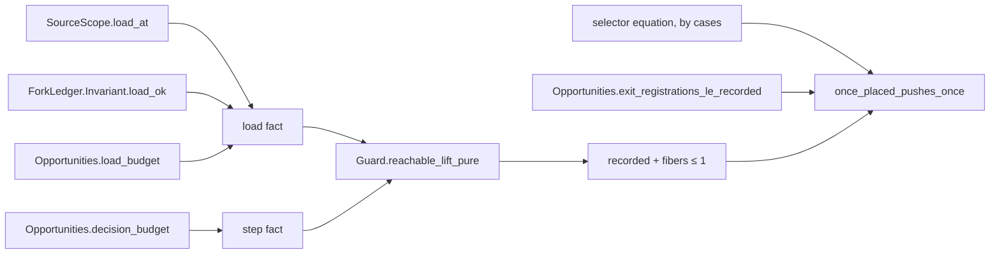

# Probe: `once_placed_pushes_once` over the source census (backlog item B2)

**The one thing to know before ruling.** The restatement does not need a new carrier. It can
keep `Guard.Reachable p table cf m`, raw reachability at any table and compile budget. Only the
premise changes: `OncePlaced (.eff p) q = true` gives way to the five census premises. The reason
is that `SourceScope.Opportunities.decision_budget` takes no admission premise. Its lift is
generic over every decision. The backlog row proposed `Api.Built` and `Run.HistoryOf`. That form
also works, but it is strictly weaker, because `Run.HistoryOf.reachable` maps a history to raw
reachability. The proof is about 30 lines, with no new lemma and no import cycle. The ruling is
about scope: the claim `once-placed-finalizer` narrows from a path-local static test to a
whole-program census.

Base: `056809565` on `refactor/phase1-phase3`. This probe ran no `lake`, no build and no commit.
The evidence is reading, `grep`, and a Python scan of the `import` lines under `src/`, `Test/`,
`tools/` and `harness/`. That scan is textual: it is not Lake's own graph.

## 1. The goal today

**Statement and placement.** The goal is in `src/Effect4/Laws/Program/FinalizerRun.lean`,
namespace `Effect4.Program.FinalizerRun`:

```lean
/-- Control-source uniqueness obligation of the at-most-once claim.
A once-placed source pushes its finalizer frame at most once across all fibers.
Consumer: the atomic cleanup-log claim. It supplies no finalizer progress. -/
@[semantics "scope-lifetime-finalization" (requirement := R11)]
proof_goal once_placed_pushes_once (p : NativeEff) (table : RowTable) (cf : Nat)
    (m : NativeMachine) (q : List Nat) :
    OncePlaced (.eff p) q = true → Guard.Reachable p table cf m →
      m.trace.countP (registeredAt q) ≤ 1
```

`registeredAt q` is the file's abbreviation for `FinalizerCredits.runRegistered (atPath q)`. It
selects a `.frame _ (.pushed (.onExit _ (.fin p) _))` event whose `p.path == q`. The file header
names `Atomic.cleans_once` as the consumer, "through the cleanup-log debit".

**Registry claim.** `tools/ProofGraph/Registry.lean`, concept `scope-lifetime-finalization`:

```lean
{ id := "once-placed-finalizer", concept := "scope-lifetime-finalization", role := .preservation
  title := "A once-placed source pushes its finalizer frame at most once across every fiber of a native decision prefix; no progress or log-writer claim"
  pointer := .witness `Effect4.Program.FinalizerRun.once_placed_pushes_once },
```

`generated/semantics.md` reports the claim as `wanted` and lists the goal among the next goals.

**Prose that names it.**

- `docs/core/semantics.md` §2.3, "4. Required Properties and Obligations", the bullet "Source
  uniqueness for finalizers (`once-placed-finalizer`)". It says: "Its premise is `OncePlaced` and
  native reachability."
- `docs/core/system-map.md` §8, row R11: "Placed nodes, goal: `once_placed_pushes_once` (the
  claim `once-placed-finalizer`) …".
- `Test/Dogfood/Scenario/SourceOpportunity.lean` header: "Consumers:
  FinalizerRun.once_placed_pushes_once and Workers.Assertions.registrations_step."
- `src/Effect4/Laws/Program/SourceOpportunities.lean` header: "Question: ordered source
  opportunity accounting for FinalizerRun.once_placed_pushes_once …".

## 2. Why the statement is hard as written

**Not shown false.** This probe found no counterexample. It did not search for one
systematically. Rows carry no code (`Effect4.Program.Row` in `src/Effect4/Program/Eff.lean` is a
type signature), so a row table cannot plant a second `.fin` name at `q`. Under `OncePlaced`, every
step of `q`'s path runs at most once per run of its parent. No construct in `onceChild` re-runs a
child. A source in a finalizer child is still bounded: `starts_le_pushes` bounds starts by pushes.
Two parts stay unverified: invocation and program parameters, if their compiled points re-root a
path; and race cleanup.

**No route reaches it.** The only proved accounting of source pushes in the tree is the
source-opportunity census. `SourceScope.Opportunities.history_budget` and `decision_budget`
(`src/Effect4/Laws/Program/SourceOpportunityHistory.lean`) carry
`ConfigurationAt p m ∧ ForkLedger.Invariant.Ok m ∧ recorded q m + fibers p q m ≤ 1`. They need
five premises:

| Premise | Definition, path | Scope | Does `OncePlaced` imply it? |
| --- | --- | --- | --- |
| `Fragment p` | `SourceScope.Fragment`, `src/Effect4/Laws/Program/ScopeFragment.lean` | whole program: no `gen`, statements, layers, `defs`, `invoke`, `call` or `param` | no: whole-program; `onceChild` admits `gen`, statements, `defs` child 1 and `provideLayer` child 1 |
| `SequentialSource p` | `SourceScope.SequentialSource`, `src/Effect4/Laws/Program/NativeScope.lean` | whole program: no parallel `scopeMake` | no |
| `RaceFreeSource p` | `SourceScope.RaceFreeSource`, same file | whole program: no `raceAll`, no `raceAllFirst` | no: `onceChild` admits both race actions at child 0 |
| `ClearFinalizers p q` | `SourceScope.Opportunities.ClearFinalizers`, `src/Effect4/Laws/Program/SourceOpportunities.lean` | `q` outside child 1 of every `onExit` and `acquireRelease` | no: `onceChild` admits child 1 of both |
| `ClearLoops p q` | `SourceScope.Opportunities.ClearLoops`, `src/Effect4/Laws/Program/SourceOpportunityCallbacks.lean` | `q` outside child 0 of every `iterate` | probably: `onceChild` has no `iterate` arm. No lemma states it (unsure) |

The two tests are incomparable. The census admits a source under `provideContext`, and
`onceChild` has no `provideContext` arm. So the census does not imply `OncePlaced` either.

**What blocks the original statement.** The blocker is not reachability. It is the ownership
invariant `SourceScope.ConfigurationAt` (`src/Effect4/Laws/Program/NativeConfiguration.lean`): every
location from which execution recovers code owns its source. `SourceScope.load_at` and
`reply_decision_lift` prove it only on `Fragment`. The debits behind `decision_budget` also need
sequential scopes and no race. To prove the original statement, the store-typing lane would
extend this ownership beyond the direct fragment, to generators, layers, definitions, invocation
and parameters. The census would also need debits for race stores, parallel closes and sources
inside finalizer children. That is a large slice, not item B2.

**Raw reachability is not the obstacle.** `decision_budget` has no admission premise. Its proof
calls `Lift.stepDecisionState_lift … trivial` over `budget_decision_lift`, whose admission
predicate is `fun _ _ _ => True`, inherited from `reply_decision_lift`. So the census bound lifts
along `Guard.reachable_lift_pure` exactly as it lifts along `Run.history_keeps`.

## 3. The proposed statement

```lean
@[semantics "scope-lifetime-finalization" (requirement := R11)]
theorem once_placed_pushes_once (p : NativeEff) (table : RowTable) (cf : Nat)
    (m : NativeMachine) (q : List Nat) (fragment : SourceScope.Fragment p)
    (clearFin : SourceScope.Opportunities.ClearFinalizers p q)
    (clearLoop : SourceScope.Opportunities.ClearLoops p q)
    (sequential : SourceScope.SequentialSource p) (raceFree : SourceScope.RaceFreeSource p)
    (reached : Guard.Reachable p table cf m) :
    m.trace.countP (registeredAt q) ≤ 1
```

**Placement, the five items.**

1. Concept: `scope-lifetime-finalization`. It is the required property "Source uniqueness for
   finalizers" of `docs/core/semantics.md` §2.3.
2. Question: the registry claim `once-placed-finalizer`, role `preservation`. Its pointer is
   this theorem. Its status moves from `wanted` to `proved`, because the proof rests on no goal.
3. Reach: the observation is the trace count of selected `onExit` pushes, over all fibers.
   The fragment is the five census premises. The carrier is raw `Guard.Reachable` at every row
   table and compile budget. Decisions row 355 rules the shared static census. Rows 254 and 275
   bound the placement predicates' consumers.
4. What it does not establish:
   - any bound for a program outside the direct fragment: generators, statements, layers,
     definitions, invocations, calls and program parameters;
   - any bound for a program with a parallel scope allocation, or with a race action anywhere;
   - any bound for a source inside a finalizer or release child, or inside an `iterate` body;
   - any link from `OncePlaced` to a dynamic count. After the landing, no library law reads
     `OncePlaced`. The static facts `Atomic.Cleanup.placement`, `crew_acquire_once_placed` and
     `queueCrew_acquire_once_placed` stay without a dynamic reader;
   - acquisition registrations: `ReleaseTrace.registeredAt` stays the business of
     `registrations_le_recorded` and the Workers readers;
   - finalizer progress, log-writer provenance and any host observation. The host boundary stays
     where `docs/core/host-boundary.md` puts it.
5. Unlocks: one of the two library planned goals closes. R11's placed node moves from goal to
   proved. No proof downstream waits on it. Optionally, `Atomic.Cleanup.cleaned` can read the
   library law in place of the scenario reader (§5).

**What it gains over the backlog's form.** The `Api.Built` and `Run.HistoryOf` form
(option B in §8) holds only for admitted histories. The raw form holds at every decision prefix,
and `history.reachable` recovers the admitted case.

## 4. The draft proof

The whole change to `src/Effect4/Laws/Program/FinalizerRun.lean`. The `Placement` import goes,
because `OncePlaced` is no longer used. `SourceOpportunityHistory` reaches `Placement`, so every
dependent still sees it.

```lean
import Effect4.Laws.Program.FinalizerCommands
import Effect4.Laws.Program.Guard.Core
import Effect4.Laws.Program.SourceOpportunityHistory

/-!
# Finalizer accounting along native runs

Concept: scope-lifetime-finalization, R11, at most one start per registration.
The custody law lifts `Machine.FinalizerCredits` through the native command loop.
The source law bounds one selected source's finalizer pushes by the source-opportunity budget.
The source law holds on the source census: the direct fragment, sequential scopes and no authored race.
`Atomic.cleans_once` reads the custody law through the cleanup-log debit.
The custody law reaches every native program, table, compile budget and decision prefix.
The laws establish no progress, log-writer provenance or agreement with a host.
-/
```

The declarations from `atPath` to `starts_le_pushes` stay as they are. The goal becomes:

```lean
/-- Control-source uniqueness of the at-most-once claim, on the source census.
A selected source pushes its onExit finalizer frame at most once across all fibers.
The census: the direct fragment, sequential scopes and no authored race.
The selected source also lies outside every finalizer child and every loop body.
Reach: every row table, compile budget and raw native decision prefix.
Consumer: the claim `once-placed-finalizer`. It supplies no finalizer progress. -/
@[semantics "scope-lifetime-finalization" (requirement := R11)]
theorem once_placed_pushes_once (p : NativeEff) (table : RowTable) (cf : Nat)
    (m : NativeMachine) (q : List Nat) (fragment : SourceScope.Fragment p)
    (clearFin : SourceScope.Opportunities.ClearFinalizers p q)
    (clearLoop : SourceScope.Opportunities.ClearLoops p q)
    (sequential : SourceScope.SequentialSource p) (raceFree : SourceScope.RaceFreeSource p)
    (reached : Guard.Reachable p table cf m) :
    m.trace.countP (registeredAt q) ≤ 1 := by
  have kept := Guard.reachable_lift_pure p table cf
    (fun machine => SourceScope.ConfigurationAt p machine ∧ ForkLedger.Invariant.Ok machine ∧
      SourceScope.Opportunities.recorded q machine +
        SourceScope.Opportunities.fibers p q machine ≤ 1)
    ⟨SourceScope.load_at p fragment cf, ForkLedger.Invariant.load_ok p cf,
      SourceScope.Opportunities.load_budget p q cf⟩
    (fun machine fuel d held => SourceScope.Opportunities.decision_budget p q 1 fragment
      clearFin clearLoop table sequential raceFree fuel machine d held.1 held.2.1 held.2.2)
    m reached
  have selectors : registeredAt q = (fun ev : ReleaseTrace.Event => match ev with
      | .frame _ (.pushed (.onExit _ (.fin point) _)) => point.path == q
      | _ => false) := by
    funext ev
    cases ev with
    | frame _ event =>
      cases event with
      | pushed code =>
        cases code with
        | onExit _ name _ => cases name <;> rfl
        | _ => rfl
      | _ => rfl
    | _ => rfl
  rw [selectors]
  exact Nat.le_trans (SourceScope.Opportunities.exit_registrations_le_recorded q m)
    (Nat.le_trans (Nat.le_add_right _ _) kept.2.2)
```

The proof uses no `simp`, `simp_all`, `first` or `try`, so the proof-style ratchet has nothing to
record. It writes no `aesop` call. The search would add nothing to a term that applies four
lemmas.



**Every lemma, checked by `grep`, with its signature.**

| Name, as written in the proof | Full name | Path | Signature |
| --- | --- | --- | --- |
| `Guard.reachable_lift_pure` | `Effect4.Program.Guard.reachable_lift_pure` | `src/Effect4/Laws/Program/Guard/Core.lean` | `(p : NativeEff) (table : RowTable) (compileFuel : Nat) (J : NativeMachine → Prop) (load : J (Api.load p compileFuel)) (pres : ∀ m fuel d, J m → J (steppedBy p fuel table m d)) (m : NativeMachine) (reachable : Reachable p table compileFuel m) : J m` |
| `SourceScope.load_at` | `Effect4.Program.SourceScope.load_at` | `src/Effect4/Laws/Program/NativeHistory.lean` | `(root : NativeEff) (fragment : Fragment root) (compileFuel : Nat) : ConfigurationAt root (Api.load root compileFuel)` |
| `ForkLedger.Invariant.load_ok` | `Effect4.Machine.ForkLedger.Invariant.load_ok` | `src/Effect4/Laws/Program/Guard/ForkLedger.lean` | `(p : NativeEff) (compileFuel : Nat) : Ok (Api.load p compileFuel)` |
| `SourceScope.Opportunities.load_budget` | `Effect4.Program.SourceScope.Opportunities.load_budget` | `src/Effect4/Laws/Program/SourceOpportunityMachine.lean` | `(root : NativeEff) (q : List Nat) (fuel : Nat) : recorded q (Api.load root fuel) + fibers root q (Api.load root fuel) ≤ 1` |
| `SourceScope.Opportunities.decision_budget` | `Effect4.Program.SourceScope.Opportunities.decision_budget` | `src/Effect4/Laws/Program/SourceOpportunityHistory.lean` | `(root : NativeEff) (q : List Nat) (cap : Nat) (fragment : Fragment root) (clearFin : ClearFinalizers root q) (clearLoop : ClearLoops root q) (table : RowTable) (sequential : SequentialSource root) (raceFree : RaceFreeSource root) (fuel : Nat) (m : NativeMachine) (decision : NativeDecision) (owned : ConfigurationAt root m) (ledger : ForkLedger.Invariant.Ok m) (bounded : recorded q m + fibers root q m ≤ cap) : ConfigurationAt root (steppedBy root fuel table m decision) ∧ ForkLedger.Invariant.Ok (steppedBy …) ∧ recorded q (steppedBy …) + fibers root q (steppedBy …) ≤ cap` |
| `SourceScope.Opportunities.exit_registrations_le_recorded` | `Effect4.Program.SourceScope.Opportunities.exit_registrations_le_recorded` | `src/Effect4/Laws/Program/SourceOpportunityHistory.lean` | `(q : List Nat) (m : NativeMachine) : m.trace.countP (fun ev => match ev with \| .frame _ (.pushed (.onExit _ (.fin p) _)) => p.path == q \| _ => false) ≤ recorded q m` |
| `Nat.le_trans`, `Nat.le_add_right` | core | — | `n ≤ m → m ≤ k → n ≤ k`; `n ≤ n + k` |

The definitions in the statement and the invariant:

| Name | Full name | Path |
| --- | --- | --- |
| `SourceScope.ConfigurationAt` | `Effect4.Program.SourceScope.ConfigurationAt` (a structure) | `src/Effect4/Laws/Program/NativeConfiguration.lean` |
| `ForkLedger.Invariant.Ok` | `Effect4.Machine.ForkLedger.Invariant.Ok` | `src/Effect4/Laws/Machine/ForkLedgerInvariant.lean` (the file `decision_budget` reads it from) |
| `SourceScope.Opportunities.recorded`, `fibers` | `Effect4.Program.SourceScope.Opportunities.*` | `src/Effect4/Laws/Program/SourceOpportunityMachine.lean` |
| `ReleaseTrace.Event` | `Effect4.Program.ReleaseTrace.Event`, the abbreviation `RunEvent EffName EffThunk Val Err Defect FiberId Ann Ctx` | `src/Effect4/Laws/Program/ReleaseTrace.lean` |

**Where the proof shape comes from.** `history_budget` builds the same invariant, the same load
triple and the same step call, over `Run.history_keeps`. `atomic_registrations_once`
(`Test/Dogfood/Scenario/SourceOpportunity.lean`) closes with the same `Nat.le_trans` chain.
`Atomic.Cleanup.cleaned` (`Test/Dogfood/Scenario/Atomic/Cleanup.lean`) proves the same selector
equation with the same `funext` and `cases` tree, then `rw [selectors]` and `exact`. That proof
builds today under `-DwarningAsError=true`.

**Import cycle: none.** The textual scan walks the closure of
`Effect4.Laws.Program.SourceOpportunityHistory` under `src/`, and `FinalizerRun` is not in it.
`LedgerFinalizer` and `FinalizerCommands` are not among them either. The import adds nine modules
to `FinalizerRun`'s closure: `Machine.Handshake`, `Machine.WriterWeights`,
`Program.PlaceFunding.Primitive`, `Program.Size` and five `SourceOpportunity*` modules.

**Name resolution.** Two of the nine declare names where `FinalizerRun` resolves unqualified
names. `Machine.Handshake` uses `Effect4.Machine`, which the file opens, and `Program.Size` uses
`Effect4.Program`, which is on its namespace chain. Their names are `Inert`, `ParkHandshake`,
`Stores.pendingWaiters`, `fiber_lookup_of_mem_nodup`, `drive_resume_unchanged_of_lookup_not_guard`,
`inert_of_lookup_not_guard`, `parkHandshake_of_fiberIds_nodup`, `sizeLayer`, `sizeAlg`,
`sizeLayer_eq`, `le_sum_of_mem`, `size_pos` and `size_child_lt`. `grep -w` finds none of them in
`FinalizerRun.lean`, `LedgerFinalizer.lean` or `Atomic/WriterPhase.lean`. Those are the only two
dependents whose closure grows. The nine modules declare no instance, no `simp` attribute and no
syntax. The proof qualifies every new name, so it opens nothing.

## 5. Consumers and whether each still type-checks

No Lean declaration uses `once_placed_pushes_once`. The search
`grep -rn once_placed_pushes_once src Test tools` finds the goal, two comments and the registry
pointer.

| Consumer | Kind | After the restatement |
| --- | --- | --- |
| Registry claim `once-placed-finalizer` | pointer by name | resolves; its title is stale (§6) |
| `Effect4.Program.LedgerFinalizer` | imports `FinalizerRun` for `atPath` and `load_funded` | unchanged statements; type-checks; rebuilds |
| `Test.Dogfood.Scenario.Atomic.Cleanup` | uses `registeredAt`, `startedAt`, `starts_le_pushes` | unchanged; type-checks; rebuilds |
| `Test.Dogfood.Scenario.Atomic.WriterPhase` | uses `startedAt`, `atPath` | unchanged; type-checks; rebuilds |
| `Effect4.Laws` root | imports the module | rebuilds |
| `FinalizerRun` header and the goal's docstring | prose | rewritten in §4 |
| `Test/Dogfood/Scenario/SourceOpportunity.lean` header | prose, wrong today | write "Consumers: Atomic.Cleanup.cleaned and Workers.Assertions.registrations_step." |
| `atomic_registrations_once` docstring | prose: "independently of the broader placement goal" | stale wording; optional fix in the same edit |
| `SourceOpportunities.lean` header (src) | "Question: … for once_placed_pushes_once" | true after the landing; leave it |
| `SourceOpportunityHistory.lean` header | "Consumer: original Workers registration and Atomic cleanup bounds" | incomplete; leave it, since an edit there rebuilds seven more modules |
| `Placement.lean` header | "Consumers: … and the control-linearity goals" | stale after the landing, since no goal reads `OncePlaced`; leave for a batched docs pass, since `Placement` sits under the whole census |
| `docs/core/semantics.md` §2.3 bullet | prose | edit (§6) |
| `docs/core/system-map.md` §8 row R11 | prose | move the node from "goal" to "proved" (§6) |
| `generated/semantics.md` | generated | `make gen-semantics` |

**Optional: let `Atomic.Cleanup.cleaned` read the library law.** The inner `by` block of `cleaned`
would become the following. It reuses the program equation and census split of
`atomic_history_budget`. Cleanup rebuilds anyway, so the retarget costs no extra build. It leaves
`atomic_registrations_once` and `atomic_history_budget` without a consumer. Their deletion is a
separate cut with its own rebuild of `SourceOpportunity`'s dependents. Not recommended in this
slice.

```lean
        (by
          have program : Store.shopProgram = some b.program := by
            unfold Store.shopProgram
            rw [(Api.Author.build_retains built).1]
            rfl
          have control := SourceOpportunity.atomic_control_census
          rw [program] at control
          have both := Bool.and_eq_true_iff.mp (Option.some.inj control)
          exact FinalizerRun.once_placed_pushes_once b.program b.table budget.compileFuel m
            (requestPath i) (SourceFragment.atomic_built_fragment b built)
            (SourceOpportunity.atomic_all_clear b built i request)
            (SourceOpportunity.atomic_loops_clear b built i request) both.1 both.2
            history.reachable))
```

## 6. The semantics registry edit and the prose edits

**Registry** (`tools/ProofGraph/Registry.lean`). The pointer stays. The title changes:

```lean
    { id := "once-placed-finalizer", concept := "scope-lifetime-finalization", role := .preservation
      title := "A selected source pushes its onExit finalizer frame at most once across every fiber of a native decision prefix, on the source census: the direct fragment, sequential scopes, no authored race, and the source outside every finalizer child and loop body; any table and compile budget; no progress or log-writer claim"
      pointer := .witness `Effect4.Program.FinalizerRun.once_placed_pushes_once },
```

Keep the id and the theorem name, so the pointer and the prose stay stable. A rename is a
separate ruling (§8).

**`docs/core/semantics.md` §2.3**, the bullet becomes:

```markdown
- **Source uniqueness for finalizers (`once-placed-finalizer`)**: A selected source on the source census pushes its finalizer frame at most once across all fibers.
  `Program.FinalizerRun.once_placed_pushes_once` proves it in `src/Effect4/Laws/Program/FinalizerRun.lean`.
  The census is the direct fragment, sequential scopes and no authored race.
  The source also lies outside every finalizer child and every loop body.
  The carrier is native reachability at any row table and compile budget.
  The proof reads the source-opportunity budget, `SourceScope.Opportunities.decision_budget`.
  It establishes no progress or log-writer provenance, and no bound for a source outside the census.
```

**`docs/core/system-map.md` §8, row R11.** Remove `once_placed_pushes_once` (the claim
`once-placed-finalizer`) from "Placed nodes, goal". Add it to the proved nodes, with the scope
"on the source census". The coordinator owns the status cells (backlog item A2).

**`generated/semantics.md`.** Regenerate with `make gen-semantics`. The claim moves from
`wanted` to `proved`, and the goal leaves the next goals.

## 7. The landing's builds and their extent

**Narrow build** (AGENTS.md: the module and its direct dependents), one `lake` at a time:

```sh
LEAN_NUM_THREADS=3 lake build Effect4.Laws.Program.FinalizerRun
LEAN_NUM_THREADS=3 lake build Effect4.Laws.Program.LedgerFinalizer Effect4.Laws \
  Test.Dogfood.Scenario.Atomic.Cleanup Test.Dogfood.Scenario.Atomic.WriterPhase
```

**Audit**, with a file in the session scratchpad:

```lean
import Effect4.Laws.Program.FinalizerRun
import ProofGraph.AxiomAudit

#axiom_audit Effect4.Laws.Program.FinalizerRun
```

Run it with `LEAN_NUM_THREADS=3 lake env lean <scratchpad>/AuditOnce.lean`. The expected output
names no axiom outside `[propext, Quot.sound]`, and no declaration of the module rests on a goal.

**Behaviour gates reached:** none. The change is a proof in the law graph. No executable code, no
generator input and no printed TypeScript changes.

**Rebuild extent of the `FinalizerRun` edit.** The scan finds 26 modules downstream. The heavy
ones:

- the Atomic writer chain: `WriterPhase`, `WriterSource`, `WriterCallbacks`, `WriterSuspensions`,
  `WriterLoops`, `WriterFrames`, `WriterEvaluation`, `WriterSync`, `WriterFinalizers` and
  `WriterMachine`, each at `maxHeartbeats 4000000`;
- `Atomic.Cleanup`, then `Test.Dogfood.Scenario.Atomic`, `Faces`, `Tape` and `Lowered`;
- both `harness/truth` `Keyed` sessions;
- through the `Effect4.Laws` root: `Test.All`, `Test.Slow`, `Test.Audit.ProofStyle`,
  `Test.Audit.TraversalCensus`, `BankCensusRun`, `ProofStyleRecord` and `Test.fixtures.ty-rule.Census`.

Any edit to `FinalizerRun.lean` triggers this, so closing the goal in place cannot avoid it. The
narrow build covers only the four direct dependents. The rest rebuild at the next wide build.

**Rebuild extent of the semantics registry edit: larger.** The scan finds 105 modules downstream of
`ProofGraph.Registry`: 22 under `src/` and 71 under `Test/`. 91 of them are outside the
`FinalizerRun` cascade. Two library modules import the semantics registry:

- `Effect4.Laws.Author.Explain` reads `Tools.Semantics.registry`;
- `Effect4.Laws.Program.ReleaseCustody.Lift` shows no use of it: `grep` finds only the import
  line (unsure). That import puts 38 modules of the release-custody chain under every semantics
  registry edit.

Batch the title edit with the next registry change, or settle `Lift`'s import first. The prose
edits under `docs/` rebuild nothing. The `SourceOpportunity.lean` header edit is a comment, so
the landing owes no build for it. It does add `Atomic.WriterOwnership`, `Workers` and
`Workers.Assertions` to the next wide build.

**Commit by explicit paths:**

- `src/Effect4/Laws/Program/FinalizerRun.lean`;
- `tools/ProofGraph/Registry.lean`;
- `docs/core/semantics.md`;
- `Test/Dogfood/Scenario/SourceOpportunity.lean`, if the header is fixed;
- `generated/semantics.md`, after regeneration.

## 8. Options for the ruling

| Option | Statement | Cost | What the claim says after |
| --- | --- | --- | --- |
| A (recommended) | census premises, raw `Guard.Reachable` (§3) | the proof of §4 | proved, on the census, at every decision prefix |
| B | census premises over `Api.Built` and `Run.HistoryOf`; proof: `history_budget`, the selector equation, then the `Nat.le_trans` chain | the same | proved, on the census, for admitted histories only: weaker than A |
| C | keep the `OncePlaced` goal open; land A as a new claim | a second claim, and the same proof | the original goal stays open; it needs the ownership invariant beyond the direct fragment (§2) |

Naming is a separate ruling. The id `once-placed-finalizer` and the name `once_placed_pushes_once`
no longer describe the premise. Keeping them keeps the pointer, the system map and the semantics
section stable. Renaming them, for example to `census-finalizer-pushes-once`, touches the
registry, `semantics.md`, the system map and the generated report in one edit.

## 9. Unsure steps

- **The selector match.** After `rw [selectors]`, `exact` must unify the local matcher with
  `exit_registrations_le_recorded`'s. The same step closes in `Atomic.Cleanup.cleaned` with a
  matcher from another module. This probe ran no Lean elaboration of it.
- **`_` binders in `cases … with`.** `Cleanup` names the unused binders and builds. The draft uses
  `_`, which the unused-variables linter accepts.
- **Heartbeats.** `FinalizerRun.lean` sets no `maxHeartbeats`, so the default 200000 holds. The
  proof does one lift and one case tree over the `EffName` constructors. If elaboration exceeds the
  default, add `set_option maxHeartbeats 400000 in` to the theorem alone.
- **Truth of the original statement.** Not shown false. The probe did not search re-rooted
  points of invocation or parameters, or race cleanup.
- **`OncePlaced` and `ClearLoops`.** The implication is likely, by `onceChild`'s missing
  `iterate` arm. No lemma states it, and option A does not need it.
- **`ReleaseCustody.Lift`'s registry import.** `grep` finds no use, but an elaboration-time use
  would not show in text.
