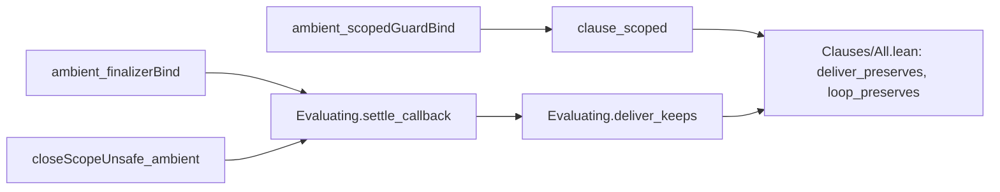

# Scope goals: proof plan for `settle_callback` and `clause_scoped` (2026-10-12)

**Know this first.** Both goals are provable now. The only thing that blocked either one was the
release's context switch. Commit `67d0cd064` removed it. Each goal needs one or two small helpers
that restate a type-only template at the ambient judgment. No helper needs a new fact about the
machine.

Scout: read-only, at worktree `lean4-effect4-land-context`, branch `land/release-merge`, head
`67d0cd064`. No `lake` was run. Every Lean block below is an unbuilt draft. The type-only
templates are read at `68856e778`.



The two goals are independent. Land the helpers, then either goal. `clause_closeScope` stays the
coordinator's, and the claims below stay modulo it until it lands.

## Placement (both goals)

1. **Concept.** `scope-lifetime-finalization` (concept 3 of `docs/core/semantics.md`), serving
   concept 4's configuration invariant `I`. Both goals carry
   `@[semantics "scope-lifetime-finalization" (requirement := R11)]`; the placement stays when
   `proof_goal` becomes `theorem`.
2. **Question.** The registry claims `step-deliver-preserves` and `step-loop-preserves`, then
   `typed-state-admitted`, `decision-keeps-typed`, `m7-*` and `obs-typed-admitted`.
   `generated/semantics.md` lists all of them modulo these two goals, `clause_closeScope` and
   `countdown_parks_positional`. It still lists `foreignFinalizer_ambient`, which `67d0cd064`
   proved; regenerate.
3. **Reach.** The ambient judgment `AmbientProg` (`src/Effect4/Laws/Program/Typed/Residual.lean`)
   and the machine typing `MCodeOk` (`Typed/Scheduler.lean`), at the evaluation step
   `Evaluating`. Decisions rows 188 (a), 349, 151 (a″); finding F-CLOSE.
4. **What it does not establish.** Preservation only, not progress. Not that the close walk
   ends. Not the finalizers' own runs. The two divergences of
   `docs/research/2026-10-12-restore-slot-scout.md` stay recorded rows: the `scoped` entry
   window and the restore's operation count.
5. **Unlock.** With `clause_closeScope`, the M6 preservation claims and M7 lose these goals. R11
   (resources are released) gains typed preservation through a scope's close.

## Goal 1: `Evaluating.settle_callback`

File: `src/Effect4/Laws/Program/Typed/Commands/Evaluate.lean`. Consumer:
`Evaluating.deliver_keeps`, the walk's callback outcome.

### Obstruction

The type-only proof at `68856e778` used four things.

| Old step | Ambient counterpart | Status |
| --- | --- | --- |
| `HostCallback` | `MHostCallback` (`Typed/HostWalk.lean`) | exists |
| `ev.recontext` then `settle_ready` | `Evaluating.settle_ready` with the context as argument | exists |
| `closeScopeUnsafe_installs` (`Typed/Adequacy.lean`) | none | missing, provable now |
| `finalizerBind_typed` (`Typed/Seq.lean`) | none | missing, provable now |

The missing installs lemma types a lone finalizer at any row. For a captured release that is
`finalizer_ambient` (`Typed/Body.lean`). Before `67d0cd064` its foreign arm needed the `window`
premise, which the callback cannot supply. That was the only block. Nothing else blocks:
`MHostCallback` gives the exit at the restored context's keys, the failure-row bound, the
position's well-formedness, the mask bit, the stack and the scope's protocol.

### Existing lemmas (each confirmed by grep at `67d0cd064`)

- `scopeExitCallback?_some`, `configTyped_closeState`, `Evaluating.settle_ready`,
  `SettlesTyped.mono`: `Typed/Commands/Evaluate.lean`.
- `MHostCallback`: `Typed/HostWalk.lean`.
- `MHostStack.mono`, `MHostStack.races`, `racesKept_of_eq`: `Typed/Scheduler.lean`.
- `finalizersAdmitted_of_typedState`: `Typed/Assembly.lean`.
- `fitsExit_unknown`: `Typed/Membership.lean`.
- `servicesFit_mono`: `Typed/Denotation.lean`.
- `ambientProg_mono`, `ambientProg_widen`, `ambient_guardBind`: `Typed/Context.lean`.
- `finalizer_ambient`, `finPosition`: `Typed/Body.lean`.
- `closeWalk_typed`, `lone_of_snapshot`, `mem_of_snapshot`: `Typed/Adequacy.lean` (reachable
  from `Evaluate.lean`'s imports).
- `ambientProg_of_admin`, `AdminCode`, `ambientInput_const`, `ambientExit_const`,
  `ambientExit_failure`: `Typed/AmbientMachine.lean`.
- `exitOk_restore`, `exitOk_failure_of_errorN`, `exitOk_success_of_answerN`: `Typed/Seq.lean`.
- `strongExit_mono`: `Typed/Residual.lean`.
- `Provision.satisfies_iff_subset_keysRow`: `src/Effect4/Program/Provision.lean`.
- `Bounds.subN_never`: `src/Effect4/Laws/Program/Bounds.lean`. `Ty.subN_refl`:
  `Laws/Program/TypeAlgebra.lean`. `Ty.sub_unknown`: `Program/Ty.lean`.
- `Effects.Program.bind_assoc`: `.lake/packages/effects/Effects/Algebra/Laws.lean`.

### Missing lemma H1: `ambient_finalizerBind`

The ambient instance of `finalizerBind_typed`. It types the finalizer boundary bound to any
continuation, at any position, including `.capturedContext`. A succeeding cleanup ends in the
`finishFinalizer` marker, whose continuation the judgment does not read. Place it in
`Evaluate.lean` before `Evaluating.settle_callback` (its upstream home is `Typed/Context.lean`,
beside `ambient_finalizer_guarantees`, whose `work` step it copies).

```lean
/-- **A finalizer's boundary under any continuation, at the ambient judgment** (`finalizerR`,
`Laws/Program/DenoteR.lean`; `finalizerBind_typed`'s ambient instance): the cleanup typed at the
finalizer type at a row, the body's exit at a position's bounds at that row: the boundary bound
to any continuation is typed at that position. A succeeding cleanup ends in the `finishFinalizer`
marker, which reads no continuation; a failing cleanup after a failed body combines both causes;
every other failure skips the bind. A step of `Evaluating.settle_callback`, its consumer. -/
theorem ambient_finalizerBind (root : ProgramSource) {w : World} {row : Env.Requirement}
    {result : AmbientPosition} {ex : ExitV} {cleanup : RProgram}
    (payload : AmbientExit w row result ex) (entry : Row.Subset result.failureRow row)
    (wf : result.WF)
    (cleanupTyped : AmbientProg root w row
      (((⟨.unknown, .never, Env.Requirement.empty⟩ : EffTy), row, row) : AmbientPosition) cleanup)
    (next : ExitV → RProgram) :
    AmbientProg root w row result ((finalizerR ex cleanup).bind next) := by
  -- the work: the cleanup after a success; after a failure, its failure combined with the body's
  have work : ∀ originalExit, ExitOk w result.type originalExit → AmbientProg root w row
      (((⟨.unknown, result.type.error, Env.Requirement.empty⟩ : EffTy), row, row) : AmbientPosition)
      (match originalExit with
      | .success _ => cleanup
      | .failure _ => (guardR .onFailure cleanup).bind fun
          | .success value => .pure (.success value)
          | .failure cause => .pure (Exit.restoreAfterFinalizer originalExit (.failure cause))) := by
    intro originalExit originalPayload
    cases originalExit with
    | success _ =>
      exact ambientProg_widen root (before := (⟨.unknown, .never, Env.Requirement.empty⟩, row, row))
        (Ty.subN_refl _) (Bounds.subN_never _) (Row.subset_refl _) (Row.subset_refl _) cleanupTyped
    | failure _ =>
      refine ambient_guardBind root cleanupTyped (fun _ ordered exit arm clean => ?_)
        (fun _ _ exit clean absent => ?_) (Row.subset_refl _)
      · cases exit with
        | success _ => exact Bool.noConfusion arm
        | failure _ =>
          rw [ambientInput_const]
          exact .pure (ambientExit_const (exitOk_restore
              (exitOk_failure_of_errorN (Ty.subN_refl _)
                (strongExit_mono _ _ _ _ ordered originalPayload))
              (exitOk_failure_of_errorN (Bounds.subN_never _) clean.1)))
            ⟨Row.subset_refl _, Row.subset_refl _⟩
      · cases exit with
        | success _ =>
          rw [ambientInput_const]
          exact ambientExit_const (exitOk_success_of_answerN (Ty.subN_refl _) clean.1)
        | failure _ => exact Bool.noConfusion absent
  unfold finalizerR
  rw [Effects.Program.bind_assoc]
  refine ambient_guardBind root (work ex payload.1) (fun _ ordered exit arm _ => ?_)
    (fun _ _ exit done absent => ?_) entry wf
  · cases exit with
    | success _ =>
      rw [ambientInput_const]
      exact .finishFinalizer ⟨strongExit_mono _ _ _ _ ordered payload.1, payload.2⟩ ⟨entry, wf⟩
    | failure _ => exact Bool.noConfusion arm
  · cases exit with
    | success _ => exact Bool.noConfusion absent
    | failure _ =>
      rw [ambientInput_const]
      exact ambientExit_failure (exitOk_failure_of_errorN (Ty.subN_refl _) done.1) entry
```

Unsure steps:

- The `work` match must be definitionally equal to `finalizerR`'s matcher after `unfold`.
  `ambient_finalizer_guarantees` relies on the same equality and builds.
- `.finishFinalizer` must unify through `seqR` and `.bind next`. `finalizerBind_typed` relies on
  the same reduction.
- If `ambientProg_widen` cannot infer `after`, pass
  `(after := (⟨.unknown, result.type.error, Env.Requirement.empty⟩, row, row))`.

### Missing lemma H2: `closeScopeUnsafe_ambient`

The ambient instance of `closeScopeUnsafe_installs`. It needs no `FinalizerTyped` premise: the
lone finalizer is `finalizer_ambient` at the row, and the walk is administrative code.

```lean
/-- **The unsafe close's program at the ambient judgment** (`closeScopeUnsafeR`;
`closeScopeUnsafe_installs`'s ambient instance): at every row, at rc.112's finalizer type
`⟨unknown, never⟩` (`internal/effect.ts:3849`). A lone finalizer is `finalizer_ambient`, a captured
release under its captured context merged over the current one; the walk is administrative code
(`closeWalk_typed`, `ambientProg_of_admin`), widened. A step of `Evaluating.settle_callback`, its
consumer. -/
theorem closeScopeUnsafe_ambient (root : ProgramSource) (w : World) (scope : Nat) (exit : ExitV)
    (flag : Bool) (st st' : Stores) (program : Option RProgram)
    (admitted : ∀ entry ∈ st.scopes.entries, ∀ fin ∈ entry.scope.closeOrder,
      FinalizerAdmitted root w fin)
    (exitFits : FitsExit w ⟨.unknown, .unknown, Env.Requirement.empty⟩ exit)
    (h : closeScopeUnsafeR scope exit flag st = some (st', program)) (row : Env.Requirement) :
    ∀ code, program = some code → AmbientProg root w row (finPosition row) code := by
  unfold closeScopeUnsafeR at h
  cases hs : scopeCloseSnapshot scope exit st with
  | none =>
    rw [hs] at h
    cases h
  | some snapshot =>
    obtain ⟨state, strategy, order⟩ := snapshot
    rw [hs] at h
    simp only at h
    obtain ⟨_, rfl⟩ := h
    intro code hcode
    match order, hs, hcode with
    | [], _, hcode => cases hcode
    | [fin], hs, hcode =>
      cases hcode
      obtain ⟨entry, hentry, hfin⟩ := lone_of_snapshot hs
      exact finalizer_ambient root (admitted entry hentry fin hfin) exitFits
    | _ :: _ :: _, hs, hcode =>
      cases hcode
      obtain ⟨entry, hentry, horder⟩ := mem_of_snapshot hs
      refine ambientProg_widen root (before := (EffTy.pure .unit, row, row)) ?_ (Ty.subN_refl _)
        (Row.subset_refl _) (Row.subset_refl _)
        (ambientProg_of_admin root
          (closeWalk_typed root w strategy _ exit
            (fun fin hf => admitted entry hentry fin (horder ▸ hf)) exitFits)
          (.fiber _ _ rfl fun _ => .fiber _ _ rfl fun _ => .pure _) row)
      exact Ty.sub_unknown _
```

Unsure steps:

- The `AdminCode` term for `closeWalkR`: `adminOp` is `true` at `closeWalk` and `closeIter` by
  its catch-all arm. If `rfl` or `.pure _` does not elaborate, unfold `closeWalkR` first.
- The `match order, hs, hcode` shape copies `closeScopeUnsafe_installs`, which builds.

### Draft proof of `Evaluating.settle_callback`

Replace the `proof_goal` by this `theorem`, keeping the attribute. The docstring's "Planned"
sentence goes; name H1 and H2 instead.

```lean
@[semantics "scope-lifetime-finalization" (requirement := R11)]
theorem Evaluating.settle_callback {root : ProgramSource} {rootTy : EffTy} {w : World}
    {m : RState} {rest : List RCmd} {f : RFiber} {y : Bool} (ev : Evaluating root rootTy w m rest f y)
    (fr : RSaved) {ty : EffTy} {flag : Bool} (declared : w.Γ f.id = some ty)
    (callback : MHostCallback root w (m.update f) f.id (finalPos ty flag) fr) :
    SettlesTyped root rootTy w f.id rest
      (prepareIterR ⟨m, { f with frame := fr }, y, .continue_, [], []⟩) := by
  have wide := ev.typed.machine.wide
  obtain ⟨tin, prev, sc, ex, hcb, payload, ⟨live, services⟩, entry, wf, bit, stack, prov⟩ :=
    callback
  obtain ⟨next, hcur⟩ := scopeExitCallback?_some hcb
  have present : (m.state.scopes.entryAt sc).isSome = true := by
    have l : (w.state.scopes.entryAt sc).isSome = true := live
    rw [wide.state] at l
    exact l
  obtain ⟨scopeEntry, hentry⟩ := Option.isSome_iff_exists.mp present
  let s : Stores := { m.state with scopes := m.state.scopes.closeState sc ex }
  have snap : scopeCloseSnapshot sc ex m.state =
      some (s, scopeEntry.scope.strategy, scopeEntry.scope.closeOrder) := by
    unfold scopeCloseSnapshot
    rw [hentry]
    rfl
  obtain ⟨program, hprog⟩ :
      ∃ program, ∀ flag, closeScopeUnsafeR sc ex flag m.state = some (s, program) :=
    ⟨_, fun _ => by
      unfold closeScopeUnsafeR
      rw [snap]
      rfl⟩
  have hexFits : FitsExit w ⟨.unknown, .unknown, Env.Requirement.empty⟩ ex :=
    fitsExit_unknown payload.1.1
  -- the store edit: the scope closed with the callback's exit
  obtain ⟨ord, restated⟩ := configTyped_closeState ev.typed hentry hexFits
  have ev1 : Evaluating root rootTy { w with state := s } { m with state := s } rest f y :=
    ⟨restated, ev.stale, ev.running, ev.live⟩
  -- any code typed at the callback's position, at the restored context's keys, settles
  suffices settles : ∀ code, AmbientProg root w prev.services.keysRow tin.1 code →
      SettlesTyped root rootTy w f.id rest
        ⟨{ m with state := s }, resetFiber f prev prev.maxOpsBeforeYield prev.preventYield
          { fr with current := code }, y, .continue_, [], []⟩ by
    have finsAdm := finalizersAdmitted_of_typedState ev.typed.machine
    rw [wide.state] at finsAdm
    have installs := closeScopeUnsafe_ambient root w sc ex false m.state s program finsAdm hexFits
      (hprog false) prev.services.keysRow
    cases program with
    | none =>
      have glue : prepareIterR ⟨m, { f with frame := fr }, y, .continue_, [], []⟩ =
          ⟨{ m with state := s }, resetFiber f prev prev.maxOpsBeforeYield prev.preventYield
            { fr with current := .vis (.inr (.finishFinalizer ex)) next }, y, .continue_, [], []⟩ := by
        simp only [prepareIterR, prepareScopedExitR, answerR, hcur, prepareR, hprog]
        rfl
      rw [glue]
      exact settles _ (.finishFinalizer payload ⟨entry, wf⟩)
    | some c =>
      have glue : prepareIterR ⟨m, { f with frame := fr }, y, .continue_, [], []⟩ =
          ⟨{ m with state := s }, resetFiber f prev prev.maxOpsBeforeYield prev.preventYield
            { fr with current := (finalizerR ex c).bind next }, y, .continue_, [], []⟩ := by
        simp only [prepareIterR, prepareScopedExitR, answerR, hcur, prepareR, hprog]
        rfl
      rw [glue]
      exact settles _ (ambient_finalizerBind root payload entry wf (installs c rfl) next)
  intro code typedCode
  refine SettlesTyped.mono ord (ev1.settle_ready prev (servicesFit_mono ord services)
    prev.maxOpsBeforeYield prev.preventYield { fr with current := code } (fun ty' declared' => ?_))
  have same : ty' = ty := Option.some.inj (declared'.symm.trans declared)
  subst same
  exact ⟨prev.services.keysRow, tin, flag,
    (Provision.satisfies_iff_subset_keysRow _ _).mpr (Row.subset_refl _), bit,
    ambientProg_mono root ord typedCode,
    MHostStack.races (racesKept_of_eq (m := m.update f)
      (m' := ({ m with state := s } : RState).update f) fun _ => rfl) (MHostStack.mono ord stack),
    ⟨prov.recorded, prov.deferred⟩⟩
```

Unsure steps:

- The two `glue` equations copy the type-only proof's `simp only` set and `rfl`. The new right
  side spells the fiber with `resetFiber`, an abbrev. It should be the same term after
  elaboration. If `rfl` fails, state the right side as `{ f with context := prev, ... }`, as
  `68856e778` did.
- `ev1` relies on `{ m.update f with state := s }` being `{ m with state := s }.update f` by
  definition. The type-only proof relied on the same.
- The `obtain` of `callback` reads `(frameProtocols root).scopeExit w prev sc` as
  `ScopeLive w sc ∧ ServicesFit w prev.services` (`Typed/Residual.lean`, `frameProtocols`).

### What the proof reads from the machine

- The restored context is `prev`. Its keys are the code's row, so the coverage is `subset_refl`.
- The new code's position is the callback's `tin`, unchanged; the mask bit is unchanged.
- The world grows by `configTyped_closeState`; code and stack move by `ambientProg_mono` and
  `MHostStack.mono`.

## Goal 2: `clause_scoped`

File: `src/Effect4/Laws/Program/Typed/Commands/Evaluate.lean`. Consumer:
`deliver_preserves_of_clauses` through `Clauses/All.lean`.

### Obstruction

The docstring says the restore slot restates the guard's callback. No restatement is needed.
The ambient judgment already has the `scopedGuard` constructor
(`ProgramArrow.scopedGuard`, `Typed/Residual.lean`), whose `widen` reads the restored context's
keys. The type-only proof used four things without an ambient counterpart today.

| Old step | Ambient counterpart | Status |
| --- | --- | --- |
| `scopedGuardBind_typed` (`Typed/Seq.lean`) | none | missing (H3), provable now |
| `denoteAt_typed` at the body | `denoteAt_ambient` (`Typed/Body.lean`) | exists; needs the body's row |
| `answerFrame_typed`, `hostStack_push` | `MFrame.answer`, `.cons (.inl _)` | exist |
| `servicesFit_addV` (old, `LayerArm.lean`) | `servicesFit_addV` (`Typed/Membership.lean`), new arguments | exists |

The body's row is the new context's keys. The pre gives
`bodyRequires root.signature cert ⊆ row`: the body's requirement without the scope key. The new
context adds the scope key, so it covers `cert.requires`. That is a short local argument, the
same as `construction_typed`'s (`Typed/LayerArm.lean`). Nothing else blocks.

### Existing lemmas (each confirmed by grep at `67d0cd064`)

- `ambientProg_fiber_inv`, `Evaluating.code`, `Evaluating.declared`, `Evaluating.look`,
  `Evaluating.settle_reset`, `SettlesTyped.mono`: `Typed/Commands/Evaluate.lean`.
- `syncOpStep_scopeMake`, `syncOpStep_le`, `syncOpStep_wf`, `ScopeStore.entryAt_make_self`:
  `src/Effect4/Laws/Machine/StoresLaws.lean`.
- `leHost_restate`, `storesOk_world`, `configTyped_restate`: `Typed/Commands/Bookkeeping.lean`
  (unchanged since `68856e778`).
- `Guard.internalKeys_state_subset`, `Guard.storeKeys_mono`: `Laws/Program/Guard/Core.lean`.
- `fits_scopeHandle`, `fits_live`, `fits_flatFits`, `servicesFit_addV`: `Typed/Membership.lean`.
- `serviceTy_scopeKey`, `satisfies_addV`: `Typed/LayerArm.lean`.
- `Env.Context.getV_addV_same`: `src/Effect4/Machine/ContextMap.lean`.
- `Row.mem_diff`, `Row.mem_singleton`, `Row.subset_refl`: `src/Effect4/Data/Row.lean`.
- `denoteAt_ambient`: `Typed/Body.lean`. `pointTyped_mono`, `ProgramArrow.close`:
  `Typed/Residual.lean`.
- `ambientStackTyped_mono`, `ambientStackTyped_widen`: `Typed/StackCertificates.lean`.
- `MFrame.answer`, `ambientInput_const`: `Typed/AmbientMachine.lean`.
- `MHostStack.mono`, `MHostStack.races`, `racesKept_of_eq`: `Typed/Scheduler.lean`.
- `servicesFit_mono`: `Typed/Denotation.lean`. `Provision.satisfies_iff_subset_keysRow`:
  `Program/Provision.lean`.

### Missing lemma H3: `ambient_scopedGuardBind`

The ambient instance of `scopedGuardBind_typed`. Place it in `Evaluate.lean` before
`clause_scoped` (upstream home: `Typed/Context.lean`, beside `ambient_scoped_frame`).

```lean
/-- **The `scoped` arm's code at the ambient judgment** (decisions row 188 (a);
`scopedGuardBind_typed`'s ambient instance): the `onExit false` guard over a body typed at
`mid`, bound to the scope's exit callback, is typed at `result` when the scope is present, the
context the callback restores fits, and every exit of `mid` lands at `result` within that
context's keys. A step of `clause_scoped`, its consumer. -/
theorem ambient_scopedGuardBind (root : ProgramSource) {w : World} {row : Env.Requirement}
    {mid result : AmbientPosition} {a : RProgram} {prev : Ctx} {sc : Nat}
    {j : ExitV → RProgram} (ha : AmbientProg root w row mid a) (live : ScopeLive w sc)
    (services : ServicesFit w prev.services)
    (widen : ∀ w', w.leHost w' → ∀ ex, AmbientExit w' (ambientInput mid ex) mid ex →
      AmbientExit w' prev.services.keysRow result ex)
    (entry : Row.Subset result.failureRow row) (wf : result.WF) :
    AmbientProg root w row result
      ((guardR (.onExit false) a).bind fun ex => .vis (.inr (.scopeExit prev sc ex)) j) := by
  show AmbientProg root w row result (.vis (.inr (.guard_ (.onExit false))) _)
  refine .scopedGuard mid prev sc ?_ (fun _ => rfl) live services widen ⟨entry, wf⟩
  show AmbientProg root w row mid
    ((a.bind fun ex => .vis (.inr (.unguard ex)) Effects.Program.pure).bind _)
  rw [Effects.Program.bind_assoc]
  exact ProgramArrow.close ha fun ex => .vis (.inr (.scopeExit prev sc ex)) j
```

### Draft proof of `clause_scoped`

```lean
@[semantics "scope-lifetime-finalization" (requirement := R11)]
theorem clause_scoped (root : ProgramSource) (rootTy : EffTy) (body : Point) :
    FiberClauseKeeps root rootTy (.scoped body) := by
  intro w m rest f y next ev hc
  have wide := ev.typed.machine.wide
  have c5 : ServicesFit w f.context.services :=
    (ev.typed.machine.fiber (rfiber?_mem ev.look)).ok.c5
  obtain ⟨ty, declared⟩ := ev.declared
  obtain ⟨row, tin, flag, covered, bit, current, stack, prov⟩ :=
    ev.code (by rw [hc]; rfl) ty declared
  rw [hc] at current
  obtain ⟨cert, ⟨⟨hpt, hstk⟩, hreq⟩, typedNext, _, _⟩ := ambientProg_fiber_inv current
    (fun _ h => nomatch h) (fun _ h => nomatch h) (fun _ h => nomatch h) (fun _ _ _ h => nomatch h)
  change EffTy at cert
  change Row.Subset (Row.diff cert.requires (Env.Requirement.single Env.scopeKey)) row at hreq
  -- the store with the new scope: the `scopeMake` row's step (as at `68856e778`)
  let scope := m.state.nextName
  let s : Stores :=
    { m.state with scopes := m.state.scopes.make scope .sequential, nextName := scope + 1 }
  have step : syncOpStep (.scopeMake .sequential) m.state = some (s, Val.scopeHandle scope) :=
    syncOpStep_scopeMake m.state .sequential
  have le : m.state.le s := syncOpStep_le _ _ _ _ step
  have swf : s.WF := syncOpStep_wf _ _ _ _ wide.wf rfl step
  have ord : w.leHost { w with state := s } :=
    leHost_restate (by rw [wide.state]; exact le) (by rw [wide.state]; rfl)
      (by rw [wide.state]; rfl) (by rw [wide.state]; rfl)
  have stores : StoresOk (preds root) { w with state := s } Expect.root s := by
    obtain ⟨c0, c1, c2, ⟨c3⟩, c4, _⟩ := storesOk_world ord rfl rfl rfl wide.stores
    refine ⟨c0, c1, c2, ⟨fun e he => ?_⟩, c4, trivial⟩
    change e ∈ m.state.scopes.entries ++ [⟨scope, Scope.make .sequential⟩] at he
    rcases List.mem_append.mp he with old | new
    · exact c3 e old
    · rw [List.mem_singleton] at new
      subst new
      exact ⟨⟨trivial⟩⟩
  obtain ⟨_, restated⟩ := configTyped_restate ev.typed le rfl rfl rfl swf stores
    (Guard.internalKeys_state_subset _ s
      (Guard.storeKeys_mono (List.Subset.refl _) (List.Subset.refl _)))
    (fun o ho owner priority mode => wide.live.dueOwners o ho owner priority mode)
    (List.Subset.refl _)
  have live' : ScopeLive { w with state := s } scope := ScopeStore.entryAt_make_self _ _ _
  have ev1 : Evaluating root rootTy { w with state := s } { m with state := s } rest f y :=
    ⟨restated, ev.stale, ev.running, ev.live⟩
  -- the context with the scope installed, its services fitting
  let ctx := f.context.withScope scope
  have handle := fits_scopeHandle _ _ live'
  have carrier : ({ w with state := s } : World).serviceTy Env.scopeKey = some Ty.scope := by
    show w.serviceTy Env.scopeKey = some Ty.scope
    rw [ev.typed.machine.services]
    exact serviceTy_scopeKey _
  have services : ServicesFit { w with state := s } ctx.services := by
    show ServicesFit _ (f.context.services.addV Env.scopeKey (Value.scope scope))
    exact servicesFit_addV (servicesFit_mono ord c5) carrier (fits_flatFits rfl handle)
      (fits_live _ _ _ handle)
  -- the body's row: the new context's keys, which hold the operation's row and the body's
  have kept : ctx.services.Satisfies row := satisfies_addV Env.scopeKey (Value.scope scope) covered
  have scopeCovers : ctx.services.Satisfies cert.requires := by
    intro k member
    by_cases isScope : k = Env.scopeKey
    · subst isScope
      show ((f.context.services.addV Env.scopeKey (Value.scope scope)).getV Env.scopeKey).isSome =
        true
      rw [Env.Context.getV_addV_same]
      rfl
    · exact kept k (hreq k
        ((Row.mem_diff k _ _).mpr ⟨member, fun h => isScope ((Row.mem_singleton _ _).mp h)⟩))
  have rowSub : Row.Subset row ctx.services.keysRow :=
    (Provision.satisfies_iff_subset_keysRow _ _).mp kept
  have restored : Row.Subset row f.context.services.keysRow :=
    (Provision.satisfies_iff_subset_keysRow _ _).mp covered
  -- the body at the new context's keys, guarded by the scope's exit callback
  have typedBody : AmbientProg root { w with state := s } ctx.services.keysRow
      (((cert, ctx.services.keysRow, ctx.services.keysRow) : AmbientPosition))
      (bodyR (interpRAt root.program m.completedExits) (.at_ body)) :=
    denoteAt_ambient root ev.typed.machine.sourceWF ev.typed.machine.services
      (pointTyped_mono ord hpt) ((Provision.satisfies_iff_subset_keysRow _ _).mp scopeCovers)
      (ambientStackTyped_widen rowSub (ambientStackTyped_mono ord hstk))
  have typedCode : AmbientProg root { w with state := s } ctx.services.keysRow
      (((cert, row, row) : AmbientPosition))
      ((guardR (.onExit false) (bodyR (interpRAt root.program m.completedExits) (.at_ body))).bind
        fun ex => .vis (.inr (.scopeExit f.context scope ex)) Effects.Program.pure) :=
    ambient_scopedGuardBind root typedBody live' (servicesFit_mono ord c5)
      (fun _ _ ex hex => ⟨hex.1, by cases ex <;> exact restored⟩) rowSub (Row.subset_refl _)
  -- the answer frame carries the body's exit to the continuation at the operation's row
  have answerFrame : MFrame root { w with state := s }
      ((((cert, row, row) : AmbientPosition)), tin.2) (tin.1, tin.2) (.answer next) :=
    .answer next fun w'' o ex hex => by
      rw [ambientInput_const]
      exact typedNext w'' (leHost_trans _ _ _ ord o) ex hex.1
  let fr' : RSaved := { f.frame with
    current := (guardR (.onExit false)
      (bodyR (interpRAt root.program m.completedExits) (.at_ body))).bind
        fun ex => .vis (.inr (.scopeExit f.context scope ex)) Effects.Program.pure
    stack := .answer next :: f.frame.stack }
  refine SettlesTyped.mono ord (ev1.settle_reset ctx services ctx.maxOpsBeforeYield
    ctx.preventYield fr' (fun ty' declared' => ?_))
  have same : ty' = ty := Option.some.inj (declared'.symm.trans declared)
  subst same
  exact ⟨ctx.services.keysRow, ((((cert, row, row) : AmbientPosition)), tin.2), flag,
    (Provision.satisfies_iff_subset_keysRow _ _).mpr (Row.subset_refl _), bit, typedCode,
    .cons (.inl answerFrame) (MHostStack.races (racesKept_of_eq (m := m.update f)
      (m' := ({ m with state := s } : RState).update f) fun _ => rfl) (MHostStack.mono ord stack)),
    ⟨prov.recorded, prov.deferred⟩⟩
```

Unsure steps:

- `change EffTy at cert` is needed so the coercion to `AmbientPosition` finds its instance.
  `FiberCert (.scoped _)` reduces to `EffTy` (`Typed/Residual.lean`).
- `change ... at hreq` needs `root.signature.scopeKey` to reduce to `Env.scopeKey`. Both reduce
  to `⟨⟨0⟩, ⟨0⟩⟩` through `Signature.withDefs` and `SigApp.signature`. If `change` fails, add
  `theorem signature_scopeKey (root : ProgramSource) : root.signature.scopeKey = Env.scopeKey := rfl`
  beside `scopeSig_scopeKey` (`Typed/LayerArm.lean`), then `unfold bodyRequires at hreq` and
  `rw [signature_scopeKey] at hreq`.
- The final `refine` unifies `evaluateFiberR`'s `.scoped` arm with `resetFiber f ctx … fr'`.
  The type-only proof relied on the same unfolding. If it fails, add a `show` of the iteration
  before the `refine`.
- The store block copies `68856e778`. `storesOk_world` and `configTyped_restate` are unchanged
  since then. `servicesFit_addV` changed its arguments; the draft uses the new ones, as
  `construction_typed` does.
- `Value.scope scope` and `Val.scopeHandle scope` are used as one term, as at `68856e778`.

### What the proof reads from the machine

- The answer frame goes from `(cert, row, row)` to the operation's position, at the fiber's mask.
  The operation's input at `scoped` is the row it entered at (`ambientFiberInput`'s catch-all).
- The body runs at the new context's keys. The guard's exits land at `(cert, row, row)` within
  the previous context's keys, which the operation's row is within (`covered`).
- The walk later meets the guard's `scopedResume` frame and hands `settle_callback` an
  `MHostCallback` with exactly these facts (`ambientProg_guard_frame`, `Evaluate.lean`).

## Landing notes for the coordinator

- Change both `proof_goal`s to `theorem`; keep the attribute. Remove each docstring's "Planned"
  sentence about the restore slot. Name H1 and H2 in `settle_callback`'s docstring and H3 in
  `clause_scoped`'s.
- `closeScopeUnsafe_installs` (`Typed/Adequacy.lean`) loses its last consumer. An orphan is
  allowed. `scopedGuardBind_typed` keeps a battery reader, `Test/Program/ScopeExitCallback.lean`.
- Narrow build: `LEAN_NUM_THREADS=3 lake build Effect4.Laws.Program.Typed.Commands.Evaluate`,
  then its direct dependents through `Clauses/All.lean`.
- Audit: `#axiom_audit Effect4.Laws.Program.Typed.Commands.Evaluate`.
- Regenerate `generated/semantics.md`; the modulo lists of the claims above shrink.
- The behaviour gates are not reached: no machine or program definition changes.

## What this note does not establish

- No draft was elaborated. Each "unsure step" is a reading of definitions, not a build result.
- The claim that nothing beyond the release blocks either goal rests on the drafts closing every
  case. A failed build at an unsure step is a repair, not a new obstruction, unless it needs a
  machine fact the callback or the pre does not carry.
- `clause_closeScope` is out of scope.
