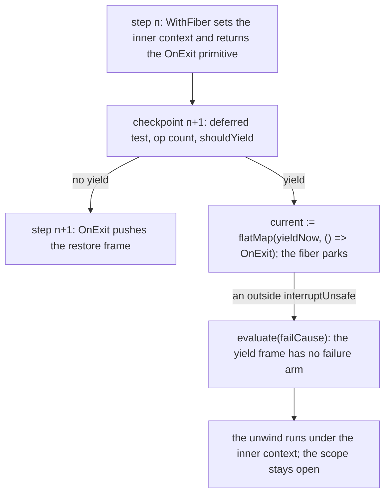

# Probe: the scoped entry window (2026-10-12)

Read-only probe. Bases: `refactor/phase1-phase3` at `10b4b0196`, the typed-context landing in the
main checkout. Also `land/release-merge` at `f6bcfa591`, in the worktree
`/Users/pooks/Dev/lean4-effect4-land-context`. In the machine files the two differ only in the
release's context (`releaseContext`, the merge). No `lake` ran. Host runs used bun 1.4.2.

A **checkpoint** below is the top of one run-loop iteration: the deferred-interrupt test, the op
count and the yield test. In rc.112 it is `runLoop` (`vendor/effect-4.0.0-rc.112/src/internal/effect.ts:638-652`).
In our machines it is `iteration` with `runloopTop`, `countOp` and `injectYield`
(`src/Effect4/Machine/Fibers.lean`).

## Know this first

- **rc.112's window is reachable, and a host run shows it.** A step scan yields once at each
  checkpoint, and another fiber interrupts at once. On rc.112 exactly one checkpoint per region
  entry leaks the inner context, for `scoped` and for `provideService`. On 4.0.1 none leaks.
- **The outcome.** The interrupt drops the pending `OnExit`, so no restore runs and the scope never
  closes. Every handler on the unwind, up to the next enclosing restore, runs under the inner
  context. A finalizer that such a handler adds through `Effect.scope` goes to the dead scope and
  never runs.
- **Our `scoped` entry has the same window**, at the same single checkpoint, in both machines.
  This is read from the source, not run.
- **Our provide regions are closed.** They are masked from the switch to the restore push. No
  deferred interrupt can skip a restore once its slot or frame exists (question 2: no).
- **A correction to the restore-slot scout.** A release does not always run inside a masked
  finalizer. An explicit `closeScope` action runs a capture's release unmasked. Both machines then
  have the window, two checkpoints wide (read). rc.112 has it too (measured), and 4.0.1 masks
  `Scope.close`. On that path rc.112 also loses the release at three checkpoints, and 4.0.1 at none.
- **Recommendation.** Record two divergences now. Close the `scoped` window inside the
  provide/scoped alignment slice that `docs/research/2026-10-12-probe-op-counts.md` ranks first,
  with 4.0.1's one-step shape. Mask an explicit close as 4.0.1 does: the smaller change with the
  larger outcome.

## Question 1: is rc.112's window reachable?

Yes. The reading gives the path, and the host run confirms it.



### The reading (rc.112)

- `scoped` (`effect.ts:3938-3947`) and `updateContext` (`:2073-2096`) switch the context inside
  `withFiber`. Each returns `onExitPrimitive(self, …)`. `OnExit[evaluate]` pushes the frame one
  step later (`:4009-4012`).
- The checkpoint first replaces `current` on a deferred interrupt (`:639-642`). Then it counts
  (`:643`). Then it wraps `current` in `flatMap(yieldNow, () => prev)` when `shouldYield` answers
  true (`:644-652`).
- `MixedScheduler.shouldYield` is `currentOpCount >= maxOpsBeforeYield`
  (`vendor/effect-4.0.0-rc.112/src/Scheduler.ts:174-176`). The default budget is 2048 (`:269-272`).
- `yieldNowWith` (`effect.ts:982-995`) schedules the resume and parks with a cancel thunk.
  `runLoop`'s `finally` clears `_running`.
- `interruptUnsafe` (`:574-595`) evaluates `failCause(cause)` at once when the fiber is
  interruptible and not running. `evaluate` (`:599-606`) first cancels the scheduled resume.
- `exitFailCause[evaluate]` (`vendor/effect-4.0.0-rc.112/src/internal/core.ts:529-547`) pops
  through `getCont` (`effect.ts:680-697`). The yield wrapper has only a success arm. The `OnExit`
  primitive in its closure is dropped, with its restore and its scope close.
- A second path is contrived. A deferred interrupt set inside the `withFiber` step also drops the
  primitive at the next checkpoint. Only user code in `updateContext`'s `f` can set it there.
- 4.0.1 pushes the frame in the switching step: `onExitUnsafe`
  (`vendor/effect-4.0.1/src/internal/effect.ts:4219-4224`), called by `scoped` (`:4100-4112`) and
  `updateContext` (`:2175-2200`).
- rc.112's `useSpan` (`effect.ts:5893-5915`) has the same shape: the span is made in `withFiber`
  and `onExit` follows. Its window would leave a span unended. Not probed.

### The host run

- Runtime: bun 1.4.2.
- rc.112: `harness/truth/node_modules/effect`, which prints `4.0.0-rc.112`.
- 4.0.1: `ts/release/node_modules/effect`, which prints `4.0.1`.
- Script: `scan.mjs`, outside the repo in the session scratchpad. Its full text is in the appendix.
- `StepScheduler` subclasses `MixedScheduler`. Its `shouldYield` answers true only at its T-th
  call.
- Each T from 1 to 40 runs twice. One run is interrupted at once by
  `Effect.runFork(Fiber.interrupt(fiber))`. The control run is interrupted after the resume.

| Program | rc.112: leaking runs of 80 | 4.0.1 |
| --- | --- | --- |
| `onExit(scoped(never), h)`; `h` reads `Scope` | 1 (T=3); the inner scope stays `Empty` | 0 |
| `onExit(provideService(never, Tag, "inner"), h)`; `h` reads `Tag` | 1 (T=3) | 0 |
| `scoped(onExit(scoped(never), h))`; `h` calls `Effect.addFinalizer` | 1 (T=5); the finalizer never runs | 0 |
| explicit `Scope.close` of an `acquireRelease` (question 3) | 1 (T=25) | 0 |

- No control run leaks in either version.
- A budget sweep agrees. `probe.mjs` sets `MaxOpsBeforeYield` from 3 to 8 through `runForkWith`.
  On rc.112 it leaks at budget 5 with no prefix, and at budget 7 with one bind before the region.
  On 4.0.1 it never leaks.
- At the leaking run the suspended rc.112 fiber holds the inner context. Its stack holds the outer
  `OnExit` and the yield frame only.
- Side observation: a budget of 1 or 2 makes no progress in either version. Each slice spends its
  operations on the resume, and at budget 1 the stack grows each slice. A probe needs a budget of
  at least 3.

## Question 2: can a deferred interrupt skip our context restore?

No. Four facts, read in both machines:

1. **The pop clears the deferred flag.**
   - Frame: `FrameFiber.getCont` (`src/Effect4/Machine/Frames.lean`) answers a deferred interrupt
     before it touches the stack. On the pop path it clears the flag. A success with a deferred
     interrupt becomes a failure, and the stack stays, as rc.112's `deferredInterruptCont`
     (`effect.ts:737-744`) does.
   - Term: `deliverR` (`src/Effect4/Laws/Program/EvaluateR.lean`) does the same. It calls `popR`
     with `deferredInterrupt := false`.
2. **The pop that answers a restore masks in the same step.**
   - Frame: `finalizerOr` in `evaluatePrim` (`src/Effect4/Machine/Fibers.lean`) installs
     `finalizerCode` on `pop.fiber`. That fiber carries the `OnExit` frame's mask and its
     restoring frame.
   - Term: `popR`'s `.resume (.onExit false)` arm sets `interruptible := false` and pushes
     `.finalizerMask`.
   - Every context restore uses the masked kind: `onExitR`'s default, `guardR (.onExit false)` in
     the `.scoped` arm, `EffName.bodyThen`, `EffThunk.releaseMasked` and `enterScoped`'s
     `Prim.onExit … false`.
3. **A masked fiber only records.** `interruptWithCause` (`src/Effect4/Machine/Fibers.lean`) sets
   `deferredInterrupt`, or evaluates an idle fiber, only under `core.interruptible`.
4. **The restore does not unmask before its switch.**
   - Frame: `finalizerProgram` answers `.restoreCtx previous` with `withFiber (setCtx previous)`.
   - Term: `finalizerR ex (fiberValR (.setContext prev))`.

So the deferred flag is false when a restore program starts, and it stays false until the restore
has run. A `scoped` exit restores inline in the pop step, as Effect's callback does: `exitScoped`
(`src/Effect4/Program/Compile.lean`) and `prepareScopedExitR` (`EvaluateR.lean`).

Only the count differs from Effect. A provide region's restore is a finalizer program of several
masked steps: exit 4 against Effect's 1 (`2026-10-12-probe-op-counts.md`). In those steps the inner
budget governs the yield test.

## Question 3: our scoped entry, provide regions and releases

### `scoped` entry: the same window as rc.112

- Frame: `enterScoped` (`src/Effect4/Program/Compile.lean`) makes the scope and switches the
  context and its budget fields. It sets `current := Prim.onExit body (.scopedExit previous scope)
  false`. The frame is pushed at the next step.
- Term: the `.scoped` arm of `evaluateFiberR` (`EvaluateR.lean`) does the same. It sets `current`
  to `guardR (.onExit false) …`. The `guard_` operation pushes the slot at the next step, and
  `prepareR` leaves it in place.
- One checkpoint lies between the two steps. It is interruptible unless the caller masked. That is
  rc.112's count: the op-counts probe measures `scoped` entry at 2, with no difference from rc.112.
- At that checkpoint `injectYield` wraps `current` with `core.yieldBefore`. The frame wrapper is
  `Prim.onSuccessConst (yieldNowWith 0) previous`. The term wrapper is `guardR .onSuccess (yieldNow
  0)`, then `previous`.
- An interrupt during the park comes from another fiber (`interruptWithCause`, then `Cmd.evaluate`)
  or from the tape (`RunDecision.interruptFrom`). The failure passes the wrapper, which has no
  failure arm. The guard never runs.
- Reach: a checked program meets the budget only at 2048, because the checker refuses a budget
  provision (op-counts probe). A program whose entry count puts its 2048th operation at that
  checkpoint reaches the window.
- The tape's `RunDecision.yieldVerdict` overrides only the first check of a run. It cannot place
  the yield there alone.

### Provide regions: closed

- Term: `updateContextR`, then `.mask false (.contextEntry …)`, then `contextEntryR`
  (`src/Effect4/Laws/Program/DenoteR.lean`).
- Frame: `updateContextAt`, then `EffThunk.provideMasked`, `updateThenK` and `EffName.bodyThen`
  (`src/Effect4/Program/Compile.lean`).
- The mask holds from `mask false` (`provideMasked`) through the restore push. An interrupt in
  between is recorded only.
- `restoreRegionR` (`EffThunk.restoreRegion`) unmasks inside the guard and fails at once on a
  recorded cause. So the restore runs.
- `c2a1cdda4` added the mask. At `68856e778` both machines had two interruptible checkpoints there
  (op-counts probe).
- The outcome agrees with 4.0.1. It differs from rc.112, which leaks at one checkpoint.

### Releases: closed inside finalizers, open at an explicit close

- **Inside a finalizer: closed.** The `scoped` exit's close and the layer closes run after a
  masked pop. `EffName.afterScopeAdd` runs a capture's release at once only inside
  `acquireRelease`'s mask. Here the scout is right.
- **At an explicit close: open.**
  - `ActionTerm.closeScope` (`src/Effect4/Program/Eff.lean`) is a source action, and the checker
    admits it (`src/Effect4/Program/Checker.lean`).
  - `WithFiberAction.closeScope` and `FiberAction.closeScope` run `storesCloseScope`
    (`src/Effect4/Machine/Stores.lean`). Its `_closerInterruptible` is unused, and no mask is added.
  - For a `FinName.foreign` capture, `finProgram` runs `Thunk.foreign`, then `getCtx`, then
    `EffName.releaseUnder` (the switch), `EffName.releaseBody` and `EffThunk.releaseMasked` (the
    mask and the push).
  - Two checkpoints lie between the switch and the mask. Both are interruptible when the closer is.
  - The term's `denoteFin` `.foreign` arm has the same two: `setContext`'s `unguard`, then
    `.mask false (.release …)`.
  - This is read, not run.
- So the docstring of `EffThunk.releaseMasked` fails at an explicit close. It claims that every path
  that runs a release is already uninterruptible.
- **rc.112, measured.** `Scope.close` (`effect.ts:3775-3776`) is `suspend(scopeCloseUnsafe)`,
  unmasked. The release's `provideContext` (`:2180-2199`) is `updateContext`. The scan's
  explicit-close program leaks at T=25. It loses the release at T=24, 25 and 26.
- **4.0.1, measured.** `scopeClose` (`vendor/effect-4.0.1/src/internal/effect.ts:3929-3935`)
  calls `fiberEnterUninterruptibleUnsafe` (`:4584-4589`) first. No T leaks, and no T loses the
  release.

## The outcome difference for a program

```ts
Effect.scoped(
  Effect.onExit(Effect.scoped(Effect.never), () =>
    Effect.addFinalizer(() => Effect.sync(() => console.log("outer finalizer"))))
)
```

An outside fiber interrupts this program while it is parked at the checkpoint after the inner
`scoped` entry.

| Runtime | Inner restore | `h`'s `Effect.scope` | "outer finalizer" |
| --- | --- | --- | --- |
| rc.112 (measured, T=5) | never runs | the inner scope, never closed | never runs |
| 4.0.1 (measured, every T) | runs | the outer scope | runs at the outer close |
| our machines (read) | as rc.112 | as rc.112 | as rc.112 |

- Other shapes follow the same mechanism. After a `provideService` entry, a handler reads the inner
  value on rc.112 only.
- After an interrupted explicit `Scope.close`, a handler reads the captured services and the
  release never runs. That holds on rc.112 and, by the reading, in our machines. It does not hold
  on 4.0.1.
- The fiber's exit is the same interrupt in every case. Only what the unwinding handlers see and do
  differs.
- Typing, read and not proved: on `land/release-merge` the leaked context holds every key of the
  caller's context in all three shapes. The typed invariant reads key coverage (`Satisfies`). So
  the window should not break the typed-context clauses there.
- On `10b4b0196` the release replaces the context. There the explicit-close window can leave a key
  of the caller's row missing.

## Recommendation

1. **Record now; no build.** Propose two rows for the coordinator's register:
   - `scoped` entry switch window: ours as rc.112, closed in 4.0.1. Evidence: scan T=3 and T=5 on
     rc.112, none on 4.0.1; our machines read.
   - Explicit `closeScope`: unmasked as in rc.112. The context window spans two checkpoints, and a
     release is lost before its body starts; rc.112 loses it at three checkpoints. 4.0.1 masks the
     close.
   - Correct the `EffThunk.releaseMasked` docstring and the scout's sentence on releases. Each is a
     comment edit.
2. **Close the `scoped` window inside the op-counts probe's first slice.** That slice moves `scoped`
   and the provide region to 4.0.1's one-step shape: switch and push in one action. It closes this
   window at no cost beyond the slice.
   - Standalone, the change is small in code: `enterScoped` pushes the `OnExit` frame and sets
     `current` to the body. The `.scoped` arm pushes the `.resume (.onExit false)` slot with `saveR`
     and sets `current` to the body bound to `unguard`.
   - The proof cost is large: 16 files under `src/Effect4/Laws` name `enterScoped` (grep). Add the
     `.scoped` step of `run_eq_ref` and `clause_scoped`'s plan.
   - Every pinned window after a `scoped` entry moves by one operation. Regenerate `lcnf`, then run
     `check-compiler`, `check-native`, `check-ocaml`, `check-truth` and `check-host-protocol`.
   - Against rc.112 it is a signed divergence: one operation fewer at entry, and no window.
   - Caution: an alignment of the provide region to rc.112's two-step shape reopens its window.
3. **Mask an explicit close as 4.0.1 does.** When `closeScope` returns a program on an
   interruptible fiber, mask the fiber and push the restoring frame or slot above the answer slot.
   - The code is `FiberAction.closeScope` (term) and the `WithFiberAction.closeScope` arm of
     `evaluatePrim.withFiber` (frame).
   - The proofs that name them: `src/Effect4/Laws/Program/Simulation/Actions.lean`,
     `src/Effect4/Laws/Machine/Clauses.lean`, `src/Effect4/Laws/Machine/Handles.lean`, and
     `clause_closeScope` (`src/Effect4/Laws/Program/Typed/Commands/Evaluate.lean`, proved on
     `land/release-merge`). Run the same gates.
   - It is a signed divergence from rc.112 (`effect.ts:3775-3776`).
   - It removes the lost release at every checkpoint of the close, not only the context leak.

## What this note does not establish

- Our machines were not run. Every claim about them is a reading of the named definitions.
- The scan covers T from 1 to 40 on four small programs. Each run had one yield and one interrupt.
- `probe.mjs` reads `fiber._stack` and `fiber.context` for observation only. `scan.mjs` uses the
  public API and a `MixedScheduler` subclass.
- The typing remark reads the invariant's shape. No theorem was checked.
- No Effect runtime coverage number moves. No census row was added.

## Appendix: `scan.mjs` and its output

Run it from any folder: `bun scan.mjs <effect package root> 40`. The script imports the runtime by
absolute path and prints the version it loaded.

```js
import { readFileSync } from "node:fs"

const root = process.argv[2]
const Tmax = Number(process.argv[3] ?? 40)
const pkg = JSON.parse(readFileSync(`${root}/package.json`, "utf8"))
const Effect = await import(`${root}/dist/Effect.js`)
const Context = await import(`${root}/dist/Context.js`)
const Scheduler = await import(`${root}/dist/Scheduler.js`)
const Scope = await import(`${root}/dist/Scope.js`)
const Exit = await import(`${root}/dist/Exit.js`)
const Fiber = await import(`${root}/dist/Fiber.js`)

console.log(`effect version loaded: ${pkg.version} (from ${root})`)

class StepScheduler extends Scheduler.MixedScheduler {
  constructor(T) { super(); this.T = T; this.calls = 0 }
  shouldYield(_fiber) { this.calls++; return this.calls === this.T }
}

const Tag = Context.Service("probe/Tag")
const tagOf = (fiber) => Context.getOption(fiber.context, Tag)._tag
const scopeOf = (fiber) => Context.getOption(fiber.context, Scope.Scope)

const variants = {
  scoped: (log) =>
    Effect.onExit(Effect.scoped(Effect.never), () =>
      Effect.withFiber((fiber) => {
        const s = scopeOf(fiber)
        log.ran = true
        log.leak = s._tag === "Some"
        if (s._tag === "Some") log.note = `inner scope state ${s.value.state._tag}`
        return Effect.void
      })),
  provide: (log) =>
    Effect.onExit(Effect.provideService(Effect.never, Tag, "inner"), () =>
      Effect.withFiber((fiber) => {
        log.ran = true
        log.leak = tagOf(fiber) === "Some"
        return Effect.void
      })),
  "scoped-finalizer": (log) =>
    Effect.scoped(
      Effect.onExit(Effect.scoped(Effect.never), () => {
        log.ran = true
        return Effect.addFinalizer(() => Effect.sync(() => { log.finalizerRan = true }))
      })
    ),
  "explicit-close": (log) =>
    Effect.scoped(
      Effect.flatMap(
        Effect.provideService(
          Effect.acquireRelease(Effect.void, () => Effect.sync(() => { log.released = true })),
          Tag,
          "captured"
        ),
        () =>
          Effect.flatMap(Effect.scope, (s) =>
            Effect.onExit(
              Effect.flatMap(Scope.close(s, Exit.void), () => Effect.never),
              () =>
                Effect.withFiber((fiber) => {
                  log.ran = true
                  log.leak = tagOf(fiber) === "Some"
                  return Effect.void
                })
            ))
      )
    )
}

const awaitExit = (fiber) => new Promise((res) => fiber.addObserver(res))

for (const [name, build] of Object.entries(variants)) {
  const leaks = []
  let rows = 0
  for (let T = 1; T <= Tmax; T++) {
    for (const mode of ["interrupt-at-yield", "control"]) {
      const log = {}
      const fiber = Effect.runFork(build(log), { scheduler: new StepScheduler(T) })
      const suspendedCtx = { scope: scopeOf(fiber)._tag, tag: tagOf(fiber) }
      if (mode === "control") await new Promise((r) => setTimeout(r, 10))
      Effect.runFork(Fiber.interrupt(fiber))
      await awaitExit(fiber)
      if (name === "scoped-finalizer" && log.ran) log.leak = !log.finalizerRan
      rows++
      if (log.leak) leaks.push({ T, mode, suspendedCtx, note: log.note, released: log.released })
    }
  }
  console.log(`${name}: ${rows} runs (T = 1..${Tmax}, each with and without the immediate interrupt)`)
  console.log(`  runs where the handler saw the inner context or the finalizer was lost: ${leaks.length}`)
  for (const l of leaks) console.log(`  ${JSON.stringify(l)}`)
}
```

Output, rc.112:

```text
effect version loaded: 4.0.0-rc.112 (from /Users/pooks/Dev/lean4-effect4/harness/truth/node_modules/effect)
scoped: 80 runs (T = 1..40, each with and without the immediate interrupt)
  runs where the handler saw the inner context or the finalizer was lost: 1
  {"T":3,"mode":"interrupt-at-yield","suspendedCtx":{"scope":"Some","tag":"None"},"note":"inner scope state Empty"}
provide: 80 runs (T = 1..40, each with and without the immediate interrupt)
  runs where the handler saw the inner context or the finalizer was lost: 1
  {"T":3,"mode":"interrupt-at-yield","suspendedCtx":{"scope":"None","tag":"Some"}}
scoped-finalizer: 80 runs (T = 1..40, each with and without the immediate interrupt)
  runs where the handler saw the inner context or the finalizer was lost: 1
  {"T":5,"mode":"interrupt-at-yield","suspendedCtx":{"scope":"Some","tag":"None"}}
explicit-close: 80 runs (T = 1..40, each with and without the immediate interrupt)
  runs where the handler saw the inner context or the finalizer was lost: 1
  {"T":25,"mode":"interrupt-at-yield","suspendedCtx":{"scope":"Some","tag":"Some"}}
```

Output, 4.0.1:

```text
effect version loaded: 4.0.1 (from /Users/pooks/Dev/lean4-effect4/ts/release/node_modules/effect)
scoped: 80 runs (T = 1..40, each with and without the immediate interrupt)
  runs where the handler saw the inner context or the finalizer was lost: 0
provide: 80 runs (T = 1..40, each with and without the immediate interrupt)
  runs where the handler saw the inner context or the finalizer was lost: 0
scoped-finalizer: 80 runs (T = 1..40, each with and without the immediate interrupt)
  runs where the handler saw the inner context or the finalizer was lost: 0
explicit-close: 80 runs (T = 1..40, each with and without the immediate interrupt)
  runs where the handler saw the inner context or the finalizer was lost: 0
```

The release detail comes from a variant of the scan. It runs the explicit-close program alone for
T from 1 to 32. It prints one line per interrupted run whose handler ran.

- rc.112: `released=false` at T=24, 25 and 26. `released=true` at T=22, 23 and 27 to 32.
- 4.0.1: `released=true` at every T from 19 to 32.

The budget sweep, rc.112, the leaking runs of `probe.mjs` (the `scoped` row, then the `provide`
row):

```text
{"M":5,"k":0,"mode":"outside-fiber-now","suspended":{"stack":"OnExit,OnSuccess","ctxScope":"Some","ctxTag":"None"},"exit":"Failure","handlerScope":"Some","handlerTag":"None","leakedScopeState":"Empty"}
{"M":5,"k":0,"mode":"outside-fiber-now","suspended":{"stack":"OnExit,OnSuccess","ctxScope":"None","ctxTag":"Some"},"exit":"Failure","handlerScope":"None","handlerTag":"Some"}
```
