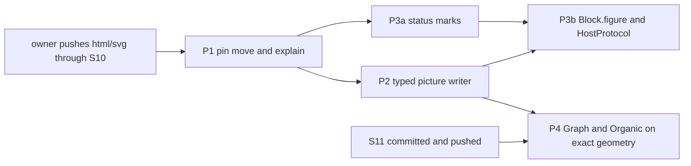

# Probe: what Effect4 does to adopt the SVG library of lean4-whatwg (2026-10-12)

Status: research note (history, not authority). A read-only probe. Base `e9e199c9d` on
`refactor/phase1-phase3`. No `lake` ran, nothing was built, fetched or committed, here or on the
PC. The PC was read with `git show`, `git grep`, `git log` and `git diff` in
`C:/Users/kokok/Dev/lean4-whatwg-svg`, and three untracked S11 files were copied by `scp` into the
session scratchpad. The seat's uncommitted files were not touched.

Inputs:

- the seat's handoff note `docs/research/2026-10-12-svg-seat-to-effect4.md` (PC working copy,
  sections 1 to 11);
- its battery `WhatwgTest/Html/SvgKit.lean` at `1365738`, and ruling R-S25 of its `COORDINATION.md`;
- decisions rows 334, 353 and 354, and DI-30;
- `docs/research/2026-10-11-docs-design-language/README.md`.

The refs are as the PC last saw them; no fetch ran. `origin/html/svg` is S8 (`ff0a602`). Local
`html/svg` is S10 (`1365738`), three commits ahead: `6266be8` (S9 pin), `599efba` (S9) and
`1365738` (S10). S11 is uncommitted. `origin/main` is `a13097f`, an ancestor of `html/svg`.
Effect4 pins `2c6e3bc` (`origin/html-h7`), also an ancestor.

## Know this first

- **The owner pushes through S10 now, and does not wait for S11.** The port of the picture
  writer needs S10's kit: `Svg.*` constructors, typed paint attributes, `SvgNode.nest`,
  `Svg.Frame`, `renderXml?`. S8 has none of it, and a port onto S8's bare node would be thrown
  away. S11 rewrites `Shape` and adds exact geometry for `Graph.lean` and `Organic.lean`. It
  touches no module that the port or the docgen imports. The push is a fast-forward of three
  commits: `ssh pc "git -C C:/Users/kokok/Dev/lean4-whatwg-svg push origin html/svg"`. If the
  push waits, P1 alone can land at `ff0a602` (S8), which `origin` already holds.
- **The pin move needs no code change to compile.** Every name that
  `tools/Tools/Document/Html.lean` uses exists at `1365738` with the same type. One change is
  owed anyway. `problem?` calls an `svg` element "not an element of the HTML Standard", though
  `Content.validIn` admits it. Once a page holds a figure, a refusal can get a wrong message.
  `Content.explain` replaces it.
- **The import closure now reaches Aesop.** `Whatwg.Html.Content.Valid` imports the SVG schema, and
  `Whatwg.Svg.Data.Mask` imports `Whatwg.Auto.RuleSets`, which imports `Aesop`. This holds at S8
  too. Aesop is at Effect4's own pin, so nothing conflicts. But the `semantics-report` executable
  now links Aesop and part of Batteries. The lakefile comment "whose import closure is Lean alone"
  becomes false.
- **No structure theorem belongs in Effect4.** `picture_okIn` and its like reach
  `Classical.choice`. A `Test` home needs a DI-30 admission that the gate's two lists do not fit.
  A `tools/` home is outside the gate but cannot be a registry claim. For the release, the
  run-time test (`okIn`, `renderXml?`, `explain`) stands at each write.
- **Nothing committed pins SVG or page text.** No golden, battery or gate compares the view's
  `.svg` files or `semantics.html`. The pin move still stales every Make marker, because
  `lakefile.toml` and `lake-manifest.json` are `BUILD_PINS`.
- **The first use for the release is the status mark** (row 354, point 2). It needs only the kit's
  constructors and the existing page check. The figure (`Block.figure`, HostProtocol's
  automaton) follows the writer's port.

## 1. Effect4's consumers of whatwg today

`grep -rln Whatwg tools src Test` finds one Lean source, `tools/Tools/Document/Html.lean`. The
others reach whatwg through it, and the view writes SVG with no whatwg import at all.

| File | Imports | What it uses |
| --- | --- | --- |
| `tools/Tools/Document/Html.lean` | `Whatwg.Html.Print.Render`, `Whatwg.Html.Content.Valid` | `RawNode` (`.element`, `.text`); `Content.validIn`, `Content.Ctx.document`, `Ctx.admitsWith`, `Ctx.child`, `Content.attrProblem?`, `Content.seqProblem?`, `Schema.Tag.ofName?` (all in `problem?`); `Print.renderDoc` |
| `tools/Tools/Document.lean` | no whatwg | the `Document` data type, its fold, `check` and the Markdown fold |
| `tools/Drivers/Semantics.lean` (exe `semantics-report`) | `Tools.Document.Html` | `Document.html`, written to `.lake/gen/semantics-report/semantics.html` |
| `Test/Audit/ClosureAudit.lean` | `Tools.Document.Html` | `#closure_audit Effect4 Tools ProofGraph` over the imported tool modules |
| `tools/Tools/View/Output.lean` | no whatwg | `Dev.svg` and `svg`: SVG as strings; `stream`, `Dev.row`, `lookRows`: the C stream |
| `tools/Drivers/View.lean` | `Tools.View.Output` | writes `NNN.svg` with `svg … 1 …`; writes its player, gallery and looks pages as strings with `escape` |
| `tools/Tools/View/Live.lean`, `LiveChecks.lean`, `tools/Drivers/Live.lean` | `Tools.View.Output` (Live) | the stream half only: `stream`, `Dev.row`, `lookRows`, `oneLine` |
| `Makefile`, group `semantics` | `SEMANTICS_SOURCES` lists `tools/Tools/Document.lean` and `tools/Tools/Document/*.lean` | `make gen-semantics` builds `semantics-report` |

`lakefile.toml` pins `whatwg` at `2c6e3bc` with the comment "Only the `Tools` library imports it,
and only `Whatwg.Html.*`, whose import closure is Lean alone". Decisions row 353 records the same
pin.

## 2. What changed between `2c6e3bc` and `1365738`

Size, by `git diff --shortstat` and `git rev-list --count`: 233 commits, 529 files,
+122,613 and −7,900 lines. `Whatwg/Html`: 35 files, +5,112 and −428. `Whatwg/Svg`: 38 new files,
+10,064. S8 to S10 alone: 47 files, +7,366 and −79.

### The Lake layout: no break for Effect4

| At `2c6e3bc` | At `1365738` | Effect4 names it? |
| --- | --- | --- |
| library `Whatwg` (globs `Whatwg.*`) | one library per standard: `WhatwgHtml`, `WhatwgSvg`, `WhatwgAuto`, `WhatwgInfra`, …; `Whatwg` owns only the umbrella module | no; module names are unchanged |
| library `Gates` (`Gates.*`) | `WhatwgGates` (`WhatwgGates.*`, namespace still `Gates.*`) | no |
| executables rooted at `VendorSeal`, `bin.Census`, …; names `census`, `citations`, … | roots `whatwgbin.*`; names `whatwg_*` | no |
| requires `hash`, `effects`, `typescript` | the same three, plus `aesop` | see below |

The renames remove a collision risk: Lake resolves module and executable names across the
workspace. No Effect4 file names a whatwg library, module root or executable, so nothing breaks.

Dependencies at `1365738`:

- `aesop` `3448c0bc`, the same commit as Effect4's; it brings `batteries` `4488d40d`, the same as
  Effect4's manifest.
- `hash` `c906b15d`, `effects` `a4ee7a14` and `typescript` `6afc9b84` differ from Effect4's pins.
  The root's pins win, as they do today against `0168306b`, `c28833b3` and `fcbc05a4`. No module
  in Effect4's import closure imports `Hash`, `Effects` or `TypeScript` (closure computed below).
- `lean-toolchain` is `v4.33.1` on both sides.

### The names Effect4 uses

Each was read at `1365738` with `git grep` and the diffs of `Context.lean`, `Sequence.lean`,
`Valid.lean`, `Render.lean` and `Tags.lean`. `Node/Raw.lean` has no diff.

| Name | At `1365738` |
| --- | --- |
| `RawNode.element`, `.text` | unchanged |
| `Content.validIn ctx n : Bool` | same type. Now `validAt (.html ctx) n`, a run of the walk algebra `check`, no longer `mutual` with `validAll`. It admits `svg` where the position admits the foreign tag, and checks the subtree by the SVG schema (`validIn_svg`). At an HTML name it is the old conjunction (`validIn_element_eq`) |
| `Content.Ctx.document`, `Ctx.admitsWith`, `Ctx.child` | same types |
| `Content.attrProblem?`, `Content.seqProblem?` | same types. `RawNode.tag?` counts a foreign `svg` child in a sequence |
| `Schema.Tag.ofName?` | same type. `Tag` gains `.math` and `.svg`, foreign tags with no markup name, so `ofName? "svg" = none` |
| `Print.renderDoc`, `Print.render` | same types. The printer is the walk algebra `printWalk` over a state of namespace and raw-text bit. An HTML tree's raw-text rule reads the parent's state, where the old printer had `renderRaw` |

`git log 2c6e3bc..1365738 -- …` lists the commits that touch these modules or the lakefile:

- `e74dc0d` (S0 merge), `10c81a3` (S2), `81fe54a` (S3b, the walk and the seam);
- `a5b9e50` (Aesop, R-S10), `8ad963d` (S3c, `explain`), `f987a6c` (S3d, the printer in two
  namespaces);
- `9d936ea` (S4d), `059c595` and `5058629` (S6), `92bbcc4` (S7), `599efba` (S9);
- the lane V and W packaging commits `8629737`, `6797082` and `1531b73`.

### Behaviour that moves

- **A page with SVG.** `validIn` admits it. `problem?` of `tools/Tools/Document/Html.lean` reads
  `Tag.ofName? "svg" = none` and reports "not an element of the HTML Standard". Once a page
  holds a figure, the message can name the figure in place of the real refusal.
- **A page with no SVG.** The checker's verdict is the old one by `validIn_element_eq`, and no
  name changes. Whether the printer writes the same bytes is not proved here: no theorem relates
  the old and the new printer. P1 compares the page's bytes.

### The import closure

A script in the scratchpad (`svg-adopt/scripts/closure.py`) walks the `import` lines that
`git grep` reads at each commit. It is a reading of the sources, not of a build.

| Roots | At `2c6e3bc` | At `1365738` |
| --- | --- | --- |
| `Whatwg.Html.Print.Render`, `Whatwg.Html.Content.Valid` | 22 whatwg modules; outside: `Lean` | 32 whatwg modules (`Whatwg.Html.*`, `Whatwg.Svg.Data.*`, `Whatwg.Svg.Schema.*`, `Whatwg.Svg.Content.Context`, `Whatwg.Auto.RuleSets`); outside: `Aesop` |
| the same, and `Whatwg.Html.Content.Explain` | | 33 |
| P2's kit: the above, and `SvgBuild`, `SvgPaint`, `SvgNest`, `Print.Picture`, `Geometry.Pen`, `Geometry.Arith` | | 59 |
| the seat's whole battery imports (with `Shape`, `Affine`) | | 61 |

The way to Aesop: `Whatwg.Html.Content.Valid` → `Whatwg.Html.Svg` → `Whatwg.Svg.Schema.*` →
`Whatwg.Svg.Data.Mask` → `Whatwg.Auto.RuleSets` → `Aesop`. `Mask.lean` registers its laws in the
bank `Whatwg.Mask` and proves one by `aesop`; `Whatwg/Svg/Value/Grammar.lean` registers into
`Whatwg.Syn`. The seat's note says that `SvgValid` and `Render` "load no tactic and no
elaborator". They load no elaborator: `Whatwg.Html.Syntax.Elaborator` is outside the closure. They
do load Aesop.

What follows for Effect4:

- the `semantics-report` executable links the object code of Aesop and of the part of Batteries
  that Aesop imports. On this Mac `.lake/packages/aesop/.lake/build` holds 132 `.c` files and no
  `.o`, and Batteries holds no `.o`, so the first link compiles them. Its time is not measured;
- after P2, `tools/Drivers/View.lean` runs over the same closure;
- the comment in `lakefile.toml` and row 353 need the new closure.

A request for the seat, not a blocker: move the `aesop` attributes and the one `aesop` proof of
`Mask.lean` and `Grammar.lean` into their law modules. The definitions that a consumer imports
would then reach Lean alone.

## 3. The port of `tools/Tools/View/Output.lean` onto the S10 kit

`WhatwgTest/Html/SvgKit.lean` at `1365738` is the port, against `Output.lean` read at
`707b9a01`. It restates `Role`, `Face`, `Font`, `Look`, `Dev` and `Keyed` under Effect4's names,
and takes `Box` and `Cubic` from `WhatwgTest/Html/SvgPicture.lean`. Those two have the fields of
Effect4's `Rect` and `Cubic` (`tools/Tools/View/Picture.lean`) exactly. The seat counts 93 lines
for the writer, the fold and the picture, and 72 for the structure proof.

### File by file

1. **`tools/Tools/View/SvgOut.lean`, new.** The typed writer beside the string writer (AGENTS:
   a second file beside the old one). It imports `Tools.View.Look`, `Whatwg.Html.Node.SvgBuild`,
   `SvgPaint`, `SvgNest`, `Whatwg.Html.Print.Picture`, `Whatwg.Svg.Geometry.Pen` and
   `Whatwg.Svg.Geometry.Arith`. It holds the battery's writer with the restated types removed:
   - `fillNode`, `curveNode`, `textNode`, `hitNode`, `shapeNode`, `closedPen`, `cutNodes`, `flat`,
     `marksOf`, and the picture (name it `svgPicture`; `Tools.View` has no `picture`);
   - `Role.token` is `Role.tokenName`, `Face.token` is `Face.tokenName`, and `Box` is `Rect`;
   - a colour is `Whatwg.Html.Rgb.ofNat (L.color role)`: Effect4's `Look.color` answers a `Nat`;
   - a font is `.fontFamily f.cssFamily`, `.fontStyle f.italic`, `.fontWeight f.weight` and
     `.fontSize (.fixed 3 f.size)`;
   - `Keyed Dev` replaces the battery's `Keyed`; `flat` reads `d.1.key` and `d.1.call` alike.

   The structure proofs stay out (section 5). The stepDown section of the battery belongs to
   `Graph.lean`, which is P4.
2. **`tools/Drivers/View.lean`.** `writePicture` writes
   `(svgPicture L W.toNat H.toNat 1 (lowerAll 1 calls)).renderXml?`. On `none` it stops with the
   picture's name: a control character in a text, or a data key that is no XML name. Before the
   write it tests `okIn Ctx.flow`; on `false` it prints `Content.explain` of the raw tree. The
   player, gallery and looks pages stay strings with `escape`.
3. **`tools/Tools/View/Output.lean`.** After the driver moves, delete the string writer:
   `opacity`, `keyAttr`, `textAttrs`, `pathData`, `Dev.svg`, `svg` and the SVG half of the
   header. Keep the stream half, which `Live.lean` reads. Keep `escape` here or move it into the
   driver, which is its last user.
4. **`tools/view/README.md`.** The table row of `Output.lean` names the stream alone, and a row
   names `SvgOut.lean`.

### What replaces `problem?` and `Dev.svg`

- **`problem?`** (`tools/Tools/Document/Html.lean`) becomes `Content.explain ctx tree`
  (`Whatwg/Html/Content/Explain.lean`). It answers a `Refusal`: a path of child indices and a
  first-order `Reason`. `explain_none_iff` says it is `none` exactly when `validIn` is `true`.
  `Reason.describe` writes the reason, and `RawNode.at?` names the node at a path. A path of
  element names, as `problem?` wrote, is a short fold of `at?` over the path's prefixes. The
  mutual pair `problem?`/`problemList?` goes.
- **`Dev.svg`** becomes `flat : Keyed Dev × Nat → SvgNode.Flat Cut`, one typed node a mark, a
  `.enter` for a cut and a `.leave` for its end. **`svg`** becomes `SvgNode.nest (cutNodes r)` of
  those calls inside `Svg.Frame.svg`. The text of a file is `SvgNode.renderXml?`, and the markup
  in a page is `SvgNode.render`.

### Names to open with care

Inside `namespace Tools.View`, these names exist on both sides:

- `Rgb` (`Tools.View.Rgb := Nat`, `Whatwg.Html.Rgb`);
- `Curve` (`Tools.View.Curve`, `Whatwg.Svg.Value.Curve`);
- `Shape` (`Tools.View.Shape`, the namespace `Whatwg.Svg.Value.Shape`);
- `Cubic` and `Box` from S11 on.

Open by name, for example `open Whatwg.Html (SvgNode SvgAttr Svg)` and
`open Whatwg.Svg.Value (Decimal Pen)`, and write `Whatwg.Html.Rgb.ofNat` in full.

### What the text of a `.svg` file becomes

From the seat's sections 8 to 10 and the guards of `SvgKit.lean`; no theorem relates the writers.

- One line for the picture, where `Dev.svg` writes a line a call.
- Geometry first on `rect` and `path`, then `class`.
- Path data in the grammar's spelling: `M10,20C10,30 30,30 30,40`, subpaths joined as `ZM`.
- `'` and `>` as they are in text and values; a tab or a line break in a value as `&#9;`, `&#xA;`.
- A negative width or height written as zero; a stray end of a cut dropped, and an open cut
  closed.
- Attribute names, classes, `data-key`, `data-look`, `viewBox`, `transform`, clip identifiers
  and the escapes of `<` and `&` are as before.

The stream (`.draw`) does not change: P2 leaves `Dev.row` and `stream` alone.

### What S11 changes for the port

The S11 working copy rewrites `Whatwg/Svg/Geometry/Shape.lean` (`Curve.bumpY r`,
`Curve.cardinal tension` over `Rat`; a curve is a list of cubic segments) and adds
`Whatwg/Html/Node/SvgDraw.lean` (`Svg.cubics`, `Svg.loops`, `Svg.box`). Its diff touches no
module that P2 imports. With S11, `curveNode` and `shapeNode` shorten to `Svg.cubics [c]` and
`Svg.loops paths` over the kit's exact `Cubic`. So P2 uses no `Shape.*` at the S10 pin, and P4
takes S11 with `Graph.lean` and `Organic.lean`.

## 4. What pins view and document text

| Output | Committed? | Pinned by | P1 | P2 | P3 | Command |
| --- | --- | --- | --- | --- | --- | --- |
| `generated/semantics.md` | yes | `make check-gen` (drift) | no change expected | no | changes if the Markdown fold writes marks or a figure's text forms | `make gen-semantics`, then commit the reviewed diff |
| `.lake/gen/semantics-report/semantics.html` | no | nothing; the driver refuses a page that `validIn` refuses | bytes expected equal; compare with `cmp` | no | changes | `make gen-semantics` |
| `.lake/gen/semantics-report/semantics.json` | no | nothing | no | no | no | `make gen-semantics` |
| the semantics refusal controls | no | `make check-semantics` | stale by `BUILD_PINS` only | no | rebuilt: `Drivers.SemanticsControls` imports `Tools.Document` | `make check-semantics` |
| `#closure_audit` over imported tool modules | no | `Test/Audit/ClosureAudit.lean` | rebuilt | no | rebuilt; audits `SvgOut` if the page imports it | `LEAN_NUM_THREADS=3 lake build Test.Audit.ClosureAudit` |
| the view's `NNN.svg`, player, gallery and looks pages | no (`tools/view/out`) | nothing | no | changes (section 3) | no | `tools/view/v -H pFork`, `tools/view/v -L` |
| the view's stream `NNN.draw` and the live patch rows | no | `tools/Tools/View/LiveChecks.lean` (`#guard`s on calls, scenes and streams); `tools/view/v -c NAME` (C store equals Lean's stream, byte for byte) | no | no change; rebuilt when `Output.lean` loses its SVG half | no | `lake build Tools.View.LiveChecks`; `tools/view/v -c pFork` |
| `.lake/gen/architecture-map.html` | no | nothing (`Tools.Architecture.esc`, no whatwg) | no | no | no (D6 is later) | `make gen-architecture` |
| `docs/design/design-language/*.svg`, `index.html` | yes | nothing; hand-drawn studies | no | no | no | none |

The live-view kit LV-0 to LV-8 (`docs/research/2026-10-10-live-view/LANDING.md`) concerns the
stream, the retained scene and its patch rows. None of its checks reads SVG. LV-1's `isqrt` maps
to S11's `sqrtDown`, which is P4.

`make check-docs` and `make check-language` read Markdown only. A P3 that adds the design
language to `docs/core/` (row 354, point 1) reaches both.

`BUILD_PINS` (`lean-toolchain lakefile.toml lake-manifest.json`) is a prerequisite of every
generation group and check marker. P1 stales all of them. By the landing rule, the gate P1 reaches
is `make gen-semantics`; the other groups rerun when the owner asks, and `make status` shows them
stale until then.

## 5. The axiom gate

Facts:

- The gate audits every declaration of every `Effect4.*` and `Test.*` module at
  `[propext, Quot.sound]` (`belongsToAuditedTree`, `Test/Audit/AxiomGate.lean`). The `Tools`
  library is outside it (`lakefile.toml`'s comment on `Tools`).
- Its walk follows constants into imported packages. A `Test` declaration that mentions
  `SvgNode.okIn`, `Print.render` or `Print.Xml.render` reaches what they reach.
- The structure theorems reach `Classical.choice` (the seat's note, section 8). The way is the
  `String` key of a data attribute and the checker of a raw subtree. R-S25 (c) puts
  `Whatwg.Svg.Geometry` under whatwg's ordinary ceiling: core's `Rat`, `Nat.sqrt` and `grind`
  lemmas reach it.
- The gate admits `Classical.choice` in two ways:
  - by exact name in `choiceImplementationDeclarations`, for rendering crossings "never proved
    about";
  - by module in `auditImplementationModules`, for meta code with no theorem.
- DI-30 adds a `# reason:` line for each entry. Its first case refused WHATWG declarations
  entering on their strength.
- `buildReport` (`tools/Tools/Semantics.lean`) refuses a registry pointer that reaches an axiom
  outside the ceiling, so such a theorem cannot be a claim.
- Row 334, point 3: the picture's layout stays a tool whose laws are tests.

Where proofs can live:

| Home | Builds? | Audited? | A claim? | Fit |
| --- | --- | --- | --- | --- |
| `WhatwgTest/Html/SvgKit.lean` (the seat's) | yes, in whatwg | whatwg's ceiling admits choice | no | holds today, for a restated writer; no theorem relates it to Effect4's |
| `tools/Tools/View/SvgOutLaws.lean` | yes | no; `#axiom_audit` would refuse it | no (`buildReport` refuses) | a tool law under row 334(3); 72 lines to port; no consumer on the M5 to M7 spine |
| a `Test` battery with named exemptions | yes | only with an entry per theorem and a DI-30 reason | no | bends both admission lists: a structure law is neither a rendering crossing nor meta code |

Recommendation: no structure theorem in Effect4 for the release. The run-time tests stand at
every write: `okIn` and `renderXml?` in the view driver, `validIn` and `explain` in the page
writer. Two routes give a theorem for Effect4's own writer, if the owner wants one:

- a tool law in `tools/`, with a decisions row;
- a request to the seat: definitions of `SvgNode.okAt` that reach no choice, so a battery holds it
  at the ceiling.

A battery keeps rendered text inside `#guard`s, which leave no constant.

## 6. The docgen and row 354

Row 354, point 6 rules inline SVG now, spliced after the content-model check. Once the whatwg
checker accepts inline SVG, figures pass the check like the rest of the page. The seam is in S3b,
so the pin move ends the interim route.

How the kit serves it:

- **One check for the whole page.** `Tools.Document.Html` builds a `RawNode` tree. A typed
  picture `n` stands in it as `n.toRaw`. The page's existing `Content.validIn Ctx.document`
  check covers it. `svg` is phrasing and flow content at `1365738` (`Schema/Families.lean`), so
  it may stand in a `span`, a `td` or a `figure`.
- **Typed values.** Path data, a view box, a transform list and a length hold typed values, and
  every value of a typed tree passes its grammar (`SvgNode.valuesOk_toRaw`). Paint and opacity
  have no sealed grammar (SV-26): their helpers take typed arguments and write a string.
- **Accessibility.** The SVG schema takes `role`, `aria-hidden`, `aria-label`, and the `title` and
  `desc` elements, which the design-language note's recommendation 4 asks of a figure.
- **Ids are page-wide.** Clip identifiers `c{index}` repeat across figures on one page. Prefix each
  with the figure's key. This probe did not read whether the checker refuses a repeated `id`.

The first concrete use: **the status mark** (row 354, point 2).

- `Inline.status w` prints `span.status` with `data-status`, and the stylesheet colours it by hue:
  green, amber, red. Row 354 says status by shape, with no hue.
- The HTML fold maps the word to a mark:
  - proved: a filled circle; modulo: half filled; a planned goal: hollow;
  - open: a dashed outline (`.strokeDasharray`); refuted: a cross.
- Each mark is a closed term of `Svg.svg`, `Svg.circle` and `Svg.path`, with `aria-hidden`,
  before the word.
- The semantics page writes `.status` in claim, requirement and plan rows
  (`tools/Tools/SemanticsDocument.lean`), so every status on the release's page shows it.
- It needs the kit's constructors and nothing of P2. The hue rules leave `style`.
- Open for the owner: the Markdown fold may write a glyph (●, ◐, ○, ◌, ×) beside the word, which
  changes `generated/semantics.md`.

Then **the figure** (the design-language note's recommendation 4, slices D3 and D4):

- `Block.figure` holds a key, a caption, its text forms and a scene: a size and a
  `List (Keyed Call)`. `Tools.Document` then imports `Tools.View.Picture`, and the document still
  holds no markup.
- The HTML fold lowers the scene and writes `svgPicture` from P2 inside `figure` with a
  `figcaption`. The Markdown fold writes the caption and the spoken form.
- The first figure is the HostProtocol automaton (row 354, point 7: automata first). Its data is
  `hostProtocol.states` and `hostProtocol.transitions` (`Effect4.Api.HostProtocol`). One `GNode`
  a state and one `GEdge` a transition give a `Tools.View.Graph`; `layout` and `calls` draw it.
  Cycles become back edges. Whether an edge's label needs a call that `Graph.lean` lacks is not
  read here.

## 7. The slices

P3a and P2 edit disjoint files (`tools/Tools/Document/*` against `tools/Tools/View/*` and
`tools/Drivers/View.lean`), so two seats can run them at once.

| Slice | Files | Lake rebuild (from imports; not measured) | Owed by the landing rule |
| --- | --- | --- | --- |
| **P1** pin move | `lakefile.toml` (`rev = "1365738abeb40d9ef38f7434e68fef1798943475"`, the comment); `lake-manifest.json` by `lake update whatwg`, whose diff touches the `whatwg` entry alone; `tools/Tools/Document/Html.lean` (`problem?` → `explain`, import `Whatwg.Html.Content.Explain`) | 33 whatwg modules; Effect4: `Tools.Document.Html`, `Drivers.Semantics` (the executable links Aesop and Batteries object code the first time), `Test.Audit.ClosureAudit`. No core, law or other battery module imports whatwg | `LEAN_NUM_THREADS=3 lake build Tools.Document.Html Drivers.Semantics Test.Audit.ClosureAudit`; keep a copy of `semantics.html`, run `make gen-semantics`, then `cmp` the two pages and `git diff --exit-code generated/semantics.md`. No `Effect4.*` or `Test.*` source changes, so no `#axiom_audit` is owed |
| **P2** typed writer | `tools/Tools/View/SvgOut.lean` (new); `tools/Drivers/View.lean`; then `tools/Tools/View/Output.lean` (SVG half out); `tools/view/README.md` | +26 whatwg modules (59); Effect4: `Tools.View.SvgOut`, `Drivers.View`; the cut rebuilds `Tools.View.Output`, `Tools.View.Live`, `Tools.View.LiveChecks` and `Drivers.Live` (`view-live` links no whatwg) | `lake build Tools.View.SvgOut Tools.View.LiveChecks Drivers.Live`; `tools/view/v -H pFork` and `tools/view/v -L` by eye; `tools/view/v -c pFork` after the cut. No outside implementation compares these outputs |
| **P3a** status marks | `tools/Tools/Document/Html.lean` | `Tools.Document.Html`, `Drivers.Semantics`, `Test.Audit.ClosureAudit` | `make gen-semantics`; `make check-semantics`; commit `generated/semantics.md` if the Markdown changes |
| **P3b** the figure | `tools/Tools/Document.lean`, `Document/Html.lean`, `SemanticsDocument.lean`; `Makefile`; `docs/GENERATED.md` (the group's inputs) | `Tools.Document`, `Tools.Document.Html`, `Tools.SemanticsDocument`, `Drivers.Semantics`, `Drivers.SemanticsControls`, `Test.Audit.ClosureAudit` | as P3a; `make check-docs` if a document changes |
| **P4** exact geometry | pin to S11's commit; `tools/Tools/View/Graph.lean`, `Organic.lean`, `SvgOut.lean` | `Graph`'s importers in `tools/Tools/View/` and the drivers | `tools/view/v -c pFork`; the LiveChecks build. A control point may move by a thousandth (seat's section 11) |

`SEMANTICS_SOURCES` lists `tools/Tools/Document*.lean` and no view module. Once the page imports
`Tools.View.SvgOut` or `Tools.View.Graph`, a change there must stale the group, so the list
grows. `LEAN_INPUTS` covers `src` and `Test` only.

### What the owner pushes first

Push `html/svg` through S10 (`1365738`), and do not wait for S11:

- P1 needs only the seam and `explain`, which S8 already has. P2 and P3 need S10's kit.
- So P1 could land today at `ff0a602`, already on `origin`. Pinning S10 at once saves a second
  pin move and its stale markers.
- S11 is uncommitted and changes `Shape`'s constructors; P2 and P3 avoid `Shape`, so S11 lands
  later as P4 with no rework of P2.
- `html/svg` contains `origin/main` (`a13097f`), so `main` can fast-forward to it later. Effect4
  pins a commit either way.

### Proposed decisions row (for the coordinator)

"`lean4-whatwg` pinned at `1365738` of branch `html/svg` (S10), replacing row 353's `html-h7`.
`Tools` imports `Whatwg.Html.*` and the SVG kit (`Whatwg.Html.Node.Svg*`, `Whatwg.Html.Print.*`,
`Whatwg.Svg.*`). Their closure reaches Aesop at Effect4's pin. Page figures pass the content-model
check (row 354, point 6). No structure theorem of a picture enters Effect4; the run-time tests
stand at each write."

## 8. Placement and limits

- Concept: none of the ten. Row 353 makes documents presentation, and row 354's laws are tool
  laws (row 334, point 3). No registry claim moves, and no requirement R1 to R14 is served
  directly; the release's docgen is the consumer.
- Evidence kinds:
  - the API comparison is a reading of sources at two commits by `git grep` and `git diff`;
  - the import closures are computed from `import` lines, not from a build;
  - the counts are `git diff --shortstat`, `git rev-list --count` and `find`;
  - the PC's refs are as of its last fetch.
- Not established:
  - that `tools/Tools/Document/Html.lean` elaborates at `1365738` (the seat elaborated a copy at
    S5; P1's build is the check);
  - that the page's bytes are unchanged with no SVG (P1's `cmp`);
  - any rebuild or link time;
  - that the S10 port, moved into Effect4's types, elaborates unchanged; the seat's port did, on
    restated types with the same fields;
  - that S11 leaves `SvgBuild`, `SvgPaint`, `SvgNest` and `Pen` alone once it is committed: read
    from today's working diff only.
- Host boundary: none involved. The XML writer is not proved to be the DOM algorithm on every
  tree (the seat's SV-40 and R-S23); a browser reads the files.
