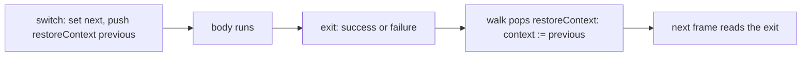

# Restore slot: a context switch's restore popped with the exit (plan, 2026-10-12)

**Retired (owner, 2026-10-12).** No proof needs the slot. The four goals below wait on the
release's context merge (`docs/research/2026-10-12-restore-slot-scout.md`), which landed on
branch `land/release-merge`. This plan stays as history.

The owner ruled on 2026-10-12: a context switch restores the previous context through a stack
slot that the walk pops with the exit. No restore code runs. This note plans the slice that lands
it. The slice is a machine change, so this note comes first (`AGENTS.md`, Working).

## Why the slice is owed

Decisions row 349 types the machine's code by one ambient judgment, `AmbientProg`. Every program's
failure row is within its entry row, interruptible or not. A context switch breaks this when its restore
runs as code after the switch. A failure can then leave while the switched-to context is current.

Four planned goals wait on the slot. Each names the slice in its docstring:

| Goal | Path | Concept |
| --- | --- | --- |
| `clause_closeScope` | `src/Effect4/Laws/Program/Typed/Commands/Evaluate.lean` | scope-lifetime-finalization |
| `Evaluating.settle_callback` | `src/Effect4/Laws/Program/Typed/Commands/Evaluate.lean` | scope-lifetime-finalization |
| `clause_scoped` | `src/Effect4/Laws/Program/Typed/Commands/Evaluate.lean` | scope-lifetime-finalization |
| `foreignFinalizer_ambient` | `src/Effect4/Laws/Program/Typed/Commands/Clauses/Close.lean` | scope-lifetime-finalization |

All four serve requirement R11. Both close walks (`clause_closeIter_sequential`,
`clause_closeIter_parallel`) are proved modulo `foreignFinalizer_ambient`.

## What rc.112 does

`updateContext` (`vendor/effect-4.0.0-rc.112/src/internal/effect.ts:2073-2096`) runs in
`withFiber`:

1. It reads `prevContext` and computes `nextContext`.
2. It calls `fiber.setContext(nextContext)`.
3. It returns `onExitPrimitive(self, callback)`. The callback calls `fiber.setContext(prevContext)`
   and returns `undefined`.

The callback returns no effect, so the restore runs inside the frame's pop and runs no operation.
Effect 4.0.1 has the same shape (`vendor/effect-4.0.1/src/internal/effect.ts`, `updateContext`): it
registers `onExitUnsafe(fiber, callback)` and returns `self`.

The switch and the frame's push are two steps. The loop top delivers a deferred interrupt whatever
the mask (`internal/effect.ts:639-642`). An interrupt between the two steps leaves with
`nextContext` current. The slot closes this window. It is the one observable difference from rc.112.

## What our machines do today

- The frame machine's region (`src/Effect4/Program/Compile.lean`, `updateContextAt`,
  `EffThunk.provideMasked`) switches under a mask. It then runs the body under
  `Prim.onExit body (EffName.restoreCtx previous)`.
- The release (`EffThunk.releaseMasked`) runs under the same finalizer.
- The term machine (`src/Effect4/Laws/Program/DenoteR.lean`) runs
  `onExitR body (fun _ => fiberValR (.setContext previous) rfl)`.

In both machines the restore is a finalizer that runs a `setContext` operation.

## The slot

- A stack frame `restoreContext previous` is pushed in the same step as the switch.
- The walk pops it on every exit and sets the context before it reads the next frame.
- No operation runs for the restore.
- At the ambient judgment, the frame is an arrow from the body's position at the switched row
  to the caller's position at `previous.services.keysRow`. `MFrame.restoreMask` is the model: it
  restores the mask flag the same way.

## Operation count

rc.112's restore runs no operation. Ours runs one `setContext` operation per region exit. The slot
removes that operation, so the count moves to rc.112's. The yield points of a fiber move with the
count (`maxOpsBeforeYield`).

To measure before the cut: run a truth fixture whose region exit falls on the yield boundary under
`make check-truth`. Compare the trace with the Effect runtime's.

## The slice

1. The machine:
   - `ScopeFrame.restoreContext` and its pop arm in `src/Effect4/Machine/Fibers.lean`;
   - the frame machine's region and release in `src/Effect4/Program/Compile.lean`;
   - the term machine's `onExitR` restore in `src/Effect4/Laws/Program/DenoteR.lean`.
2. The simulation between the two machines (`run_eq_ref`) at the new frame.
3. The typing: `MFrame.restoreContext` in `src/Effect4/Laws/Program/Typed/AmbientMachine.lean`.
   Then `ambient_onExit_restore` becomes the slot's arrow.
4. The four goals above, proved in place.
5. Regenerate `lcnf`. Run `check-compiler`, `check-native`, `check-ocaml`, `check-truth` and
   `check-host-protocol`.

## What this does not establish

- It changes no behaviour outside the interrupt window, except the operation count above.
- It proves no progress, and no outside-runtime observation beyond the named gates.
