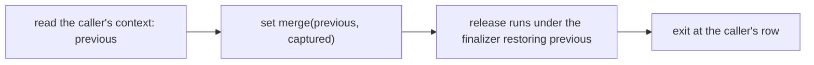

# Restore slot: scout (2026-10-12)

**Know this first.** No proof needs the restore slot. All four goals that name it wait on one
premise, which a one-line modelling fix discharges. That fix brings our release closer to what
Effect actually runs. The slot itself changes one rare outcome and an operation count.

This note scouts the plan `docs/research/2026-10-12-restore-slot-plan.md`. It judges each step by
two tests (owner, 2026-10-12):

- Does it change an outcome of a real run?
- Does the proof graph need it for a guarantee?

## What blocks the four goals

| Goal | Path | What its docstring names |
| --- | --- | --- |
| `foreignFinalizer_ambient` | `src/Effect4/Laws/Program/Typed/Commands/Clauses/Close.lean` | the release's context switch |
| `clause_closeScope` | `src/Effect4/Laws/Program/Typed/Commands/Evaluate.lean` | the release's context switch |
| `Evaluating.settle_callback` | `src/Effect4/Laws/Program/Typed/Commands/Evaluate.lean` | the close's release |
| `clause_scoped` | `src/Effect4/Laws/Program/Typed/Commands/Evaluate.lean` | the scoped exit's close, so the release |

`foreignFin_ambient` (`src/Effect4/Laws/Program/Typed/Body.lean`) is already proved. It states
`foreignFinalizer_ambient` with one more premise, `window`: the captured context covers the
caller's row. `foreignFinalizer_ambient` is that theorem without `window`.

`window` fails today because our release replaces the context with the captured one:

- the term machine: `denoteFin`'s `foreign` arm (`src/Effect4/Laws/Program/DenoteR.lean`) runs
  `setContext c.ctx`;
- the frame machine: `EffName.releaseUnder` (`src/Effect4/Program/Compile.lean`) runs
  `EffThunk.setCtx ctx`.

A captured context can lack a key that the caller's context holds. A failure in the release then
leaves the fiber at a row that the caller's position does not cover.

## What Effect runs

`acquireRelease` registers `provideContext(release(a, exit), context)`
(`vendor/effect-4.0.0-rc.112/src/internal/effect.ts:3983`). `provideContext` is
`updateContext(self, Context.merge(context))` (`:2196-2197`). `Context.merge(self, that)` keeps
every key of `self`, and `that` wins on a shared key (`vendor/effect-4.0.0-rc.112/src/Context.ts`,
`merge`). Effect 4.0.1 has the same code (`vendor/effect-4.0.1/src/internal/effect.ts`,
`provideContext`; `Context.merge` is identical).

So Effect runs a release under the caller's context with the captured one merged over it. The
switched-to context holds every key of the caller's. A failure in the release leaves at a row that
the caller covers, so `window` holds.

## The fix: merge, as Effect does

- Term machine: `setContext c.ctx` becomes `setContext` of the merge, in `denoteFin`'s `foreign` arm.
- Frame machine: the same change in `EffName.releaseUnder`.
- The simulation (`run_eq_ref`) mirrors one change on each side.
- Typing: `foreignFin_ambient` discharges `window` from the merge's keys. `foreignFinalizer_ambient`
  becomes a one-line theorem.

### What changes at run time

For a well-typed program the merge changes no read. The checker types a release at its captured
row, and the captured service wins on every key of that row. The visible difference is the
yield budget. `setContext` reads `MaxOpsBeforeYield` and `PreventSchedulerYield` off the context
(`src/Effect4/Machine/Fibers.lean`, `WithFiberAction.setContext`). Under the merge, the caller's
budget services apply to the release, as they do in Effect.

### Cost

- Two definitions change: `denoteFin` and the `releaseUnder` continuation. Both sit low in the
  graph, so the narrow build rebuilds most of `Effect4.Laws`.
- The behaviour gates the change reaches: `check-compiler`, `check-native`, `check-ocaml`,
  `check-truth`, `check-host-protocol`, after `lcnf` is regenerated.

## What the slot would add

- **The switch window.** rc.112 sets the context, then returns `onExitPrimitive`. The restore
  frame is pushed one loop step later. A yield at that step lets an outside interrupt fail the
  fiber with the switched context current and no restore frame. 4.0.1 pushes the frame in the
  same step (`onExitUnsafe`). In our machines a provide region switches under a mask
  (`updateContextR`), and a release runs inside a finalizer, which is masked. So only `scoped`
  entry has this window, as in rc.112. The outcome: a scope that an interrupt hits exactly at its
  entry's yield is never closed.
- **The operation count.** Effect's restore callback returns no effect, so the pop answers the
  exit in one loop step. Ours runs the restore as a finalizer program (`finalizerCode`), which
  takes several steps. Yield points after a region exit can move.

Neither is a proof obligation. Both are recorded divergences. A probe measures them before any
slice.

## Recommendation

1. Retire the slot slice. Keep the two divergences above as recorded rows.
2. After the typed-context landing, land the merge: the two definitions, the simulation, then
   `foreignFinalizer_ambient` proved.
3. Then attempt `clause_closeScope`. Stop and report if it needs anything beyond the release.
   `Evaluating.settle_callback` and `clause_scoped` follow only if their proofs stay short.

## Open questions (probes, not slices)

- Does a truth fixture place a yield right after `scoped` entry, with an outside interrupt?
  Run it against rc.112 and 4.0.1 under `make check-truth`, and print the Effect version.
- How many loop steps does a provide region's exit take in our machine, and in Effect's?
- `provideContext` skips the switch when the release is an exit value
  (`effectIsExit(self)`, `:2196`). Ours always switches. This changes only the operation count.

## What this note does not establish

- No proof is attempted. The claim that the three `Evaluate.lean` goals wait only on the release
  comes from their docstrings. The step 3 attempt tests it.
- No run was made. The window and the operation count are read from the source.
