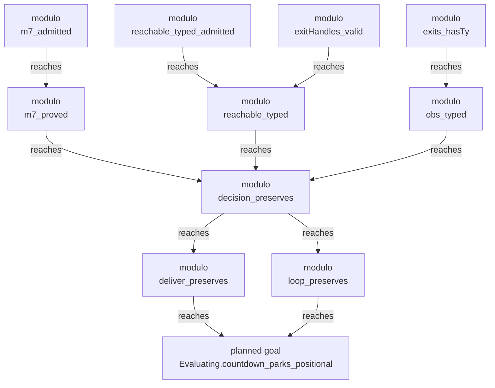
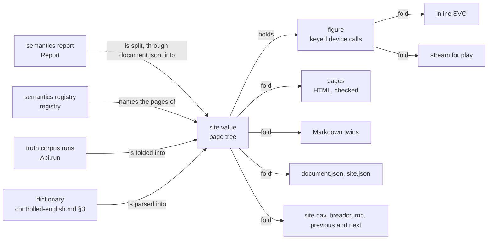

# 2026-10-12 Understanding the proof graph and the fiber machine: refinements for the site

Status: research note (history, not authority). Base: `142224632` on `refactor/phase1-phase3`,
and the coordinator's uncommitted changes to eight tools files, read at 20:58 (§6.5).
The measured site is `.lake/gen/site`, written by `make site` at 20:32 from the page sources of
`baaf0dc73`. A rebuild at 20:44 wrote a semantics page of the same size. The whatwg pin is
`c33ce29` (S16, `07b2b4752`).

Each fact carries one label. [reading] is the dictionary's evidence word: established by reading
the named source. [measured] is a command run for this note, and §9 gives each method.
[inference] is reasoning from labelled facts, with no run.

## 1. Know this first

- **The semantics page is mostly the plan, and the plan is mostly repetition.** The plan section
  holds 944,132 of 1,291,998 bytes (73.1%) [measured]. Its 14 node tables list 2,550 rows for
  1,342 distinct nodes, and its largest Mermaid source holds 591 nodes [measured]. The dictionary
  keeps a diagram under about thirty nodes (`docs/core/controlled-english.md` §5) [reading].
- **The answer a newcomer needs is small, and no page shows it.** The plan's open part holds 37
  nodes (26 modulo, 11 goals) and 35 edges, in 7 components of at most 11 nodes [measured]. M7
  rests on one goal through three hops: `m7_proved`, `decision_preserves`, `deliver_preserves`,
  then `Evaluating.countdown_parks_positional` [measured].
- **The explanations exist in Lean and stop before the site.** The goal's docstring says why the
  proof waits [reading]. `J` must say that each countdown key has at most one firing to come, and
  neither rc.112 nor Effect 4.0.1 fires twice. The report holds no docstring [reading:
  `DeclarationEntry`, `NodeEntry` in `tools/Tools/Semantics.lean`]. 21 of 212 claim statements
  display as the bare name of a proposition, such as `Effect4.Program.Sched.SessionEqRef`
  [measured].
- **The machine has no page.** No fiber, machine frame, decision, frontier, scope or mask (the
  region form that saves a fiber's interruptibility) is drawn on the site [measured]. The data and
  the drawing code exist [reading]. The view draws run frames (`Tools.View.Run`), and the kit
  draws strips (`Whatwg.Svg.Scene.Strip`). The truth lane compares 93 programs' schedules with
  rc.112. A one-fiber automaton has its edges stated by three theorems (`holds_evaluate`,
  `holds_flush`, `holds_answer`) [reading].
- **Navigation and figures fit a scriptless page.** A page tree held as one Lean value gives the
  site nav, breadcrumbs, previous and next links and an on-this-page aside as folds [inference].
  The content model at the pin accepts inline `svg`, and `Tools.View.SvgOut.fileText` checks a
  picture at flow content before it writes it [reading]. Search, scroll tracking, pan and zoom
  need a script, so they belong in the studio (row 362) [inference]. The coordinator's working
  tree builds that site value and a typed shell already (§6.5) [reading].
- **Motion on the site meets the site's own header.** The kit writes a step's motion as a `style`
  attribute and a `style` element (`Whatwg/Html/Node/SvgMotion.lean`) [reading]. The site's
  `Content-Security-Policy` is `default-src 'self'` with no `style-src` (`Tools.Site.headers`)
  [reading]. A browser then refuses both inline forms [inference: the policy's fallback]. A static
  figure carries presentation attributes only, and the policy lets it through [inference].

## 2. What a reader meets today

### 2.1 The pages and their sizes

| File | Bytes [measured] | What it holds [reading] |
| --- | --- | --- |
| `index.html` | 1,961 | two paragraphs, links to the two other pages, the JSON contract |
| `semantics/index.html` | 1,291,998 | the whole semantics report as one document |
| `specimen/index.html` | 5,018 | every block kind and status mark |
| `semantics/report.json` | 2,546,607 | the report, format `effect4-semantics-report`, schema 6 |

The semantics page by part [measured]:

| Part | Bytes | Share | What dominates |
| --- | --- | --- | --- |
| How to read a status | 1,311 | 0.1% | nine status words, each beside its mark |
| the ten concepts | 333,542 | 25.8% | 216 claim parts; 212 Lean statements, 142,330 bytes (11.0%) |
| Applicability decisions | 6,932 | 0.5% | 24 rows |
| Placement | 284 | 0.0% | two sentences |
| Plan | 944,132 | 73.1% | 14 node tables, 619,683 bytes (48.0%); 14 Mermaid sources, 280,644 bytes (21.7%) |
| Acceptance programs | 3,100 | 0.2% | five dogfood programs |

### 2.2 How it reads

- **Headings.** The page has one `h1`, 15 `h2` and 230 `h3` [measured]. The `h2` are the
  legend, the ten concept names and four parts. 216 `h3` are claim keys such as `fits-mono`, and a
  claim's title follows as a paragraph [measured; reading: `claimPart`].
- **Status words.** The legend defines nine words [reading: `Report.document`]. `wanted` marks a
  claim whose pointer is a planned goal, and `goal` marks a plan node that is a planned goal. The
  two words name one status, drawn with one hollow mark [reading: `page.css`].
- **Links.** The page holds 245 permalinks, 296 links inside the page and 246 ids, none
  repeated [measured]. It links no other page of the site, and its `nav` lists its 15 top parts
  only [measured; reading: `Tools.Document.Html.page`].
- **Claim text.** Claim titles run from 2 to 345 words, with a median of 34, and 70 exceed 60
  words [measured]. The median displayed statement holds 360 characters, the longest 4,863
  [measured].
- **Words.** The title of the concept `translation-simulation` uses "capstone", which the
  dictionary's milestone entry forbids [reading]. The landing page says a program "runs on a
  reference machine" and "lowers to OCaml" [reading]. By the dictionary, the frame machine runs a
  program and the reference machine serves proofs [reading: §3.2]. The LCNF route lowers the Lean
  machine to OCaml, not the program [reading: §3.1].

### 2.3 What a newcomer cannot learn from it [inference]

- what a claim, a role, a witness, a concept and an applicability decision are: the legend
  defines the nine status words only;
- what rests on what, at a readable size: 526 nodes appear under several requirements, and
  `Effect4.Program.Node.at_append` under ten [measured];
- why M6 and M7 rest on one goal: neither the chain of §1 nor the goal's docstring is on the page;
- a claim's scope: the semantics registry keeps no fragment, observation or premise field (W22)
  [reading: `Claim`, `tools/ProofGraph/Registry.lean`].

## 3. Reader questions, by kind

The middle column is [reading]; the last column is [measured] by searching the page.

| Kind | Question | Where the answer lives today | On the site |
| --- | --- | --- | --- |
| tutorial | How does one program run, fiber by fiber? | `tools/view/v -r pFork`; `framesBuilt` (`tools/Tools/View/Run.lean`) | no |
| tutorial | What happens, step by step, when a fiber is interrupted inside an uninterruptible region? | `pMaskWait`, `pMaskedRestore`, `pInterruptEscape` (`harness/truth/corpus.json`); `FrameFiber`, `Prim.setInterruptible` (`src/Effect4/Machine/Frames.lean`) | no |
| how-to | What does requirement R<n> still need? | its plan part; `OpenPart`, `PartState` (`tools/ProofGraph/Registry.lean`) | yes, inside the plan's 944 KB |
| how-to | Why is this theorem modulo, and through which nodes? | `#plan_status`, `#why`, `#goal_impact` (`tools/ProofGraph/Plan.lean`, `tools/ProofGraph/Why.lean`); `broughtIn.nearest` in `report.json` | the goals only |
| how-to | How do I cite one claim? | the permalinks of `baaf0dc73` | yes |
| reference | What does each word mean? | `docs/core/controlled-english.md` §3 | no |
| reference | What does a fiber hold; what are the machine frames, the decisions and the frontier reasons? | `RunFiber`, `RunDecision`, `Cmd` (`src/Effect4/Machine/Fibers.lean`); `Prim`, `FrameFiber`, `FrameEvent` (`src/Effect4/Machine/Frames.lean`); `FrontierReason` (`src/Effect4/Api/Frontier.lean`) | no |
| explanation | What do proved, modulo and goal mean, and why does M6 rest on one goal? | `Standing` (`tools/ProofGraph/Goal.lean`); the docstring of `Evaluating.countdown_parks_positional` (`src/Effect4/Laws/Program/Typed/Commands/Clauses/Park.lean`); system map §8, R9 | the legend only |
| explanation | What is a decision tape, and why is meaning relational? | DB-03 (`docs/DESIGN-BASIS.md`); `RunDecision`; row 361 | no |
| explanation | How do the reference machine and the frame machine agree? | `run_eq_ref` (`src/Effect4/Laws/Program/RuntimeR.lean`); `BMeans` (`src/Effect4/Laws/Program/Simulation/Fibers.lean`) | one claim and its statement |
| explanation | How does a frontier differ from a failure, a refusal and a halt? | dictionary §3.2, §3.6; `frontierReasons` (`src/Effect4/Api/Frontier.lean`); `Stuck` (`src/Effect4/Machine/Fibers.lean`) | one claim |
| explanation | What does M7 say, and what does it leave out? | `M7Fragment`, `m7_of_ledger` (`src/Effect4/Laws/Program/Typed/Assembly.lean`); system map §8, R1 and R9 | statements only |

## 4. Refinements for the proof graph

### 4.1 What the report holds, and what it lacks

`report.json` holds nearly every field the proof-graph pages need [reading: `Report.toJson`,
`tools/Tools/Semantics.lean`]:

- concepts (`id`, `title`, `defaultModules`, `counts`) and applicability decisions (`concept`,
  `decisionRow`, `excluded`, `reason`, `who`);
- claims: `id`, `concept`, `role`, `title`, `contestedBy`, `literature`, and `status` with its
  `witness` or `goal` (`name`, `module`, `statement`, `axioms`, `restsOn`);
- the plan: requirements (`openParts` with `state` and `on`, `top`, `placed`, `next`) and nodes
  (`kind`, `status`, `restsOn`, `module`, `placement`, `statement`, `broughtIn.nearest`).

The semantics registry loads with `import Lean` alone, so a page tree can read the concepts and
requirements without the law graph [reading: `tools/ProofGraph/Registry.lean`].

| Missing | Why a reader needs it | Where it comes from | Cost [inference] |
| --- | --- | --- | --- |
| a docstring per declaration | the authored reason, in controlled English | `Lean.findDocString?` while the report is built | small |
| the chain from a modulo node to each goal | "why is it modulo" | a shortest path over `nearest` among the open nodes, each hop an edge of the report | small |
| what a goal blocks | "what waits on this goal" | the inverse of `restsOn`; `GoalTable` (`tools/ProofGraph/Why.lean`) computes it | small |
| a claim's scope | W22's third label; the edge labels of §5.4 | a new authored field of `Claim`: fragment, observation, premises (Q4) | medium |
| a short name per claim | headings and figure labels | `Claim.title` split into a name and its paragraph | medium |
| a concept for 32 top nodes | grouping in the figures of §4.3 | a tag, or a default module; they carry none today [measured] | small |
| a claim's explanation | the meaning in words | `docs/core/semantics.md` names 179 of 216 claim ids in code [measured]; Q3 joins them | medium |

### 4.2 The refinements

1. **A page per concept**, with its own applicability decisions. The ten sections hold 8,497 to
   84,245 bytes each [measured].
2. **A page per requirement.** It holds the title and the open parts by state. It holds the top
   and placed nodes with their marks, the next goals and the two figures of §4.3. The full reach
   moves to one node index, each node once with an anchor: about 330 KB [inference: 243 bytes a
   row today].
3. **An open-work page.** It lists the 11 goals with their docstrings and statements, and the
   claims and requirements that rest on each. Each modulo node shows its chain to its goals. The
   data is 37 nodes and 35 edges [measured].
4. **One word for a planned goal** (Q1). The status words are hand lists in five places:
   `Specimen.statuses`, the legend of `Report.document`, `statusCounts`, `evidenceTags` and the
   selectors of `page.css` [reading]. One `Status` type with a word and a mark makes the legend,
   the counts and the specimen folds of `Status.all` [inference].
5. **Statements a reader can open.** A statement that is a bare name links to its definition,
   shown once unfolded. A long name shortens by `displayNames`, as the plan's tables do
   [inference].
6. **A glossary bound to dictionary §3** (Q3). Each term is a `dfn` with an `id`, and a page links
   a term to it at its first use.
7. **The requirement by concept matrix.** It has 14 rows and 11 columns (ten concepts and none),
   and 98 cells are not empty [measured]. The architecture map draws it with d3 from a CDN
   (`tools/Tools/ProofGraphView.js`) [reading]. A static table carries it on the site [inference].
8. **Permalinks across the split.** A browser keeps a fragment to itself, so a host redirect
   cannot move `#claim:x` [inference]. Keep `/semantics/` as a static index: one `id` per old key,
   beside a link to the key's new page.

The figure shows the largest open component, as the report's `nearest` edges give it [measured].
It holds the top nodes of R1 (`reachable_typed_admitted`), R6 (`reachable_typed`) and R9
(`m7_proved`, `m7_admitted`). It shows the report's edges and claims no law of its own.

### 4.3 Graph viewing

Today each requirement's graph is a Mermaid source in a `details` element: 14 sources, 280,644
bytes, up to 591 nodes and 1,063 edges [measured]. `planPart` writes each source from the plan's
data (`tools/Tools/SemanticsDocument.lean`), so the plan needs no Mermaid parser [reading]. Three
forms replace the sources:

| Form | What it draws | Size [measured] |
| --- | --- | --- |
| the open spine | a requirement's goal and modulo nodes, with the edges among them | at most 14 nodes per requirement (R10); a goal's component at most 11 |
| the concept quotient | the reach grouped by concept; an edge weighted by the edges it stands for | at most 11 boxes and 39 edges (R6) |
| no full drawing | the reach as rows of the node index | 1,342 reached nodes |

The pipeline is in Lean already [reading]:

1. Map each `NodeEntry` to a `GNode` (`tools/Tools/View/Graph.lean`), keyed by `node:` and the
   node's name.
2. Put the display name on its first line and the status word on its second.
3. Order the nodes consumers first, so no back edge occurs [inference: a proof term holds no cycle].
4. Lay the graph out with `Graph.layout`, then draw it with `Laid.calls` and `lowerAll`.
5. Write the picture with `Tools.View.SvgOut.picture`, and wrap each node in an SVG `a`.
6. Place the picture in a `figure` with its `figcaption`, and check it with the page.
7. Write the same device calls as a stream (`Tools.View.Output`), so `play` shows the figure.

The kit's tag set holds `a`, `title` and `desc`, and `SvgBuild` has no constructor for them
[reading: `Whatwg/Svg/Schema/Tags.lean`]. The whatwg requests note asks for this figure form (W4).

**The marks.** A `GNode` has no mark [reading]. The view's promise family (`Part.hollow`,
`Part.filled`, `tools/Tools/View/Page.lean`) draws squares and has no half or dashed part, while
`page.css` draws circles [reading]. Row 354 (2) names five marks, and one geometry for text and
figures is the design language's choice (Q2) [inference].

**What `Block.figure` holds** (Q2): a key, a caption (`Line`), a spoken form (`List Line`, a
sentence per node and edge), and the picture. The picture is a width, a height and the keyed
device calls (`List (Keyed Dev)`). The HTML fold writes inline SVG, the Markdown fold the caption
and the spoken form, and the JSON fold all four [inference]. The C stream is one more fold, as row
363 (5) asks [reading]. `Tools.Document` may import `Tools.View.Picture`, since no view module imports a
document module [measured: the modules' imports].

**Interaction with no script.** A node is a link, `:target` marks the row it opens, and a
`details` element holds the full table [inference].

## 5. Refinements for the fiber machine

The order follows row 354 (7): automata first, then sequences, then tables. Every figure below
folds a named declaration. None needs a new machine definition, except where a row says so.

### 5.1 Automata

| Figure | States | Edges | Evidence on the edges |
| --- | --- | --- | --- |
| one fiber under a host | the loaded root (`Api.load`), parked on a yield (`Myield`), parked on a host call (`Mcall`), exited (`Mexit`) | `evaluate`, `flush`, an answer that holds an exit | lemmas `holds_evaluate`, `holds_flush`, `holds_answer` (`src/Effect4/Laws/Program/Agreement/Hosted.lean`) of the claim `rows-denotation-session`, marked proved [measured]; on `LoopedRows`, at a decision whose budget sufficed |
| the host protocol | `idle`, `awaitingAsync`, `parked`, `terminated` | the 44 labelled edges of `hostProtocol.transitions` (`src/Effect4/Api/HostProtocol.lean`; 1 + 4 + 36 + 3 by reading) | data with no law per edge; draw its four edge families, not 44 arrows |
| a scope's state | `empty`, `openEmpty`, `openInline`, `openMap`, `closed` (`ScopeState`, `src/Effect4/Machine/Scope.lean`) | the scope's operations evaluated at one value per constructor | a finite evaluation, captioned as one |
| a fiber's life | new, created, running, parked, resumed, exited | 9 transitions observed in the events of the 93 corpus runs [measured] | tested per program; no transition theorem |
| a library model | `Queue.Model.Phase` and its peers | `step` over `Op` (`src/Effect4/Library/Queue/Model.lean`) | the model's own laws |

- The first row comes first because its edges are lemmas. Its caption carries their scope: one
  fiber, with no second fiber, scope, interruption, clock step or refused reply [reading].
- A fiber's life is five flags of `RunFiber` today, which `stateText` names in words
  (`tools/Tools/View/Run.lean`) [reading]. The machine models note proposes one sum type, `Life`
  (its R4) [reading]. Until it lands, the figure is a census of events and says so [inference].
- Of the observed transitions, 12 go from parked to running with no resume [measured]. They are
  interrupts of a parked fiber, which `interruptTarget` evaluates (`Cmd`) [inference].

### 5.2 Sequences: a run as a score

A run is a score: one strip per fiber, one column per step, and the decisions on top [reading:
row 354 (7); `Strip`]. The data is the run's journal (`Run.journal`), the machine's trace
(`RunEvent`, `src/Effect4/Machine/Fibers.lean`) and the decisions (`RunDecision`: `fire`, `flush`,
`evaluate`, `yieldVerdict`, `answerAsync`, `interruptFrom`, `installMiddleware`, `advance`)
[reading]. The kit's `Whatwg.Svg.Scene.Strip` draws one strip per fiber, a box per stretch of one
state, with the laws `runs_expand` and `boxes_tile` [reading]. The coordinator's whatwg list notes
the fit (`docs/research/2026-10-12-whatwg-requests.md`) [reading].

A corpus program's score can carry the truth lane's verdict. Its committed result reads: 81 of 93
programs agree with rc.112 on exits, schedules and sync exits, with 12 signed divergences
(`harness/truth/result.json`) [measured]. The schedule is the truth lane's reduced trace, which it
compares with rc.112 [reading: `runJson`, `harness/truth/Truth.lean`].

### 5.3 Machine frames, masks and interruption

A fiber's machine frames are its stack of `Prim` frames (`FrameFiber`: `current`, `stack`,
`interruptible`, `interruptedCause`, `deferredInterrupt`) [reading]. The trace records each push,
pop, finalizer and substitution as a `FrameEvent` [reading]. The truth corpus keeps only their
count (`frames`), so the site computes the events in Lean from the run's trace [reading:
`runJson`]. A figure then draws the stack's depth per event, each frame a box, and the walk of a
failure as its pops [inference].

Six corpus programs answer "what happens when a fiber is interrupted inside an uninterruptible
region" [reading: `harness/truth/corpus.json`; verdicts measured from `result.json`]:

| Program | What it shows | Lean against rc.112 |
| --- | --- | --- |
| `pInterruptedWait` | no region: the interrupt stops the wait, and the cell holds 1 | agree |
| `pMaskWait` | a restore inside an uninterruptible region makes the wait interruptible again: the cell holds 1 | agree |
| `pMaskedRestore` | inside an outer uninterruptible region the restore keeps the fiber masked: the wait finishes, the cell reaches 18, and the fiber then exits interrupted | agree |
| `pInterruptEscape` | U-01: a masked interrupt preempts a catch; Lean exits interrupted, rc.112 fails with 42 | signed divergence |
| `poisonNoHandler` | row 359's failure walk: a walk that skips a restoring mask adds the recorded interrupt, so the cause holds the failure 42 and the interrupt (`FrameFiber.skippedCause`) | signed divergence (`LATEST`) |
| `closeInterruptedMidFinalizer` | row 359: an explicit close masks its closer, as Effect 4.0.1 does | signed divergence (`LATEST`) |

Each example page names the claims that cover its steps, with their limits [reading:
`docs/core/semantics.md` §2.3]:

- `saved-mask-restoration`: the flag at a region's boundaries; no progress, nothing about a module,
  and nothing for a region that changes no flag;
- `saved-mask-region-bracket`: a region ends at its entry's stack and flag; no cleanup, delivery,
  budget or liveness;
- `saved-mask-chain-runs`: the saved flags' chain at every live fiber of a run; nothing of an exited
  fiber.

### 5.4 The two machines and their agreement

A figure of about ten nodes shows the agreement ladder [inference]. Its nodes are the program
(`Eff`), runtime code (`Prim`), the residual program (`RProgram`) and the meaning (`meaning`).
The frame machine, the reference machine and the host session are nodes too. Its edges are
equal-observation theorems, each with its fragment [reading: system map §5, K3]:

- `run_eq_meaning` on `Straight`, and `loopAgreement` on `Looped`;
- `run_eq_ref` at the empty row table, and `run_eq_ref_table` at any row table (row 314);
- `session_eq_ref`, and `denoteRows_eq_session` on `StraightRows`;
- `h8_loopedRows` on `LoopedDataRows`, past a budget bound.

The claims above are proved in the report [measured]. The fragments live in claim titles today, so
the edge labels need the scope field of §4.1 (Q4) [inference]. The page also states what is absent:
`scheduler-progress` and `fair-scheduling` are absent claims, and `decision-keeps-typed` is modulo
the countdown goal [measured].

### 5.5 A frontier, a failure, a refusal and a halt

| Kind | Carrier | What it means [reading: dictionary §3.1, §3.2, §3.6] |
| --- | --- | --- |
| frontier | `FrontierReason`: `commandFuel`, `compileFuel`, `awaitHost`, `awaitTimer`, `awaitDecision` | the run waits; live, never a failure; `frontier_empty_iff_deadlocked` |
| failure | `Cause` and `Exit` | a typed failure, a defect or an interrupt, recorded in the exit |
| refusal | `TypeRefusal`, `PrintRefusal`, `ReadRefusal`, `TableRefusal` | a located failure of a check or a translation: a path and a reason |
| halt | `Stuck`: `unknownFiber`, `unknownScope`, `unknownRace` | malformed code; a halted machine is outside `J` (`machineTyped_not_halted`) |

The table is a fold of the four carriers' constructors and their docstrings [inference].

### 5.6 What draws a run today

- `tools/view/v -r NAME` draws, per control decision, the program's lines and its graph of fibers
  with fork and exit edges (`framePrepared`, `tools/Tools/View/Run.lean`) [reading].
- The C player `play` replays the same device calls, and `v -H` writes the SVG pages [reading:
  `tools/view/README.md`].
- The run frames draw no machine frame, mask, scope or decision strip [reading]. They show fork
  sites only, since the machine records no address for a running fiber (slice V2's gap) [reading].
- Motion waits for the port of row 360 (P5), and then for Q5 on the site [inference].

## 6. The site's information architecture

### 6.1 The pages

| Path | Kind | Built from | Size |
| --- | --- | --- | --- |
| `/` | landing | the site value: what Effect4 is, the two ideas, where to start | small |
| `/proofs/` | explanation | claims, roles, statuses, planned goals, the plan, R1–R14 and the M5 → M6 → M7 spine, with the open component of §4.2 as its figure | prose from Q3's source |
| `/proofs/open/` | how-to | the 11 goals: docstrings, chains, what each blocks | 37 nodes [measured] |
| `/semantics/<concept>/` | reference | one concept's claims and applicability decisions | 8 to 84 KB each [measured] |
| `/semantics/plan/<requirement>/` | reference | one requirement's open parts, nodes and two figures | a few KB [inference] |
| `/semantics/nodes/` | reference | every plan node once: anchor, status, `restsOn`, `nearest` | about 330 KB [inference] |
| `/machine/` | explanation | fibers, machine frames, masks, scopes, decisions, frontiers, the two machines; the automata of §5.1 | figures [inference] |
| `/machine/runs/<program>/` | tutorial | one corpus program: its TypeScript, its score, its machine frames, the claims that cover it | six pages first (§5.3) |
| `/glossary/` | reference | dictionary §3, one `dfn` per term | Q3 |
| `/specimen/` | design | as today | 5 KB [measured] |
| `/semantics/` | index | links to its parts' pages, and one `id` per moved key | small [inference] |

The paths under `/semantics/` are the ones the working tree's `split` gives (`semanticsCut`)
[reading]. The other pages come from the machine's declarations and runs, and from Q3's text.

### 6.2 Navigation

The page tree is one value, and each navigation element is a fold of it [inference]:

| Element | HTML | Fold of the page tree |
| --- | --- | --- |
| site nav | `nav aria-label="Site"` in `header`; the current link has `aria-current="page"` | the first level |
| breadcrumb | `nav aria-label="Breadcrumb"` around an `ol`; the last item has `aria-current="page"` | the path's prefixes |
| on this page | an `aside` holding `nav aria-label="On this page"`: two levels of parts as nested `ol` | one document's parts to depth 3 |
| previous and next | `nav aria-label="Pages"` at the foot, with `a rel="prev"` and `a rel="next"` | neighbours in pre-order |
| landmarks | `header`, `main`, `aside`, `footer`, and the skip link of `baaf0dc73` | the shell |

CSS needs no script for `position: sticky` (the aside on a wide screen), `:target` with
`scroll-margin-top`, and `details` [inference]. Four things need a script: search, marking the part
in view during a scroll, pan and zoom, and filters that keep state [inference]. They belong in the
studio (row 362) or a later framework (row 363 (3)).

### 6.3 The HTML Standard through lean4-whatwg

`Tools.Document.Html` builds `RawNode` trees and checks each page at write: `Content.validIn`,
with `Content.explain` for the located refusal [reading]. At the base, no Effect4 module imports
the typed tree (`Whatwg.Html.Node.Typed`, `Node.Combinators`, `Syntax.Elaborator`) [measured]. The
working tree's `Tools.Site` imports two of them (§6.5) [reading]. The typed tree fits the shell and
not the content [inference]:

- **The shell** is fixed: `head`, `header` with the site nav, the breadcrumb, the `aside` and the
  `footer`. Written with `html!`, a misplaced element is a Lean elaboration error at its token
  [reading: the elaborator's docstring].
- **The content** is data at run time, the fold of a document. It enters the shell as a
  `Child ctx` once `validIn ctx raw = true` holds. A dependent `if` gives that today, and the
  coordinator's ask W1 names it [reading: `Typed.lean`; the whatwg requests note].
- **A figure** enters the same way, through `Child.ofSvg`, with `node.okIn ctx = true` decided at
  run time [reading: `Whatwg/Html/Node/SvgValid.lean`].
- **The cost.** The kit measured about 0.25 thousand heartbeats per node through `html!`, and
  about 12 thousand per node through the combinators [reading: `MarkupBenchmark.lean`]. A list
  literal of more than 32 children costs seconds [reading: `Typed.lean`]. A shell of about 50
  nodes stays far under the default budget [inference].
- **The gain** is earlier, located errors and a shell that reads as HTML. The output's validity
  already holds by the check at write, so the typed shell adds no guarantee about the output
  [inference].

The elements the pages should use, each with a combinator in the kit [reading:
`Whatwg/Html/Node/Combinators.lean`]:

| Element | Use |
| --- | --- |
| `nav` with `aria-current` | the site nav, the breadcrumb, previous and next |
| `aside` | on this page |
| `figure`, `figcaption` | each graph and automaton |
| `details`, `summary` | long statements, node tables, register records |
| `dl` with `dfn` | the glossary: a term's defining instance |
| `abbr` with `title` | R1–R14, M5–M7, LCNF, DB-n |
| `time` with `datetime` | the build's date in the footer |
| `samp` | trace and schedule lines: the machine's output |
| `caption` | a table's name, in place of the wrapper's label |
| `hgroup` | a concept's name and its description |
| `link rel="alternate"` | each page's `document.json` and its Markdown twin |

The content model judges one element at a time. Unique ids, resolving fragment links and one
`main` are document rules [reading: the whatwg requests note, W2]. `Site.check` holds them until
the kit does [inference].

### 6.4 Lean composition

The diagram shows the proposed sources and folds of the site. It claims no law.

Clean wins [inference]:

- **One `Site` value, its folds and `Site.check`**: in the working tree (§6.5).
- **References across pages by a page's `space`**, as the working tree does: no new inline is
  needed, and a split keeps the document's keys.
- **`Block.figure` (Q2) and one `Status` type** (§4.2, item 4): not yet.
- **A Markdown twin per page.** The Markdown fold exists, and `link rel="alternate"` names the twin.

Over-engineering [inference]:

- a document algebra whose carrier is a `Child ctx` at each position: the check at write is
  already total, with a located refusal (`explain_none_iff`);
- a round-trip law between the Markdown fold and a parser: the fold drops reference keys and
  marks, so no retraction holds. A parser owes a located refusal and finite tests;
- a layout law per figure: the view's laws hold for every graph (`ranks_forward`, `place_apart`),
  and row 334 (3) keeps them tool laws;
- a search index computed in Lean for pages that cannot run it.

### 6.5 The coordinator's working tree, read at 20:58

The working tree, uncommitted, builds much of this section already [reading: `git diff` of
`tools/Tools/Site.lean`, `tools/Drivers/Site.lean` and six more files]:

- `Tools.Site.Site` holds the pages in reading order, and `split` makes a page of each concept and
  of each requirement under the plan (`semanticsCut`).
- A reference resolves across pages through a page's `space`, and `Site.check` refuses one that
  does not resolve. Folds give the site nav, breadcrumbs, parts, neighbours and `site.json`.
- The shell is the typed tree through `html!`. `admit` takes a folded node in at its typed position
  with `Content.explain`, which is W1 written locally.
- The site driver takes the report's document from `document.json` (`Json.Document.reads`), so it
  imports no report.

Two review points [inference]:

- Row 363 (1) says that no output is the source of another. The read-back makes `document.json` a
  source of pages, so the row names that seam, or one producer writes the pages (Q6).
- `split` moves each claim one folder down, so an old link to `/semantics/#claim:x` opens the top
  of `/semantics/`. That page holds no `claim:` id in the build of 21:01 [measured]. One `id` per
  moved key on the parent page keeps old links working (§4.2, 8).
- The requirement pages keep their Mermaid sources and node tables: `/semantics/plan/r14/` holds
  178,796 bytes in that build [measured]. The figures of §4.3 and the node index shrink them.

## 7. Ranked slices and owner questions

### 7.1 The slices

Sizes are guesses from reading [inference]. Each slice lands by explicit paths after a narrow build.

| Rank | Slice | Files | Size | What the reader gains | Done when | Ruling |
| --- | --- | --- | --- | --- | --- | --- |
| 1 | OPEN: the open plan in words | `tools/Tools/Semantics.lean` (docstrings, chains, what a goal blocks; report schema 7); `tools/Tools/SemanticsDocument.lean` (an "Open work" part first) | about 150 lines | why a node is modulo and why M7 rests on one goal, in the authors' words, on today's page | `make gen-semantics`, `make check-semantics` and `make site` pass; the part lists 11 goals and 26 modulo nodes, each with its chains | none |
| 2 | PAGES: the site value and its navigation | in the working tree (§6.5): `tools/Tools/Site.lean`, `tools/Drivers/Site.lean`, the folds; left: the moved keys of `/semantics/` | about 30 lines left | a page per concept and per requirement; site nav, breadcrumb, parts, previous and next | `make site` passes; `Site.check` refuses a planted dead link (red control) | Q6 |
| 3 | FIGURES: the open spine and the concept quotient | `Tools.Document` (`Block.figure`) and its three folds; `tools/Tools/View/Graph.lean` (a mark per node); `tools/Tools/View/SvgOut.lean` (`a`, `title`, `desc`); `Tokens.rules` in the site's CSS | about 300 lines | what rests on what, at most 14 nodes a picture | `make site` passes, with each figure inside the checked page; `play` shows one figure's stream | Q2 |
| 4 | MACHINE: automata first | a new machine document module; the site driver | about 300 lines | the one-fiber automaton, the host protocol, the scope's states, the fiber's life, the frontier table | `make site` passes; each caption names its evidence word | after 3 |
| 5 | RUNS: six worked runs | a new runs document module; strips by `Whatwg.Svg.Scene.Strip` | about 350 lines | masks and interruption, step by step, beside rc.112's verdicts | `make site` passes; each page's verdict equals `result.json`'s | Q8 |
| 6 | WORDS: the semantics registry for readers | `tools/ProofGraph/Registry.lean`; dictionary §3.8 if Q1 rules (a) | about 200 lines of edits | short claim names, scopes, concepts for 32 nodes, no "capstone" | `make gen-semantics` and `make check-language` pass | Q1, Q4 |
| 7 | GLOSSARY: the dictionary as a page | a parser of the controlled-English subset into `Tools.Document` | about 250 lines | each word's meaning, anchor and literature, linked from every page | `make site` passes; the parser refuses a planted malformed row at its line | Q3 |
| 8 | SHELL: the typed shell | in the working tree (§6.5): `tools/Tools/Site.lean` | a decisions row | located errors in the shell, and a shell that reads as HTML | the shell's elaboration time measured; a row records it | Q7 |

The recommended first slice is OPEN: it needs no ruling, it is small, and every later page reuses
its data [inference].

### 7.2 Questions for the owner

- **Q1 (meaning).** One word for a planned goal? (a) `goal` on every page and in the report, with
  dictionary §3.8 amended; (b) `wanted` stays beside `goal`. Recommended: (a), one status with
  one word and one mark (W8, W22).
- **Q2 (representation).** What does `Block.figure` hold? (a) keyed device calls, a caption and a
  spoken form; (b) the graph data, laid out by each fold. Either way, text and figures share one
  geometry of marks. Recommended: (a), one layout for the web, the C player and the JSON (row 363).
- **Q3 (representation).** May the site parse hand-written controlled-English Markdown, the
  dictionary first? (a) yes, with a located refusal; (b) no, every explanation moves into Lean
  values. Recommended: (a), one hand input per page.
- **Q4 (representation).** Does a claim gain a scope: its fragment, observation and premises?
  Recommended: yes, for the 35 claims of the roles `simulation` and `adequacy` first [measured].
- **Q5 (representation).** How does motion pass the site's policy? (a) keyframes in a CSS file
  and animation by class, asked of the kit; (b) `style-src` hashes in `_headers`. Recommended:
  (a), so the policy stays `default-src 'self'`.
- **Q6 (representation).** How does the report reach the pages? (a) the JSON contract is the
  seam, its read tested at write and row 363 (1) amended; (b) one producer writes every page.
  Recommended: (a), since the site then builds without the law graph [inference]. Either way,
  `/semantics/` keeps its moved keys.
- **Q7 (representation).** The working tree adopts the typed shell. Recommended: a decisions row
  records it, with the shell's measured elaboration time and the local `admit`.
- **Q8 (domain).** May a page show the truth lane's rc.112 verdicts beside Lean's run?
  Recommended: yes, with the Effect version and the run's date from `result.json`, as tested.

## 8. Placement and limits

**Placement.** The note proposes tooling and pages only, and no proof obligation, so it owes no
placement block (`AGENTS.md`). A slice's law about the view or the site is a tool law, not a claim
of the semantics registry (row 334 (3)). The pages explain the ten concepts and R1–R14, and
they move no status.

**What this note does not establish.**

- The counts are one build's and one report's, and they are history at the next landing (W30).
- No checker and no browser ran for this note: the acceptance of inline `svg` is reading, and the
  refusal of inline motion styles is inference.
- The elaboration costs are the kit's measurements on its own documents.
- The fiber's life classes are the view's words, and the census of 93 runs is no theorem.
- The truth verdicts are the truth lane's, from its own run; this note ran no host.

## 9. Evidence: how each measurement was made

| Facts | Method [measured] |
| --- | --- |
| file sizes | `ls -la` over `.lake/gen/site` |
| bytes per part, blocks, statuses, headings; permalinks, links, ids; pictures | Python's `html.parser`, and `grep -o` counts, over the site's pages |
| reach, open part, chains, quotient, matrix; titles, statements, roles; ids in `docs/core/semantics.md` | Python over `report.json`: breadth-first walks over `broughtIn.nearest` from each requirement's `top` and `placed`; its claims; code spans of the authority |
| truth verdicts and corpus events | Python over `harness/truth/result.json` and `harness/truth/corpus.json` |
| imports of the typed tree; the pin | `grep -rn 'import Whatwg' tools src Test`; `lake-manifest.json`; `git -C .lake/packages/whatwg rev-parse HEAD` |
