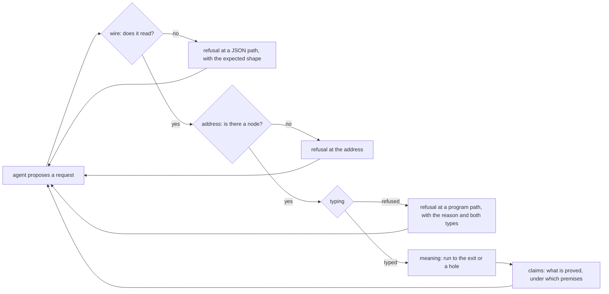

# Probe: the agent's authoring surface, used as an agent uses it

Status: probe note (history, not authority). 2026-10-13. Base: `f5011ee7e` on
`refactor/phase1-phase3`. The owner's question: what does a good development experience for agents require of
the API? And how far is the tree from it?

## The one thing to know first

The edit loop itself is good. Edits are local, reversible, deterministic and fast: about two
milliseconds each once the tool runs. Each answer names the law behind it. The friction sits
around the loop:

- An agent writes variables as positions, never names.
- A malformed program, an unknown atom, an unbound variable and a missing address answer with no reason, or not at all.
- The tree publishes one JSON shape of a program, and the tool reads another (F5). No answer lists the atoms.
- An agent cannot run what it wrote, ask what is proved of it, or call a library module.

Four of these are in flight in today's seats. Six are not, and five of the six touch the files
seat APPCHECK holds.

## Question

Row 307 (4) rules the first authoring path: an agent works through the data operations, behind an
MCP wrapper. The 2026-10-12 usability probe (`docs/research/2026-10-12-probe-api-usability.md`)
tested the other path, a newcomer writing Lean builders. This probe takes the ruled path. It
writes programs from scratch as JSON, with no Lean, through the session tool
(`tools/Tools/Session.lean`). It then asks which laws such a surface owes an agent.

## What was run

| Run | Requests | Result | Evidence word |
| --- | --- | --- | --- |
| the fixture program opened, then `sketch` | 2 | its JSON print: tagged objects, variables as `{"_tag":"var","index":n}` | tested |
| six programs written from scratch, then omit, view, fill, undo, journal and `run` | 15 | the findings below | tested |
| 300 fills in one session | 301 | 2.57 s wall, against 3.10 s for a run of 2 requests | measured |
| a 200-deep program (401 table entries), 50 fills at depth 100 | 51 | 1.64 s wall; each fill `spliced` | measured |
| a host-row call, and empty lists with no element type | 4 | F10; `list never` | tested |
| P1 in the encoding of `ts/eff/eff.gen.ts` | 1 | refused (F5) | tested |

Each run is `scratch/lean-slot.sh lake env lean --run tools/Drivers/Session.lean < requests.jsonl`.
The agent's own builder (`build.py`) and the request files are in the session scratchpad. The
programs are finite probes, not theorems.

## Findings

### What holds

| # | Finding | Evidence | The law behind it |
| --- | --- | --- | --- |
| G1 | An edit costs milliseconds, and the start dominates. 300 fills take less wall time than a run of two requests. | the timings above | `EditSession.feed_repaint`, `Sketch.table_fill`: a fill that keeps its focus's type splices the table |
| G2 | A type refusal is located and typed: the path, the row, the expected request type and the given one. | P2: `requestNotSubtype` at `[1,1,0]`, row `refSet`, expected `prod (refOf a) a`, given `prod (refOf (list string)) nat` | `explain = none ↔ wellTyped` (located refusal, `docs/core/controlled-english.md` §3.2) |
| G3 | One refusal does not stop the table. Every other address keeps its type. | P2: 7 entries, 1 refusal | `Sketch.table`, `Table.typedAt_table` |
| G4 | Undo restores the earlier program, and the journal is data. | `fill-wrong`, then `undo`: no refusals, type `nat` | `EditSession.feed_undo`; `Tools.Session.replays` |
| G5 | Each answer says what backs it: the application (`empty`) and the laws by name. | every answer | the session tool names a law only where its delta was decided |

### What an agent stumbles on

| # | Finding | Evidence | Cause |
| --- | --- | --- | --- |
| F1 | Variables are positions counted from the first binder. Inserting a binder renumbers every later variable by hand. | the fixture's `refSet` reads its ref as `var 1`, the second binder; the agent's builder counts levels | the stored `Eff` holds no names. The named source `Src` is a Lean function, `Env → List Nat → Except Refusal (Eff Op)` (`src/Effect4/Program/Authoring.lean`), so no named form exists as data |
| F2 | A malformed program answers no location and no reason. | P4 (a `bind` without `rest`) and P5 (the literal tag `string`, where the reader wants `str`) both answer "the program does not read" | `Tools.Session.programOfJson` answers `Option` |
| F3 | An unknown atom and an unbound variable both answer the fallback reason `term`. | P3 (`lenght`), P6 (`var 3` in an empty context), `fill-wrong` (`eq` of a list and a number) | `TypeReason.term`; unchanged since the usability probe's friction 5 |
| F4 | A fill at an address with no node answers `ok`, changes nothing, and enters the journal. | `fill-nowhere` at `[9,9]`: delta `unchanged` | the session feeds the edit without asking `focusAt` first |
| F5 | **The tree publishes one JSON encoding of a program, and the tool reads another.** An agent that follows the published one is refused with no reason. | `ts/eff/eff.gen.ts` writes a list family as an array (its header's carrier rule). The tool reads `{"_tag":"cons","head":…,"tail":…}`. P1 written with arrays: "the program does not read" (run `ts-encoding`) | two prints of one `Eff`: `tools/Drivers/TsGen.lean` and the canonical JSON print (`Canonical.ofJsonAnyOrder`). Neither names the other. Gemini's census found the TypeScript types; the run found the mismatch |
| F5b | No answer gives the atom catalogue. The agent guessed one literal tag wrong. | P5; the atoms are listed only in Lean source (`src/Effect4/Program/Authoring/Atoms.lean`) | `NativeAtom.all` and `NativeAtom.row` (`src/Effect4/Machine/Term.lean`) are data that no answer reads; MCP slice M2 is not built |
| F6 | A hole shows as `perform (external 0) unit`. Its name is absent from the view, and holes enter only by `omit` or as hex bytes. | `view-hole`; `open` reads `holes` as hex only, though `sketch` answers `holesJson` | `Tools.Session.Request` has no JSON field for a hole table |
| F7 | A fill may change the hole's type, and the whole program's type changes with it. Only the delta's kind hints at it. | `fill-bool`: type `nat` became `bool`, delta `rechecked` | a fill re-checks the whole candidate, as `Built.rebuild` does (`docs/core/api-surface.md` §1.1) |
| F8 | An answer is large. A view of one hole is about 1.2 KB: the focus twice, as hex and as JSON, and each type as nested tags. | `view-hole` | `Ty.render` (`src/Effect4/Program/Ty.lean`) is not used by the tool |
| F9 | The agent cannot run what it wrote. | `run`: "unknown operation run" | row 373 (5): editing and running are two sessions joined by one operation, not built |
| F10 | The application is the empty one, so a program with host rows cannot be edited. The refusal does not say so. | `host-row`: `outsideDomain` at `[0]`, row `external`; it names neither the row's index nor the empty table | seat APPCHECK, in flight (O2 of the obligations note) |
| F11 | A library module is a set of Lean functions. On the wire an agent writes the module's expansion, never `Queue.offer` by reference. | `Queue.Definitions` and `eff_module` (`docs/core/api-surface.md` §1.3) produce source at Lean elaboration | pieces by content address (row 336 (7), MCP slice M7) are not built |
| F12 | No answer says what is proved of a program. | the claim record lives in `Test/Dogfood/Application.lean` | seat CLAIMS' slice QUERY-APP, in flight |

One more run held: an empty list with no element type checks at `list never`, and its length at
`nat` (`nil-untyped`, `length-nil`).

### The planned surface, item by item

Gemini's census (`gemini-dx-census.md`, this folder) gives each planned item its status at the
head. The coordinator re-opened each cited declaration. Three of its rows were wrong; the counts
below carry the corrections.

| Plan | Landed | Partial | Absent |
| --- | --- | --- | --- |
| the usability probe's ten API fixes | none | none | all ten |
| the agent-authoring note's eleven tools | `explain` and `obligations` (`#explain`, `#obligations` and their JSON forms, `src/Effect4/Laws/Author/Explain.lean`) | `find` and `impact` (`#why`, `#plan_status`, `#goal_impact` answer the claims' half, `tools/ProofGraph/`); `module` (`eff_module`, `src/Effect4/Program/Authoring/Module.lean`; no module form) | `run model`, `explore`, `derive`, `prove`, `compare`, `report` |
| the MCP note's slices M0 to M12 | none | M4 (store roots, `Store.putRoot`), M5 (single edits), M9 (the `Live` face), M12 (`Package`) | M0 to M3, M6 to M8, M10, M11 |

Gemini's corrected rows: it marked `module`, `find` and `impact` absent, and it named
`ts/eff/eff.gen.ts` as the shape an agent should follow. The run above shows the tool refuses that
shape (F5).

## The theory: what an authoring surface owes an agent

### The loop

An agent proposes, and the tool checks. The agent is untrusted, forgets between turns and pays for
every byte it reads. The tool is deterministic and holds first-order data. The loop converges when
each answer tells the agent exactly what to change next, and costs it little to read.

Every layer owes the same law: **totality with location**. Each request answers a value or a
refusal that names a place and a reason. The tree states it at the typing layer only. The literature
names it for typing with holes. The marked lambda calculus (Zhao, Moon, Omar and others, POPL
2024) marks every ill-typed part and types the rest. G3 shows our table already does this.

### Eight requirements, each as a law

The literature marks below are recalled, not read again for this note.

| # | Requirement | Its law | Literature | Status at `f5011ee7e` |
| --- | --- | --- | --- | --- |
| A1 | **Local, reversible, deterministic edits** | a splice keeps every untouched entry; undo is a left inverse; a transcript replays | Hazelnut's edit actions (Omar and others, POPL 2017) | proved and measured: G1, G4 |
| A2 | **Totality with location at every layer** | wire: the located reader answers `.ok` exactly when the reader does; address: a fill refuses exactly when `focusAt` is `none`; typing: `explain = none ↔ wellTyped` | the marked lambda calculus | typing proved; wire and address absent (F2, F4) |
| A3 | **A reason for each refusal** | each refusal's reason names its rule: unknown atom, arity, argument types, unbound variable | the same | partial: rows and records have reasons; atoms and variables fall back to `term` (F3) |
| A4 | **Holes as wire syntax, with their context** | a hole reads from the wire with its name; its answer gives its type, its environment and the catalogue entries that fit; each fitting entry checks at the hole | typed holes as context for a model (Blinn, Omar and others, OOPSLA 2024) | partial: `holes_conservative` proved; no hole on the JSON wire, no name in the view, no fitting entries (F6) |
| A5 | **Names on the wire, read exactly** | an exact embedding of a named form into `Eff`: `read (print p) = p` and exactness modulo the renaming of binders | lenses and exact embeddings (§3.5 of the dictionary) | absent (F1); a representation question for the owner |
| A6 | **Self-description** | the shape's schema, the located reader and the catalogue are folds of the program's syntax signature, so none drifts from the reader | MCP's tool schemas; MCP slice M2 | broken: the published TypeScript types disagree with the reader (F5); no schema, no catalogue (F5b) |
| A7 | **Meaning from the session** | a session runs its sketch to its exit or to a hole; filling a hole and resuming observes what running the filled program does | live evaluation around holes and fill-and-resume (Omar and others, ICFP 2019) | ruled as row 373 (5) and (6); not built (F9) |
| A8 | **Reuse by reference** | a piece stored with its environment and type is used at any larger environment, by weakening | content-addressed code | ruled as row 336 (7); not built (F11) |

Two practical requirements carry no law. **Context economy**: an answer gives the rendered type
beside the tagged one, and leaves out what the agent did not ask for (F8). **What is proved**: a
query answers each claim of a program with its status and premises (F12).

### How these meet the obligations note

The obligations note (`docs/research/2026-10-13-authoring-obligations/README.md`) lists O1 to O8,
the laws of the program as data. This probe adds the laws of the surface the agent touches. Four
are in flight:

| Surface requirement | Obligation | Seat in flight |
| --- | --- | --- |
| A real application in the session (F10) | O2 | APPCHECK |
| Addresses that survive an edit | O1 | ADDRESS |
| What is proved, by query (F12) | O6 | CLAIMS, slice QUERY-APP |
| Answers checked before they reach the run | O7 | REPLAY |
| A2 wire and address, A3, A4, A6, context economy | none | none |
| A5 names on the wire | none | none: the owner's question |
| A7 meaning from the session | O3, O7 | none |
| A8 reuse by reference | O4 | none: after ADDRESS and MCP slice M4 |

## Proposals, ranked by what they unlock for their cost (not rulings)

| Rank | Slice | Law | Unlocks | Cost | Files |
| --- | --- | --- | --- | --- | --- |
| 0 | **one JSON encoding of a program**: the canonical reader reads the published TypeScript encoding (arrays for list families), and the tool prints it | the read of the TypeScript print is exact: `read (print p) = some p` | F5's defect removed; one shape for the schema, the TypeScript types and the tool (rule 2 of D-J, `docs/core/api-surface.md` §2) | M | `src/Effect4/Store/Domain/ShapeRead.lean`, `tools/Tools/JsonBridge.lean` |
| 1 | a fill or omit at a missing address refuses with the address | the session's answer is `none` exactly when `focusAt` is | A2 at the address layer: no silent no-op enters the journal | S | `tools/Tools/Session.lean` |
| 2 | reasons for an unknown atom, its arity, its argument types and an unbound variable | `explain = none ↔ wellTyped` keeps holding, with the new reasons | A3; the usability probe's fix 4 | M | `src/Effect4/Program/Typing/TermRefusal.lean` |
| 3 | a located JSON reader, and the shape's JSON Schema, both from the shape alphabet's one fold | located read is `.ok` exactly when `Canonical.ofJsonAnyOrder` is `some` | A2 at the wire, A6; the usability probe's `decodeAt` | M | `src/Effect4/Store/Domain/ShapeRead.lean`, the session tool |
| 4 | a `catalogue` answer: atoms, operations and forms with their types, and the application's rows | a fold of `NativeAtom.all` and the signature; nothing written by hand | A6; an agent asks instead of guessing | S | the session tool |
| 5 | holes on the wire: a named hole node, `holesJson` in `open`, the hole's name in every view, and the catalogue entries that fit its type | each fitting entry checks at the hole | A4 | M | the session tool, `Sketch` |
| 6 | the rendered type beside the tagged one; the focus's hex only on request | none: a view | context economy | S | the session tool |
| 7 | MCP slice M1: the request sum and its answers as `Canonical` data (row 373 (9)) | `json-read-exact` | every MCP slice after it | a day | the session and query tools |
| 8 | the session runs its sketch (row 373 (5)), with fill-and-resume (row 373 (6)) | the fill-by-term law | A7 | M to L | after REPLAY and APPCHECK |
| 9 | pieces by content address, and the library's definition blocks stored as pieces | weakening at a larger environment | A8: `Queue.offer` by reference | L | after ADDRESS and MCP slice M4 |

Slices 1 to 7 touch `tools/Tools/Session.lean` or `src/Effect4/Program/Typing/`, which seat APPCHECK
holds today. So they queue as APPCHECK's follow-on slices, in this order, or as one seat after
APPCHECK merges. Running them beside it would conflict file by file. Slice 0 touches neither, and
it waits only for a free seat: the owner caps the running seats at about three (2026-10-13).

## A question for the owner

**Names on the wire (A5), representation.** An agent writing JSON counts binders by hand (F1).
Three options:

- (a) Store each binder's display name in `Eff` as an annotation that no judgment reads. The print
  shows it, and the reader takes names.
- (b) Keep `Eff` nameless, and add a named form on the wire only. Its exact embedding into
  `Eff` reads by name and prints generated names.
- (c) Neither: positions stay, and code mode's generated builders (MCP slice M6) hide them.

Recommendation: (b). It adds no field to the stored program, so no judgment and no digest changes,
and its law is the one every exact embedding owes. Option (a) changes every program's digest and
the printer's binder names. Option (c) leaves an agent without code mode to count by hand.

## What this does not establish

The runs are finite probes of one tool at one head, with the empty application. No program with
host rows, definitions or layers was edited. The timings are wall times on a machine shared with
six seats, and no lake build ran inside them. The literature is recalled, not read again. The
requirements A1 to A8 are this note's proposal: none is a registry claim yet. A slice that lands
one places it in `docs/core/semantics.md` and the registry first.
