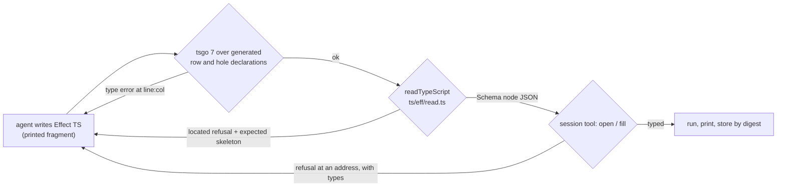

# Probe: which way of writing programs is most ergonomic for an agent

Status: probe note (history, not authority). 2026-10-13. Base: `b091d6e59` on
`refactor/phase1-phase3`. An agent (Claude) wrote the same three programs through every surface
that works today. It recorded each try, each refusal, the bytes it wrote and the bytes it read.
The owner asked for an agent's first-person view with evidence. The owner's floated idea is
tested here, not assumed.

## The one thing to know first

I would write programs as Effect TypeScript in the printed fragment. `readTypeScript` would read
the text into `Eff`, and the session tool would check it. tsgo over generated row declarations
would be my first, fastest check. JSON is the right wire between tools, and the wrong
language to author in. I never needed canonical bytes or hex.

The fragment already is the typed builder API that code mode proposes to generate. One table,
`src/Effect4/Codegen/Templates.lean` (printed to `ts/eff/templates.gen.ts`), drives both the
printer and the reader. What is missing around it is small and listed below. The largest single
friction is that the TypeScript reader accepts only the binder names `a0`, `a1`, … by depth.

The diagram is the loop I recommend. Its first box, its generated declarations and the run at the
end do not exist yet. Everything else ran in this probe.

## Reading list: what each earlier note concluded, and where this probe stands

| Note | What it concluded | This probe's evidence | Stand |
| --- | --- | --- | --- |
| `docs/research/2026-10-09-mcp-code-mode-design.md` | Tools are cases of one request sum, with schemas folded from the shape alphabet. Digests are identifiers. Code mode's first layer is builders generated from the syntax signature (`succeed(value)`, `bind(first, rest)`). The agent's code emits an edit script that the server applies. | The tool schemas idea holds: the catalogue and located JSON refusals work. The builders duplicate the printed fragment, which I wrote from Effect knowledge on the first or second try. | Agree on schemas and digests. Disagree on generated builders (§ Judgment). |
| `docs/research/2026-10-09-mcp-support-plan.md`, `…-receipt.md` | MCR-1 to MCR-5: a shape is not the codec's admission rule; checked snapshot and history need two identities; a script needs a checked interpreter; disjoint syntax is not independent typing; generated declarations need the right law. | Not exercised: no MCP server or edit script exists to run. MCR-5's warning applies to the row declarations I propose: tsgo is advice, the checker decides. | No conflict. |
| `docs/research/2026-10-13-agent-dx-probe/README.md` | The edit loop is good; friction sits around it. F1 to F12, requirements A1 to A8. Slice 0 (one JSON encoding) first; names on the wire as option (b), a JSON named form. | F2 and F10 are fixed. F3, F4, F6, F8 and F9 remain. F5 is half fixed (E4 below). | Agree on A1 to A8. On A5, agree with the law and disagree with the place (§ Judgment). |
| `docs/research/2026-10-13-fluent-authoring/README.md`, `Probe.lean` | One signature gives every wire artifact. One scope resolves names. A hole is a metavariable; a piece is a filled one. A located reader landed; a catalogue landed. | Both landings work (E1, E2). The TypeScript reader lacks the named scope the note gives the Lean source. A hole written in TypeScript as a named call already reads (E9). | Agree. Extend the named scope to the TypeScript reader. |
| `ts/eff/README.md` | `readTypeScript` reads the printed fragment; `toJson` is "the JSON and canonical byte formats shared with Lean and OCaml". | `readTypeScript` reads all three programs. `toJson`'s output is refused by the session tool (E4). | The README steers an agent to the wrong JSON. |
| `docs/STATE.md`, "Next, in order" and "What the owner must decide" | MCP slice M1 lands now; rulings 3 to 6 wait. The authoring line comes next. | The cheapest wins for an agent sit outside M1: the catalogue's gaps, binder names, row declarations. | Reorder suggested (§ Recommendations). |

## What was run

Every command ran at `b091d6e59` from the repository root, with `LEAN_NUM_THREADS=3`. Nothing was
built. The scratch files are in the session scratchpad; the ones worth keeping are in this folder.

| File here | What it holds | How to run it |
| --- | --- | --- |
| `requests.jsonl` | the three programs as JSON `open` requests, then an omit, a view and a fill | `lake env lean --run tools/Drivers/Session.lean < docs/research/2026-10-13-agent-ergonomics-probe/requests.jsonl` |
| `programs.ts`, `rows.json`, `check.ts` | the three programs as printed-fragment TypeScript, their row tables, and a reader that emits one `open` request | `bun --no-install docs/research/2026-10-13-agent-ergonomics-probe/check.ts a todo \| lake env lean --run tools/Drivers/Session.lean` (also `b db`, `c none`, `aHole todo+hole`) |
| `tsgo/` | the same programs against hand-written row declarations (`approws.ts`), with one deliberate type error | link `harness/truth/node_modules` as `tsgo/node_modules`, then `tsgo/node_modules/.bin/tsgo --noEmit -p tsgo/tsconfig.json`; remove the link after |
| `Probe.lean` | the three programs through the authoring lifts: build, print, two runs, five refusals | `lake env lean docs/research/2026-10-13-agent-ergonomics-probe/Probe.lean` |

The programs:

- **(a)** a to-do `add`: perform the host row `Todos.add("milk")`, answer the length of the list
  it returns;
- **(b)** a resource in a scope: acquire a connection by a host row, release it by another, query
  it inside the scope;
- **(c)** fork two children, join both, add their answers.

### The tally

The counts are mine, from this session's transcript. "Tries" counts submissions until the program
typed. "Read" is the bytes of documentation, source and answers I had to read for that surface,
by `wc -c` of the files and line ranges.

| Surface | (a) tries | (b) tries | (c) tries | Bytes written (a / b / c) | Read | One check |
| --- | --- | --- | --- | --- | --- | --- |
| JSON, session tool | 2 | 1 | 2 | 239 / 394 / 795, plus rows 258 / 678 | about 40 KB | 1.43 to 1.47 s |
| TypeScript, `readTypeScript` then the session | 4 | 3 | 3 | 69 / 115 / 343, plus the same rows as JSON | about 25 KB | 0.07 to 0.08 s to read; 0.09 to 0.14 s for tsgo |
| Lean, the authoring lifts | 2 | 2 | 1 | 110 / 136 / 180, plus 2 and 4 lines of `eff_rows` | about 37 KB, plus 7 KB to run with a host | 1.38 to 1.65 s for a whole probe file |

- **Measured** by `/usr/bin/time -p`, three runs each:
  - the session tool on one `open` and one `view`;
  - `bun` reading program (c);
  - tsgo 7.0.0-dev.20260629.1 on the `tsgo/` folder;
  - `lake env lean` on a probe file with two builds, two prints and one run.
- **Measured** (`python3`, `len(json.dumps(…, separators=(',',':')))`, and `wc -c`): the bytes
  written.
- **Read, by surface**:
  - JSON: the header of `tools/Tools/Session.lean` (4,140 B) and the catalogue answer (24,393 B).
    Then `tools/Effect4Gen/binders.json` (4,186 B), the row declarations in
    `src/Effect4/Program/Eff.lean` (3,037 B) and a fixture transcript (3,356 B);
  - TypeScript: `ts/eff/README.md` (6,924 B), the head of `ts/eff/read.ts` (8,759 B), four
    printed programs under `harness/truth/generated/` (3,781 B), and the session header again;
  - Lean: the heads of `Program/Authoring.lean`, `Api/Author.lean`, `Effect4/Author.lean`,
    `Sugar.lean`, `Services.lean` and `Declare.lean`, the lift list, and
    `Test/Dogfood/Scenario/Todo.lean`; `Test/Run/LiveContract.lean` to run with a host.
- **Inferred**: a token is about three to four bytes of this text. So (c) costs me about 230
  tokens as JSON, 100 as TypeScript and 50 as Lean.

Each TypeScript program met one more rule of the fragment. The rules were the binder names (a, b),
the release's two parameters (b), and the fork's name and options object (c). The JSON tries met
the row record (a) and the observer mode's wire name (c).

## Findings

Each row says what ran and what answered. E-numbers are this note's.

### JSON through the session tool (`tools/Drivers/Session.lean`)

| # | What I did | What answered | Did the answer lead to the fix? |
| --- | --- | --- | --- |
| E1 | opened (a) with a row of five fields | `"at":"[0]","wanted":"Row: the field shape (RowShape)","found":"none"` | Partly. It named the field, not its values. I read `RowShape`, `RowKind` and `Registration` in `src/Effect4/Program/Eff.lean`. The reader has no defaults, though the Lean record has them. |
| E2 | asked `catalogue` before writing anything | 24,393 bytes: 45 atoms with schemes, the program's forms, no rows | Yes for atoms and forms. It omits three things I needed: which field binds a variable (`binders.json`), each native operation's request and answer, and the row record's form before any open. |
| E3 | wrote (c) with `"mode":"awaitValue"` | `"reason":"term"` at `[1,1,1,1]`, no further reason | No. The `view` at that address showed the environment held `exitOf`. The wire's `awaitValue` is `Fiber.await`, which answers an `Exit`; `joinEffect` is `Fiber.join`. The Lean lifts call them `await` and `join` (`src/Effect4/Program/Authoring/Services.lean`). |
| E5 | misspelled `length`; used `var 1` unbound; applied `succ` to a list | `term` each time | No. F3 of the DX probe is unchanged. |
| E6 | performed `external 3` in a one-row table | `outsideDomain`, row `external` | Partly. It names neither the index nor the table's length. |
| E7 | requested a number where the row wants a string | `requestNotSubtype`, expected `string`, given `nat`, row `addTodo` | Yes. |
| E8 | `fill` at `[9,9]`, an address with no node | `ok`, delta `unchanged` | No. F4 of the DX probe is unchanged. |

Variables are depths counted from the outermost binder (`var 0` is the first binder). I learned
it from the fixture's JSON print, which the `sketch` operation answers. The hole that `omit`
creates is `perform (external 1) unit`: a host row after the application's one row. The view shows
the hole's type and environment, never its name `count`. A `view` at one address answers the
sub-program three times: as hex in `focus.program`, as JSON in `focus.programJson`, and as JSON
again in `programJson`.

### TypeScript through `readTypeScript` (`ts/eff/read.ts`)

| # | What I wrote | What answered | Did the answer lead to the fix? |
| --- | --- | --- | --- |
| E10 | `Effect.gen(function* () { const todos = yield* Todos.add("milk"); return length(todos) })` | `gen.0 > cons.0: unsupportedStmt` | No. The binder name was the fault, and the refusal does not say so. |
| E11 | `Effect.flatMap(Todos.add("milk"), (todos) => …)` | `arity Effect.flatMap; expected a0 at argument 1 > parameters` | Yes. Renaming to `a0` read. |
| E12 | `Effect.acquireRelease(Db.open("db"), (a0) => Db.close(a0))` | `expected a0, a1 at argument 1 > parameters` | Yes. The release takes the resource and the exit. |
| E13 | `Effect.fork(…)`, Effect 3's name | `unknownHead Effect.fork` | No. Nothing suggests `Effect.forkChild`. |
| E14 | `Effect.forkChild(Effect.succeed(1))` | `arity Effect.forkChild; expected an argument 1` | Partly. The printed corpus showed the options object it wants. |
| E15 | `Effect.andThen(…)`; `Effect.map(e, succ)`; `return yield* e`; `a0.length` | `unknownHead Effect.andThen`; `unknownHead Effect.map`; `node YieldExpression`; `shape term` | No. `Effect.map` is in the profile's head list (`ts/eff/profile.gen.ts` `heads`), so "unknown head" misleads. |
| E16 | `Ref.make`, `Ref.update`, `Ref.set`, `Ref.get` in `flatMap` chains | read on the first try | No refusal. The printed examples showed `Ref.make`, `Ref.set` and `Ref.get`; `Ref.update` I wrote from Effect's own API. |
| E17 | `Todos.ad(…)`; `length(a1)` with one binder | `bind.0: unknownHead Todos.ad`; `bind.1 > succeed.0: unknownIdent a1` | Yes. Both are located; neither suggests a spelling. |

**E4: the README's JSON is not the session's JSON.** `toJson` of `ts/eff/json.gen.ts` writes the
golden exchange form, positional: `["bind",["perform",…],…]`. The session tool refuses it:
`"at":"","found":"an array of 3","wanted":"Eff: an object whose _tag is one of …"`. The Schema
node itself, `JSON.stringify` of `readTypeScript`'s result, opens and types. The brief for this
probe named `toJson` too. So the steer is in the package README and in how people describe it.

**E18: tsgo and the reader disagree in both directions.** tsgo 7 accepts (a), (b) and (c) against
hand-written declarations of the rows (`tsgo/approws.ts`). It also accepts two texts the reader
refuses. They are `forkChild` with no options and a release with one named parameter. tsgo
refuses `add(a0, 1)` with `a0` a list, at line and column. Its message is `TS2345: Argument of
type 'readonly string[]' is not assignable to parameter of type 'number'`. The session's checker
answers the same fault with `term`. One disagreement is signed: the checker types `Ref.set` as
answering the cell, and tsgo as `void` (DI-98, in the module note of
`src/Effect4/Program/Native.lean`).

**E9: a hole reads as a named call.** With a hole row named `count` appended to the table,
`Effect.flatMap(Todos.add("milk"), (a0) => count())` reads to `perform (external 1) unit`. That is
the session's own hole. `open` with `holesJson` then types it, and a `fill` at its address
splices. The cost is a full twelve-field row record for each hole.

### Lean through the authoring lifts (`Effect4.Author`)

- (a), (b) and (c) build at the right types: `number`, `string`, `number`. `Tools.Code.codeLines`
  (`tools/Tools/Code/Module.lean`) prints each as the same fragment I wrote by hand.
- Binders have names (`let conn ← …`, `acquireWith … fun c => …`). Lean's own elaborator catches a
  misspelled binder at line and column.
- The scope reader names its refusals: `unbound "todo"` at `[1]`, `unboundRow "Todos.add"` at
  `[]`. The checker's refusals are the session's: `term` for a misspelled atom and for a wrong
  argument type.
- The frictions were Lean's, not the program's. `open` cannot name a row and `show` cannot name a
  definition: both are keywords. `EffTy`, `ExitV`, `TypeReason` and `TypeScript.Expr` have no
  `Repr`. So I printed types with `Ty.render`, refusals with `Tools.Query.refusalJson`, and
  compared exits with `==` against a guess.
- Running works. (c) runs to `success 3` through `Api.Built.runSync`. (b) runs to
  `success "rows"` through `Live.feedAll` (`src/Effect4/Run/Live.lean`) with three host answers
  selected by row. My first guess at the exit's shape was wrong, and nothing printed the real one.

### Running from the wire

The session tool runs nothing (F9 of the DX probe). `tools/Drivers/Live.lean` takes the same
requests and draws patch rows; it does not run either. Only a Lean author can run a program
today.

## Judgment (inferred from the evidence above)

### Which surface

**Effect TypeScript in the printed fragment, checked by tsgo, read by `readTypeScript`, typed by
the session.** Three reasons, each from a measure above:

1. **It is the smallest to write.** Program (c) is 343 bytes as TypeScript against 795 as JSON.
   JSON's cost is structural: every literal is `{"_tag":"lit","value":{"_tag":"nat","value":1}}`.
2. **It draws on what the model already knows.** `Ref.update` read on the first try, though no
   example I had read showed it (E16). In JSON I guessed the observer mode wrong (E3), because its
   wire name differs from Effect's.
3. **It has the best feedback.** The reader's refusals are located (E11, E12). They often show
   the expected skeleton. tsgo answers a wrong argument type in 0.1 s at line and column. The
   checker says `term` for the same fault (E18).

Where models and tools are heading supports the same choice. Models write code against a typed
API more reliably than they fill large nested tool arguments. A language server's quick type
check is the loop agents already use. The MCP note's sources say the same of code mode (its §3,
read there through summaries; not read again here).

**JSON stays the wire.** It is what an MCP tool carries, what the session answers, and what
another tool reads. An agent should rarely type it. **Lean stays the surface for this
repository's seats**, who prove things about the programs they write. For an outside agent, Lean
costs a toolchain, keyword collisions and missing `Repr` instances.

### Bytes and hex

I never needed canonical bytes or hex in this probe. Every carrier went in and out as JSON. Hex
still costs context: 322 of 1,323 bytes of one `view` answer, and 1,430 of 2,439 bytes of a
`sketch` answer (program (c)). A digest is a different thing. An agent can hold a 64-character
digest as an opaque handle to a stored sketch or piece. That pays only when some request takes the
digest back. Today the session names its application by digest, and no request accepts it.

So: **an agent should never see hex**. A digest is fine as a handle, once handles do something.
This agrees with the owner's floated idea on its first half.

### What code mode should and should not generate

The owner's idea has the agent call tools and write TypeScript that one abstraction generates. The
evidence splits it in two.

- **Already generated, do not generate again.** The program-building API is the printed fragment.
  Its grammar is one table (`Codegen/Templates.lean`), and both the printer and `readTypeScript`
  follow it. A second builder vocabulary, as in the MCP note's §5.1 (`bind`, `succeed`,
  `lit.nat`), would have no prior in a model's training. Its first version would carry no types
  (that note's §5.4).
- **Generate these.** Generate the declarations tsgo needs to check an agent's text. Each row,
  hole and service gets one TypeScript declaration. They fold from the row table through
  `Effect4.Codegen.Types.ofTy` (`src/Effect4/Codegen/Types.lean`). `tsgo/approws.ts` is a hand
  copy of what that fold would write. Today the printer imports `Db` from a prelude that does not
  declare it (the printed module in `Probe.lean`'s output).
- **Generate these too.** The tool schemas and the catalogue, folded from the shape, as the MCP
  note proposes. Add the fragment's grammar to the catalogue, one line per constructor. Render it
  from the template table; do not serve that table's 28,042 bytes of JSON.
- **Do not generate** a second JSON named form of programs. The named form an agent writes is
  TypeScript text.

### What a hole and a fill should look like

- **A hole is a named, typed call in the agent's language.** `count()` already reads as a hole
  (E9). Its type should come from a TypeScript annotation, not a twelve-field record.
  `readTypeText` in `ts/eff/read.ts` already reads `number`, `ReadonlyArray<string>`,
  `readonly [string, number]` and `Option.Option<string>` into `Ty`. It returned nothing for
  `Fiber.Fiber<number, never>`.
- **A hole's answer** gives its name and its type, rendered as TypeScript. It gives its
  environment with names and rendered types. It lists the atoms and rows whose answer fits. This
  is the fluent note's §3.
- **A fill** names its hole, not an address. Its payload is TypeScript text in the hole's scope,
  using the environment's names. The answer is the delta, the rendered type and any located
  refusal. The journal and undo stay as they are; they worked.

## Recommendations, ranked by value to an agent over build cost (not rulings)

Value and cost are my estimates. H, M and L are high, medium and low; XS to L are sizes.

| Rank | Change | Value | Cost | Its law | Files |
| --- | --- | --- | --- | --- | --- |
| 1 | Say which JSON the session reads. Export one function that prints the Schema node's JSON, and state in the README that `toJson` writes the golden exchange form (E4). | M | XS | none: documentation and one function | `ts/eff/README.md`, `ts/eff/read.ts` (an export) |
| 2 | Fill the catalogue's gaps (E2): the binder table, each native operation's row (the table `ts/eff/profile.gen.ts` already holds), a row record's template, the fragment's grammar one line per constructor, and a nearest spelling for an unknown head (E13, E15, E17). | H | S | none: folds of existing tables (`binders.json`, `Profile`, `Codegen/Templates.lean`) | `tools/Tools/Catalogue.lean`; `ts/eff/read.ts` for the spelling hint |
| 3 | Binder names by scope in the TypeScript reader: any identifier, resolved nearest-first, as the Lean scope reader does (E10, E11, E12). | H | M | `read (print p) = p` unchanged; exactness modulo renaming of binders | `ts/eff/read.ts` (`varRead`, `sameParams`, `binderNames`), `src/Effect4/Codegen/Read.lean` (`Var.read`), then `make check-ts-reader` |
| 4 | Generated declarations of an application's rows, holes and services, so tsgo checks agent text (E18). | H | S to M | none: advice; the checker decides (MCR-5) | `tools/Tools/Code/Module.lean` or `tools/Drivers/TsGen.lean`; served by the catalogue |
| 5 | Session answers without hex unless asked, and each type rendered by `Ty.render` beside its tags. | M | S | none: a view | `tools/Tools/Session.lean`, `tools/Tools/Query.lean` (`focusJson`, `entryJson`) |
| 6 | A hole by name: `open` takes `{name, answer}` per hole and builds the row; every view names the hole; `fill` takes a hole name. | M | S to M | the hole table only grows, so a name stays a target (MCR-3's uniqueness caveat applies) | `tools/Tools/Session.lean`, `src/Effect4/Program/Sketch.lean` (`Row.hole`) |
| 7 | A `run` operation: a closed program through `Api.Built.runSync`, a host program through a script of answers and `Live.feedAll`; the exit as JSON. | H | M | `Live.reached` and the run's laws, unchanged | `tools/Tools/Session.lean`; a JSON print of `ExitV` |
| 8 | Checker reasons for an unknown atom, an arity, the argument types and an unbound variable (E5; the DX probe's slice 2). | M | M | `explain = none ↔ wellTyped` keeps holding | `src/Effect4/Program/Typing/TermRefusal.lean` |
| 9 | A fill or omit at a missing address refuses with the address (E8; the DX probe's slice 1). | L | S | the answer is a refusal exactly when `focusAt` is `none` | `tools/Tools/Session.lean` |
| 10 | Read the shorter spellings tsgo accepts: `forkChild` with no options, a one-parameter release, `Effect.andThen`, `Effect.map` with a lambda. | M | M to L | exactness modulo a named normaliser, not a widening | `src/Effect4/Codegen/Templates.lean`, `src/Effect4/Codegen/Read.lean`, `ts/eff/read.ts` |
| 11 | A fill's payload as TypeScript text in the hole's named scope. | M | M | the reader's exactness at the hole's environment | after 3 and 6: `tools/Tools/Session.lean` |

Ranks 1, 2, 5 and 9 need no new law. Rank 3 is the DX probe's option (b) law, placed in the reader
agents already use. Rank 4 and rank 10 change what tsgo and the reader agree on, so they shrink
E18 from both sides. Rank 7 is row 373 (5) of the decisions register.

## Where I disagree with the earlier notes

1. **Code mode's builders (MCP note §5.1).** The printed fragment is the builder API, with Effect's
   names and tsgo's types. Generate declarations, not a second vocabulary.
2. **Names on the wire (DX probe A5, option (b)).** The law is right. Its place is the TypeScript
   reader and `Codegen/Read.lean`, not a new JSON named form, which would be a fourth encoding.
3. **One JSON encoding (DX probe slice 0; the fluent note's "landed").** The Schema node's JSON
   reads. The README's `toJson` does not (E4). The landing is half visible to an agent.
4. **What to build first (`docs/STATE.md`).** M1's typed requests help a server author. Ranks 1
   to 4 above help an agent sooner, and none waits on M1.

## What this does not establish

- One agent wrote three small programs at one head. The counts of tries and bytes read are from
  my own transcript, not a controlled study. Another model, or I with this note in context, would
  count differently.
- The timings are wall times on a shared machine, three runs each.
- **A download happened, against the brief.** Two bare imports had no `node_modules` above them.
  They were `effect` in a scratch script and `oxc-parser` in the first `check.ts`. bun's
  auto-install fetched `effect@4.0.4` and `oxc-parser@0.154.0` into `~/.bun/install/cache`. The
  reader itself always loaded the pins from `ts/eff/node_modules`. The kept `check.ts` has no bare
  import and runs with `--no-install`. Its four requests are byte-identical to the earlier ones
  (`cmp`).
- tsgo checked against declarations I wrote by hand, not generated ones.
- No program used services, layers, records, loops or definition blocks. The fragment's coverage
  of those is untested here.
- No MCP client, server or edit script was run; none exists.
- The claims about where agent coding is heading are recalled, and the MCP note's sources were
  not read again.
- No proposal here is placed in `docs/core/semantics.md` or the registry. A slice that takes
  rank 3, 6 or 10 places its law first.
