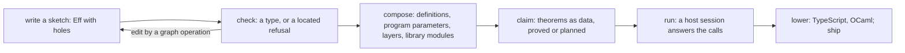

# What an agent needs to author verified programs: the obligations, in order

Status: research note (history, not authority). 2026-10-13. The coordinator, on the owner's
question of the evening: what work puts the language on the line for practical use and a release,
seen from an agent that builds arbitrarily complex programs as first-order data. It proposes an
order and rules nothing. The requirements and their measured statuses are
`docs/core/system-map.md` §8 and `generated/semantics.md`.

## 1. The one thing to know first

An agent can build large verified programs when eight laws hold over the program as data. Two hold
at full reach today: the checker is decidable, sound and complete at an application's signature,
and a sketch with holes checks conservatively. The other six hold on fragments or not yet. The
largest gap is composition. A program that calls its own definitions, or passes programs as
parameters, is outside every proved meaning today. So the first work is the meaning of
definitions (PROC-5), then the claims record that makes a program's theorems part of its data.

## 2. The agent's loop

Each arrow is a map of first-order data. Each one owes a law, so that the agent's step keeps what
the agent already knows.

## 3. The mathematics, one object for each step

### 3.1 Programs are an initial algebra

`Eff` is the free object of its signature, with its binders as data (`binders.json`). Every
traversal is a fold (`cata_eff`), and two folds agree when their algebras do
(`hom_eq_cata_eff`). An edit is a map from programs to programs.

- **O1, typed edits.** A graph operation (wrap, extract, inline, rebase a reference) takes a
  program that checks at `τ` to a program that checks at `τ`, or it refuses at a path. Its form is
  subject reduction for edits: `HasTy Γ p τ → op p = some p' → HasTy Γ p' τ`. Row 336 orders the
  operations; none is built. The ground is a program in the store and `rebaseRefs` (seat ORG's L9).

### 3.2 Typing is a decided relation, and holes are an order

`check` decides `HasTy` at an application's signature (`check_sound`, `check_complete`,
`admitSig_ok_iff`). A sketch is a program with holes. It checks at a type with a gap, and filling a
hole only adds information: the precision order of gradual typing, called graduality
(`holes_conservative`, `sketch_weakening`, `Sketch.hole_hasTy`; R14).

- **O2, checking at a real application.** The edit session runs at the empty application, and its
  check refuses a layer reference that program admission accepts (the backlog deep dive, its
  section 2). Row 373 (7) rules the route: check the expansion, and read its table at the source's
  addresses. The law is `source-annotation-agrees`.

### 3.3 Meaning is a fold into a free monad, and handlers interpret it

`denoteRows` folds a program into a call tree over `StoreSig ⊕ RowSig table`: a free monad over
the stores' signature and the host rows' signature (DI-69). Handlers give it meaning: the stores'
comodel, and a host or a reply tape (`meaningUnder`). Interaction trees and Plotkin and Pretnar's
handlers are the literature (`docs/core/semantics.md`, concept 10).

- **O3, the meaning covers the authoring language.** Three parts are outside it.
  - A definition block: a recursive handler, cut at a budget (`mrecB`, after Interaction Trees'
    `mrec`). Probed today: `docs/research/2026-10-13-proc5-probe/README.md`. Slice PROC-5, goal G5.
  - Definitions with program parameters (row 340, `.invoke`): an operation whose argument is a
    program. These are higher-order effects (the hefty-algebras line of `docs/DESIGN-BASIS.md`).
    Slices HO-4 and HO-5.
  - More than one fiber: forks, scopes and layers in the call tree. Today the frame machine covers
    them, and the call tree does not.

### 3.4 Composition: equal parts give equal wholes

A fold is compositional: if two parts have equal meanings, every program that holds one has the
meaning of the program that holds the other. This is contextual equivalence at an observation,
and it is why proofs scale to large programs: an agent proves a part once, and every use inherits
it.

- **O4, the laws of the forms an agent uses to compose.**
  - The inlining law: invoking a definition behaves as its body (G7, slice PROC-6). With it,
    extract and inline are safe edits.
  - A library module's law: a composed module agrees with its expansion (R10, `Agrees profile
    module expansion`). Proved: the step agreement laws of Latch, Pool, PubSub, Queue, Ref and
    Semaphore. Open: `jobs_step`, `retries_declared`.
  - The first composition law: SynchronizedRef from Ref and Semaphore (G10), then the
    transaction attempt (G4). A module built from two modules inherits their theorems.
  - The frame machine agrees with the call tree beyond the fragments of `run_eq_meaning`
    (`Straight`) and `loopAgreement` (`Looped`): with definitions first (G4 of the procedures
    note).

### 3.5 Safety: a checked program never goes wrong

`ExitOk` holds at every typed position (R9): an exit fits its type, and no shape defect occurs.
`m7_proved` states it on `M7Fragment`, modulo one planned goal, `countdown_parks_positional`.

- **O5, safety at the authoring language's reach.** Close the goal, then widen the fragment: the
  row table (host calls), then definitions, then program parameters. Each widening reuses O3's
  meaning.

### 3.6 Claims are data: a weakest precondition of the call tree

Row 307 (9) asks that a program's theorems be part of its data, resting on the theory of
algebraic effects. The claims packet (`docs/research/2026-10-07-packet-application-claims.md`,
§3.4) gives the judgment `Typed o Ψ w Q t`. Each call of the tree `t` meets the demand of the
protocol `Ψ`, and each leaf satisfies `Q`, for every answer that keeps `Ψ`'s promise. It is the
weakest precondition of a tree under a specification of each operation: the construction the
literature calls a Dijkstra monad (recalled there, not read). It composes along `bind`, so a
claim of a sequence follows from claims of its parts.

- **O6, the application and claim records.** A claim is a theorem or a planned goal with its
  placement, and the record adds its kind, the programs it reads and what it assumes. The
  premise's grade says who discharges it: proved, monitored by the session, validated on one run's
  journal, or assumed. The packet's slices 1 to 5 needed no call tree. Slices 6 to 10 waited on
  DI-69, which has landed (`denoteRows`). None is built.

### 3.7 The host: a session is the meaning under the replies

`session_eq_ref`, `denoteRows_eq_session_host` and the looped forms (H8, H9) state that a host
session observes what the call tree gives under the replies. Seat LIVE landed the `Live` face
today, with `view_funded` and `view_classifies`.

- **O7, typed and checked replies.** One checked replay route: `Typed.replay` replays the
  session's journal, checked at each call's instance (row 98, `replay-at-call-instance`). The typed
  guarantee with host answers, claimed on data rows first (row 99, `admit_sound`, the deep dive's
  Q2).

### 3.8 Lowering: a simulation for each face

Inside a profile a face's observation equals the reference's, and outside it the face refuses
(R8). `read_print` and `read_exact` are proved. The runs are proved on fragments and gated against
the outside implementations elsewhere.

- **O8, what a release claims of the shipped code.** Row 28 waits on the owner's meaning of
  "verified lowering". The deep dive recommends: the Lean definitions carry the theorems, and the
  LCNF route carries rule coverage and gated differentials, with the trust boundary named.

## 4. The order, and what each step gives an agent

Row 373 (1) rules the first three: the `Live` face, then PROC-5, then the checked replay. The rest
is this note's proposal.

| Order | Work | Obligation | What it gives an agent |
| --- | --- | --- | --- |
| done | the `Live` face, DM1 to DM4 | O7, part | one session to open, feed and view; a funded bit read without replay |
| 1 | PROC-5, the meaning of a definition block | O3 | recursion and named parts inside the proved meaning |
| 2 | the checked replay route | O7 | host answers applied only when checked |
| 3 | PROC-6, the inlining law; then G4's agreement with the machine | O4 | extract and inline as proved edits; the machine runs definitions as the meaning says |
| 4 | the application and claim records, slices 1 to 6 | O6 | every program carries its theorems as data; an agent asks what is proved of it |
| 5 | checking at a real application, and the first graph operations | O1, O2 | typed feedback on every edit of a real program |
| 6 | HO-4 and HO-5, program parameters | O3 | combinators and services written in the language, with their laws |
| 7 | R9's goal, then the fragment widened | O5 | "it checks, so it cannot crash" over the language agents write |
| 8 | the module laws: `jobs_step`, `retries_declared`, G10, G4 | O4 | library modules whose theorems a program inherits |
| 9 | row 28 ruled, then the lowering gates | O8 | a shipped artifact with a named claim |

## 5. What this note does not establish

It proves nothing and runs nothing beyond the commands its sources record. Each obligation's
status comes from the plan (`#plan_status`) and the registry, not from this note. The literature
names are the tree's own marks; no text was read again for this note. The order is a proposal: the
owner rules it in `docs/core/decisions.md`.
