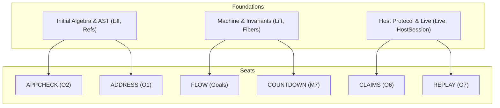

# Reuse census for six authoring and proof seats

Status: research note. 2026-10-13. Obligation O6 ground, decisions row 376 (3).

The proof graph is dense.
Every new definition or lemma must first be searched for.
A duplicate declaration is a defect.
This census audits reuse, duplication risks and proof automation across six concurrent seats.

## 1. Seat CLAIMS: application and claim records

Seat CLAIMS builds the application record and the program claim record.
It lands slices 1 to 6 of the application claims packet.

### 1.1 What it must reuse

- `Module`, `RowDef`, `ServiceDef`, `DefSrc`, `requestOf`, `elaborateModule` and `elaborateTree` in `src/Effect4/Program/Authoring.lean`.
- `SigApp`, `SigApp.signature`, `SigApp.codeTy`, `SigApp.serviceTy` and `admitSig` in `src/Effect4/Program/SigApp.lean`.
- `RowTable`, `Row` and `Row.normalizeTypes` in `src/Effect4/Program/Table.lean`.
- `Api.Built` in `src/Effect4/Api/Built.lean`.
- `Api.Author.build` in `src/Effect4/Api/Author.lean`.
- `Run`, `Run.open`, `Run.Reactor`, `Run.drive` and `Run.runWith` in `src/Effect4/Run.lean`.
- `Seen`, `Sel`, `Event`, `Event.commands`, `feed`, `live`, `rows` and `held` in `src/Effect4/Run/Event.lean`.
- `Protocol`, `Typed`, `Protocol.Le` and `Typed.refine` in `src/Effect4/Laws/Effects/Protocol.lean`.
- `denoteRows`, `meaningUnder`, `meaningRows`, `tapeHandler`, `Alphabet.ofTable`, `RowFamily`, `RowSig` and `RowsSig` in `src/Effect4/Laws/Program/DenoteRows.lean`.
- `Pointer`, `Claim`, `Role` and `Concept` in `tools/ProofGraph/Registry.lean`.
- `Node`, `Plan`, `Standing`, `Plan.next` and `Node.restsOn` in `tools/ProofGraph/Plan.lean`.
- `proof_goal` and `Standing` in `tools/ProofGraph/Goal.lean`.
- `@[semantics ...]` in `src/Effect4/Laws/Auto/Semantics.lean`.
- `foldMap_eff` in `src/Effect4/Program/Fold.lean`.
- `Scenario`, `Clause`, `NamedRun`, `Control`, `seenAt` and `refusals` in `Test/Dogfood/Scenario.lean`.

### 1.2 What it might duplicate

- **Claim status enum.**
  Do not define a new status enum.
  A claim's status is read from `ProofGraph.Standing` in `tools/ProofGraph/Goal.lean` via `#plan_status`.
- **Application row table representations.**
  Do not declare a second table type.
  Reuse `RowTable` in `src/Effect4/Program/Table.lean` and `SigApp` in `src/Effect4/Program/SigApp.lean`.
- **Protocol representations.**
  The mathematical protocol judgment on call trees is `Effect4.Laws.Effects.Protocol`.
  The authored row protocol for journals is first-order data (`RowProtocol`).
  Keep them distinct and do not duplicate the free monad judgment.
- **Verification gates.**
  Decisions row 375 retired goal gate pins.
  Decisions row 301 rules that assertions are readers, controls or finite evaluations.
  Do not introduce `#application_gate` or pinned counter commands.
- **Second program interpreter.**
  Do not write another call tree interpreter over host rows.
  Reuse `denoteRows` and `meaningUnder` in `src/Effect4/Laws/Program/DenoteRows.lean`.

### 1.3 What aesop can do

- **Fitting rule bank:** `Effect4.Checker` and `Effect4.Atoms` in `src/Effect4/Laws/Auto/RuleSets.lean`.
- **Bank membership:**
  Checker inversion lemmas, term typing rules, subtyping transitivity and `Typed.refine` monotonicity lemmas belong in `Effect4.Checker`.
- **Automation reach:**
  Aesop directly closes inversions of `Typed` derivations on call tree leaves (`.pure`).
  It also closes congruence steps of `meaningUnder` across straight-line program fragments.

## 2. Seat REPLAY: one checked replay route

Seat REPLAY establishes `Typed.replay` through `Live.feed`.
It checks host answers at each call instance and retires `replayAdmitted`.

### 2.1 What it must reuse

- `Live`, `Live.open`, `Live.start` and `Live.feed` in `src/Effect4/Run/Live.lean`.
- `Live.reached`, `Live.journal_replays`, `session_eq_ref`, `start_error`, `start_ok` and `view_checked` in `src/Effect4/Laws/Api/Live.lean`.
- `Api.replay`, `replayChecked`, `load`, `root`, `Outcome`, `Inspection`, `Budget`, `Typed` and `Typed.replay` in `src/Effect4/Api.lean`.
- `Runner.Command` in `src/Effect4/Api/Runner.lean`.
- `Session`, `Header`, `Phase`, `Reply`, `preflight`, `applyReply` and `advance` in `src/Effect4/Api/HostSession.lean`.
- `preflight_success_prepared_fits`, `instance_prepared_success`, `preflight_envelope`, `external_prepared_answer_typed`, `start_callInstance` and `instanceAt_complete` in `src/Effect4/Laws/Api/HostSession.lean`.
- `Run.play`, `Run.feed`, `Run.journal_replays` and `Run.Reached` in `src/Effect4/Run.lean` and `src/Effect4/Laws/Run.lean`.

### 2.2 What it might duplicate

- **Custom replay loop.**
  Do not author an ad-hoc loop over journal commands.
  Replay is `Live.feed` folded over `List Runner.Command`.
- **Admission theorem restatements.**
  `preflight_success_prepared_fits` and `instance_prepared_success` already establish that admitted answers fit call instances.
  Apply them directly.
  Do not state parallel lemmas.
- **Retained legacy replay functions.**
  Row 373 (8) rules that `replayAdmitted` is deleted once callers move to `Typed.replay`.
  Raw `Api.replay` remains solely as a named test entry.
- **New gate commands.**
  Do not add a replay gate command or pinned counters.
  Write readers and controls in `Test/` batteries instead.

### 2.3 What aesop can do

- **Fitting rule bank:** `Effect4.StepInv` and `Effect4.Fibers` in `src/Effect4/Laws/Auto/RuleSets.lean`.
  Use `Effect4.Stores` when store equations appear.
- **Bank membership:**
  Leaf transition equations, non-answering command step lemmas and phase preservation rules belong in `Effect4.StepInv`.
- **Automation reach:**
  Aesop directly closes step cases for deterministic commands (advance, flush, control) where the machine does not allocate or await answers.

## 3. Seat FLOW: answer-flow history producer

Seat FLOW instantiates `DecisionLift` with `AnswerFlow.FrameAt` per fiber.
It closes four application goals across histories.

### 3.1 What it must reuse

- `DecisionLift`, `StepKeeps`, `Guarded`, `ParkedAt`, `interruptEdit`, `driveState_lift` and `unitOrder` in `src/Effect4/Laws/Machine/Lift.lean`.
- Five existing users of `DecisionLift`: `NativeHistory` (`src/Effect4/Laws/Program/NativeHistory.lean`), `NativeReplies` (`src/Effect4/Laws/Program/NativeReplies.lean`), `NativeHeapHistory` (`src/Effect4/Laws/Program/NativeHeapHistory.lean`), `ReleaseCustody/Lift` (`src/Effect4/Laws/Program/ReleaseCustody/Lift.lean`) and `PlaceFunding/Run` (`src/Effect4/Laws/Program/PlaceFunding/Run.lean`).
- `Model`, `ExitAt`, `SavedAt`, `StackAt`, `ResultAt`, `FrameAt`, `stack_path`, `path_stack` and `saved_mono` in `src/Effect4/Laws/Machine/AnswerFlow.lean`.
- `FrameFiber`, `Prim` and `PrimInterp` in `src/Effect4/Machine/Frames.lean`.
- `RunMachine`, `RunFiber`, `RunEvent`, `RunDecision` and `Cmd` in `src/Effect4/Machine/Fibers.lean`.
- `PlaceFunding.Local` in `src/Effect4/Laws/Program/PlaceFunding/Run.lean`.
- `WorldOrder` in `src/Effect4/Laws/Effects/Protocol.lean`.

### 3.2 What it might duplicate

- **History induction machinery.**
  Do not write a new induction principle over execution histories.
  `DecisionLift` in `src/Effect4/Laws/Machine/Lift.lean` already lifts command-step and edit facts to whole histories.
- **Frame-level answer-flow laws.**
  `AnswerFlow.lean` already proves `stack_path`, `path_stack` and `saved_mono`.
  Do not prove local stack transports again.
- **Per-arm command transports.**
  Per-arm transports already exist for dispatcher draining, task execution and interrupt records in `src/Effect4/Laws/Machine/Lift.lean`.
  Reuse them.
- **Scenario-specific invariant carriers.**
  Do not define isolated ad-hoc invariants for `Workers`, `QueueWorkers` and `Timeout`.
  Instantiate `DecisionLift` once with `AnswerFlow.FrameAt` as the common producer.

### 3.3 What aesop can do

- **Fitting rule bank:** `Effect4.StepInv` and `Effect4.Fibers` in `src/Effect4/Laws/Auto/RuleSets.lean`.
  Use `Effect4.Stores` for store equations and `Effect4.Atoms` for value matching.
- **Bank membership:**
  Command preservation lemmas for commands that leave fiber frames unchanged belong in `Effect4.StepInv`.
- **Automation reach:**
  Aesop directly closes `nil`, `skip`, `middleware` and `yield` fields of `DecisionLift`.
  It also closes step cases for frame-preserving machine commands.

## 4. Seat APPCHECK: checking at a real application

Seat APPCHECK enables the edit session to check programs against real application tables.
It verifies layer references via expansion and establishes `source-annotation-agrees`.

### 4.1 What it must reuse

- `EditSession`, `EditSession.reached_view`, `Edit.Step`, `EditSession.feed_repaint` and `EditSession.feed_undo` in `src/Effect4/Program/Edit.lean` and `src/Effect4/Laws/Program/Edit.lean`.
- `Sketch`, `Sketch.annotate_eq_table`, `Sketch.table_fill`, `Sketch.table_omit`, `Sketch.omitAt`, `Sketch.fillAt` and `Sketch.decode_exact` in `src/Effect4/Program/Sketch.lean` and `src/Effect4/Laws/Program/SketchWire.lean`.
- `Annotate.check`, `Annotate.unreached` and `annotate` in `src/Effect4/Program/Typing/Annotate.lean`.
- `Table`, `Table.Entry` and `Table.typedAt_table` in `src/Effect4/Program/Typing/Table.lean`.
- `Eff.expandRefs`, `Eff.expandRound`, `Eff.refSites`, `Eff.layerRefsWF`, `Eff.refFault` and `expandAlgebra` in `src/Effect4/Program/Refs.lean`.
- `SigApp`, `SigApp.signature` and `admitSig` in `src/Effect4/Program/SigApp.lean`.
- `Wire.encodeProgram`, `Wire.decodeProgram`, `Wire.encodeHoles` and `Wire.decodeHoles` in `src/Effect4/Program/Wire.lean`.
- `Canonical.ofJsonAnyOrder` and `Canonical.ofJson_exact` in `src/Effect4/Store/Domain/ShapeRead.lean` and `src/Effect4/Laws/Store/ShapeRead.lean`.
- `Tools.Session.State`, `Tools.Session.Request` and `Tools.Session.answerLine` in `tools/Tools/Session.lean`.

### 4.2 What it might duplicate

- **Reference expansion traversal.**
  Do not write a new reference expansion traversal in `Typing` or `Session`.
  `Eff.expandRefs` in `src/Effect4/Program/Refs.lean` already expands layer references bounded by reference sites.
- **Second address annotation traversal.**
  Do not reimplement the address table walk.
  `Annotate.check` in `src/Effect4/Program/Typing/Annotate.lean` already computes the address table in one pass.
- **Application codecs.**
  Do not author new serialization codecs for row tables and services.
  Reuse `Effect4.Program.Wire` and `Effect4.Store.Domain.ShapeRead`.
- **Ad-hoc address mapping.**
  Do not invent unverified address translation heuristics.
  Prove the exact claim `source-annotation-agrees` relating source addresses to expansion addresses.

### 4.3 What aesop can do

- **Fitting rule bank:** `Effect4.Checker` and `Effect4.Atoms` in `src/Effect4/Laws/Auto/RuleSets.lean`.
- **Bank membership:**
  Leaf typing rules in `Annotate.check` and lookup agreement in `Table.Entry` belong in `Effect4.Checker`.
- **Automation reach:**
  Aesop directly closes inductive step cases in `source-annotation-agrees` for constructs that do not touch layer terms (`succeed`, `fail`, `sync`, `select`, `bind`).

## 5. Seat ADDRESS: address algebra and rebaseRefs

Seat ADDRESS builds the path algebra and `rebaseRefs`.
It ensures moved subtrees retain well-formed layer references.

### 5.1 What it must reuse

- `Path.lt`, `Path.properPrefix`, `Path.declBefore`, `Path.insertBy`, `Path.sortBy`, `Path.spineIndex`, `Path.spineHead` and `Path.layerPath` in `src/Effect4/Program/Refs.lean`.
- `Node.at_`, `Node.layerAt`, `Node.replaceAt`, `Node.replaceLayerAt` and `Node.eff?` in `src/Effect4/Program/Refs.lean`.
- `Eff.refSites`, `Eff.layerRefsWF`, `Eff.refFault`, `Eff.refFault_isNone`, `Eff.firstRefFault`, `Eff.firstRefFault_eq_none`, `Eff.layerPaths`, `Eff.refTargets`, `Eff.hoistAll` and `Eff.restoreAll` in `src/Effect4/Program/Refs.lean`.
- `setChild_spec`, `child_setChild_ne`, `setChild_self` and `setChild_overwrite` in `src/Effect4/Laws/Program/References.lean`.
- `Node.foldList`, `mem_addresses_iff`, `layerRefsWF_mem`, `layerRefsWF_at` and `foldMapAt_eff_fuse` in `src/Effect4/Laws/Program/PathFold.lean`.
- `Node.child` and `Node.setChild` in `src/Effect4/Program/NodeLenses.lean`.
- `cata_eff`, `EffAlgebra` and `foldMapAt_eff` in `src/Effect4/Program/Fold.lean`.
- Derived generator manifest in `tools/Effect4Gen/manifest.json`.

### 5.2 What it might duplicate

- **Hand-written store instances.**
  Do not write manual `Canonical` or `Content` instances for `Eff NativeOp`.
  Add `Eff NativeOp` to `tools/Effect4Gen/manifest.json` under kind `program`.
  The generator derives `Content` and `program-digest-exact` automatically.
- **Path order and prefix predicates.**
  `Path.lt`, `Path.properPrefix` and `Path.declBefore` are already defined in `src/Effect4/Program/Refs.lean`.
  Do not re-declare them in a new address module.
- **Node replacement theorems.**
  `src/Effect4/Laws/Program/References.lean` already proves `setChild_spec`, `child_setChild_ne`, `setChild_self` and `setChild_overwrite`.
  Reuse these lemmas.
- **Reference formation predicates.**
  `Eff.layerRefsWF` and `Eff.refFault` in `src/Effect4/Program/Refs.lean` already define reference well-formedness.
  `rebaseRefs` must target `Eff.layerRefsWF` directly rather than creating a second predicate.

### 5.3 What aesop can do

- **Fitting rule bank:** `Effect4.Checker` and `Effect4.Atoms` in `src/Effect4/Laws/Auto/RuleSets.lean`.
- **Bank membership:**
  Path transitivity (`Path.properPrefix_trans`), path concatenation rules (`Path.append_prefix`) and `Node.at_append` belong in `Effect4.Checker` or a path bank.
- **Automation reach:**
  Aesop directly closes base cases of tree relocation induction where moved subtrees do not contain reference targets.
  It also closes path inequality disjunctions.

## 6. Seat COUNTDOWN: the countdown goal

Seat COUNTDOWN proves `Evaluating.countdown_parks_positional`.
It unblocks 11 registry claims and requirements R1, R6 and R9 (M7 capstone).

### 6.1 What it must reuse

- `Pending`, `fireObserver`, `countdownWalk`, `countdownParkEdits`, `dropToken`, `exitStore`, `exitDone`, `countdownMachine` and `countdownFiber` in `src/Effect4/Machine/Fibers.lean`.
- `StoredObserverOk`, `ObserverCommandOk`, `CountdownAt`, `CountdownPayload`, `FiberColumnsBelow` and `ObserverState` in `src/Effect4/Laws/Program/Typed/Scheduler.lean`.
- `Evaluating`, `Evaluating.countdown_parks`, `Evaluating.walk_exitOk`, `addToken_Θ_self`, `addToken_Θ_other`, `addToken_leHost`, `clause_awaitAll`, `clause_awaitAllFailFast` and `clause_awaitNewChildren` in `src/Effect4/Laws/Program/Typed/Commands/Clauses/Park.lean`.
- Planned goal `Evaluating.countdown_parks_positional` in `src/Effect4/Laws/Program/Typed/Commands/Clauses/Park.lean`.
- Findings 1 to 4 in `docs/research/2026-10-12-countdown-guard-note.md` and unmerged commits on `land/tc-seat-B` (`ab2e4c915`, `7268dec31`).
- `ItemsFit`, `ExitOk` and `Fits` in `src/Effect4/Laws/Program/Typed/Membership.lean`.
- Generator `src/OCaml5/Tools/LcnfGen.lean` (`make gen-lcnf`).

### 6.2 What it might duplicate

- **From-scratch countdown equations.**
  Do not rewrite countdown equations from scratch.
  Adapt the work of branch `land/tc-seat-B` (`ab2e4c915`, `7268dec31`).
- **Uniqueness clauses in invariant J.**
  Do not add uniqueness requirements for countdown keys to J.
  Guarding `fireObserver` by `p.waitingOn = some id` makes stale observer firings inert.
  Findings in the countdown guard note prove that key uniqueness is unnecessary.
- **Weakened goal statements.**
  Do not restate or weaken `Evaluating.countdown_parks_positional`.
  Turn `proof_goal Evaluating.countdown_parks_positional` into `theorem` in place.
- **Duplicate countdown walk theorems.**
  Reuse `Evaluating.countdown_parks` and `Evaluating.walk_exitOk` in `src/Effect4/Laws/Program/Typed/Commands/Clauses/Park.lean`.
  Do not re-prove general walk properties.

### 6.3 What aesop can do

- **Fitting rule bank:** `Effect4.Fibers`, `Effect4.StepInv` and `Effect4.TypedState` in `src/Effect4/Laws/Auto/RuleSets.lean`.
- **Bank membership:**
  Observer registration equations (`addObserver`), observer firing rules and countdown walk reduction steps belong in `Effect4.Fibers`.
- **Automation reach:**
  Aesop directly closes the unguarded arm of `fireObserver` where `p.waitingOn` is not `some id`.
  In that case, the machine emits an event with no command, preserving configuration typing trivially.

## 7. Cross-seat touch boundary map

To prevent merge conflicts and duplicated work, each seat stays within its assigned boundary.

| Seat | Allowed modifications | Read-only references | Must not touch |
| --- | --- | --- | --- |
| CLAIMS | `src/Effect4/Program/Authoring/**`, `src/Effect4/Program/`, `src/Effect4/Laws/Program/` (new files), `Test/**` | `Test/Dogfood/Scenario/Todo.lean`, `denoteRows` | `src/Effect4/Laws/Program/DenoteRows.lean`, `tools/ProofGraph/Registry.lean`, `lakefile.toml` |
| REPLAY | `src/Effect4/Api.lean`, `src/Effect4/Api/**`, `src/Effect4/Run/**`, `src/Effect4/Laws/Api/**`, `src/Effect4/Laws/Run/**`, `Test/**` | `src/Effect4/Run/Live.lean`, `src/Effect4/Laws/Api/HostSession.lean` | `src/Effect4/Laws/Program/**`, `tools/ProofGraph/Registry.lean`, `lakefile.toml` |
| FLOW | `src/Effect4/Laws/Machine/**`, `src/Effect4/Laws/Program/PlaceFunding/**`, `src/Effect4/Laws/Program/ReleaseCustody/**`, Scenario modules | `src/Effect4/Laws/Machine/Lift.lean`, `AnswerFlow*.lean` | `Test/Dogfood/Scenario.lean`, `src/Effect4/Laws/Run/**`, `src/Effect4/Machine/Fibers.lean` |
| APPCHECK | `src/Effect4/Program/Typing/**`, `tools/Tools/Session.lean`, `tools/Tools/Session/**`, `src/Effect4/Laws/Program/` (new laws) | `src/Effect4/Program/Refs.lean`, `Annotate.lean` | `src/Effect4/Program/Refs.lean`, `src/Effect4/Program/Authoring/**`, `lakefile.toml` |
| ADDRESS | `src/Effect4/Program/Refs.lean`, `src/Effect4/Program/` (new address module), `src/Effect4/Laws/Program/References.lean` | `src/Effect4/Laws/Program/PathFold.lean`, `manifest.json` | `src/Effect4/Program/Typing/**`, `tools/Tools/Session*`, `src/Effect4/Program/Authoring/**` |
| COUNTDOWN | `src/Effect4/Machine/Fibers.lean`, `src/Effect4/Laws/Program/Typed/**`, `make gen-lcnf` outputs | `docs/research/2026-10-12-countdown-guard-note.md` | `src/Effect4/Laws/Machine/AnswerFlow*`, `src/Effect4/Laws/Run/**`, `tools/ProofGraph/Registry.lean` |
