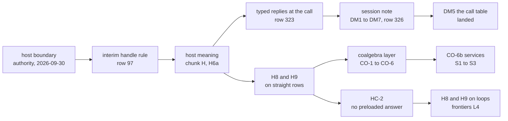
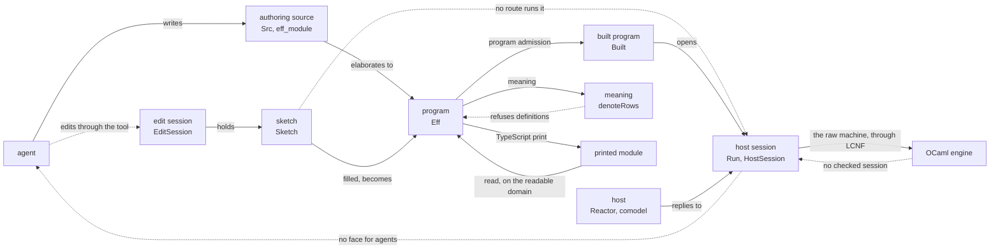

# 2026-10-13 The backlog of four areas: the host session, holes, authoring, and the lowering route

Status: research note (history, not authority). Base: `68bbe8b50` on `refactor/phase1-phase3`.
Seat BACKLOG wrote it from the brief `docs/research/2026-10-13-seat-backlog-brief.md`. It rules
nothing, and it changes no code. HEAD moved to `ab2bb64f0` during the seat, by view, research
and SVG-kit commits only, so no finding here moves (reading, `git diff --stat`).

## The one thing to know first

- **Three seams join the four areas, and `docs/STATE.md`'s ordered list closes none of them.**
  Two have slices under its "Also open" (PROC-5, row 328; the session API's slices, row 326).
  - A program with a definition block is outside every meaning fragment, so H8 and H9 say
    nothing about the programs that authoring now writes.
  - The edit session cannot type a real application's program. Its tool runs at the empty
    application, and its check refuses a layer reference that program admission accepts.
  - The host session has no face that an agent, an MCP tool or the view can drive. Decisions
    row 326 rules the `Live` face, and only its slice DM5 is in the tree.
- **`docs/STATE.md` names that face as landed.** It says the session's face is `Live.open`,
  `Live.start`, `Live.feed` and `Live.view`. No declaration named `Live` exists (reading, by
  `git grep`).
- **Two of the first share's four gates lie in these areas** (row 307, point 6): the guarantee
  of a host session, and lowering (row 28). Both wait on owner rulings (rows 28 and 97 to 99),
  more than on proofs.
- **The ranked list starts with five slices.** The host session's face (DM1 to DM4). The meaning
  of a definition block (PROC-5). The edit session at an application and through layer
  references. One checked route for host replies (row 98). Lowering made measurable at every
  landing.

## Question

The owner asked on 2026-10-13 to grill the backlog beyond the visual features. The four areas
are the host session, the holes abstraction, authoring and lowering. For each area this note
gives the trail, what is true at HEAD, the drift between the documents and the code, and the
candidate slices. Then it says how the four connect, ranks the slices across the four, and asks
the owner at most twelve questions.

## What was read or run (each with its evidence word)

- **Reading**: `AGENTS.md`, `docs/STATE.md`, `docs/core/host-boundary.md`,
  `docs/core/api-surface.md`, `docs/core/lcnf-route.md` and `ocaml/README.md`.
- **Reading**: `docs/core/system-map.md` (§1 to §8), `docs/core/controlled-english.md` (§2 to
  §6), the design issues named below and the decisions rows named below.
- **Reading**: the area notes, each named where a finding uses it. The main ones are
  `2026-10-07-session-api-design.md`, `2026-10-09-host-coalgebra.md`,
  `2026-10-09-host-calls-and-cleanup.md`, `2026-10-11-handles/README.md`,
  `2026-10-06-seat-GAP-study.md`, `2026-10-08-tangible-authoring-design.md`,
  `2026-10-08-agent-authoring.md`, `2026-10-08-host-authoring-boundary.md`,
  `2026-10-09-mcp-code-mode-design.md`, `2026-10-09-js-semantics-audit.md`,
  `2026-10-11-type-interface/README.md` and `2026-10-08-seat-ORG-theory-map.md`.
- **Reading**: the probes and queues of 2026-10-12: `2026-10-12-probe-backlog-queue.md`, the
  three `2026-10-12-probe-notes-queue-*.md`, `2026-10-12-probe-hc2-keyed-lane.md` and
  `2026-10-12-probe-api-usability.md`.
- **Reading**: the code at HEAD, file by file where a finding cites it.
- **Reading**: `git log`, `git show` and `git grep`, for every commit hash and every absence
  claimed.
- **Reading**: `generated/semantics.md`, for every status of a registry claim, a requirement and
  a planned goal.
- **Tested**: `python3 scripts/check-language.py --strict` on this note passes, with no finding.
  It checks the writing rules only.
- **Not run**: no `lake`, no `make`, no TypeScript and no OCaml. No finding about the tree rests
  on a run of this seat.

## Findings (each with its evidence)

### 1. The host session

#### 1.1 The trail

The diagram shows the order of the main landings and designs of the host session. It claims no
law.

| Step | What it gave | Where | Evidence |
| --- | --- | --- | --- |
| The authority | the external lane's contract, parked until host services need it | `docs/core/host-boundary.md` (2026-09-30) | reading |
| Row 97's interim rule | a host row may not answer an internal handle | `90df5d21a`, merged `bc77e97fb` | reading |
| Chunk H, row 313 | the row table's meaning, `denoteRows`, `meaningUnder`, the fragment `StraightRows` | `11afc560e` | reading |
| Slice H6a, row 314 | `session_eq_ref` rests on no planned goal | `201a97ae4` | reading |
| Typed replies, row 323 | a reply is admitted at its call's checked instance | `374a32f0d`, `018101e1f` | reading |
| The session note | the deep module `Live` and its seven slices DM1 to DM7 | `030eefa40`; ruled by row 326 at `640060a06` | reading |
| DM5 | the checked call table, made once at open | `5c01db4a3`; `1253079c5` reaches a block | reading |
| H8 | the meaning under a run's reply tape is the run's observation | `0e36b4b96` | reading |
| CO-3 to CO-6 | any comodel of `RowSig table` drives a run under H9; the session as a system | `0a108d2f9` to `a78fcad87` | reading |
| CO-6b, S1 to S3 | a block's services print as Effect services; a client runs on rc.112 | `356cc11d3`, `d0fdd93fa`, `ec08fe863` | reading |
| HC-2, row 343 | preloaded answers deleted; every host call parks | merge `45873fc76` | reading |
| H8 and H9 on loops; L4 | the meaning at a budget; a waiting run names its wait | `c9bfc4498` to `a6f4e8bba`; `8ce5e1c4f` | reading |

What was dropped or superseded, and why:

- **The host-call note's HC-1, HC-3, HC-4 and HC-5** gave way to the coalgebra slices
  (`2026-10-09-host-coalgebra.md` §7: "This order replaces HC-1, HC-3, HC-4 and HC-5"). HC-1,
  the live call view, has no successor slice and no decisions row (the 2026-10-09 queue, its
  item O1).
- **The preloaded answer list** went before the nine legacy truth fixtures moved to the keyed
  lane. That inverted DI-23's order, and row 343 (8) signs the nine as `HC-2` until they move.
- **The session note's DM1 to DM4, DM6 and DM7** have no commit (reading, `git log --grep`).
- **Codex's keyed-layer scout after Effect's `LayerMap`**, named in `docs/STATE.md` item 0, has
  no note. Codex reached its quota on 2026-10-12 (STATE item 00).

#### 1.2 True at HEAD

| Part | Declarations | Path | Status |
| --- | --- | --- | --- |
| The checked session | `Session`, `start`, `bindCall`, `preflight`, `submit`, `applyReply`, `advance`, `inspect`, `callTable`, `instanceAt` | `src/Effect4/Api/HostSession.lean` | code |
| The run a caller holds | `Run`, `Run.open`, `Run.step`, `Run.play`, `Run.observe`, `Run.work`, `Run.nextControl`, `Run.controlOnce`, `Reactor`, `Run.drive`, `Run.runWith` | `src/Effect4/Run/Basic.lean` | code |
| The event alphabet | `Sel`, `Move` | `Test/Dogfood/Scenario.lean` | test code, not in the library |
| The session against the reference | `session_eq_ref`, `origin_addresses_call`, `reached_callInstance` | `src/Effect4/Laws/Api/SessionRef.lean` | proved (`generated/semantics.md`) |
| The raw agreement at every row table | `run_eq_ref_table` | `src/Effect4/Laws/Program/Table/Agreement.lean` | proved |
| H8 and H9 | `denoteRows_eq_session`, `denoteRows_eq_session_host` | `src/Effect4/Laws/Api/SessionMeaning.lean` | proved, fragment `StraightRows` |
| On loops, and the waits | `h8_loopedRows`, `rows_loop_frontier` | `src/Effect4/Laws/Api/SessionMeaningLoop.lean` | proved, fragment `LoopedDataRows` |
| The driver | `runWith_denotes`, `runWith_layer_denotes`, `hostGuard_through`, `sessionSystem_finished` | `src/Effect4/Laws/Api/HostDrive.lean` | proved |
| The ledger's laws | `reply_commute` (`src/Effect4/Laws/Api/HostSession.lean`); `session_keys_once` (`src/Effect4/Laws/Run/Journal.lean`) | as named | proved |
| The next call, before a run settles | `request_leads` | `src/Effect4/Laws/Run/CallTree.lean` | planned goal, R6 |

Four facts read from the code bound what the session is today:

- **The face is `Run`, not `Live`.** `Run` holds the session, the journal and the verdicts.
  Events stay in a test module, and `Observation` is the first-order reading.
- **The header still names `profile`.** Row 326 (4) renamed it `binding`, with DM3's codec.
  `Refusal.selectionRequired` and `Refusal.pendingControl` still stand, and DM6 deletes them.
- **`applyReply` keeps no bit for an applied step that ran out of fuel.** Row 326 (4) and DM4
  give it one, so a view can report `funded` without a replay of the journal.
- **The OCaml engine generates the raw machine, not the checked session.** The roots of
  `ocaml/gen/api_gen.ml` and `ocaml/engine/api_engine.ml` are `Effect4.Api.run` and
  `Effect4.Api.replay` (`ocaml/gen/roots.json`).

What bounds it:

- **Planned goal**: `request_leads` (R6), whose consumer is the routing clause
  `unauthorized_calls_nothing`.
- **Decisions rows**: 95 to 101; 98 and 99 open, 100 parked; 191, 310, 313, 314, 323, 326,
  333, 338, 339, 343, 344, 348 and 361.
- **Design issues**: DI-23, DI-57, DI-58, DI-65, DI-68, DI-69, DI-81 and DI-85.
- **R6's open parts**, as `generated/semantics.md` lists them:
  - the value half of `admit_sound`, which waits on row 97;
  - the host as a relation between the machine's calls and its answers;
  - receipt and application on the keyed lifecycle (rows 98 to 100);
  - the public typed guarantee (row 99);
  - the proposed claims `expansion-keeps-call` and `replay-at-call-instance`.

#### 1.3 Drift

| Document | What it says | What the tree holds | Evidence |
| --- | --- | --- | --- |
| `docs/STATE.md`, "The machine and the session" | the session's face is `Live.open`, `Live.start`, `Live.feed` and `Live.view` | no `Live`; only DM5 landed | reading, `git grep`, `git log` |
| `docs/STATE.md`, item 0 | Codex scouts a keyed layer after `LayerMap` | no scout note; Codex's quota ended on 2026-10-12 | reading |
| `docs/STATE.md`, item 0 | "Codex reviews the `Effects` packet" | Codex's reviews `2051b3988` and `a15eb1921` of 2026-10-09 exist; a further review is unnamed | reading; which review is meant is a guess |
| `docs/core/host-boundary.md` §3 | the holes of rows 95, 96 and 97 stand: "Fiber handles are exploitable now" | rows 95 and 96 landed; row 97's interim rule landed (`bc77e97fb`) | reading |
| `docs/core/host-boundary.md` §6 | X3, the table-aware reference and DI-57's statement, is parked | `run_eq_ref_table` and `session_eq_ref` are proved (rows 313, 314, 343) | reading |
| `docs/core/host-boundary.md`, the header | the lane is parked until host services need it | row 310 (7) lifted DI-57's park on 2026-10-07 | reading |
| `docs/core/system-map.md` §8, R6 | "open, parked by the owner (2026-09-30)" | the same lift; the cell lists the landed theorems too | reading |
| `docs/core/api-surface.md` §1 | "the package root imports all four" | five entry modules (row 332) | reading |
| `docs/core/api-surface.md` §2, D-F | one Lean MCP server with fourteen tools | row 333 (4) rules two services over one data contract; the MCP note designs M0 to M12 | reading |
| the register | the host-call note's three questions (one form of a host call, the live call view, the order) | no decisions row records them | reading (the 2026-10-09 queue, O1) |
| `ocaml/README.md`, "Building" | the engine's tests are a declared-red sweep row | `make check-ocaml` runs `dune test engine` (`Makefile`) | reading |

#### 1.4 Next

| Slice | What it unlocks | Cost | Waits on | Risk |
| --- | --- | --- | --- | --- |
| **DM1 to DM4**: events in the library, `Live`, `Live.open` and `Live.start`, one `View` with each call's checked instance, and the `funded` bit with `view_funded` | the face that row 326 ruled; MCP's M9; one verb set for editing and running (row 334); the view of each wait (row 333 (3)); a caller that can read `session_eq_ref`'s premise | 10 to 16 hours (the session note's estimates) | nothing: ruled | DM3's derived codec moves ordinals; DM4 changes `applyReply`, which about seven laws unfold (the note's §5) |
| **DM6**: the keyed tool's `planRun` moves onto `feed`; `selectionRequired` and `pendingControl` go | one driver loop for every host lane | 2 to 4 hours | DM3 | a scenario that relies on a selector taking the first of two calls |
| **One checked replay route**: `Typed.replay` through the session's journal (row 98); `replayCheckedFrom` admits at the call instance (`replay-at-call-instance`) | no public entry applies an unchecked host answer; the OCaml session's admission | about a day (a guess) | row 98's ruling | harness callers of `Api.replay` |
| **K1 and K2**: the nine legacy fixtures on the keyed lane (row 343 (8), option (b)) | nine signed divergences become compared runs on rc.112 | small for `pKv`; medium for the SQLite five (the backlog queue, B1) | nothing: ruled | the lane compares no schedule, so the nine's schedules stop being compared (the HC-2 probe) |
| **`admit_sound`'s value half on data rows** | the typed guarantee of row 99 on rows whose columns hold no handle | a probe first: one day (a guess) | Q2 below | it needs the session's token joined to the ghost token table, which no law states yet |
| **`request_leads`** (the goals lane) | the routing clause rests on no planned goal | the goals packet's estimate | nothing | an operational prefix over every budget and control decision |
| **A run view driven by a host** | the owner's aim of 2026-10-09: watch a session answer calls | hours, after DM3 (a guess) | DM3 | none known |
| **The typed layer's driver with no guard, and the guard behind the entries** (the 2026-10-09 queue, L1 and L7) | `runWith_layer_denotes` drives the layered host itself; `Reactor.ofHost` and the guard reachable from `Effect4.Run` | hours each (the queue) | nothing | L7 moves core declarations under rows 39 and 332 |
| **Shape (c) of a printed service** (row 338 (4)) | the rows a service's definitions call become its layer's requirements: `Layer<S, never, T>` | days (a guess) | a host row that is a service | the typed handler's print is named, not designed (the CO-6b plan §7) |
| **CO-7's Effect4 half; the handles note's steps 3 to 9; row 97 lifted kind by kind** | handle rows in the host meaning: key-value and resource hosts | many slices | rows 97 and 100 | high: the world, `Fits` and the typed state |
| **HC-6**: the immediate-answer lowering | rc.112's inline answer as a lowering, at matched budgets | a day | an observation at a settled point | the trace differs: three events against six (the host-call note §6.3) |
| **Row 348**: the frontier reason `blockedForever` | R12: a wait that can never resume is named | after the reachability law | `handles-reach-monotone` | none known |
| **The widening packet's S1 to S3**: a host meaning for `scoped` and `acquireRelease`, its connection to runs, then the actual `TodoPaged` program | the to-do application's paged program inside a host meaning; R2 (C2), R6, R11 | 7 to 12 person-days (the packet's §4) | nothing: L1 to L4 landed | the resource contract's definitions (its Q11, Q12) |
| **The widening packet's F1 and F2**: forks as decisions, then the first fork and join agreement | the first concurrent fragment with a host meaning | 7 to 14 person-days, the most uncertain (the packet's §4) | S1 | the residual relation does not exist yet |

### 2. Holes: sketches, the edit session and the explain judgment

#### 2.1 The trail

| Step | What it gave | Where | Evidence |
| --- | --- | --- | --- |
| Row 281, row 282 | type slicing and a gap with holes as first-class work; R14 | the owner, 2026-10-06 | reading |
| Seat GAP's study, seat LATTICE | eight stages, seven slices; the generic lattice of type slices | merge `066b35b0b` | reading |
| SKETCH, row 291 | a hole is a host row; the hole table after the row table | merge `3a87d53f6` | reading |
| REPLACE, row 294 | the replacement law; `Sketch.fillAt`, `Sketch.omitAt` | merge `9dd89864b` | reading |
| The focus function, row 296 | `focusAt` | merge `11396a079` | reading |
| FORM, row 297 | a type variable is formed in a template only | merge `9d67ac144` | reading |
| TABLE, row 302 | the address table, its refusals and the slot table | `de7b40448` | reading |
| P1, row 324 | the table in one traversal (`annotate`) | merge `dbd0660cd` | reading |
| The edit session, row 334 | `open`, `feed`, `view` over a program and its table | `ff87466d4`, `29f8608fb` | reading |
| A whole program | a filled sketch is checked as its module, block included | `d610801f9` | reading |
| Sketch bytes; the omission splices | `sketch-wire`; `omit-splices-table` | `cdcb0ef39`, `902c78263` | reading |
| The session tool | the edit session over JSON lines, with its journal | `de9ec7255`, `ebc497c77` | reading |
| Two overwatch repairs | the fallback check deferred; the edit session exposed to authors | `90940a540` | reading |

The GAP study's plan (§9.1), against HEAD:

| Stage | What | At HEAD |
| --- | --- | --- |
| 0a | formation at a variable | landed (row 297) |
| 0b | a parameter bound at two covariant places | answered another way: the match by bounds (rows 303, 306) |
| 1 | the sketch | landed (row 291) |
| 2 | the replacement law | landed (row 294) |
| 3 | the traced check and total marking | the focus and the table landed; marking past a refused sibling did not |
| 4 | type slices of the error and requirement columns | not landed: `column-graduality` is a proposed claim |
| 5 | uniform eliminators | landed in part (rows 293, 298, 304); the tests by equality are not converted |
| 6 | the gap, `Ty.gap` | not landed; row 336 (3) ruled the gap as the type at a marked place |
| 7 | term holes | not landed |
| 8 | a handler for a hole's operation; running to a hole | not landed |

Dropped or superseded: the text edit as a tree edit (the tangible design's slice 3). Row 336 (1)
rules that an agent edits the graph by operations, and that the TypeScript print is an output.
Row 336 (2) leaves the text after an edit waiting.

#### 2.2 True at HEAD

| Part | Declarations | Path | Status |
| --- | --- | --- | --- |
| A sketch | `Sketch`, `Row.hole`, `SigApp.withHoles`, `Sketch.hole`, `Sketch.check`, `Sketch.fillAt`, `Sketch.omitAt`, `Sketch.focusAt`, `Sketch.table`, `Sketch.refusals` | `src/Effect4/Program/Sketch.lean` | code |
| Its laws | `holes_conservative`, `Sketch.check_fill`, `Sketch.check_omit`, `Sketch.check_filled_module` | `src/Effect4/Laws/Program/Sketch.lean` | proved |
| The edit session | `Edit`, `Edit.Delta`, `EditSession`, `EditSession.open`, `feed`, `feedStep`, `run`, `view` | `src/Effect4/Program/Edit.lean` | code |
| Its laws | `run_coherent`, `reached_view`, `feed_undo` | `src/Effect4/Laws/Program/Edit.lean` | proved |
| The tools | `Tools.Session`; the query tool `Tools.Query`; the snapshot resolver with `resolve_agrees` | `tools/Tools/Session.lean`, `tools/Tools/Query.lean`, `tools/Tools/Session/Snapshot.lean` | tool code and tool laws |
| The located refusal | `explain_none_iff` (`src/Effect4/Program/Typing/Agreement.lean`); `refusals_nil_iff` (`src/Effect4/Laws/Program/Typing/Table.lean`) | as named | proved |

Five facts read from the code bound what an agent can do with holes today:

- **The session tool runs at the empty application.** Its docstring says so, and every answer
  names the application `"empty"` (`tools/Tools/Session.lean`). A program with host rows or a
  service table cannot be opened through it.
- **A sketch's check refuses a layer reference.** `Sketch.check` runs `Checker.checkModule` on
  the program as written. `Checker.checkLayer` refuses `.ref` with `layerReference`
  (`src/Effect4/Program/Checker.lean`). Program admission checks `program.expandRefs` instead
  (`typeOfProgram`, `src/Effect4/Program/Typing.lean`; `Api.check`, `src/Effect4/Api.lean`).
  The annotation that the edit session opens with reads `.ref` through the same refusing arm
  (`Annotate.checkLayer`, `src/Effect4/Program/Typing/Annotate.lean`). Codex's finite control
  shows one built program whose source check refuses at its reference
  (`docs/research/2026-10-10-live-graph-support/run-view/COMPATIBILITY-3ef7aeb0.md`, tested
  there).
- **No sketch runs.** Program admission reads the application's tables alone, so it refuses a
  program that performs a hole (`src/Effect4/Program/Sketch.lean`, its table of the parallel).
  The edit session's module doc says: "It runs nothing."
- **A hole with no stated type has no type of its own.** `Ty` has no gap leaf
  (`src/Effect4/Program/TyCore.lean`). The GAP study's interim rule declares it at `never`.
- **An address after a refused sibling is not reached.** No mark stands there, so a half-written
  program shows no type past its first refusal (R14's `marking-agrees`).

What bounds it:

- **Planned goals**: none. R14's open parts are proposed claims or need a definition
  (`generated/semantics.md`): `sketch-renumbering`, `sketch-admission`, `column-graduality`,
  `marking-agrees`, `expected-type-slice`, `checker-monotone`, the gap claims, `fill-by-term`.
- **Decisions rows**: 281, 282, 285, 286, 288, 291 to 298, 302 to 306, 324, 334, 336 (3) and
  342 (`checker-monotone`'s wording).

#### 2.3 Drift

| Document | What it says | What the tree holds | Evidence |
| --- | --- | --- | --- |
| `docs/STATE.md`, "Partial programs" | "A sketch reads a whole program, definition block included" | a whole program with a layer reference is refused by the sketch's check | reading; Codex's control |
| `docs/STATE.md`, its heading | "Partial programs" | the dictionary lists "partial program" as a word not to use, in favour of sketch | reading, `docs/core/controlled-english.md` §3.6 |
| `docs/core/api-surface.md` §1, the `Author` row | no sketch and no edit session | `Effect4.Author` re-exports `Program.Sketch` and `Program.Edit` since `90940a540` | reading |
| `docs/STATE.md` item 5 | "the session tool as an MCP server" | the tool is no server, and the MCP note's slices wait on six rulings; a research adapter stands at `docs/research/2026-10-10-live-graph-support/mcp/` | reading; not drift, an unstarted plan |

#### 2.4 Next

| Slice | What it unlocks | Cost | Waits on | Risk |
| --- | --- | --- | --- | --- |
| **The session tool at an application**: `open` takes the application's row table and services as canonical bytes | an agent edits a program with host rows, such as the to-do application | hours (a guess) | Q7 below | the snapshot law `resolve_agrees` is stated at the empty application |
| **A sketch typed through layer references**: the sketch checks its expansion, as program admission does, and its table reads the expansion at the source's addresses (`source-annotation-agrees`) | R14 on authored modules with layers (row 341, step 2) | one to two days (a guess) | Q8 below | an edit inside a referenced layer moves every copy, so it leaves the spliced path |
| **`sketch-admission`**: a located refusal for a sketch with its hole table | a tool refuses a malformed hole row by name | hours (a guess) | nothing | none known |
| **Total marking** (`marking-agrees`) | a type at every address of a half-written program | two days (the tangible note, slice 5) | the type at a marked place: ruled, the gap (row 336 (3)) | the interim type, `never`, differs from the gap at cells |
| **Running a sketch**: a sketch built at its hole table, opened as a host session; a reply at a hole's frontier as a fill (`fill-by-term`) | "one session edits and runs" (STATE item 5); the tangible design's slice 7 | two days (the tangible note) | DM2; Q5 and Q6 below | the observation of a fill after a reply needs a definition |
| **GAPLEAF**: `Ty.gap`, consistent subtyping and the gap check | "not stated" in place of `never`; type slices through cells | large: the first append to `Ty` | the owner is told before the append (row 288 (5)) | the wire tags, the compatibility policy and every hand algebra move |
| **COLUMN**: a `SliceView` of a real program | the first minimal type slice of a real program | a day (a guess) | nothing | `ColumnOpen`'s reach |
| **The rule of each table entry, as data** | each entry names its `HasTy` rule (STATE item 5) | a day (the tangible note, slice 6) | nothing | none known |
| **`sketch-renumbering`** | a stored sketch survives a row added to its application | five hours (ORG's rank 9) | nothing | none known |
| **Stage 5's rest**: the tests by equality read each union member (`checker-monotone`, row 342) | a filling at a smaller type stays typed; marking past a refused term | days (a guess) | nothing | a conversion widens the admitted programs: a tsgo probe first, and the owner hears of it (row 285 (3)) |

### 3. Authoring

#### 3.1 The trail

| Step | What it gave | Where | Evidence |
| --- | --- | --- | --- |
| The named source tree, DI-83 and DI-84 | `Src`, elaborated once by authoring elaboration; one table of what an author may write | ruled 2026-09-16 | reading |
| Procedures PROC-1 to PROC-4, row 328 | a definition block at the root; `Def.of`; the Queue as definitions | `f0ca3dcb3` and its predecessors | reading |
| `eff_module` | the authoring record from one declaration list | merge `7dee92b43` | reading |
| The library's layout, row 332 | five entry modules; `Modules` becomes `Library` | `96e3fd109` to `5fd7d5fa8` | reading |
| `#explain`, `#obligations` | one question asked of any part | `5c26f1212`; their own import at `70840796e` | reading |
| The tangible authoring design | one document, five faces, one journal; eight slices | `c1e25bbf1` | reading |
| Row 336 | an agent edits the graph by operations; pieces by content address; the gap | ruled 2026-10-09 | reading |
| The MCP and code-mode design | M0 to M12, after six rulings | `c4b6b7956` | reading |
| Programs as parameters, row 340 | HO-1, HO-2, HO-3a, HO-3b | `facb99dc9`, `000bcd7ad`, `770fdaf9c` | reading |
| Layer scopes, row 341 | module layers in a block; per-call layers | `235403a03`, `54ed060e6`, `de38da567`, `b04ae8617` | reading |
| The usability probe | thirteen frictions; ten API fixes | `504dd9bf6`; the README's "Start here" at `eb8b6daec` | reading |

Dropped or superseded:

- **The text edit as the agent's surface** (the tangible design's decision 1), by row 336 (1).
- **One Lean MCP server with fourteen tools** (api-surface D-F, rows 14 and 15), in substance by
  row 333 (4) and the MCP note. Rows 14 and 15 stay open.
- **The module form** `module Queue mirrors "Queue.ts"` (row 331 (6)) and `derive_step` (the
  agent-authoring note §5) stay designs. Row 332 lists both among what `Effect4.Author`
  re-exports, and neither is in `src/` (reading, `git grep`).
- **The application and claim record** (`2026-10-07-packet-application-claims.md`, slices APP
  to QUERY-APP) was ruled by row 336 (9), and nothing landed: no
  `src/Effect4/Program/Authoring/Application.lean`.

#### 3.2 True at HEAD

| Part | Declarations | Path | Status |
| --- | --- | --- | --- |
| The entry modules | `Effect4.Author`, `Effect4.Run`, `Effect4.Emit`, `Effect4.Library`, `Effect4.Laws.Author` | `src/Effect4/Author.lean` and its siblings | code |
| Building a program | `Api.Author.build`, `Api.Author.program`, `Built` | `src/Effect4/Api/Author.lean`, `src/Effect4/Api/Built.lean` | code; `build_table_lawful` and its siblings proved |
| Definitions | `DefSrc`, `Def.invoke`, `Def.of`, `eff_module` | `src/Effect4/Program/Authoring.lean`, `src/Effect4/Program/Authoring/Defs.lean`, `src/Effect4/Program/Authoring/Module.lean` | code |
| Questions of a part | `#explain`, `#obligations` | `src/Effect4/Laws/Author/Explain.lean` | tool code |
| The step language | `Step`, `Modeled` | `src/Effect4/Step.lean`, `src/Effect4/Schema/Modeled/Derive.lean` | code; its laws proved |

Five facts read from the code bound authoring today:

- **Every meaning fragment refuses a definition block.** `Straight` rejects `.defs` and
  `.invoke` (`src/Effect4/Program/Fragment.lean`). The generator's one rule table gives both
  `.reject` in every profile: straight, looped, rows and looped rows
  (`tools/Effect4Gen/Fragments.lean`). So `run_eq_meaning`, `loopAgreement`, H8 and H9 cover
  no program that holds definitions. The frame machine and the reference agree on them (row 328:
  G4), and the typed state covers them (`invoke_arm`).
- **The same table refuses scopes, layers, services and forks.** It rejects `scoped`,
  `acquireRelease`, `provideLayer`, `service`, `withFiber` and the masks. So PROC-5 alone reaches
  the definition blocks whose bodies stay inside `StraightRows`. The rest is the widening
  packet's (`docs/research/2026-10-10-host-meaning-widening/README.md` §2 and §3).
- **No authoring builder writes an invocation with programs.** `Def.invoke` takes terms only
  (`src/Effect4/Program/Authoring.lean`), and `DefSrc.params` holds `(String × Ty)` pairs. The
  programs of HO-1 to HO-3 are written as raw `Eff` in batteries.
- **No API fix of the usability probe landed.** `git grep` finds no `runToEnd`, `emitText`,
  render functions for an exit or a refusal, `ServiceDef.of` or `decodeAt` in `src/`. The README
  fixes landed (`eb8b6daec`).
- **The common combinators are absent as forms.** `Codegen.Forms.all` holds no `catchAll`,
  `mapError`, `orElse`, `timeoutFail` or `retryTimes`; its `duals` table names several as heads
  with no expansion (`src/Effect4/Codegen/Forms.lean`).

What bounds it:

- **Decisions rows, open**: 14 and 15.
- **Decisions rows, ruled with open slices**: 328 (PROC-5), 329 (S1 to S4) and 361 (DET D1 to
  D3 wait on the authoring line).
- **Decisions rows, ruled**: 307, 308, 330, 331, 332, 333, 336, 340, 341 and 347.
- **Design issues**: DI-83, DI-84, DI-85 and DI-89.
- **Owner rulings pending**: the MCP note's six rulings (STATE, "What the owner must decide").

#### 3.3 Drift

| Document | What it says | What the tree holds | Evidence |
| --- | --- | --- | --- |
| row 332 (1) | `Effect4.Author` re-exports `derive_step` and the module form | neither exists in `src/` | reading, `git grep` |
| `docs/core/api-surface.md` §1.3 | "Higher-order builders remain expanded under decisions row 328" | true of `eff_module`; but row 340 now stores definitions whose parameter is a program, and the section names neither them nor the missing authoring form | reading |
| `docs/STATE.md` item 0 | HO-4, HO-5, CX3 and CX4 are next on the host session's line | CX3 and CX4 have no consumer: "the typed run goes through sites, not substitution" (`2026-10-10-cx-lexical-scope.md`) | reading |

#### 3.4 Next

| Slice | What it unlocks | Cost | Waits on | Risk |
| --- | --- | --- | --- | --- |
| **PROC-5**: `denoteRows` reads an invocation on `StraightRows`, the block's handler before the host's (goal G5, `invoke_unfolds_at_limit`) | H8 and H9 for programs with definitions and services; the definition block as a verified service (the coalgebra note §5.3); R2 (C2), R6, R10 | 6 to 8 hours by the procedures note, written before HO-1; one to two days with parameters (a guess) | nothing | the fragment generator's classes; row 344's `denoteCtl` callers |
| **MCP M1**: the request sum and its answers with `Canonical`; the session tool reads and writes through them | every MCP option needs typed requests (the MCP note's finding F3) | a day | nothing | MCR-1: a schema is not a carrier's codec admission |
| **MCP M2 and M3**: schemas, then the stdio binding | row 307 (4): the first authoring path | three days | rulings 1 and 2 (Q9) | as M1 |
| **The application and claim record**: APP, RECORD, PROTOCOL, MODEL, QUERY-APP | row 307 (8) and (9): the to-do application's claims as data | S, then four M (the packet's table) | nothing: ruled (row 336 (9)) | the goal gate's pin moves by one |
| **The usability fixes**: renders, `Built.runSync` refusing an open program, `Built.runToEnd`, `ServiceDef.of`, a located decode | an agent's and a newcomer's first runs | S to M each (the probe's table) | nothing | a render needs an exact-name exemption in the axiom gate |
| **Forms**: `catchAll`, `mapError`, `orElse`, `timeoutFail`, `retryTimes`, each with its rc.112 expansion and a truth case | R10's forms; ordinary Effect code | L (the probe's table) | nothing | each form owes a typing lemma and a behaviour law (DI-89) |
| **A program in the store, `rebaseRefs`, pieces and search by type** | row 336 (1), (6) and (7): the graph operations of an agent | 1 hour, 8 hours, then two days (ORG rank 5; MCP M7) | ruling 3 of the MCP note (a piece's key) | medium |
| **An authoring form for programs as parameters** | `Pool.use` and `withPermits` written through `Src` | hours to a day (a guess) | HO-4 for generic parameters | none known |
| **HO-4, HO-5** | a generic `use`; Pool's service | M to L | row 342's explicit type argument | medium |
| **The module toolkit's gaps**: G1 wrapper laws, G3 `derive_step`, G2 the module form at the Latch | the agent-authoring note's ladder | days | nothing | the derivation's lemma bank |
| **SIM S1 to S3**, then PROC-6's inlining law | the relation across schedules; R10's module law | 11 hours, then 12 to 24 | nothing | low for S1 to S3 |
| **CX3, CX4** | theory: substitution and bounded unfolding | days | nothing | no consumer on the spine; defer |

### 4. Lowering

#### 4.1 The trail

| Step | What it gave | Where | Evidence |
| --- | --- | --- | --- |
| The LCNF route | the machine through Lean's compiler IR, LCNF, to OCaml | `docs/core/lcnf-route.md` (2026-09-17) | reading |
| The builtin table as data | one row for each Lean constant; three forms | `8b236fa7f` | reading |
| Seat LOWER, rows 252 and 262 | the conformance runner; `let_return_outcome` outside the trust ceiling | merged `c09826c0` | reading |
| The compiler checkpoint, row 263 | `make check-compiler` | `0acec081` | reading |
| The typed TypeScript print, rows 324 and 325 | P1, P2a, then P3, UNGUARD and P2b | `dbd0660cd`; merge `e53468ced` | reading |
| The code plane, slice F | modules with exact imports; `TsFold`; the house and the layout as algebras | `2688f3101`, `de2af6915` | reading |
| The JavaScript audit | J1 to J9 placed as laws; ECMA-262 vendored | `9078498f7`, `5ce041bb4` | reading |
| Integers at one bound, rows 316 to 322 | the reference, OCaml and the TypeScript prelude refuse past the bound | `34330b34a` and its neighbours | reading |
| The type interface note | the census, five wrong answers, R-T1 to R-T9 | `b243b95bc` | reading |
| Its repairs | the literal refused (row 357); the order model of tsgo; OCaml ingress refusal; warning 8 back | `3d676de29`, `6c3108d50`, `daaaf01bd`, `8eb8290c8`, `8e1cf9b92` | reading |

Dropped or superseded:

- **Every OCaml route but the one made from LCNF** (`ocaml/README.md`; archived at `14e6835`).
- **Row 31's rung-3 TypeScript reader before any emitter** stays open, and no slice names it.
  The LCNF-to-TypeScript backend of api-surface D-J and DI-88 is unscheduled.

#### 4.2 True at HEAD

| Part | Declarations | Path | Status |
| --- | --- | --- | --- |
| The LCNF translation | `translateClosure`; `builtins` | `src/OCaml5/Lcnf/Translate.lean`, `src/OCaml5/Lcnf/Builtins.lean` | code; no theorem (`src/OCaml5` declares none, the ORG note §6.1) |
| The generated OCaml | roots `Effect4.Api.run`, `Effect4.Api.replay` and the engine's projections | `ocaml/gen/roots.json` | generated |
| The program printer and reader | `printT`, `readEff`, `readModule`; `printTypedAt` | `src/Effect4/Codegen/Templates.lean`, `src/Effect4/Codegen/Read.lean`, `src/Effect4/Codegen/PrintTyped.lean` | code |
| Their laws | `read_print`, `read_exact`, `printTyped_eq_print`, `readTyped_printTyped`, `readModule_printModule_defs` | `src/Effect4/Laws/Codegen/` | proved, on the readable domain |
| The application's print | `Api.print` calls `Program.print`, the untyped print | `src/Effect4/Api.lean` | code |
| The emitted module | `Api.emitModule`, `ModuleEmission`; its imports are empty by the producer's docstring | `src/Effect4/Codegen/Checked.lean` | code |
| A runnable module | `Tools.Code.Module`, exact imports and a header | `tools/Tools/Code/Module.lean`; `tools/Drivers/Emit.lean` | tool code |
| The target order | `rel`, `assignable` | `src/Effect4/Laws/Codegen/TargetOrder.lean` | its battery checks agreement with tsgo on the recorded pairs (a finite check, not run here) |

Five facts read from the code bound lowering today:

- **No theorem relates the OCaml engine to the Lean machine** (row 28 open).
- **Two finite comparisons run.** Lane S replays five scenario fixtures through the generated
  `api_replay` and compares each view with Lean's (`ocaml/engine/test/scenarios/test_scenarios.ml`).
  The corpus cross-face is "reported, not gated" (`ocaml/engine/test/test_diff.ml`).
- **The vector differential of `docs/core/lcnf-route.md` §3 is wired to no target.** The conform
  runner has the profiles `compiler`, `native` and `cases` only (`scripts/check-conform.py`).
- **The lowering is outside the load instrument.** `treeScopes` lists `Effect4`, `Test`, `Tools`
  and `ProofGraph`, not `OCaml5` or `Conform` (`tools/Tools/LoadPaths.lean`).
- **The printer's conformance slices are unstarted.** The `typescript` package stays pinned at
  `f5878bf` (`lake-manifest.json`), which is also the newest commit of `lean4-typescript` on this
  machine. So J1 to J7 are not upstream, and neither is the plain `const` statement that row
  341's step 3b waits for. No reader of ECMA-262 exists.

What bounds it:

- **Decisions rows, open**: 26, 27, 28, 29, 31, 101 and 108 (mostly implemented; see the drift).
- **Decisions rows, ruled and not started**: 262 and 346.
- **Decisions rows, ruled or landed**: 252, 254, 263, 309, 321, 322, 324, 325, 337 (7) and 357.
- **Design issues**: DI-15, DI-49, DI-55, DI-56, DI-88 and DI-91.
- **Counterexamples**: `E4-PRINT-CE-001` (SEEDED); `E4-PRINT-CE-003` (RESERVED, for the owner's
  ruling on input positions); `E4-OCAML-CE-001` and `E4-PRINT-CE-002` (REPAIRED).
- **R8's open parts**, as `generated/semantics.md` lists them:
  - rows 28 and 108;
  - K2 on the readable domain, and DI-81's identity carrier;
  - finite checks of the TypeScript face, and the profile as data.

#### 4.3 Drift

| Document | What it says | What the tree holds | Evidence |
| --- | --- | --- | --- |
| `docs/core/lcnf-route.md` §8 | "the three faces agree only on a bounded range, and none refuses outside it" | the three refuse past the bound at `succ`, `add`, `plus` and `minus` (rows 321, 322), at a literal (row 357) and at a product (`E4-RUN-CE-047`) | reading |
| `docs/core/decisions.md`, row 108 | "open, recommended" | its implementation landed for those atoms; its rest is the truth runner's record of a refusal (row 322 (4)) and the store functions | reading; the register is the coordinator's |
| `docs/core/system-map.md` §2, layer 8 | "number policy mixed" | as above | reading |
| `docs/research/2026-10-11-type-interface/README.md` §3.3 | "No gate compares an OCaml machine run with Lean's" | lane S does, for five scenario fixtures; the corpus cross-face does not | reading (history, not authority) |
| `ocaml/README.md`, "Owed" | the host over the engine that answers parks | still owed: DM7 and HC-7 are not landed | reading; not drift |

#### 4.4 Next

| Slice | What it unlocks | Cost | Waits on | Risk |
| --- | --- | --- | --- | --- |
| **Lowering made measurable**: `OCaml5` and `Conform` in `treeScopes` with a lowering census (ORG rank 6); the corpus cross-face gated with a signed exception list (R-T8); row 262's evaluator under the trust ceiling | the share's gate "lowering (row 28)" gets evidence at every landing; R8 | 2 hours, then dune only, then one slice | row 28 names the first stage law | the gate first meets the two same-named goldens (`test_diff.ml`'s note) |
| **The emitted module is the application's**: the typed print at joins (the checked module print plan, `2026-10-09-checked-module-print-plan.md`); imports written from Lean data; the reader keeps every service method (CO6B-ALIASES) | a file that tsgo and rc.112 accept, from the library API; R8, R5 | L, S and M | Q11 | the shared assembly reopens `emitModule_erasure` and its siblings |
| **DM7 and HC-7: the checked session through LCNF** | row 307 (5): a host session on OCaml; host-boundary §4.6's keyed entry | a day or more | DM2; the checked replay route | each translator rule moves every generated file's bytes; the checker's algebras in LCNF (the session note, finding 2) |
| **Repair A** (row 346), with tsgo's bound of 25 | `E4-PRINT-CE-001` repaired; `sub_print_sound` provable | L | nothing: ruled | high: it changes the checker's order, on which M7 stands |
| **J1, then J2 to J7 upstream, then J9's reader** | latent printer hazards as laws; the conformance credential | M, a package version, L | nothing: ruled (row 337 (7)) | printed bytes move; golden repins |
| **R-T4 to R-T6**: `Int` and `Num`; input positions; one product frame | an upper-section reader; inputs inside the model; one data language | M each | the owner (STATE's owner list) | each moves printed types |
| **R-T7**: the TypeScript type algebra and reader generated from Lean | about 2,700 hand-ported lines retire (the type interface note, item 10) | L | rows 29 and 31; DI-88's order | high |
| **Row 108's remainder** | a refusal recorded as "outside the profile" on the truth lane | S to M | nothing | no corpus program reaches the bound yet (row 322 (4)) |

### 5. How the four connect

The diagram shows the loop that the brief names, with each seam drawn as a dashed edge. It shows
data flow between the dictionary's objects, and it claims no law.

The seams, weakest first. Each line names its evidence.

1. **The meaning refuses definitions** (reading: the fragment table). Authoring writes modules as
   definition blocks (PROC-4, `eff_module`, CO-6b). So the host meaning's theorems reach none of
   the programs an agent builds from the library. PROC-5 closes the seam for straight bodies.
   The widening packet's S and F steps close it for scopes, resources and forks.
2. **The typed guarantee stops at the reply** (reading: R6's open parts). The typed state holds
   on tapes whose host answers are ghost-admitted (`reachable_typed`, modulo a planned goal of
   R9). `admit_sound`'s value half would link the session's reply admission to that ghost
   admission, and it waits on row 97. So M7 stays at the empty row table on answer-free tapes,
   and row 99's public guarantee is unclaimed. It is a share gate (row 307 (6)).
3. **The edit session sees an empty application, and refuses layer references** (reading: the
   tool's docstring; Codex's control, tested there). An agent cannot edit the to-do
   application or an authored module with layers through the tool.
4. **The host session has no agent face** (reading: no `Live`). MCP's M9, the run view with
   host replies and "one session edits and runs" all wait on DM1 to DM4.
5. **The OCaml engine runs the raw machine** (reading: `ocaml/gen/roots.json`). It admits no
   reply and correlates no call. With row 28 open, the lowering gate has no stated claim.
6. **The printed module is not the agent's file** (reading: `Api.print`, `ModuleEmission`).
   The library prints untyped at joins and writes no imports; only a tool writes a runnable
   module.

## Proposals (not rulings)

### 6. One ranked list

The owner's two tests of 2026-10-12 rank first: an outcome of a real run, then the proof graph.
The share's gates (row 307 (6)) rank next, then the cost. Each line gives one reason.

| Rank | Slice | Area | The reason |
| --- | --- | --- | --- |
| 1 | **DM1 to DM4**: the `Live` face, its view and the `funded` bit | host session | Ruled, sized in hours, and three lines wait on it: MCP's runs, the view's host replies, and editing beside running. |
| 2 | **PROC-5**: the meaning reads a definition block | authoring, host session | The first step into the largest seam: a block with straight bodies, the shape of a service over host rows. |
| 3 | **The edit session at an application, and through layer references** | holes, authoring | Without it no agent edits a real program through the tool, which every MCP option wraps. |
| 4 | **One checked replay route**: `Typed.replay` through the journal (row 98); `replay-at-call-instance` | host session, lowering | The certificate-first face still applies host answers that no check admits. |
| 5 | **Lowering made measurable**: the census, the corpus cross-face gated, row 262 | lowering | The share's lowering gate has only lane S and the compiler checkpoint at a landing; the rest costs hours. |
| 6 | **K1 and K2**: the nine legacy fixtures on the keyed lane | host session | Nine signed divergences become compared runs, under a ruled option. |
| 7 | **The emitted module is the application's**: typed print at joins, imports from Lean, CO6B-ALIASES | lowering, authoring | An agent's emitted file should compile and run without a tool; one defect drops a service method. |
| 8 | **DM7 and HC-7**: the checked session on OCaml | lowering, host session | Row 307 (5) asks for it; it needs ranks 1 and 4 first. |
| 9 | **The widening packet's S1 to S3**: scopes and resources, then `TodoPaged` | host session, authoring | It puts the to-do application, the dogfooding's centre, inside a host meaning. |
| 10 | **Total marking**, then `sketch-admission` | holes | A half-written program then shows a type everywhere; the gap's ruling is in hand. |
| 11 | **MCP M1**, then M2 and M3 after the rulings | authoring | Row 307 (4) names it the first authoring path; M1 needs no ruling. |
| 12 | **The application and claim record** | authoring | Ruled and unbuilt; it makes the to-do application's claims data. |
| 13 | **The usability fixes and the missing forms** | authoring | Each removes a friction that the probe met in a real program. |
| 14 | **A program in the store, `rebaseRefs`, pieces** | authoring | The ground of row 336's graph operations, after MCP's ruling 3. |
| 15 | **`admit_sound` on data rows** | host session | It may make row 99 claimable on a fragment; a probe decides (Q2). |
| 16 | **Running a sketch**, with `fill-by-term` | holes, host session | The tangible design's runnable document; it needs rank 1 and Q5, Q6. |
| 17 | **Repair A** (row 346) | lowering | Ruled, and high risk under M7; it waits for a quiet stretch of the law graph. |
| 18 | **J1 to J7, then J9** | lowering | The hazards are latent today; the credential matters for the share's Lean audience. |
| 19 | **GAPLEAF** | holes | The first append to `Ty`; after marking shows where `never` misleads. |
| 20 | **HO-4, HO-5, and an authoring form for program parameters** | authoring | Pool's service waits on it; no current program does. |
| 21 | **CO-7, the handles steps 3 to 9, row 97 kind by kind** | host session | The deep representation work; it waits on rows 97 and 100. |
| 22 | **HC-6; the widening packet's F1 and F2; SIM S1 to S3; R-T7; CX3, CX4** | mixed | Each waits on a ruling, on another slice, or on a consumer. |

#### 6.1 The placement of the first five slices' obligations

`AGENTS.md` asks for five fields before an obligation is worked. Each row takes them from the
note named in its first cell; none is a new proposal of this seat.

| Obligation (source) | Concept; question; consumer | Reach | Does not establish | Unlocks |
| --- | --- | --- | --- | --- |
| `view_funded`, DM4 (the session note §4) | `translation-simulation`; proposed claim `view-funded`; consumer `session_eq_ref` stated at `Live` | every `Live`; the view's flag against `Run.funded` | that a run is funded (`embedded-budget-sufficient`) | R6 |
| G5 `invoke_unfolds_at_limit`, PROC-5 (the procedures note) | `translation-simulation`; proposed claims `block-handler-monotone` and `block-handler-unfolds`; consumer `denoteRows` with invocations | the free monad over the store, host and block signatures, at every budget | the frame machine's agreement; termination; any scheduler: one fiber, `StraightRows` | DI-69's statement with definitions; R2 (C2) and R10 for a block |
| `source-annotation-agrees` (Codex's live-graph `THEORY.md`) | `initial-algebras-folds`, compatibility; consumer `Program.sessionPage` there, and the edit session's table here | an admitted source, with the expansion's provenance | equal raw and expanded paths; any run | R14, reference-aware editing |
| `replay-at-call-instance` (row 323 (8); R6's open part) | `host-session-protocol`; consumer: `Typed.replay`, then the OCaml engine | rows whose answer column allocates nothing; success and failure | handle rows and delayed cell reads (row 100); host progress | R6 |
| `let_return_outcome` under the trust ceiling, row 262 | `translation-simulation`; the claim `ocaml-let-return-outcome` that row 262 names, absent from the semantics registry today | one rule of the target evaluator | any other translator rule; the pinned compiler | R8 |

The census and the gated cross-face of rank 5 are a measurement and a finite check. Neither is a
theorem, and neither needs a placement block.

### 7. Questions for the owner

Each question is one of meaning, domain or representation, with a recommendation. This note
cites question n as Qn.

1. **Domain: what host session does the first share promise?** Options: (a) the Lean session's
   laws (H8, H9, `session_eq_ref`), with the TypeScript keyed lane as finite evidence;
   (b) (a) and the OCaml checked session (DM7). Recommended: (a). DM7's translator rules move
   every generated file, and row 307 (5) says "if we can".
2. **Meaning: is the typed guarantee with host answers claimed on a fragment now?** Row 99 waits
   for the whole external lane. Recommended: claim it on data rows (no handle in any column, a
   shape-decided answer column), after a probe of `admit_sound`'s value half there. Handle rows
   stay parked under row 97.
   - The ghost admission `AnswerOk` asks membership at the token's declared type
     (`src/Effect4/Laws/Program/Typed/Assembly.lean`).
   - The session gives membership at the call's instance on shape-decided columns
     (`preflight_success_prepared_fits`, `src/Effect4/Laws/Api/HostSession.lean`).
   - The probe must join the two: the session's token to the ghost token table, which
     `docs/core/api-surface.md` §1.1 names as not established.
3. **Representation: what does `Typed.replay` replay?** Today it replays raw decisions, and a
   host answer among them is applied unchecked. Recommended: a journal of run commands through
   the session (row 98). Raw `Api.replay` stays as a named test entry, and `replayAdmitted` goes.
4. **Representation: record the host-call note's three questions as answered?** Recommended:
   yes.
   - The call is the operation of `RowSig table`.
   - The live call view is DM3's view, with each call's checked instance (row 333 (3)).
   - HC-1 retires into DM3.
5. **Representation: one event type for editing and running, or two sessions?** Row 334 (1)
   asks for one face. Recommended: two sessions with the same verbs. One operation joins them:
   it builds a sketch at its hole table and opens a host session on it.
6. **Meaning: what does filling a hole after a reply mean?** `fill-by-term` needs a definition.
   Recommended: compare two runs at matched budgets. One takes a value at a hole's frontier, and
   the other runs the program with that value filled. Their observations are the root's exit
   and the stores at a settled point, and they are equal.
7. **Representation: how does an edit request carry its application?** Recommended: by value
   now, the row table and services as canonical bytes in `open`. By digest later, when MCP's M4
   lands the store (rows 14 and 15).
8. **Representation: how does a sketch type a layer reference?** Two options stand.
   - (a) Check the expansion, as program admission does, and read its table at the source's
     addresses (`source-annotation-agrees`).
   - (b) Add a typing rule that types a reference at its target's checked layer type, in the
     target's scope (row 341).

   Recommended: (a). `LayerHasTy` has no rule for `LayerTerm.ref` by design: "their absence
   from the system is the statement" (`src/Effect4/Laws/Program/Typing/HasTy.lean`). Option (b)
   would reopen `check_sound`, `check_complete` and M5's reading of the expansion (row 153). The
   expansion replaces each reference leaf by its target's term, so every source address is an
   address of the expansion (a reading of `Eff.expandRefs`, `src/Effect4/Program/Refs.lean`). An
   edit inside a referenced layer then rechecks, since every copy moves.
9. **Domain: may MCP start before the walk-through?** Recommended: land M1 now, since every option
   needs typed requests. Rule 1 as the edit script (a) and 2 as a Lean executable over stdio (a).
   Rulings 3 to 6 wait for the walk-through that row 307 (4) asks for.
10. **Meaning: what does row 28's lowering claim for the share?** The owner's words of
    2026-10-07 name verified implementations of the machine's data structures and protocol.
    Recommended: the Lean definitions carry the theorems; the LCNF route carries rule coverage
    and gated differentials (option (b)); the trust boundary is named. A stage law at
    `Api.replay` (option (a)) follows the share.
11. **Representation: what does an emitted module promise?** Recommended: one emission route for
    agents. It prints types at joins, writes its imports from Lean data, and decodes an exported
    entry's inputs with the printed Schema (R-T5). It brands only `Ref` arguments.
12. **Domain: the order of the host session's line in STATE item 0.** Recommended: DM1 to DM4,
    PROC-5 and the checked replay before HO-4 and HO-5. CX3 and CX4 wait for a consumer, since
    the typed run goes through sites.

## What this does not establish

- No statement here is proved, and no probe ran for this note. Every finding is a reading of
  the tree, its history or its notes, at `68bbe8b50`.
- A status of a claim, a requirement or a planned goal is the generated report's
  (`generated/semantics.md`), not this note's.
- A cost marked "a guess" is a guess. The other costs are the cited notes' estimates, not
  measurements.
- The seams of section 5 are ranked by reading. No measurement of agents or of runs ranks them.
- An absence ("no declaration", "no commit") is a `git grep` or `git log` reading at the base. A
  name spelled otherwise could escape it.
- Whether `admit_sound`'s value half holds on data rows (Q2) is a guess until a probe runs.
- The host boundary stays where `docs/core/host-boundary.md` puts it. Nothing here moves it.
