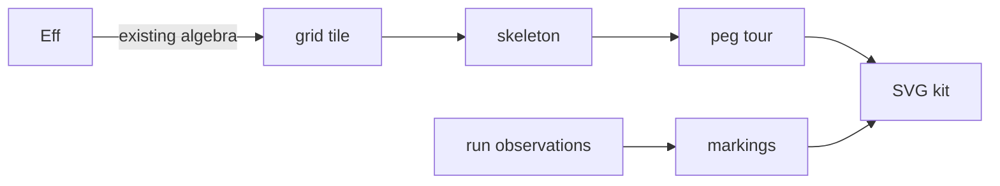

# PC peg port

The view stays in tools. Generic geometry belongs to the SVG kit.
The machine, its stored program, and its semantics stay with the Mac coordinator.

Base: `25c97480f797c17cd89b2e7adb7e2c66c67d6c15`.
Scope: the file fence of `2026-10-13-codex-view-handoff.md`.
The manifest changes only to name the reconciled kit commit.

## Slices

1. Reconcile the PC and Mac kit histories in an isolated worktree.
2. Measure the existing studio pages before changing their consumers.
3. Build a data-only skeleton and its closed peg tour.
4. Read board changes from existing trace and journal observations.
5. Replace sampled films where their structure stays fixed.
6. Fold the program into grid tiles through its existing algebra.
7. Move shared declarations to their owners and delete replaced definitions.

## Ownership

| Seat | Files |
| --- | --- |
| Kit | The isolated SVG worktree and its declaration records |
| Geometry | `Tube/Belt.lean`, new skeleton modules, and `Tube/Glyphs.lean` |
| Board | `Tube/Marking.lean`, new board modules, `Tube/Score.lean`, and `Tube/Queue.lean` |
| Coordinator | Tiles, page consumers, the driver, manifest, measurements, and integration |

## Proof placement

Concept: `initial-algebras-folds`, serving R14's inspection tools.
Role: tool laws under decisions row 334, point 3.
These laws do not change a registry claim about the machine.

The tile laws describe integer translation and composition of drawing data.
Their consumers are the program tile fold and its renderer.
The room invariant combines containment and disjoint allocated cells.
Its proposed tool question is `view-tile-room`, with role invariant.
The pointer is `Tile.ofProgram_room` in `tools/Tools/View/Tube/Tile.lean`.
It quantifies over every finite `Eff` program and every cell payload function.
It establishes no bound on the ink or text that a renderer places in a cell.
The fold uses `EffAlgebra.ofLayer` and `cata_eff` from `src/Effect4/Program/LayerView.lean` and `src/Effect4/Program/Fold.lean`.
It adds no program syntax.

The board law observes the fold of changes at recorded ticks.
A projection law keeps its step premise explicit.
The trace omits store writes, so events alone establish no store projection.
Queue pictures use the snapshots that the existing APIs return.

Geometric claims distinguish exact integer equations from approximation checks.
The fixed-point tangent calculation does not prove exact real tangency.
The viewport and the browser remain host boundaries.

## Verification

Build each changed module and its direct consumers with `LEAN_NUM_THREADS=3`.
Run `#axiom_audit` on the changed computational modules.
Record rendering declarations that reach the host-facing text libraries separately.
Measure page generation and figure sizes with `view-pages` before and after integration.
Name every page change caused by the new drawings.
Run the kit's required gates before the new pin lands.

The receipt records open obligations and exact commands.
No finite rendering probe establishes the algebra's proposed exact embedding of programs.
