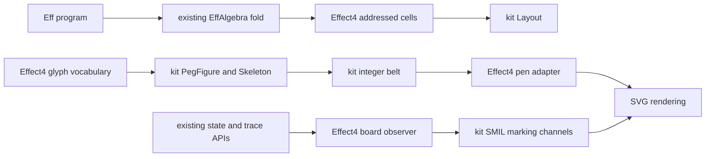

# PC peg port receipt

Merge the SVG kit branch before this Effect4 branch.
The manifest requires kit commit `1ecaf5c1d422a1c98b9d61717ba777b7507d7bf6`, which remains unpublished.
The handoff permits only the manifest edit. The Mac coordinator must align the revision in `lakefile.toml`.
Until that edit, Lake warns that the manifest differs from the declared revision.
Do not run `lake update whatwg` against the old declaration.

## Commits and worktrees

| Repository | Base | Implementation head | Branch |
| --- | --- | --- | --- |
| Effect4 | `25c97480f797c17cd89b2e7adb7e2c66c67d6c15` | `3e0f7d90d` | `codex/pegs-port` |
| SVG kit | PC `59c59a1`, Mac `e64e915` | `1ecaf5c1d422a1c98b9d61717ba777b7507d7bf6` | `codex/svg-reconcile` |

Effect4 worktree: `C:/Users/kokok/.codex/worktrees/pegs-port/lean4-effect4`.
Kit worktree: `C:/Users/kokok/Dev/lean4-whatwg-svg-reconcile`.
The branches hold local commits. Nothing is pushed.
The original Effect4 checkout retains its untracked `ocaml/link/` and `tools/viewer/` directories.
The original kit checkout retains its sixteen-file patch, byte for byte.
Its SHA-256 is `ecd889dde8b443d65c507fdc3acd1e3aa1908e82761fb036a8d1aa093e68d6f0`.

Three GPT-6.1 Sol agents use high effort for kit, geometry, and board work.
Independent reviews cover arithmetic transfer, tile induction, film channels, and final consumer wiring.
The final review reports no blocking finding.

`2026-10-13-codex-pegs-evidence/Commits.txt` records the implementation commits.
`2026-10-13-codex-pegs-evidence/ChangedPaths.txt` records every changed implementation path.
The receipt commit adds this file and its evidence directory.

## Ownership and changes

The kit owns peg geometry. Effect4 owns program vocabulary, recorded machine observations, and the final view.

| Paths | Change |
| --- | --- |
| `tools/Tools/View/Tube/Belt.lean`, `Skeleton.lean`, `PegFigure.lean`, `PegBridge.lean` | Alias kit carriers and transport laws; convert tuples and cubics at the pen boundary |
| `tools/Tools/View/Tube/PegGlyphs.lean`, `PegRender.lean`, `PegChecks.lean` | Author the peg vocabulary, render checked contours, and exercise controls |
| `tools/Tools/View/Tube/Board.lean`, `Board/Film.lean` | Fold observations and refuse changing structures before writing fixed films |
| `tools/Tools/View/Tube/Queue.lean`, `Score.lean`, `Sheet.lean` | Use actual recorded states, fixed paths, shared definitions, and changing markings |
| `tools/Tools/View/Tube/Tile.lean`, `TilePage.lean` | Fold existing program syntax into grid cells and show real corpus programs |
| `tools/Tools/View/Tube/Glyphs.lean`, `GlyphPage.lean` | Use peg stills and an explicit cache lookup |
| `tools/Tools/View/Tube/Motion.lean`, retired `Physics.lean` | Remove unused sampled Queue motion, carry, event, and swell machinery |
| `tools/Tools/View/Motion.lean`, `Place.lean`, `Flow.lean` | Reuse the kit join, remove the duplicate key alias, and name the region carrier `RegionFrame` |
| `tools/Drivers/GlyphSheet.lean`, `View.lean`, `tools/view/v`, `README.md` | Generate the program page and expose it through the studio |
| `Test/Audit/GlyphControls.lean` | Consume peg checks and test addressed tiles at actual program constructors |
| `lake-manifest.json` | Pin the reconciled kit |

The tile payload remains caller data. The tile stores no second program syntax.
`Tile.ofProgram` uses the existing seven-sort algebra through `EffAlgebra.ofLayer` and `cata_eff`.
The page uses the existing glyph table and non-child argument descriptions.

`Board.film` returns a located message through `Except String SvgNode`.
Its check rejects repeated keys and changed path, layer, tone, fill, level, and rounding fields.
Filled marks also keep width and dash fixed.
The unchecked writer remains private.
The Sheet consumer presents refusals visibly and reuses each computed recording.

The fixed Score staff allocates every recorded lane before playback.
The fixed Queue inlet accommodates the greatest recorded waiting load.
The films change opacity, stroke width, dash array, and dash offset at recorded boundaries.
No sampled path animation remains in those four films.
Reduced-motion presentation uses the final marking.

## Proof placement

Concept: `initial-algebras-folds`, serving R14 inspection tools under decisions row 334, point 3.
Evidence status: the strict audit accepts the landed tool proofs.
Scope: finite program syntax, integer drawing data, and conditional observations of recorded transitions.
No machine registry claim changes status.

| Pointer and path | Role and observation | Consumer and limits |
| --- | --- | --- |
| `Tile.ofProgram_room`, `tools/Tools/View/Tube/Tile.lean` | Proposed tool invariant `view-tile-room`; `Fits` and `Clear` for every finite `Eff` and payload function | Program page; bounds allocated cells, not ink or text |
| `Tile.children_hold`, `layer_fits`, `layer_clear`, same path | Helpers of `view-tile-room`; carry child membership through the existing fold | `ofProgram_room`; no typing, schedule, or value-wire conclusion |
| `Tile.ofProgram_fits`, `ofProgram_clear`, same path | Projections of the room invariant | Callers needing one room property |
| `Board.fold_projection`, `tools/Tools/View/Tube/Board.lean` | Proposed tool invariant `view-board-projection-fold`; equality after each finite command prefix | Requires projection agreement at every transition; concrete machine instances remain open |
| `Board.fold_append`, same path | Helper of the board question; command concatenation | Observer composition; no liveness conclusion |
| `Belt.normal_inset`, `normal_move`, `tools/Tools/View/Tube/Belt.lean` | Reexport exact optional integer-normal equations from the kit | Casing and placement; no real tangency conclusion |
| `Skeleton.tour_move`, `walk_head`, `walk_last`, `walk_closed`, `tools/Tools/View/Tube/Skeleton.lean` | Reexport ordered-tour and rooted-walk observations from the kit | Peg figures; no global simplicity conclusion |
| `join_new`, `join_old`, `tools/Tools/View/Motion.lean` | Existing join observations, now direct applications of kit laws | Existing view transitions; statements stay unchanged |
| `step_ok`, `tools/Tools/View/Tube/Motion.lean` | Existing transition-control law after dead sampled code removal | Existing tube films; statement and hypotheses stay unchanged |

The plans record placement before the corresponding proof work.
The board, geometry, and adapter receipts retain their detailed hypotheses and commands.
The host boundary remains where `docs/core/host-boundary.md` places it.

## Verification

Every Lake command uses `LEAN_NUM_THREADS=3`. Commands run one at a time in each worktree.
The evidence directory is `docs/research/2026-10-13-codex-pegs-evidence/`.

| Command | Result | Evidence file |
| --- | --- | --- |
| `lake build view-pages Test.Audit.GlyphControls Drivers.View` | Exit 0, 1159 jobs | `Build.txt` |
| `lake build Tools.View.Inc Tools.View.FlowLaws Drivers.Live` | Exit 0, 413 jobs | `DirectConsumers.txt` |
| `lake env lean docs/research/2026-10-13-codex-pegs-evidence/StrictAudit.lean` | Exit 0; kit 309 declarations, Effect4 129 declarations; zero planned goals | `StrictAudit.txt` |
| `lake env lean docs/research/2026-10-13-codex-pegs-evidence/RenderAudit.lean` | Exit 1; 58 of 1197 declarations reach `Classical.choice` | `RenderAudit.txt` |
| `lake env lean docs/research/2026-10-13-codex-pegs-evidence/StudioAudit.lean` | Exit 1; 25 of 97 declarations reach `Classical.choice` | `StudioAudit.txt` |
| `lake env lean docs/research/2026-10-13-codex-pegs-evidence/PageDriverAudit.lean` | Exit 1; 3 of 12 declarations reach `Classical.choice` | `PageDriverAudit.txt` |
| `lake env lean docs/research/2026-10-13-peg-adapter-evidence/Compatibility.lean` | Exit 0; finite cubic equality against frozen geometry | `Compatibility.txt` |
| `lake exe view-pages tools/view/out/pegs-final` | Exit 0 | `FinalPages.txt`, `FinalTiming.json` |
| `lake env lean --run tools/Drivers/View.lean gallery .lake/peg-studio` | Exit 0; all five page links exist | `Studio.txt`, `StudioCheck.json` |
| `wsl bash -n /mnt/c/Users/kokok/.codex/worktrees/pegs-port/lean4-effect4/tools/view/v` | Exit 0 | Integration command |
| `git diff --check` | Exit 0 | Integration command |

The rendering audits are refusals, not successful strict audits.
Their logs retain each declaration and its dependency route.
Routes include the kit's SVG node string traversal and existing rational outline arithmetic.
No axiom gate or exemption changes.

The finite adapter probe compares every authored body and unit contour across the 37 shapes.
It uses exact cubic record equality at grid step 12000 and inset `LINE`.
The retained probe records the frozen source commits and blob hashes.

Browser checks run against the final `tubes.html` in the Codex browser on Windows.
`BrowserCheck.js` compares computed markings at every authored key time, one millisecond after each boundary.
`BrowserCheck.json` records 496 observations and no mismatch.
`BrowserLayoutCheck.json` records shared path references, discrete channels, and reduced-motion presentation.
All seven films hide animation and show their final still under reduced motion.
Browser emulation and SVG clocks are restored after the checks.
These are finite host observations, not a browser agreement theorem.

The kit receipt records its full build, `whatwg_trustgate`, declaration snapshot, ledger, citation, vendor, CSS, self-test, and kernel commands.
The kit files are `docs/research/2026-10-13-codex-kit-receipt.md`, `2026-10-13-codex-kit-placement.md`, and `2026-10-13-codex-kit-pegs.md`.
The kit ledger leaves general geometric obligations open.
No Effect runtime behavior changes, so no outside Effect runtime gate is reached.
The Effect4 whole-tree battery and axiom gate are not run.

## Measurements and page changes

The page producer supplies these byte counts. `PageComparison.csv` records final hashes.
`BaselineMeasure.tsv` and `FinalMeasure.tsv` retain every figure measurement.

| Page | Baseline bytes | Final bytes | Change |
| --- | ---: | ---: | --- |
| `glyphs.html` | 115912 | 115912 | Identical |
| `cells.html` | 45339 | 45339 | Identical |
| `tubes.html` | 4379820 | 957210 | Four fixed board films replace sampled films |
| `tube-glyphs.html` | 744013 | 709853 | Static cards use the peg vocabulary |
| `program-pegs.html` | Absent | 17669 | Three real program pictures |

The capacity-13 figure changes from 2967283 bytes to 53267 bytes.
Its animation count changes from 1450 to 62.
The final kit transfer changes no bytes in the five integrated pages.
The final local generation takes 3443 milliseconds, including process startup.
The page producer reports `tubes.html` writing at 922 milliseconds before and 136 milliseconds after.
These are individual local measurements, not a throughput benchmark.

## Open work and proposed decisions

The peg port remains partial. The changes above land usable consumers without claiming the full design.

1. Align the kit revision in the coordinator-owned `lakefile.toml` after merging both branches.
2. Keep integer peg geometry in the kit and program vocabulary in Effect4.
3. Place any machine-loop observer in the coordinator's semantics slice.
4. Prove concrete projection agreement before claiming an event-only machine view.
5. Resolve typed ports, value wires, and program readback before claiming an exact embedding.
6. Prove laws for refused tangent pairs and remaining real-curve bounds in the kit's peg graph.
7. Replace changing-shape consumers before retiring `Tube/Outline.lean` and the remaining blends in `Tube/Kit.lean`.
8. Decide whether rule 184 supplies motion between recorded states. These films implement recorded boundaries only.
9. Continue the remaining D137 and D143 declaration moves recorded in the kit.

The remaining tube and glyph films still consume the old changing-shape renderer.
The fixed Queue and Score films also retain their existing authored pipe and staff geometry.
The tile law proves no ink containment, text containment, typing, progress, or liveness.
No source file under `src/`, coordinator decision register, or core root import changes.
