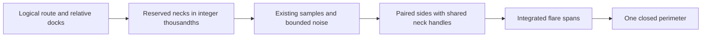

# One connector perimeter

The connector replaces separate body and collar contours with one perimeter.
`Grow.stroke` remains available during caller migration.

## Placement before work

| Item | Placement |
| --- | --- |
| Concept | `initial-algebras-folds`, concept 7, R14 live authoring |
| Question | Does the displayed connector use shared points and tangent handles at its necks? |
| Role | Tool geometry helper under decisions row 334(3) and row 336(8) |
| Consumer | `Laid.organicCalls` in `tools/Tools/View/Graph.lean`, after coordinator migration |
| Observation | Integer cubic controls, in thousandths of a logical pixel |
| Fragment | Forward routes with vertical source and target docks |
| Hypotheses | Positive width and positive surface drop for a nonempty connector |
| Nonclaims | No scheduler simulation, circle exactness, global injectivity, or universal absence of intersections |
| Unlock | One perimeter for the program graph display |

The local shared-handle lemmas serve this question.
Finite controls check the constructed perimeter at real route shapes.
No new language judgment enters the registry.

## Geometry

A dock contains a surface offset and a requested radius.
Both values use thousandths relative to the route endpoint.
The connector reserves necks before it samples the body.
Each flare and adjacent body segment share the integer handle `radius * 552 / 1000`.
An effective radius below two thousandths becomes zero.
This rule avoids a positive radius with a zero rounded handle.

The radius respects terminal vertical reach and one quarter of the available surface drop.
Interior samples outside the vertical neck shoulders retain the existing noise calculation.
Paired forward sides retain the existing integer Catmull–Rom interpolation.
The return side swaps cubic controls instead of interpolating reversed samples.

The two transverse caps retain deliberate corners.
All joins inside each side are intended smooth joins.
The output lists these joins structurally, without filtering failures.

## Rounding

The connector retains `Grow.KAPPA = 552` and existing sequential integer divisions.
The kit default `Cubic.kappa = 0.5523` does not replace this constant.
The perimeter uses the kit's paired-edge outline recipe with integer controls.
Kit rational arithmetic reaches `Classical.choice` through `Rat.instAdd`.
The strict Effect4 connector therefore keeps its paired integer edges directly.
The return side swaps these controls without rounding or resampling.
