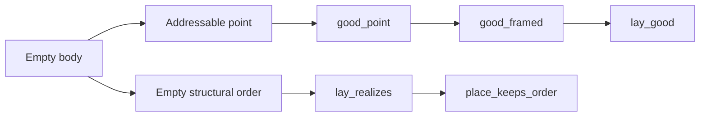

# Empty graph region allocation: placement before repair

Base: `bf87bb067c9b7588078ab2bfbf53ae400c5b7c0d`.
Status: research repair brief.

The retained red control at the base observes `Flow.layout (Flow.ofProgram (.scoped (.gen .nil)))`.
Its region starts at `y = -32` and the former dimension check passes.
`GraphCheck.laid` refuses that allocation.

Normalize an empty region body to `point (k ++ "/empty")` before allocating its margins.
Keep the point through nested and sequential layout composition.
Do not clamp the region's final coordinate.

## Placement

Concept: `initial-algebras-folds`, concept 7 in `docs/core/semantics.md`.
Required property: the structural fold keeps its layout invariant and realizes its structural order.
Tool role: preservation, R14, decisions row 334 (3) and row 336 (8).
Existing consumers: `lay_good`, `place_descends`, `place_apart`, and `place_keeps_order`.

| Repaired pointer | Path | Observation and scope |
| --- | --- | --- |
| `good_framed` | `tools/Tools/View/FlowLaws.lean` | `Good` remains true after empty-body normalization and region allocation |
| `lay_realizes` | `tools/Tools/View/FlowOrder.lean` | Every structural order vertex and edge remains realized, under nonnegative widths |

The empty case uses `good_point` and contributes no order vertex.
The nonempty case retains the existing margin translation.
No new schedule, source typing, ink bound, or semantic meaning follows.
No new registry claim or planned goal enters this repair.

Finite controls cover empty, nested-empty, and sequential regions.
The existing ten Flow specimens must still pass the rendering check.
The retained axiom audit includes Flow, FlowLaws, and FlowOrder, with their existing rendering-boundary exclusions.
