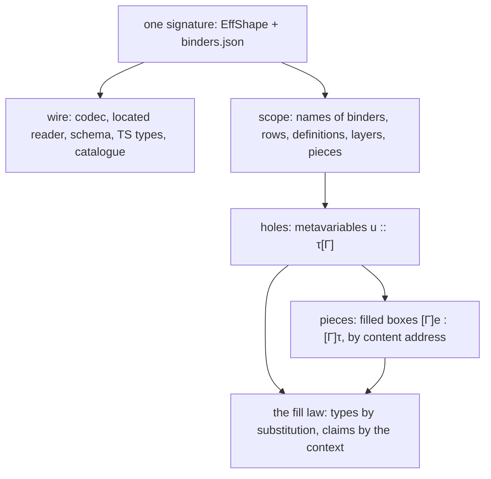

# Fluent authoring: the deep modules under the agent's surface

Status: theory note with a probe (history, not authority). 2026-10-13. Base: `0d918c680` on
`refactor/phase1-phase3`. The owner asked what would be clean as the agent-surface questions
become deep modules, centred on the abstractions of fluent authoring and composition. The
questions come from `docs/research/2026-10-13-agent-dx-probe/README.md`. The probe is
`Probe.lean` in this folder.

## The one thing to know first

The friction points share four abstractions, and the tree already holds most of each. **The program's
syntax signature** gives every wire artifact. **One scope** resolves every name an agent writes.
**A hole is a metavariable**, and **a piece is a filled one**. One law about filling a hole
carries types and claims through composition. One slice landed today: one JSON encoding for
agents (`8324f43e9`). The named source needs the owner's word: it is a representation.

## 1. One signature, every wire artifact

**What the tree has.** The shape alphabet (`Shape`, `src/Effect4/Store/Domain/Shape.lean`) describes
each carrier. Its printer (`printIn`) and its reader (`readIn`, `ShapeRead.lean`) are generic
over it. The exactness law is proved once over all shapes (`readIn_exact`).

**What the probe found.** Three JSON encodings of one program exist:

| Encoding | Where | Lists |
| --- | --- | --- |
| the canonical print | `printIn` | nested `cons` objects |
| the published types | `ts/eff/eff.gen.ts`, from `tools/Drivers/TsGen.lean` | arrays |
| the golden exchange | `ts/eff/json.gen.ts`, `ocaml/eff/eff_json.ml` | positional `["cons", h, t]` |

Gemini's map (`docs/research/2026-10-13-agent-dx-probe/gemini-encodings.md`) shows the first two
differ only on four families: `Terms`, `Stmts`, `Effs` and `LayerTerms`.

**Landed today (`8324f43e9`).** The list rule (`listItem?`): a sum of exactly `nil` and
`cons head tail`, under two tags, has an array for its JSON. The any-order normaliser reads
the array, and the tools print it (`Canonical.printArrays`). The law is exactness modulo the
named normaliser (`Canonical.ofJsonAnyOrder_exact`). The bytes and every digest are unchanged.

**Clean end state.** One carrier-rule table, read by every fold of the signature. The folds are
the printer, the reader, the Effect Schema (`Schema/OfShape.lean`), the TypeScript types and the
JSON Schema of MCP slice M2. `printIn` and `OfShape.render` adopt the list rule in one rebuild with M2;
then `arraysIn` goes. The golden exchange form is the next consolidation. The OCaml estate owns
it.

**The located reader.** The probe's `readAt` is `readIn` with `Except` in place of `Option`. It
answers the JSON path and what the shape wanted there:

| Input | Answer |
| --- | --- |
| a `bind` with no `rest` | at `rest`: the field `rest`: one of `succeed`, `fail`, … |
| the literal tag `string` | at `value.value._tag`: `Lit`: one of `unit`, `nat`, `bool`, `str`; found `string` |
| arrays with the rule off | at `first.value.args`: `Terms`: an object whose `_tag` is one of `nil`, `cons` |

Clean end state: one reader, located. `readIn` becomes `readAt`'s `toOption`, and
`readIn_exact` is restated at `.ok`. Then no second reader exists.

## 2. One scope: names as data

**What the tree has.** The authoring lifts are an algebra of the binding signature on the
scope reader `Src Op := Env → List Nat → Except Refusal (Eff Op)` (`Program/Authoring.lean`). They
are generated from `binders.json` (`Program/Authoring/Lifts.lean`). `Env` holds every sort of
name: values, layers, rows and definitions. `Reason` already names each failure: `unbound`,
`unboundRow`, `unboundDef`, `unboundLayer` and `reservedName`.

**The step.** The named source as data is the free object of that same signature. Reading it
is the unique fold into the lifts: one line per constructor, generated from the same table. This
is the initial and the final encoding of one signature (Carette, Kiselyov and Shan's
"finally tagless", recalled). The wire carries the initial form; Lean authors keep the final.

**What the probe ran** (part A, every check a `#guard`):

- the to-do program, written with names, reads to the stored program with levels;
- a consistent renaming reads to the same program;
- the nearest binder wins;
- `nwo` is refused as `unbound "nwo"` at path `[1]`;
- a host row by spelling reads to its index in the application's table;
- outside the table it is refused as `unboundRow "insert"`;
- the stored program prints back with generated names, and reads to itself.

**Laws of the deep module.**

- *Retraction*: a closed program printed with generated names reads back to itself.
- *Exactness modulo renaming*: what reads is the print of the stored program, up to a
  consistent renaming of binders.
- *Located refusal*: reading refuses exactly at an unresolved name, with the name and its path.

**What it removes.** An agent never counts binders (the probe's F1). Moving a subtree never
renumbers the agent's text: the scope resolves again. So `rebaseRefs` (seat ADDRESS) stays a
store law, not the agent's work. A misspelled variable or row gets its own reason (part of F3).

## 3. Holes are metavariables; pieces are filled ones

**The mathematics.** Contextual modal type theory (Nanevski, Pfenning and Pientka, recalled)
types a metavariable `u :: τ[Γ]`: a term of type `τ` still to come, which may use `Γ`. A sketch is
`Δ; Γ ⊢ e : τ`, with `Δ` the hole table. Filling is the substitution of a metavariable. Its typing
lemma is the tree's `Sketch.check_fill`. Hazelnut and Hazelnut Live (Omar and others, recalled)
build structure editing and evaluation around holes this way.

**A piece is a filled box.** A piece `[Γ]e : [Γ]τ` is a term with its context and type, by
content address. MCP ruling 3's recommended key is exactly the box's digest (the MCP note §10.2).
A hole asks for a box type; a piece is an inhabitant; weakening reuses it in a larger context.
A library module's definition block is a piece too, since `eff_module` produces `.defs`.

**What the hole's answer owes the agent.** Typed holes as a model's context (Blinn, Omar and
others, OOPSLA 2024, recalled) reports one finding. A hole's expected type, its typing context
and the fitting definitions improve a model's completions. So a hole's answer gives its name, `τ`, `Γ`
with names (§2), and the catalogue entries and pieces that fit `τ`. Its law: each fitting entry
checks at the hole.

## 4. Composition: one fill law carries types and claims

Fluent composition needs one law at the point where parts meet: filling a hole.

- **Types.** `Δ, u :: τ[Γ]; Γ' ⊢ C : σ` and `Δ; Γ ⊢ e : τ` give `Δ; Γ' ⊢ C[e/u] : σ`
  (`Sketch.check_fill`). Proved.
- **Meaning.** The meaning is a fold (`denoteRows`), so the meaning of `C[e/u]` is a function of
  `e`'s. Equal parts give equal wholes. Proved on fragments (`StraightEq`'s congruences); the
  call tree's version is open.
- **Claims.** A hole may carry a contract: a postcondition its filler must meet. The claim of
  `C` is proved once, assuming the contract. Filling with a piece that has the contract proved
  discharges it. This is modular verification, and the claim judgment composes along `bind`
  (the claims packet §3.4).

The claim record already has the slot for it. A premise has a grade, and "assumed" is the grade
of an open contract (`Test/Dogfood/Application.lean`, seat CLAIMS). The plan's three statuses
apply unchanged. A program whose holes have open contracts is *modulo* them, as a proof is modulo
its planned goals. A hole with a contract is a program's planned goal.

## 5. What to build, in order (not rulings)

| Order | Deep module | Its law | Cost | Waits on |
| --- | --- | --- | --- | --- |
| done | one JSON encoding for agents (`8324f43e9`) | `ofJsonAnyOrder_exact` | landed | nothing |
| 1a | done: a refused carrier's JSON located by one walk of the shape (`Tools.JsonBridge.locate`); the reader still decides | none: the walk explains, as `Api.explain` does | landed | nothing |
| 1b | the located reader as the one reader | `readIn_exact` at `.ok`; agreement by definition | M | nothing |
| 2 | the named source and its fold into the lifts | retraction, exactness modulo renaming, located refusal | M | the owner's word (representation) |
| 3 | done: the catalogue (`Tools.Catalogue`): forms with the sums held inline, atoms with their schemes, rows; types in the program's own JSON | `ofJsonAnyOrder_exact`, `atom_table_wf` | landed | nothing |
| 4 | holes on the wire: named, with `τ`, `Γ` and the fitting entries | each fitting entry checks at the hole | M | 2, and APPCHECK's slice |
| 5 | the list rule in `printIn` and `OfShape.render`, with MCP M2's schema | exactness unchanged | M, one rebuild of 759 modules | M1 |
| 6 | pieces by content address; a library block as a piece | weakening; the box's digest | L | ADDRESS, MCP M4 |
| 7 | contracts at holes, and claims carried by fill | the context lemma for the call tree | L | CLAIMS' record, 6 |

Slices 1 and 3 touch no seat's files. Slice 2 touches `Program/Authoring*`, CLAIMS' former cone,
now free. Slice 4 follows APPCHECK in the session tool.

## 6. The owner's question, with the probe's evidence

**Names on the wire (representation).** Recommended: the named source as the free object of the
binding signature the lifts already form an algebra of (option (b) of the DX note). It stores
nothing new: no field in `Eff`, no digest change. Its reading is a fold into the existing lifts,
so their refusals carry over. Part A of the probe ran it on the to-do program.

## 7. What this does not establish

The probe is finite: `#guard`s on named programs. It has no theorem. The named source covers a
fragment: succeed, perform, a row by spelling, bind, and three term forms. The literature is
recalled, not read again. The claims of §4 beyond `Sketch.check_fill` and `StraightEq` are
proposals. The order of §5 rules nothing.
