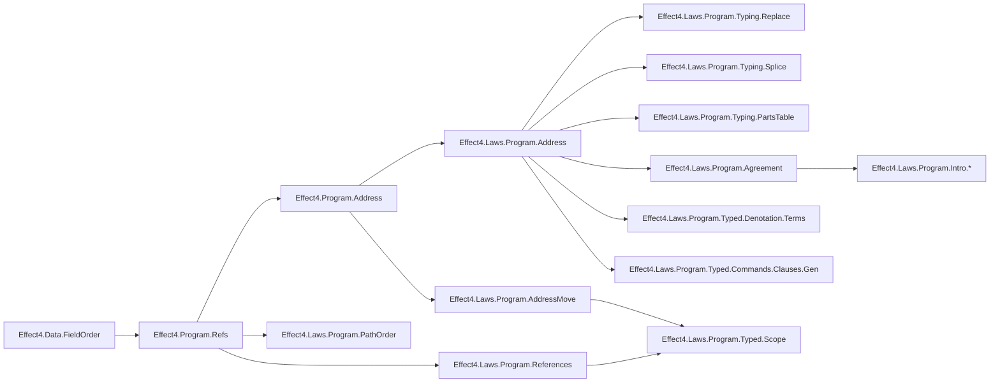
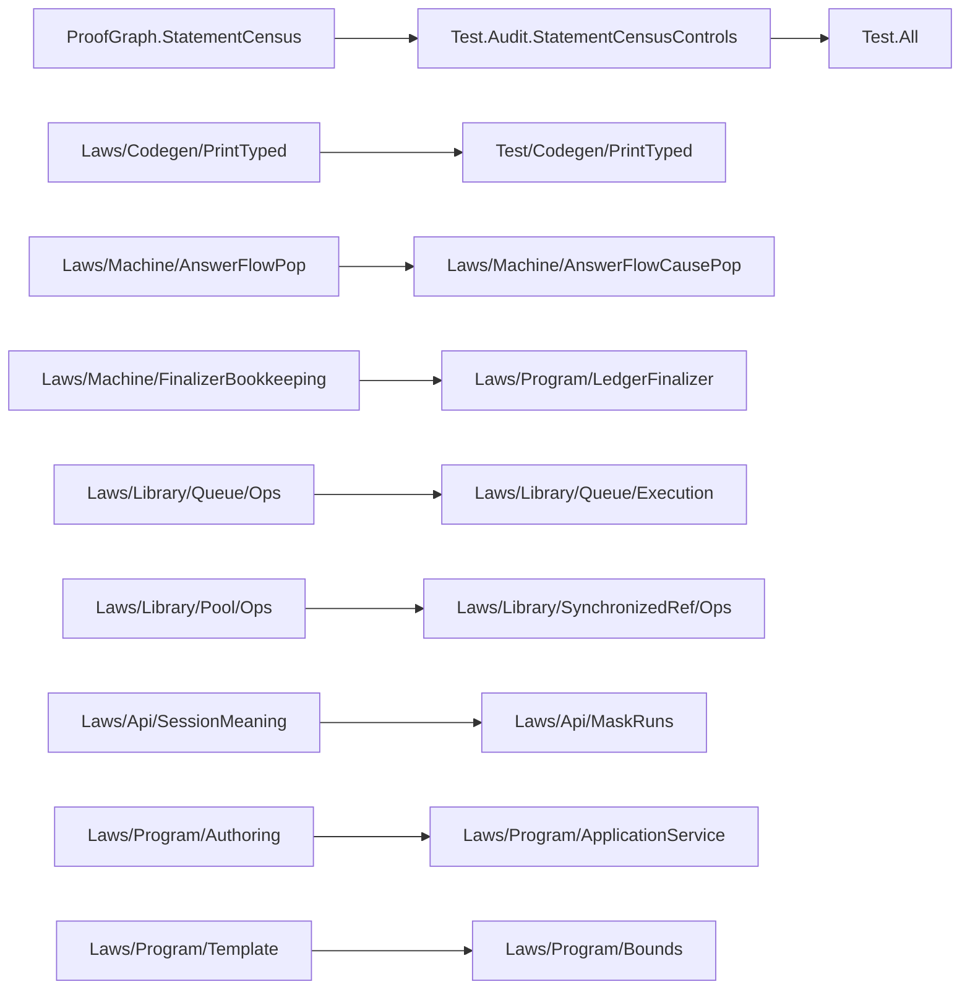

# Consolidation and Review Receipt (2026-10-13)

## Coordinator Summary

All seven duplicate families from `docs/research/2026-10-13-seat-address-receipt.md` are consolidated in the working tree.
The file `docs/research/2026-10-13-gemini-consolidation/commits.txt` lists the seven ordered `git add` and `git commit` commands.
Today's landings leave `RowServices.rowServiceFault` and `ns ++ "Key"` unwired in `Print.printEntry` and `Checked.emitModule`.
Those files sit inside the `seat SVC` fence, so §3 ranks the defects and gives their exact repairs.

- **Base commit**: `3e86319b2`
- **Branch**: `gemini/consolidation`
- **Fenced files touched**: none

## Part 1 — Consolidation of the Seven Duplicate Families

### Summary by Family (Commit Order)

| Order | Family | Surviving Home | Deleted Declarations | Rewritten Callers |
| --- | --- | --- | --- | --- |
| 1 | 7 — Dead access lemmas | `Node.replaceAt` (`src/Effect4/Program/Refs.lean`), `Node.replaceLayerAt_spec` (`src/Effect4/Laws/Program/References.lean`) | `Node.replaceLayerAt_eq_replaceAt`, `Node.layerAt_replaceLayerAt` (`src/Effect4/Laws/Program/References.lean`) | 0 (receipt: 0) |
| 2 | 5 — The bodies' spine | `Path.spineIndex_append` (`src/Effect4/Laws/Program/AddressMove.lean`), `spineParams_index` (`src/Effect4/Laws/Program/Typed/Scope.lean`) | `spineParams_append` (`src/Effect4/Laws/Program/Typed/Scope.lean`) | 3 in `src/Effect4/Laws/Program/Typed/Scope.lean` (receipt: 3) |
| 3 | 3 — A layer's node | `Node.layerAt_eq_some_iff` (`src/Effect4/Laws/Program/References.lean`) | `Node.at_of_layerAt` (`src/Effect4/Laws/Program/Typed/Scope.lean`) | 5 across `Typed/Denotation.lean` and `Typed/LayerArm.lean` (receipt: 5) |
| 4 | 2 — A machine point's child | `at_child`, `at_childWith` (`src/Effect4/Laws/Program/Agreement.lean`) | `at_child_of`, `at_childWith_of` (`src/Effect4/Laws/Program/Intro/Weight.lean`) | 41 across `Intro/*.lean` and `Typed/Mask.lean` (receipt: 37 external + 4 internal) |
| 5 | 1 — One more child index | `Node.at_child`, `Node.at_append`, `Node.at_snoc` (`src/Effect4/Laws/Program/Address.lean`) | `Agreement.Node.at_append` (`Laws/Program/Agreement.lean`), `node_at_child` (`Typed/Denotation/Terms.lean`), `at_snoc2`, `at_snoc1`, `at_frame` (`Typed/Commands/Clauses/Gen.lean`) | 46 across 10 modules (receipt: 45 external + 1 internal) |
| 6 | 6 — Stranded basis | `Table.under` (`src/Effect4/Program/Address.lean`), 4 `Table.under_*` and 9 `Node.*` lemmas (`src/Effect4/Laws/Program/Address.lean`) | Original definitions in `Program/Typing/Splice.lean` and `Laws/Program/Typing/{Replace,Splice,PartsTable}.lean` | 0 (namespaces stay unchanged) |
| 7 | 4 — Order on keys and paths | `Field.ltKey` and `Field.ltKey_*` (`src/Effect4/Data/FieldOrder.lean`), `abbrev Path.lt := Field.ltKey` (`src/Effect4/Program/Refs.lean`) | `def Path.lt` (`Program/Refs.lean`), `lt_cons_iff`, `lt_irrefl`, `lt_trans`, `lt_asymm`, `lt_trichotomy`, `lt_total` (`Laws/Program/PathOrder.lean`) | 10 across `References.lean`, `PathOrder.lean`, `Hoisting.lean`, `HoistingTotal.lean`, `Laws/Codegen/Module.lean` |

### Placement of New and Generalized Lemmas

- `Node.at_snoc` (`src/Effect4/Laws/Program/Address.lean`):
  - **Concept**: `initial-algebras-folds` (`docs/core/semantics.md` §2.7), requirement R14.
  - **Question**: serves `address-composes` (`Node.at_child`) and `compile_sound` as the one-step path-extension law.
  - **Reach**: every operation alphabet `Op`, any root node `root : Node Op`, path `path`, and child index `i`.
  - **Does not establish**: typing, scope safety, or machine progress.
  - **Consumers**: `Node.at_child` (`src/Effect4/Laws/Program/Address.lean`), `compileStmts_Step_at` (`src/Effect4/Laws/Program/Agreement.lean`), `actionTerm_scopedAt_of_at` (`src/Effect4/Laws/Program/NativeActionScope.lean`), `compile_Step_hook` (`src/Effect4/Laws/Program/Simulation/Hooks.lean`), and `action_opportunities_of_at` (`src/Effect4/Laws/Program/SourceOpportunityActions.lean`).
- `at_child` and `at_childWith` (`src/Effect4/Laws/Program/Agreement.lean`):
  - **Concept**: `frame-machine` (`docs/core/semantics.md` §2.3), requirement R4.
  - **Question**: serves `run_eq_meaning` (`src/Effect4/Laws/Program/Intro.lean`) and `typed-adequacy`.
  - **Reach**: `NativeOp` programs, any addressed node `n : Node NativeOp` at `q.path` and child index `i`.
  - **Does not establish**: evaluation of terms or machine progress.
  - **Consumers**: `src/Effect4/Laws/Program/Intro/{Weight,Sequential,Errors,Fibers,Layer,Scope}.lean` and `src/Effect4/Laws/Program/Typed/Mask.lean`.

### Detail by Family

1. **Family 7 (`dead access lemmas`)**:
   - Removed `Node.replaceLayerAt_eq_replaceAt` and `Node.layerAt_replaceLayerAt` from `src/Effect4/Laws/Program/References.lean`.
   - Both lemmas had zero callers in `src/` and `Test/`.
2. **Family 5 (`the bodies' spine`)**:
   - Imported `Effect4.Laws.Program.AddressMove` into `src/Effect4/Laws/Program/Typed/Scope.lean`.
   - Moved `spineParams_index` above `scopeParams_child` and deleted `spineParams_append` in `src/Effect4/Laws/Program/Typed/Scope.lean`.
   - Rewrote `scopeParams_child`, `scopeParams_below`, and `scopeParams_layer_below` to rewrite by `spineParams_index` and `Path.spineIndex_append`.
3. **Family 3 (`a layer's node`)**:
   - Deleted `Node.at_of_layerAt` from `src/Effect4/Laws/Program/Typed/Scope.lean`.
   - Rewrote the 1 caller in `src/Effect4/Laws/Program/Typed/Denotation.lean` and the 4 callers in `src/Effect4/Laws/Program/Typed/LayerArm.lean` to `(Node.layerAt_eq_some_iff _ _ _).mp`.
4. **Family 2 (`a machine point's child`)**:
   - Generalized `at_child` and `at_childWith` in `src/Effect4/Laws/Program/Agreement.lean` from `{e : NativeEff}` to `{n : Node NativeOp}`.
   - Deleted `at_child_of` and `at_childWith_of` from `src/Effect4/Laws/Program/Intro/Weight.lean`.
   - Rewrote all 33 uses of `at_child_of` and 8 uses of `at_childWith_of` across `Intro/{Weight,Sequential,Errors,Fibers,Layer,Scope}.lean` and `Typed/Mask.lean`.
5. **Family 1 (`one more child index`)**:
   - Added `Node.at_snoc` in `src/Effect4/Laws/Program/Address.lean`.
   - Deleted `Agreement.Node.at_append` from `src/Effect4/Laws/Program/Agreement.lean` and rewrote its 5 callers to `Node.at_snoc`.
   - Deleted `node_at_child` from `src/Effect4/Laws/Program/Typed/Denotation/Terms.lean` and rewrote all 35 callers across `Terms.lean`, `Arguments.lean`, `LayerArm.lean`, and `Denotation.lean` to `Node.at_child`.
   - Deleted `at_snoc2`, `at_snoc1`, and `at_frame` from `src/Effect4/Laws/Program/Typed/Commands/Clauses/Gen.lean` and rewrote their 6 callers to `Node.at_child` and `Node.at_append`.
6. **Family 6 (`stranded basis in Laws/Program/Typing/`)**:
   - Moved `Table.under` from `src/Effect4/Program/Typing/Splice.lean` to `src/Effect4/Program/Address.lean`.
   - Moved `Table.under_append`, `Table.under_self`, `Table.under_prefix_false`, `Table.under_sibling_false`, `Node.child_add_three`, `Node.at_stmts_nil`, `Node.at_layers_nil`, `Node.replaceAt_eff`, `Node.replaceAt_defs_main`, `Node.replaceAt_defs_body`, `Node.replaceAt_effs_head`, `Node.replaceAt_effs_tail`, and `Node.replaceAt_layers_cons` from `src/Effect4/Laws/Program/Typing/{Replace,Splice,PartsTable}.lean` to `src/Effect4/Laws/Program/Address.lean`.
7. **Family 4 (`the order on keys and paths`)**:
   - Imported `Effect4.Data.FieldOrder` in `src/Effect4/Program/Refs.lean` and replaced `def Path.lt` with `abbrev Path.lt : List Nat → List Nat → Bool := Field.ltKey`.
   - Replaced the two `#guard` lines in `src/Effect4/Program/Refs.lean` with `example : … := rfl`. The kernel checks both equations without precompiled VM code from `FieldOrder`.
   - Deleted `lt_cons_iff`, `lt_irrefl`, `lt_trans`, `lt_asymm`, `lt_trichotomy`, and `lt_total` from `src/Effect4/Laws/Program/PathOrder.lean`.
   - Aligned `sortBy_pairwise` and `sortBy_eq_self` in `src/Effect4/Laws/Program/PathOrder.lean` with the Boolean equations `Field.ltKey_total` and `Field.ltKey_asymm`, and updated `PathOrder.lean`, `References.lean`, `Hoisting.lean`, `HoistingTotal.lean`, and `Laws/Codegen/Module.lean`.

## Part 2 — Review of Today's Nine Landings

Reviewed commits: `6f32c88cd`, `9cff5c7cf`, `0c1760dd9`, `45761a86a`, `c4f56a879`, `23f95aac2`, `d2d10b383`, `f463ee53b`, and `60f10bc4c`.
Reviewed receipts: `docs/research/2026-10-13-seat-svc-receipt.md`, `docs/research/2026-10-13-seat-rows-receipt.md`, and `docs/research/2026-10-13-seat-bank-receipt.md`.

### Ranked Findings (Fenced or Cross-Seat)

#### 1. High — `RowServices.rowServiceFault` and `ns ++ "Key"` are unwired in `Print.printEntry` and `Checked.emitModule`

- **Commits**: `9cff5c7cf` (`seat ROWS`) and `d2d10b383` (integration into `Checked.lean` and `Print.lean`).
- **Declarations**: `rowServiceFault` and `rowNameUses` in `src/Effect4/Codegen/RowServices.lean`; `rowNameUses` and `printEntry` in `src/Effect4/Codegen/Print.lean`; `ModuleEmission.file` in `src/Effect4/Codegen/Checked.lean`.
- **Defect**:
  1. `ModuleEmission.file` (`src/Effect4/Codegen/Checked.lean`) emits `(rowServices table).map printRowService`, which declares `class <Ns>Key` and `const <Ns>` for every dotted row.
  2. Neither `Print.printEntry` nor `Checked.emitModule` calls `RowServices.rowServiceFault table`. Conflicting `serviceKey` strings or unsafe method names after the dot pass `emitModule` without refusal and emit invalid TypeScript.
  3. `Effect4.Program.rowNameUses` (`src/Effect4/Codegen/Print.lean`) includes `qualifiedRoot row.spelling` (`ns`) and `RowArg.names row.trailing`, but omits `ns ++ "Key"`. Meanwhile `Effect4.Codegen.rowNameUses` (`src/Effect4/Codegen/RowServices.lean`) includes `ns ++ "Key"`, omits `RowArg.names row.trailing`, and has zero callers outside `RowServices.lean`. Consequently, a definition, parameter, or export named `<Ns>Key` passes `printEntry` and collides with the emitted `class <Ns>Key`.
  4. In `rowBreaksServices` (`src/Effect4/Codegen/RowServices.lean`), the `splitDot? row.spelling = none` arm returns `false`. A row with `"Clock."` or `"a.b.c"` has `splitDot? = none`, while `SourceBindings.qualifiedRoot` returns `some "Clock"` or `some "a"`. The expression printer then emits a member call while `rowServices` emits no service declaration.
- **Proposed Fix (for `seat SVC` / coordinator)**:
  1. Return `row.spelling.contains '.'` in the `splitDot? = none` arm of `rowBreaksServices` (`src/Effect4/Codegen/RowServices.lean`). Make the `NsKey` check symmetric (`s.ns == ns ++ "Key" || ns == s.ns ++ "Key"`).
  2. Unify the two `rowNameUses` definitions by adding `ns ++ "Key"` to `Effect4.Program.rowNameUses` in `src/Effect4/Codegen/Print.lean` and deleting the duplicate `Effect4.Codegen.rowNameUses` in `src/Effect4/Codegen/RowServices.lean`.
  3. Call `rowServiceFault table` inside `Print.printEntry` (and check `name != ns && name != ns ++ "Key"`), then update `printEntry_checks` in `src/Effect4/Codegen/Print.lean` and `src/Effect4/Laws/Api/Codegen.lean`.

#### 2. Medium — `Print.serviceNamesFault`, `paramsNameFault`, and `classNameFault` miss collisions with application service names (`sv.name` and `sv.name ++ "Layer"`)

- **Commits**: `6f32c88cd` (`seat SVC`) and `d2d10b383`.
- **Declarations**: `serviceNamesFault`, `paramsNameFault`, and `classNameFault` in `src/Effect4/Codegen/Print.lean`.
- **Defect**:
  1. `serviceNamesFault` checks `table.any (fun row => row.spelling == sv.name)` instead of `(rowNameUses table).contains sv.name || (rowNameUses table).contains (sv.name ++ "Layer")`. An application service named `Clock` alongside a dotted row `"Clock.now"` passes `serviceNamesFault`, and the file then emits two `const Clock = ServiceMap.Service…` declarations.
  2. `paramsNameFault` checks `defs.any (·.name == q.name)` against definition names (`add`), not service names (`TodoRepo` or `TodoRepoLayer`). A method parameter named `TodoRepo` shadows the service tag inside `TodoRepoLayer`.
  3. `classNameFault` checks payload classes against `d.name` and `d.params`, not against `sv.name` or `sv.name ++ "Layer"`. A payload class named `TodoRepo` collides with `const TodoRepo`.
  4. `serviceFault` (`src/Effect4/Program/Eff.lean`) checks `defs.any (fun d => d.name == sv.name || d.name == sv.name ++ "Layer")`, but does not check whether one service's `sv.name` equals another service's `sv'.name ++ "Layer"`.
- **Proposed Fix (for `seat SVC`)**:
  - In `serviceNamesFault` (`src/Effect4/Codegen/Print.lean`), check `(rowNameUses table).contains sv.name || (rowNameUses table).contains (sv.name ++ "Layer")`.
  - Include `(servicesOf defs).flatMap (fun sv => [sv.name, sv.name ++ "Layer"])` in `paramsNameFault` and `classNameFault` (`src/Effect4/Codegen/Print.lean`), and check cross-service `sv.name == sv'.name ++ "Layer"` in `serviceFault` (`src/Effect4/Program/Eff.lean`).

#### 3. Low — General `Block`, `HostRuns`, and `RefHeap` helpers live inside leaf module `src/Effect4/Laws/Library/Ref/Cache.lean`

- **Commit**: `60f10bc4c` (`seat BANK`, fenced under `seat IMPOSE`).
- **Declarations**: `bodyOf`, `refPoke_peek`, `hostRun_bind_straight`, and `hostRun_bind_call` in `src/Effect4/Laws/Library/Ref/Cache.lean`.
- **Defect**:
  - `bodyOf` (`(blockOf? p).bind fun b => b.2.1[k]?`) is a general definition-block projection that belongs beside `blockOf?` in `src/Effect4/Laws/Program/Block.lean`.
  - `hostRun_bind_straight` and `hostRun_bind_call` are general `hostRun` laws over `RowsSig table` that belong beside `hostRun_bindExit`, `hostRun_straight`, and `hostRun_call` in `src/Effect4/Laws/Program/HostRuns.lean`.
  - `refPoke_peek` (`refPeek heap q = some v → refPoke heap q v = heap`) is a general `RefHeap` law that belongs in `src/Effect4/Laws/Library/Ref/Operations.lean`.
- **Proposed Fix (for `seat IMPOSE`)**:
  - Move `bodyOf` to `src/Effect4/Laws/Program/Block.lean`, `hostRun_bind_straight` and `hostRun_bind_call` to `src/Effect4/Laws/Program/HostRuns.lean`, and `refPoke_peek` to `src/Effect4/Laws/Library/Ref/Operations.lean` when the `seat IMPOSE` fence opens.

#### 4. Low — Duplicate `List.mapM` over `Except` lemmas and byte-order helper in fenced `seat SVC` modules

- **Commits**: `45761a86a` and `d2d10b383`.
- **Declarations**: `mapM_error_mem` and `mapM_ok_each` in `src/Effect4/Laws/Program/ApplicationService.lean`; `bytesLe` in `src/Effect4/Codegen/Checked.lean`.
- **Defect**:
  - `mapM_error_mem` and `mapM_ok_each` in `src/Effect4/Laws/Program/ApplicationService.lean` sit one directory away from `mapM_ok_mem` and `bind_ok` in `src/Effect4/Laws/Program/Authoring.lean`.
  - `bytesLe` in `src/Effect4/Codegen/Checked.lean` re-implements lexicographic byte comparison alongside `Field.ltKey` (`src/Effect4/Data/FieldOrder.lean`).
- **Proposed Fix (for `seat SVC`)**:
  - Move `mapM_error_mem` and `mapM_ok_each` next to `mapM_ok_mem` in `src/Effect4/Laws/Program/Authoring.lean`, and express `bytesLe` in `src/Effect4/Codegen/Checked.lean` through `Field.ltKey` on `Field.bytesKey`.

## Verification and Axiom Gate

- **Changed files (30 files)**:
  - `src/Effect4/Program/Address.lean`
  - `src/Effect4/Program/Refs.lean`
  - `src/Effect4/Program/Typing/Splice.lean`
  - `src/Effect4/Laws/Codegen/Module.lean`
  - `src/Effect4/Laws/Program/Address.lean`
  - `src/Effect4/Laws/Program/AddressMove.lean`
  - `src/Effect4/Laws/Program/Agreement.lean`
  - `src/Effect4/Laws/Program/Hoisting.lean`
  - `src/Effect4/Laws/Program/HoistingTotal.lean`
  - `src/Effect4/Laws/Program/Intro/Errors.lean`
  - `src/Effect4/Laws/Program/Intro/Fibers.lean`
  - `src/Effect4/Laws/Program/Intro/Layer.lean`
  - `src/Effect4/Laws/Program/Intro/Scope.lean`
  - `src/Effect4/Laws/Program/Intro/Sequential.lean`
  - `src/Effect4/Laws/Program/Intro/Weight.lean`
  - `src/Effect4/Laws/Program/NativeActionScope.lean`
  - `src/Effect4/Laws/Program/PathOrder.lean`
  - `src/Effect4/Laws/Program/References.lean`
  - `src/Effect4/Laws/Program/Simulation/Hooks.lean`
  - `src/Effect4/Laws/Program/SourceOpportunityActions.lean`
  - `src/Effect4/Laws/Program/Typed/Commands/Clauses/Gen.lean`
  - `src/Effect4/Laws/Program/Typed/Denotation.lean`
  - `src/Effect4/Laws/Program/Typed/Denotation/Arguments.lean`
  - `src/Effect4/Laws/Program/Typed/Denotation/Terms.lean`
  - `src/Effect4/Laws/Program/Typed/LayerArm.lean`
  - `src/Effect4/Laws/Program/Typed/Mask.lean`
  - `src/Effect4/Laws/Program/Typed/Scope.lean`
  - `src/Effect4/Laws/Program/Typing/PartsTable.lean`
  - `src/Effect4/Laws/Program/Typing/Replace.lean`
  - `src/Effect4/Laws/Program/Typing/Splice.lean`
- **Build command and result**:
  - `LEAN_NUM_THREADS=2 lake build Effect4.Program.Address Effect4.Program.Refs Effect4.Program.Typing.Splice Effect4.Laws.Program.References Effect4.Laws.Program.Address Effect4.Laws.Program.AddressMove Effect4.Laws.Program.PathOrder Effect4.Laws.Program.Hoisting Effect4.Laws.Program.HoistingTotal Effect4.Laws.Codegen.Module Effect4.Laws.Program.ReferenceExpansion Effect4.Laws.Program.Typing.Replace Effect4.Laws.Program.Typing.Splice Effect4.Laws.Program.Typing.PartsTable Effect4.Laws.Program.Typed.Scope Effect4.Laws.Program.Typed.Admission Effect4.Laws.Program.Typed.Denotation.Terms Effect4.Laws.Program.Typed.Denotation.Arguments Effect4.Laws.Program.Typed.Commands.Clauses.Gen Effect4.Laws.Program.Typed.LayerArm Effect4.Laws.Program.Typed.Denotation Effect4.Laws.Program.Typed.Mask Effect4.Laws.Program.Agreement Effect4.Laws.Program.Intro.Weight Effect4.Laws.Program.Intro.Sequential Effect4.Laws.Program.Intro.Errors Effect4.Laws.Program.Intro.Fibers Effect4.Laws.Program.Intro.Layer Effect4.Laws.Program.Intro.Scope Effect4.Laws.Program.Intro Effect4.Laws.Program.NativeActionScope Effect4.Laws.Program.Simulation.Hooks Effect4.Laws.Program.SourceOpportunityActions`
  - Result: `Build completed successfully (541 jobs).` (0 errors, 0 warnings).
- **Axiom gate command and result**:
  - `LEAN_NUM_THREADS=2 lake env lean scratch/Audit.lean`
  - Result: `#axiom_audit: 5656 declarations within [propext, Quot.sound], 0 of them modulo planned goals; 0 planned goals`.
- **Open obligations**: none in the consolidated modules; the four fenced findings in §3 await `seat SVC` and `seat IMPOSE`.
- **Bounded or host-only evidence**: none.

---

# Round 2 — Statement Census, Unfenced Law Consolidation, and Part C

## Round 2 Summary

- **Base commit**: `93a80a561` (coordinator fast-forward holding Round 1's seven commits `92e373a55..93a80a561`)
- **Branch**: `gemini/consolidation`
- **Fenced files touched**: none
- **One thing the coordinator must know before merging**: `Test/All.lean` adds `import Test.Audit.StatementCensusControls` at its end, and all 13 Round 2 slices in `docs/research/2026-10-13-gemini-consolidation/commits.txt` touch strictly disjoint file sets so they can be committed in order without conflict.

## Part A — `#statement_census` and `Test/Audit/StatementCensusControls.lean`

- **`tools/ProofGraph/StatementCensus.lean`**:
  - Defines `#statement_census M₁ M₂ …` (default transparency) and `#statement_census reducible M₁ M₂ …` (`reducible` transparency).
  - Reads non-auxiliary `ConstantInfo.thmInfo` declarations whose defining module is in `M₁ … Mₖ`.
  - Normalizes each theorem statement in `MetaM` by telescope replacement: every binder's user name is replaced with `.anonymous`, every binder info is normalized to `.default`, and level parameters are canonically renamed `u_0, u_1, …`.
  - Under default mode, groups theorems by `Expr` equality of the normalized statement followed by `isDefEq` confirmation at `.default` transparency.
  - Under `reducible` mode, unfolds reducible constants at the head of the conclusion and of each hypothesis to form candidate buckets, then partitions by `withTransparency .reducible (isDefEq t₁ t₂)` so `abbrev` aliases (such as `Path.lt := Field.ltKey` and `DeferredCause`) equate.
  - Counts direct proof-term references (`getUsedConstantsAsSet`) across all theorem values in the scanned modules and prints `#statement_census[ reducible]: <N> theorems in <K> modules; <G> duplicate groups:` in deterministic alphabetical order.
- **`Test/Audit/StatementCensusControls.lean`** (wired at the end of `Test/All.lean`):
  - **Reader 1**: `#guard_msgs` over `#statement_census Effect4.Laws.Run Effect4.Laws.Run.Journal` (`59 theorems in 2 modules; 0 duplicate groups`).
  - **Reader 2**: `#guard_msgs` over `#statement_census Effect4.Laws.Machine.Arena` pinning the intentional `[aesop]` bank pair `instLawfulArenaList` and `list_lawful`.
  - **Control**: `#guard_msgs` over `#statement_census reducible Test.Audit.StatementCensusControls` pinning the `reducible` alias pair `reducible_control_left` (`RelAlias x y`) and `reducible_control_right` (`x = y`), which default mode keeps separate and `reducible` mode joins.

## Part B — Statement Census and Consolidation Across the Six Law Areas

### Census Counts Before and After (Unfenced Modules)

| Area | Unfenced Modules | Theorems (Before → After) | Default Duplicate Groups (Before → After) | `reducible` Duplicate Groups (Before → After) |
| --- | --- | --- | --- | --- |
| `Laws/Machine` | 76 | 1,999 → 1,993 | 8 → 2 | 8 → 2 |
| `Laws/Codegen` | 21 | 1,041 → 1,040 | 1 → 0 | 1 → 0 |
| `Laws/Program` | 386 | 8,414 → 8,401 | 16 → 13 | 33 → 21 |
| `Laws/Library` | 45 | 860 → 856 | 4 → 0 | 4 → 0 |
| `Laws/Run` | 8 | 202 → 202 | 0 → 0 | 0 → 0 |
| `Laws/Api` | 16 | 254 → 253 | 1 → 0 | 1 → 0 |
| **Combined (all 6 areas, incl. cross-area)** | **552** | **12,770 → 12,745** | **33 → 17** | **50 → 26** |

### Consolidated Families (Disjoint File Sets, Leaf-First Order)

| Slice | Area(s) | Surviving Home | Deleted Declarations | Rewritten Callers | Touched Files |
| --- | --- | --- | --- | --- | --- |
| B1 | `Laws/Codegen` | `TypedRowShapeSupport.printPerformAt_exprHead` (`Laws/Codegen/PrintTyped.lean`) | `P2bRowSupport.rawPerformAt_head` (`Laws/Codegen/PrintTyped.lean`) | 1 in `PrintTyped.lean` | `src/Effect4/Laws/Codegen/PrintTyped.lean` |
| B2 | `Laws/Machine` | `PopTrace.drain_empty`, `PopTrace.drain_not_frame` (`Laws/Machine/PopTrace.lean`); `External.drain_cause` (`Laws/Machine/AnswerFlowFamilyPop.lean`) | `AnswerFlow.drain_empty`, `AnswerFlow.drain_not_frame` (`AnswerFlowPop.lean`); `AnswerFlow.drain_cause` (`AnswerFlowCausePop.lean`) | 0 | `src/Effect4/Laws/Machine/AnswerFlowPop.lean`, `src/Effect4/Laws/Machine/AnswerFlowCausePop.lean` |
| B3 | `Laws/Machine`, `Laws/Program` | `StackLedger.interruptRecord_key`, `StackLedger.update_absent` (`Laws/Machine/Ledger.lean`); `FinalizerCredits.indicator_sum` (`FinalizerBookkeeping.lean`); `FinalizerRun.funded_reachable` (`FinalizerRun.lean`) | `FinalizerCredits.interruptRecord_key`, `FinalizerCredits.update_absent` (`FinalizerBookkeeping.lean`); `LedgerFinalizer.indicator_sum`, `LedgerFinalizer.funded_reachable` (`LedgerFinalizer.lean`) | 0 | `src/Effect4/Laws/Machine/FinalizerBookkeeping.lean`, `src/Effect4/Laws/Program/LedgerFinalizer.lean` |
| B4 | `Laws/Machine` | `drainOwed_queue` (`Laws/Machine/Scheduling.lean`) | `drainOwed_queue_aux` (`Laws/Machine/Scheduling.lean`) | 1 folded into `drainOwed_queue` | `src/Effect4/Laws/Machine/Scheduling.lean` |
| B5 | `Laws/Library` | `Model.message_nodes_for_steps`, `Model.offer_nodes_for_steps` (`Laws/Library/Queue/Typing.lean`) | `Queue.message_nodes`, `Queue.offer_nodes` (`Laws/Library/Queue/Ops.lean`) | 6 in `Queue/Ops.lean` | `src/Effect4/Laws/Library/Queue/Ops.lean` |
| B6 | `Laws/Library` | `Semaphore.bool_nodes`, `Semaphore.unit_nodes` (`Laws/Library/Semaphore/Ops.lean`) | `Pool.bool_nodes`, `Pool.unit_nodes` (`Laws/Library/Pool/Ops.lean`) | 3 inlined as `nodesFormed_of_check (by decide)` in `Pool/Ops.lean` | `src/Effect4/Laws/Library/Pool/Ops.lean` |
| B7 | `Laws/Api` | `Run.inspect_keeps_machine` (`Laws/Api/SessionMeaning.lean`) | `HostSession.inspect_machine` (`Laws/Api/MaskRuns.lean`) | 2 (`Test/Machine/MaskRuns.lean`, `Test/Dogfood/Proofs/HostTimeoutHistory.lean`) | `src/Effect4/Laws/Api/MaskRuns.lean`, `Test/Machine/MaskRuns.lean`, `Test/Dogfood/Proofs/HostTimeoutHistory.lean` |
| B8 | `Laws/Program` | `Finish.interruptedAt_update` (`Laws/Program/Guard/Finish.lean`) | `interruptedAt_update_mark` (`Laws/Program/Guard/ControlRemainder.lean`) | 3 in `ControlRemainder.lean` | `src/Effect4/Laws/Program/Guard/ControlRemainder.lean` |
| B9 | `Laws/Program` | `Guard.driverContract` (`Laws/Program/Guard/Driver.lean`) | `Guard.driverContract_of_lift` (`Laws/Program/Guard/Driver.lean`) | 1 folded into `driverContract` | `src/Effect4/Laws/Program/Guard/Driver.lean` |
| B10 | `Laws/Program` (`reducible`) | `Guard.Interruption.*` (`Interruption.lean`), `Guard.DeferredCause.*` (`DeferredCause.lean`), `CommandStoreDebit.post_task_ids` (`CommandStoreDebit.lean`) | 7 unused connector theorems in `Laws/Program/MovesConnect.lean`; `Opportunities.post_task_ids` in `Laws/Program/SourceOpportunityCommands.lean` | 0 | `src/Effect4/Laws/Program/MovesConnect.lean`, `src/Effect4/Laws/Program/SourceOpportunityCommands.lean` |
| B11 | `Laws/Program` (`reducible`) | `Bounds.solve_lookup_of_mem` (`Laws/Program/Template.lean`) | `Bounds.lookup_solve_seed` (`Laws/Program/Bounds.lean`) | 3 in `Bounds.lean` | `src/Effect4/Laws/Program/Bounds.lean` |

### Duplicate Groups Kept and Why

1. **`[aesop]` Bank Pairs (Kept by Rule)**:
   - `Effect4.Machine.Arena.list_lawful` (`attribute [aesop safe apply (rule_sets := [Effect4.Stores])]`) and `Effect4.Machine.Arena.instLawfulArenaList` (`instance` closed by `aesop (rule_sets := [Effect4.Stores, Effect4.StoreKernel])`, tested in `Test/Machine/StoreKernelBank.lean`) in `src/Effect4/Laws/Machine/Arena.lean`. One is the bank's registered rule and the other is the typeclass instance that tests the bank.
   - `Effect4.Program.Guard.OuterDriver.timer_clockStep_keys` (`@[aesop unsafe 90% apply (rule_sets := [Effect4.Fibers])]` in `src/Effect4/Laws/Program/Guard/OuterDriver.lean`) and `Effect4.Program.Guard.timer_clockStep_keys` (unmarked theorem in `src/Effect4/Laws/Program/Guard/Core.lean`). Keeping the `@[aesop unsafe]` registration on the leaf wrapper avoids exporting an `unsafe` rule to all 20 importers of `Guard/Core.lean`.
2. **High-Fanout or Cross-Subsystem Connector Pairs (Kept in Round 2 to Bound Rebuild Cost and Disjointness)**:
   - `Effect4.Machine.drainOwed_grows` and `Effect4.Machine.drainOwed_grows_aux` in `src/Effect4/Laws/Machine/Approximation.lean` (15 importers across `Laws/Machine` and `Laws/Program`).
   - `Conform.Effect4.Typing.effTy_scoped` (`Laws/Program/Typing/Sound.lean`, 14 importers) and `Effect4.Program.effTy_scoped` (`Laws/Program/ScopedTyping.lean`, 9 importers): `Conform` compatibility wrapper vs canonical `Effect4.Program` theorem.
   - `Effect4.Program.Agreement.contAOf_acquired` (`Laws/Program/Agreement.lean`, 27 importers) and `Effect4.Program.ReleaseCustody.Sequencing.acquired_registration` (`ReleaseCustody/Sequencing.lean`, 14 importers): sibling subsystems with no import edge between them.
   - `Effect4.Program.Agreement.resolve_of_at` (`Laws/Program/Agreement.lean`, 27 importers, 21 uses) and `Effect4.Program.SourceScope.resolve_at` (`Laws/Program/SourceScope.lean`, 18 importers, 2 uses): sibling roots with no import edge between them.
   - `Effect4.Program.Agreement.suspendBodyAt_zero` (`Laws/Program/Agreement/Machine.lean`) and `Effect4.Program.Sched.suspendBodyAt_zero'` (`Laws/Program/Intro/Weight.lean`, 7 importers): sibling branches under `Agreement.lean`.
   - `Effect4.Program.Guard.AnswerDecision.guardQueue_drainDue` (`Guard/AnswerDecision.lean`) and `Effect4.Program.Guard.FinishQueue.guardQueue_drainDue_single` (`Guard/FinishQueue.lean`, 15 importers).
   - `Effect4.Program.Guard.raceIds_update` (`Guard/Core.lean`, 20 importers) and `Effect4.Program.ReleaseCustody.CommandDebit.update_race_ids` (`ReleaseCustody/CommandRaceDebit.lean`, 4 importers).
   - `Effect4.Program.PlaceFunding.commandAllowance_zero` (`PlaceFunding/Commands.lean`) and `Effect4.Program.PlaceFunding.zero_allowance` (`PlaceFunding/Run.lean`).
   - `Effect4.Program.ReleaseCustody.AdministrativeKept.{drain_owed, post_task, same_fibers}` (`ReleaseCustody/AdministrativeKept.lean`) and `Effect4.Program.ReleaseCustody.OuterFrames.{drain_owed, post, fields}` (`ReleaseCustody/OuterFrames.lean`): parallel instantiation modules for two different `PlaceLedger` instances.
   - `Effect4.Program.Typed.configTyped_cons_drainDue` (`Typed/Commands/Evaluate.lean`) and `Effect4.Program.Typed.configTyped_drainDue` (`Typed/Edits.lean`, 20 importers).
   - `Effect4.Program.Typed.countdownAt_tok` (`Typed/Commands/Clauses/Park.lean`) and `Effect4.Program.Typed.countdownAt_world` (`Typed/Commands/Bookkeeping.lean`, 18 importers).
   - `Effect4.Program.Typed.firstErrorValue?_of_caught` (`Typed/Denotation.lean`) and `Effect4.Program.caughtErrorValue?_first` (`Handles/Hooks.lean`).
   - Cross-area pairs `Effect4.Program.Guard.nextToken_modify` / `Effect4.Run.modify_nextToken` and `Effect4.Program.emptyTable_refuses_every_answer` / `Effect4.Run.admit_nil_answer`.
   - Remaining 8 `reducible`-only pairs in `Laws/Program` (`Footprint` vs `Guard/Interruption` and `Guard/ReturnFields` where `Footprint` does not import `Guard`; `MemoIds` vs `PlaceFunding.Actions` and `NativeReferences`; `Simulation.Deliver` vs `NativeFrameScope`; and the symmetric `iff` projections `framePath_of_stackAccepts` / `stackAccepts_of_framePath` in `Typed/Contracts.lean`).

## Part C — `mapM_error_mem`, `mapM_ok_each`, and `bytesLe` vs `Field.ltKey`

### 1. Move of `mapM_error_mem` and `mapM_ok_each`

- Moved `Effect4.Program.Authoring.mapM_error_mem` and `Effect4.Program.Authoring.mapM_ok_each` out of `src/Effect4/Laws/Program/ApplicationService.lean` and placed them immediately below `mapM_ok_mem` in `src/Effect4/Laws/Program/Authoring.lean`.
- Because both files open `namespace Effect4.Program.Authoring` and `ApplicationService.lean` imports `Effect4.Laws.Program.Authoring`, the declaration names and callers (`serviceDefs_error` and `serviceDefs_of_refused` in `ApplicationService.lean`) require no qualification changes.

### 2. Assessment of `bytesLe` (`src/Effect4/Codegen/Checked.lean`) vs `Field.ltKey` (`src/Effect4/Data/FieldOrder.lean`)

- **Do Not Unify (`Checked.lean` stays untouched)**:
  1. `bytesLe` (`src/Effect4/Codegen/Checked.lean`) is a private 5-line structural recursion on `List UInt8` (`| [], _ => true | _ :: _, [] => false | a :: as, b :: bs => if a == b then bytesLe as bs else a < b`) used once in `orderServices` to sort emitted services by `s.name.toUTF8.toList`.
  2. `Field.ltKey` (`src/Effect4/Data/FieldOrder.lean`) is strict `<` on `List Nat`, not `≤` on `List UInt8`. Expressing `bytesLe` via `Field.ltKey` would require converting both `String` keys through `Field.bytesKey : String → List Nat` (which allocates a `List Nat` via `.toUTF8.toList.map UInt8.toNat` on every comparator call) and negating the flipped strict comparison (`!Field.ltKey (Field.bytesKey b.name) (Field.bytesKey a.name)`).
  3. No theorem in `src/Effect4/Laws/Codegen/` reasons about the comparator inside `orderServices` (`Laws/Codegen/Services.lean` proves membership preservation `mem_orderServices` via `List.Perm` of `mergeSort`, which is parametric in the comparator `le`). Unifying `bytesLe` with `Field.ltKey` would therefore add runtime allocation and an extra import to `Checked.lean` while saving zero proof lines.

## Round 2 Verification and Axiom Gate

- **Changed files in Round 2 (20 files)**:
  - `tools/ProofGraph/StatementCensus.lean` (new)
  - `Test/Audit/StatementCensusControls.lean` (new)
  - `Test/All.lean`
  - `src/Effect4/Laws/Codegen/PrintTyped.lean`
  - `src/Effect4/Laws/Machine/AnswerFlowPop.lean`
  - `src/Effect4/Laws/Machine/AnswerFlowCausePop.lean`
  - `src/Effect4/Laws/Machine/FinalizerBookkeeping.lean`
  - `src/Effect4/Laws/Program/LedgerFinalizer.lean`
  - `src/Effect4/Laws/Machine/Scheduling.lean`
  - `src/Effect4/Laws/Library/Queue/Ops.lean`
  - `src/Effect4/Laws/Library/Pool/Ops.lean`
  - `src/Effect4/Laws/Api/MaskRuns.lean`
  - `Test/Machine/MaskRuns.lean`
  - `Test/Dogfood/Proofs/HostTimeoutHistory.lean`
  - `src/Effect4/Laws/Program/Guard/ControlRemainder.lean`
  - `src/Effect4/Laws/Program/Guard/Driver.lean`
  - `src/Effect4/Laws/Program/MovesConnect.lean`
  - `src/Effect4/Laws/Program/SourceOpportunityCommands.lean`
  - `src/Effect4/Laws/Program/Bounds.lean`
  - `src/Effect4/Laws/Program/Authoring.lean`
  - `src/Effect4/Laws/Program/ApplicationService.lean`
- **Build commands and results**:
  - `/Users/pooks/Dev/lean4-effect4/scratch/lean-slot.sh lake build ProofGraph.StatementCensus Test.Audit.StatementCensusControls Effect4.Laws.Codegen.PrintTyped Test.Codegen.PrintTyped Effect4.Laws.Machine.AnswerFlowPop Effect4.Laws.Machine.AnswerFlowCausePop Test.Machine.AnswerFlow Test.Dogfood.Proofs.HostTimeoutNumberFormFamily Effect4.Laws.Machine.FinalizerBookkeeping Effect4.Laws.Machine.FinalizerEvaluation Effect4.Laws.Program.LedgerFinalizer Effect4.Laws.Program.PlaceLedgerConnect Effect4.Laws.Machine.Scheduling Test.Machine.Runtime.SchedulingContract Effect4.Laws.Library.Queue.Ops Effect4.Laws.Library.Queue.Execution Test.Program.SemaphoreWrapper Test.Program.QueueOps Effect4.Laws.Library.Pool.Ops Effect4.Laws.Library.SynchronizedRef.Ops Test.Program.PoolOps Effect4.Laws.Api.MaskRuns Test.Machine.MaskRuns Test.Dogfood.Proofs.HostTimeoutHistory Test.Dogfood.Scenario.Timeout Effect4.Laws.Program.Guard.ControlRemainder Effect4.Laws.Program.Guard.CommandObservations Effect4.Laws.Program.Guard.Driver Effect4.Laws.Program.ReleaseCustody.CommandClosure Effect4.Laws.Program.Guard.Decision Test.Dogfood.Proofs.HostTimeoutDriver Effect4.Laws.Program.MovesConnect Effect4.Laws.Program.CommandFrames Effect4.Laws.Program.SourceOpportunityCommands Effect4.Laws.Program.SourceOpportunityHistory Effect4.Laws.Program.Bounds Effect4.Laws.Program.Typed Effect4.Laws.Program.Typed.Membership Effect4.Laws.Program.Typing.TermIntro Effect4.Laws.Step.Waiting Test.Program.BoundsControls Test.Program.FormationContract Test.Program.TypeAlgebraContract Effect4.Laws.Program.Authoring Effect4.Laws.Program.ApplicationService Effect4.Laws`
  - Result: `Build completed successfully (1207 jobs).` (0 errors, 0 warnings).
- **Axiom and closure audit results**:
  - `#axiom_audit`: `3461 declarations within [propext, Quot.sound], 0 of them modulo planned goals; 0 planned goals`
  - `#closure_audit`: `3760 declarations; none binds a table before a returned closure`
- **Open obligations**: none.
- **Bounded or host-only evidence**: none.

