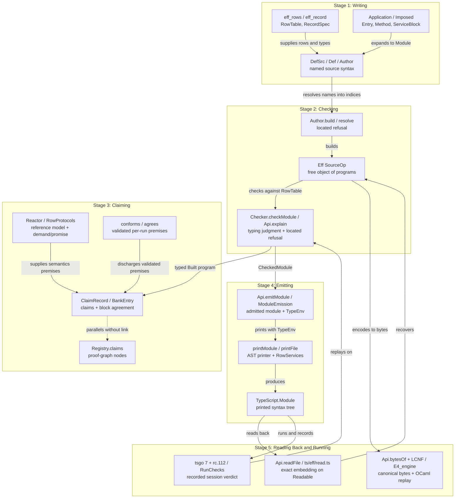

# The Author's Hot Path: Overview, Findings, and Probe Log (2026-10-13)

Status: working note (history, not authority).

This note walks the five stages of the author's hot path from source authoring to emitted and
checked execution. Each stage names its representations in the vocabulary of `AGENTS.md` and
`docs/core/controlled-english.md`. Section 2 records the structural findings across those five
stages. Section 3 ranks the proposed consolidations by clarity over cost. Section 4 records the
friction log from probing IMPOSE item 4 (`cached` in `Test/Dogfood/Scenario/Todo/Cached.lean`).

## 1. The Five Stages of the Hot Path

### 1.1 Stage 1: Writing

- **`Ty`** (`src/Effect4/Machine/Types.lean`): the free object of types. Its generated algebra is
  `TyAlgebra`, with fold `cata_ty` (`src/Effect4/Program/Generated/Algebras.lean`).
- **`Term`** (`src/Effect4/Machine/Term.lean`): the free object of first-order expressions over
  De Bruijn indices and `NativeAtom`. Its generated algebra is `TermAlgebra`, with fold
  `cata_term`.
- **`Eff`** (`src/Effect4/Program/Eff.lean`): the free object of canonical programs over an
  operation alphabet `Op`. Its generated algebra is `EffAlgebra`, with fold `cata_eff`, and its
  one-layer functor is `LayerView` (`src/Effect4/Program/LayerView.lean`).
- **`Author` and `BVal`** (`src/Effect4/Program/Authoring/Syntax.lean`): a named surface syntax
  over string variable names and `SourceOp`. It is not a free object. It is a staging carrier
  whose arrow `Author.resolve` (`src/Effect4/Program/Authoring/Resolve.lean`) is a located refusal
  into `Eff SourceOp` (`Except ResolveError (Eff SourceOp)`).
- **`DefSrc`, `Def`, and `Module`** (`src/Effect4/Program/Authoring.lean`): three staging records
  for definitions before index resolution.
  - `DefSrc` holds string parameter names, explicit return types (`answer`, `error`,
    `requirements`), and an `Author` body.
  - `Def` wraps `DefSrc` with higher-order authoring combinators (`Def.call`, `Def.invoke`,
    `Def.invokeWith`) and `Param.run` (`src/Effect4/Program/Authoring/Param.lean`).
  - `Module` pairs a `RowTable`, a list of `DefSrc` declarations, a list of `ServiceSpec` records,
    and a main `Author` body.
  - Its arrow `Module.resolve` (`src/Effect4/Program/Authoring.lean`) is a located refusal into
    `Eff SourceOp` that resolves definition names and parameter names to positional indices.
- **`RecordSpec`, `ErrorSpec`, and `eff_rows`** (`src/Effect4/Program/Authoring/Declare.lean`,
  `src/Effect4/Program/Authoring/Rows.lean`): elaboration commands that generate `Ty` abbreviations,
  field projections, constructors, and `RowTable` definitions from concise declarations.
- **`Application` and `Application.Imposed`** (`src/Effect4/Program/Authoring/Application.lean`,
  `src/Effect4/Program/Authoring/ApplicationService.lean`): an application descriptor bundling a
  `RowTable`, a list of `Entry` declarations, and a `RowProtocols` list.
  - Its arrow `Application.serviceModule` is a located refusal into `Authoring.Module`. It packs
    every entry's context keys into one product and wraps each entry in a definition.
  - `Application.Imposed` extends an `Application` with a state-holding `ServiceBlock` (such as
    `refCache.block` in `Test/Dogfood/Bank.lean`) and a list of `Method` wrappers (`readingThrough`
    and `invalidating`). Its arrow `Imposed.serviceModule` is a located refusal into
    `Authoring.Module` that splices the banked `DefDecl` block ahead of the application's service.

### 1.2 Stage 2: Checking

- **`Checker.check` and `Checker.checkModule`** (`src/Effect4/Program/Typing/Checker.lean`): the
  executable typing judgment over `Eff SourceOp` and `RowTable`.
  - `Checker.check` computes the canonical triple `EffTy` (`answer`, `error`, `requirements`) of a
    program, normalizing every inferred `Ty` with `Ty.normalize`.
  - `Checker.checkModule` checks a program alongside its definition headers (`defsOf`), verifying
    that each `DefDecl` body has the header's normalized answer, error, and requirement types.
- **`Api.explain` and `Typing.explain`** (`src/Effect4/Api/Core.lean`,
  `src/Effect4/Program/Typing/Explain.lean`): a located refusal (`Eff SourceOp → RowTable →
  Option Refusal`) where each `Refusal` names a Dewey `Path` and a `Reason`.
  - Its completeness theorem is `explain_eq_none_iff` (`src/Effect4/Laws/Program/Typing/Explain.lean`):
    `explain e table = none ↔ (check e table).isSome`.
- **`Api.Author.build`** (`src/Effect4/Api/Authoring.lean`): composes `Module.resolve` with
  `Api.buildAt` to produce a `Built` certificate (`program : Eff SourceOp`, `table : RowTable`,
  `ty : EffTy`) or an `AuthorRefusal` (either `.resolve` or `.typing`).

### 1.3 Stage 3: Claiming

- **`Denote.meaning` and `Denote.meaningRows`** (`src/Effect4/Program/Denote.lean`): the reference
  denotations of `Eff NativeOp` and `Eff (RowsSig table)`.
  - On the straight host-row fragment, `denoteRows_eq_session_host`
    (`src/Effect4/Laws/Api/HostDrive.lean`) is an equal-observation simulation relating the
    machine's host drive (`Run.runWith`) to `Denote.meaningRows` on the root exit.
- **`Effect4.Run.conforms` and `Effect4.Run.agrees`** (`src/Effect4/Laws/Program/Validated.lean`):
  decidable predicates on a recorded `Run` that check protocol conformance (`RowProtocols`) and
  reference-model agreement (`Run.Reactor σ`).
  - Their soundness theorems `conforms_sat` and `agrees_hostRun` turn those per-run Boolean
    decisions into the semantic hypotheses `RowProtocols.Sat` and `hostRun` agreement.
- **`ClaimRecord` and `BankEntry`** (`Test/Dogfood/Application.lean`, `Test/Dogfood/Bank.lean`):
  dogfood metadata structures for application claims (`Premise`, `PremiseGrade`) and reusable state
  blocks. `refCache` (`Test/Dogfood/Bank.lean`) records the cache block's digest and its agreement
  theorem `cache_agrees` (`src/Effect4/Laws/Library/Ref/Cache.lean`).
- **`Registry.claims`** (`tools/ProofGraph/Registry.lean`): the semantics registry mapping each
  system-map requirement (`R1`–`R14`) and concept in `docs/core/semantics.md` to its kernel theorem
  pointer.

### 1.4 Stage 4: Emitting

- **`Classes` and `Classes.TypeEnv`** (`src/Effect4/Codegen/Classes.lean`,
  `src/Effect4/Codegen/Types.lean`): the module's type-spelling context.
  - `Classes` holds the record and error payload class tables extracted from a program by
    `classesOf`.
  - `Classes.TypeEnv` bundles `classes : Classes`, `scopeKey : ServiceKey`, and `names : KeyNames`
    into one context passed to the type printers and type readers.
- **`Types.ofNormalized`** (`src/Effect4/Codegen/Types.lean`): the partial map from a normalized
  `Ty` to a `TypeScript.TypeRef` under a `scopeKey` and `KeyNames`. It is a paramorphism over `Ty`
  rather than a pure catamorphism over `TyAlgebra` because the `.list (.prod .string .string)` arm
  inspects the subterm's syntax (`Effect4.Schema.Bridge.isObjectShape`) to emit
  `Readonly<Record<string, string>>`.
- **`RowServices.rowServices`** (`src/Effect4/Codegen/RowServices.lean`): groups dotted host-row
  spellings (`"TodoRepo.insert"`) by namespace into `RowService` descriptors and prints each as a
  `ServiceMap.Service` class and tag (`printRowService`).
- **`Api.emitModule` and `ModuleEmission`** (`src/Effect4/Codegen/Checked.lean`): a located refusal
  from an entrypoint name, `Eff SourceOp`, and `RowTable` into a `ModuleEmission` certificate or a
  `PrintRefusal`.
  - `ModuleEmission.file` combines payload class declarations, `rowServiceDecls`, printed
    definitions, printed `ServiceBlock` layers (`printServices`), and the main export into one
    `TypeScript.Module` with computed imports (`importsOf`).

### 1.5 Stage 5: Reading Back and Running

- **`Api.readModule`, `Api.readFile`, and `ts/eff/read.ts`** (`src/Effect4/Codegen/Read.lean`,
  `ts/eff/read.ts`): the TypeScript AST readers in Lean and in TypeScript (over `oxc-parser`).
  - On the readable fragment (`Readable` and `ReadableDefs`), `printModule` and `readModule` form
    an exact embedding modulo definition-header normalization (`normalizeDefs`):
    - totality on the domain: `PrintReadable.lean` and `ModuleEmission.admit`
      (`src/Effect4/Laws/Codegen/Admit.lean`);
    - retraction: `readModule_printModule_defs` and `printModule_roundTrip`
      (`src/Effect4/Laws/Api/ModuleReadable.lean`);
    - exactness: `read_exact` (`src/Effect4/Laws/Codegen/Read.lean`).
  - Outside the readable fragment, `readModule` and `readFile` return a `ReadRefusal`. That refusal
    is a coarse tag (`ReadRefusal.shape`, `ReadRefusal.arity`), not a located refusal with a path.
- **`Tools.RunChecks.checkSession` and `apps/todo/Check.lean`** (`tools/Tools/RunChecks.lean`,
  `apps/todo/Check.lean`): the runtime session verifier.
  - It reads a JSON Lines session recorded by `apps/todo/server.ts` or `harness/truth/session/`.
  - For each request, it rebuilds `builtAt`, replays the recorded completions through `Run.runWith`,
    and decides `built`, `replayed`, `exit`, `decided`, and `agrees`.
- **The LCNF and OCaml route** (`docs/core/lcnf-route.md`,
  `docs/research/2026-10-13-lowering-vertical-slice/README.md` §5 and §6):
  - `Api.bytesOf` encodes a canonical `Eff` program into bytes, which `ocaml/eff` decodes into
    OCaml data without lowering the program through LCNF.
  - Meanwhile `OCaml5.Lcnf.translateClosure` (`src/OCaml5/Lcnf/Translate.lean`) lowers the Lean
    machine declarations (`Api.run`, `Api.replay`) from mono LCNF into `ocaml/gen/*.ml`.
  - Step V5 of the lowering slice needs no change in `Tools.RunChecks.checkSession`. An OCaml host
    loop (`ocaml/engine/e4_host.ml`) writes the same `effect4-app-session-v1` record and feeds
    `apps/todo/Check.lean` directly.

## 2. Structural Findings Across the Hot Path

### Finding 1 — Stage 1 and Stage 4 disagreed on where `ApplicationService` discharges context (`Application.methodDef` vs `PrintRefusal.callbackRequirement`)

- **Evidence**: reading and tested (`src/Effect4/Program/Authoring/ApplicationService.lean`,
  `Test/Dogfood/Scenario/Todo/Cached.lean`).
- **What happened**: `Application.methodDef` placed `provideContext (Authoring.app "fst" [state])`
  outside the imposed wrappers `ms.foldr (fun m inner => m.wrap e.name inner) (e.applied args)`.
  When `readingThrough` wrapped `list` in `Def.invokeWith "listCacheGet" [var "cache"] [fun _ =>
  inner]`, the loader callback retained its `[todoRepoKey]` requirement. Stage 2
  (`Checker.checkModule`) accepted the module because the outer `provideContext` discharged
  `todoRepoKey`. Stage 4 (`Api.emitModule`) then refused with
  `PrintRefusal.callbackRequirement [0, 1, 1, 1, 1, 1, 0, 0, 1]`. TypeScript parameter headers
  close a callback's `R` channel as `never` (decisions row 378 (4), HO3-REQ-01).
- **Status**: Fixed in Slice 3 (`src/Effect4/Program/Authoring/ApplicationService.lean`).
  `provideContext` now wraps `e.applied args` inside `ms.foldr`, so each imposed wrapper receives a
  context-discharged inner effect.

### Finding 2 — `eff_record` produces an unnormalized `Ty.record`, splitting Stage 1 authoring from Stage 2 and Stage 5 (`ReadableTy`)

- **Evidence**: reading and tested (`src/Effect4/Program/Authoring/Declare.lean`,
  `Test/Dogfood/Scenario/Todo.lean`, `Test/Dogfood/Bank.lean`).
- **What happens**: `eff_record Todo where id : .nat, title : .string, done : .bool` generates
  `Todo.ty : Ty` with fields in declaration order `["id", "title", "done"]` rather than sorted byte
  order `["done", "id", "title"]`.
  - In Stage 2, `Checker.check` normalizes every inferred type, so authors must write
    `Todo.ty.normalize` in type assertions (`Test/Dogfood/Scenario/Todo.lean`).
  - In Stage 4 and Stage 5, `Types.ofTy` normalizes `DefDecl` header types when printing, whereas
    `Record.writeRecord` embeds raw unnormalized fields in `_ty_record` metadata inside
    `Authoring.record`. Consequently, any `DefDecl` whose header mentions `Todo.ty` directly
    (`refCache.block` in `Test/Dogfood/Bank.lean`, `listCache.stateTy` in `Todo.lean`) violates
    `ReadableTy` (`ty.normalize = ty`), so `readFile` returns `normalizeDefs p` rather than `p`.

### Finding 3 — Three sequential representations of one definition (`DefSrc`, `Def`, `DefDecl`) leak positional indices and internal parameter names to the author

- **Evidence**: reading (`src/Effect4/Program/Authoring.lean`,
  `src/Effect4/Program/Authoring/ApplicationService.lean`, `Test/Dogfood/Scenario/Todo.lean`,
  `Test/Dogfood/Scenario/Todo/Cached.lean`).
- **What happens**:
  - An author writes a reusable block as `Def` values (`Cache.lean`) and resolves them into
    positional `DefDecl` nodes (`refCache.block` in `Bank.lean`). `Imposed.serviceModule` then
    synthesizes dummy `DefSrc` stubs (`stubOf`) before `Module.resolve` and swaps the `DefDecl`
    nodes back with `replaceDefs` (`ApplicationService.lean`).
  - Furthermore, an imposed wrapper in `Todo.lean` (`readingThrough` and `invalidating`) must call
    `Def.invokeWith "listCacheGet" [Authoring.var "cache"] [fun _ => body]`, naming the internal
    variable `"cache"` that `Application.Imposed.state` bound inside `methodDef`.
  - In Stage 3 proofs (`cached_list_after_add` in `Cached.lean`), the author must manually unfold
    `paramsAsRows 1 getBody` and pass positional De Bruijn arguments `[Val.cell q]`.

### Finding 4 — `ReadRefusal` and `PrintRefusal` do not report declaration or parameter names

- **Evidence**: reading and tested (`src/Effect4/Codegen/Checked.lean`,
  `src/Effect4/Codegen/Read.lean`, `Test/Dogfood/Scenario/Todo/Cached.lean`).
- **What happens**:
  - When `Api.emitModule` refuses a callback requirement, it returns
    `PrintRefusal.callbackRequirement [0, 1, 1, 1, 1, 1, 0, 0, 1]`. It names neither the enclosing
    definition (`TodoApp_list`) nor the parameter (`load`).
  - When `Api.readFile` or `Api.readModule` refuses a definition header in `listCacheGet`,
    `readDefHead` returns `none`. `readDefs` then returns `ReadRefusal.shape "definition"` without
    naming `listCacheGet`, `r`, or the rejected `TypeRef`.

### Finding 5 — `ClaimRecord` and `BankEntry` sit beside `Registry.claims` with no link or shared identifier

- **Evidence**: reading (`Test/Dogfood/Application.lean`, `Test/Dogfood/Bank.lean`,
  `tools/ProofGraph/Registry.lean`).
- **What happens**: `ClaimRecord` records an application's theorems by string name and grades their
  premises (`proved`, `validated`, `openGoal`). Meanwhile `Registry.claims` records system-map
  claims with kernel-checked `Name` pointers and `Requirement` tags. Neither references the other: a
  dogfood claim in `Todo/Claims.lean` does not register in `ProofGraph.Registry`, and `ClaimRecord`
  holds string names rather than kernel constant names.

### Finding 6 — The spelling context was split across three arguments, and `ts/eff/read.ts` lacked row-key names

- **Evidence**: reading and tested (`src/Effect4/Codegen/Classes.lean`,
  `src/Effect4/Codegen/Print.lean`, `src/Effect4/Codegen/Read.lean`, `ts/eff/read.ts`).
- **Status**: Both clean wins are landed in Slice 1 (`ts/eff/read.ts`, `ts/eff/target-types.ts`)
  and Slice 2 (`Classes.TypeEnv` and `Signature.typeEnv` across 15 Lean files).

## 3. Ranked Changes by Clarity Over Cost

| Rank | Proposed Change | Stage(s) | Clarity Gained | Cost | Law That Must Keep Holding | Files |
| --- | --- | --- | --- | --- | --- | --- |
| 1 | **Landed (Slice 1, B1)**: Read and print service keys by row namespace in `ts/eff` (`rowKeyNames`, `nameOf`, `keyOf`) | 4, 5 | Restores exact parity between Lean's printer/reader and the TypeScript reader on service modules (`todo.gen.ts`) | S | `readTypeScript` and `readTypeScriptFile` agree with `Api.readModule` and `Api.readFile` on all 449 corpus vectors and `todo.gen.ts` (`make check-ts-reader`) | `ts/eff/target-types.ts`, `ts/eff/read.ts`, `ts/eff/test/read.test.ts` |
| 2 | **Landed (Slice 2, B2 + B3)**: Bundle `Classes`, `scopeKey`, and `KeyNames` into `Classes.TypeEnv`; compact `ofNormalized_isSome` | 4, 5 | Replaces 3 threaded spelling arguments with 1 `TypeEnv` across 16 functions; documents why `ofNormalized` is a paramorphism over `Ty` | S | `readTyChecked_declarationType`, `readModule_printModule_defs`, and `ModuleEmission.admit` | `src/Effect4/Codegen/{Types,Classes,Print,RowServices,Admit,Read}.lean`, `src/Effect4/Laws/Codegen/*.lean` |
| 3 | **Landed (Slice 3, Probe)**: Provide entry context inside imposed wrappers in `Application.methodDef` | 1, 4 | Eliminates `PrintRefusal.callbackRequirement` when an imposed method (`readingThrough`) wraps an entry in a higher-order callback (`Def.invokeWith`) | S | `checked_of_serviceModule` (`src/Effect4/Laws/Program/ApplicationService.lean`) and `emitted? cached = true` (`Test/Dogfood/Scenario/Todo/Cached.lean`) | `src/Effect4/Program/Authoring/ApplicationService.lean`, `Test/Dogfood/Scenario/Todo/Cached.lean` |
| 4 | **Proposal 4 in `effect-face-proposals.md`**: Admit `Ref.Ref<A>` in `readDefHead` (`readParamTyChecked`) while keeping expression type arguments unchanged | 5 | Lets `Api.readFile`, `Api.readModule`, and `ts/eff/read.ts` read back modules that impose `Ref.Cache` (`cached`) without breaking `Test/contracts/faces.contract.md` §B19 | S | `readDefHead` retraction on `printDef` for `DefDecl` headers with `.refOf`, while `Classes.readTy {}` still refuses `Ref.Ref<number>` at expression type arguments (`TermRows.lean`) | `src/Effect4/Codegen/{Classes,Read}.lean`, `src/Effect4/Laws/Codegen/{Classes,ReadPrint,Module,Admit}.lean`, `ts/eff/read.ts` |
| 5 | Pass the state variable `BVal` to `Method.wrap : String → BVal → Author → Author` in `Application.Imposed` | 1 | Removes the hidden string coupling where `Todo.lean` must know that `listCache.state` is named `"cache"` | S | `checked_of_serviceModule` and `imposed_serviceModule_checks` | `src/Effect4/Program/Authoring/ApplicationService.lean`, `Test/Dogfood/Scenario/Todo.lean` |
| 6 | Normalize record fields in `Record.writeRecord` or `eff_record` (after owner ruling on `refCache.digest`) | 1, 2, 5 | Makes `Todo.ty` canonical (`ReadableTy`) at birth, removing `.normalize` from author assertions and making `refCache.block` headers satisfy `DefDecl.readable` directly | M | `RecordSpec.wf`, `read_print`, and updated `refCache.digest` in `Test/Dogfood/Bank.lean` | `src/Effect4/Program/Authoring/Declare.lean`, `src/Effect4/Program/Authoring/Record.lean`, `Test/Dogfood/Bank.lean`, `Test/Dogfood/Scenario/Todo.lean` |
| 7 | Enrich `ReadRefusal.shape` and `PrintRefusal` with the enclosing definition name and parameter name | 4, 5 | Turns opaque refusals (`shape "definition"`, raw Dewey paths) into located diagnostics naming the offending declaration | M | `readModule_printModule_defs` and `emitModule` soundness | `src/Effect4/Codegen/{Checked,Print,Read}.lean`, `ts/eff/read.ts` |
| 8 | Add a block-call simulation lemma for `Denote.meaningRows` / `hostRun` over a spliced `ServiceBlock` | 3 | Lets authors state claims like `cached_list_after_add` over `Def.invokeWith` and `provideContext` instead of manually unfolding `paramsAsRows 1 getBody` | M | `denoteRows_eq_session_host` and `cache_agrees` (`src/Effect4/Laws/Library/Ref/Cache.lean`) | `src/Effect4/Laws/Program/Block.lean`, `src/Effect4/Laws/Library/Ref/Cache.lean`, `Test/Dogfood/Scenario/Todo/Cached.lean` |

## 4. Probe Friction Log: Imposing the Banked Cache on the To-Do Application

We probed IMPOSE item 4 (`docs/research/2026-10-13-seat-impose-brief.md`, item 4; decisions row
378 (8), (23)) on `Test/Dogfood/Scenario/Todo/Cached.lean`.

### Friction 1 — `Application.methodDef` discharged `provideContext` outside `ms.foldr` (Fixed in Slice 3)

- **Symptom**: Calling `Effect4.Api.emitModule "main" built.program built.table` on `cached`'s
  built service module failed with `PrintRefusal.callbackRequirement [0, 1, 1, 1, 1, 1, 0, 0, 1]`.
- **Root cause**: `Application.methodDef` (`src/Effect4/Program/Authoring/ApplicationService.lean`)
  constructed `Authoring.provideContext (Authoring.app "fst" [state]) (ms.foldr (fun m inner =>
  m.wrap e.name inner) (e.applied args))`. For `list`, `readingThrough` wrapped `e.applied args`
  in `Def.invokeWith "listCacheGet" [Authoring.var "cache"] [fun _ => inner]`. Inside that
  callback, `inner` still required `todoRepoKey` because `provideContext` stood outside
  `Def.invokeWith`.
- **Resolution**: Moved `Authoring.provideContext (Authoring.app "fst" [state])` inside `ms.foldr`
  around `e.applied args`. `cached` now builds and emits cleanly (`emitted? cached = true` in
  `Test/Dogfood/Scenario/Todo/Cached.lean`), producing all 15 constant declarations with zero free
  names.

### Friction 2 — `Api.readFile` and `Api.readModule` refuse `cached` because `readDefHead` rejects `Ref.Ref<…>` under the frozen faces contract

- **Symptom**: After `cached` emitted cleanly, calling `Effect4.Api.readFile built.table file` and
  `Effect4.Api.readModule built.table emission.module` returned `.error (.shape "definition")`.
- **Root cause**: `cached` splices `refCache.block` (`listCacheMake`, `listCacheGet`,
  `listCacheInvalidate`), whose headers take and return `.refOf (.option (.list Todo.ty))`, printed
  as `Ref.Ref<Option.Option<ReadonlyArray<Todo>>>`. Both `readDefHead` and `readParam` call
  `Classes.readTyChecked`, which calls `Classes.readNamed` (`src/Effect4/Codegen/Classes.lean`).
  `Classes.readNamed` has no arm for `["Ref", "Ref"]`.
- **Why we did not change `Classes.readNamed` in place**: Adding `["Ref", "Ref"]` to
  `Classes.readNamed` makes `cached` read back, but breaks `Test/Codegen/TermRows.lean` and
  `ts/eff/test/term-rows.test.ts`. The frozen contract `Test/contracts/faces.contract.md` (§B19)
  pins that `Classes.readTy {}` refuses `Ref.Ref<A>` at expression type arguments and loop cursor
  annotations.
- **Resolution**: Recorded the refusal control in `Test/Dogfood/Scenario/Todo/Cached.lean`. Proposal
  4 in `docs/research/2026-10-13-gemini-consolidation/effect-face-proposals.md` admits
  `Ref.Ref<A>` in `readDefHead` and `readParam` once the owner rules.

### Friction 3 — `Todo.ty` is unnormalized in `refCache.block`, so reading `cached` back yields `normalizeDefs p` rather than `p`

- **Symptom**: When `Ref.Ref<A>` is enabled in `readDefHead` as an experiment, `Api.readFile
  built.table file` succeeds with `.ok (normalizeDefs built.program)` rather than `.ok
  built.program`.
- **Root cause**: `eff_record Todo` defines `Todo.ty` with field order `["id", "title", "done"]`,
  whereas `Todo.ty.normalize` has field order `["done", "id", "title"]`. `refCache.block` puts
  `Todo.ty` directly in the headers of `listCacheMake`, `listCacheGet`, and `listCacheInvalidate`.
  Printing normalizes those headers (`Types.ofTy`), so reading back yields `normalizeDefs
  built.program`. Meanwhile `listCacheMake` constructs `Authoring.none (.list Todo.ty)` with raw
  field metadata, so normalizing `Todo.ty` changes `refCache.digest` in `Test/Dogfood/Bank.lean`.

### Friction 4 — Proving `cached_list_after_add` requires manual De Bruijn row substitution (`paramsAsRows 1 getBody`) and raw cell threading (`[Val.cell q]`)

- **Symptom**: In `Test/Dogfood/Scenario/Todo/Cached.lean`, the claim `cached_list_after_add`
  cannot be stated directly over `TodoApp_list` or `Def.invokeWith "listCacheGet"`.
- **Root cause**: `Denote.meaningRows` (and `hostRun`) has no rule for `.invoke` or
  `.provideContext` (`invoke_unfolds_at_limit` operates on `Denote.meaning` at a fuel limit over
  `NativeOp`, not `RowsSig table`). Consequently, the author must write the sequence using
  `invalidateBody` and `paramsAsRows 1 getBody` directly and pass `[Val.cell q]` as the explicit
  environment list.

