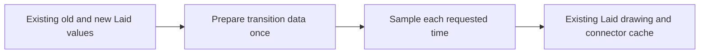

# Graph interface assessment

The first proposed slice prepares graph motion once per pair of layouts.
It keeps the current connector construction and emitted geometry.
Code ownership remains with the coordinator until a brief assigns files.

Base: `d6285ddf8ab54ef7d5fc3bb32a23831173e45afe`.
Branch: `codex/graph-api-depth`.
Evidence: source inspection only.
No build, finite probe, timing measurement, or new theorem supports this assessment.

## Existing carriers and consumers

`Graph` (`tools/Tools/View/Graph.lean`) holds ordered `GNode` values and position-based `GEdge` values.
`Laid` in that file holds `Placed`, `Route`, `Region`, and `FlowMark` values.
`Laid.Ix.of` in that file prepares keyed placement lookup for drawing.
`Laid.Ix.find_of` in that file establishes agreement with first-occurrence lookup.

`Program.lines` (`tools/Tools/View/Program.lean`) folds the existing program into addressed display lines.
`Flow.ofProgram` (`tools/Tools/View/Flow.lean`) folds the existing program into structural rendering data.
Neither proposed slice adds another program representation.

`Page` (`tools/Tools/View/Page.lean`) contains an optional graph panel.
`sampleLaid` (`tools/Tools/View/Motion.lean`) samples graph changes between two layouts.
`Drivers.View.writeFrames` (`tools/Drivers/View.lean`) calls `sample` repeatedly for each page transition.

## Priorities

| Priority | Proposed interface | Current caller work | Consumer | Proposed files |
| --- | --- | --- | --- | --- |
| 1 | Prepare a transition, then sample it | Repeated placement scans, route-key scans, endpoint-height lookup, level sorting, and phase assignment | `sampleLaid`, `sample`, `Drivers.View.writeFrames` | New `tools/Tools/View/GraphMotion.lean`; callers `tools/Tools/View/Motion.lean` and `tools/Drivers/View.lean` |
| 2 | Read typed contacts from a layout | SVG route-key parsing, node-shape classification, contour-cap interpretation | `contacts` and `sequence` in `tools/view/motion_inspector.py` | New `tools/Tools/View/GraphQuery.lean`; metadata exporter in `tools/Drivers/View.lean`; inspector consumer |
| 3 | Construct graph edges by checked keys | Caller `findIdx` wiring and missing-name positions | `Specimen.graphAt` | New `tools/Tools/View/GraphBuild.lean`; `tools/Tools/View/Specimen.lean`; optional `tools/Tools/View/GraphCheck.lean` |

## First slice

A prepared transition stores analysis data for the existing layouts.
Its placement entries retain the target order and each matching old placement.
Its route entries retain target order, key membership, target height, and entry phase.
Its exit entries retain the old order.
Preparation uses the existing `Laid.Ix` and explicit key tables.
The sampler changes positions, growth, and reveal through the existing arithmetic.
It does not rebuild membership tests or sort entry levels at each sample.

The current lookup chooses the first old placement when keys repeat.
Preparation must retain that answer before layout admission.
The existing kit join groups enter, update, and exit values.
Its grouped results do not retain interleaving between entering and updating target values.
The transition must retain target order rather than concatenate those groups.

The performance benefit remains a candidate until identical frame exports provide timing measurements.
A source inspection shows repeated analysis inside `sampleLaid`.
It does not establish a complexity bound or a runtime improvement.

## Proposed law placement before implementation

1. **Concept:** `initial-algebras-folds`, concept 7 in `docs/core/semantics.md`.
   The proposed tool law serves agreement between two implementations of one finite rendering observation.
   It does not extend the program fold requirements.
2. **Question:** preparing and sampling answers the same `Laid` value as the current `sampleLaid`.
   The proof role is compatibility.
   The evidence status is proposed.
   Decisions row 334 (3) and row 336 (8) permit a named tool law.
   Registry placement remains a coordinator proposal under R14.
3. **Reach:** arbitrary finite layout pairs, choreography data, and sample times.
   The observation includes array order, repeated-key behavior, dimensions, marks, regions, positions, growth, and reveal.
   A narrowed admitted-layout fragment must be named if arbitrary-pair agreement proves unsuitable.
4. **Limits:** agreement establishes no program typing, execution schedule, curvature property, timing bound, or host rendering equality.
   Connector construction remains unchanged.
5. **Consumer:** repeated samples in `Drivers.View.writeFrames` use one prepared transition.
   The slice serves R14 view navigation and removes repeated graph analysis from that consumer.

No theorem statement enters source before the coordinator assigns this slice.

## Contact query follow-up

A contact identifies a route, its source or target side, and its explicit endpoint key.
Its classification reads the endpoint placement and layout marks.
A node contact requires an actual `Placed.node` value.
A pass point remains a pass point.
A fork or join port requires graph-owned identity or explicit incidence data.
String suffixes alone cannot establish every port role for arbitrary caller keys.

The current inspector infers contacts from the final emitted contour.
Earlier reveal samples retain the final classification.
Graph-owned contact export can remove that inference for supported graph generators.
The export must state its coordinate scale and translation.
A contact's absence in an early sample remains absence, not evidence of a gap.

## Existing kit and graph capabilities

`Whatwg.Svg.Scene.Join` (`.lake/packages/whatwg/Whatwg/Svg/Scene/Join.lean`) already owns list joins by key.
Its join matches repeated new keys to the first matching old value.
Reuse that meaning when joins enter a prepared transition.

`Whatwg.Svg.Scene.Network` (`.lake/packages/whatwg/Whatwg/Svg/Scene/Network.lean`) reads existing nodes and links through source, target, and quantity functions.
Its value and channel operations concern quantities and bands.
They do not replace this structural flow layout or its current connector method.
No network adapter belongs in the first motion slice.

`Flow.ReachTable` (`tools/Tools/View/FlowReach.lean`) already offers checked directed path queries.
Its `reaches_iff` establishes agreement with `Flow.Reach` after endpoint admission.
A second reachability implementation would duplicate an existing interface.

## Deferred cleanup

`Flow.ofPage` (`tools/Tools/View/Flow.lean`) scans page lines by key while relabelling.
`Live.page` (`tools/Tools/View/Live.lean`) performs the same label lookup.
A shared prepared line-label table can remove both scans later.
That small helper alone offers less behavior than prepared graph motion.

`GraphCheck.input` (`tools/Tools/View/GraphCheck.lean`) checks node keys and edge positions.
It does not check edge-key uniqueness.
A checked key constructor must define edge identity before promising admission of unique route identities.
Parallel edges require distinct caller keys when motion joins routes by key.

The coordinator owns production changes outside the assigned slice.
