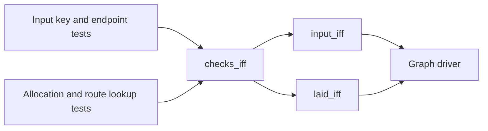

# Graph rendering checks: placement before proof

Base: `e9cf615b5047ac3a4d1be053291434fd757b9b7d`.
Status: research brief. The coordinator owns integration and the register.

The checker observes input endpoints, key lookup, and allocation rectangles.
A rendering refusal carries its site, index, field, and reason as data.
The checker reads no program typing or scheduling judgment.

## Placement

Concept: `initial-algebras-folds`, concept 7 of `docs/core/semantics.md`.
Required property served: agreement of a finite checker with its stated observation.
Proposed tool question: `view-graph-renderability-check`, under decisions row 334 (3).
Role: decidability of the limited finite rendering observation.
Requirement served: R14, through the graph driver.

| Pointer in `tools/Tools/View/GraphCheck.lean` | Observation and scope | Consumer |
| --- | --- | --- |
| `checks_iff` | The checker accepts exactly when every supplied finite Boolean test holds | Both rendering admission arrows |
| `input_iff` | Every input key and endpoint test holds exactly when input admission accepts | Driver before generic graph layout |
| `laid_iff` | Every allocated rectangle and route lookup test holds exactly when laid admission accepts | Driver before rendering |

The helper `checks_iff` serves the two named admission observations.
These observations use String Boolean comparison, as the renderer's lookup does.
They establish no semantic key-equivalence relation.

The retained audit invokes `#plan_status` on these nodes.
The axiom audit checks the module at `[propext, Quot.sound]`.
The coordinator can register the proposed question after reviewing its scope.
No planned goal enters a library root.

## Limits

Input admission checks nonempty, distinct node keys and endpoint ranges.
Laid admission checks nonempty, distinct placed keys and endpoint resolution for every route kind.
A downward route needs at least two keys.
Allocated node rectangles and region rectangles must lie within the declared canvas.
Points have zero allocated height. Their declared width remains allocation data.
Route curves, stroke thickness, labels, arrowheads, and marks have no ink-bound theorem here.
The checker proves no ontology, program typing, scheduling, deadlock, or source-to-graph relation.

## Behaviour evidence

Finite controls cover dangling forward, back, and loop references, duplicate keys, and negative or overflowing allocations.
The current Flow specimens receive a retained probe report.
A failure is reported to the coordinator. This slice does not repair the owned layout module.
