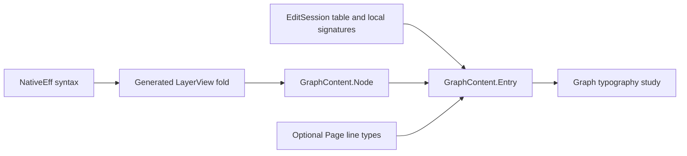

# Graph node content plan

Content means constructor data and argument data for one displayed source address.
This note proposes view metadata, not another program representation.
The base is `f25c74f3e2c6acd2bf4ad85c7cbd205dcc8952e0`.

## Source and consumer

`Tools.View.Program.lines` in `tools/Tools/View/Program.lean` folds the generated layer into rendered lines.
Those lines retain addresses and operations, but lose constructor and argument fields.
`Effect4.Program.EffAlgebra.ofLayer` in `src/Effect4/Program/LayerView.lean` already supplies both fields.
The graph typography study consumes these fields without parsing rendered labels.

## Data and arrows

`GraphContent.Argument` uses `ArgF NativeOp` with a `Unit` child carrier.
Each child argument retains its family and position, but holds no subtree.
Each other argument retains its original value.
`GraphContent.Node` holds `path`, `depth`, `family`, `ctor`, `arguments`, and `op`.
`ofProgram` projects syntax into an ordered list of nodes.
It uses the same spine suppression and child-address convention as `Program.lines`.

`GraphContent.Entry` joins a node with optional `Table.Entry`, operation metadata, and optional rendered type text.
`ofSession` reads the session table by exact source address.
Its operation row comes from `Sketch.sigAt`, including definition, parameter, and hole declarations.
An operation outside that signature's domain retains its operation value but has no row.
`ofSessionPage` additionally reads `Line.type` by the node's explicit key.
The key formatter writes the address, but no reader parses that spelling.
Duplicate table addresses and page keys use the first occurrence.

## Observation and limits

Raw `EffTy` retains separate answer, error, and requirement fields.
Raw `NodeEnv` retains variable types separately from requirements.
An unavailable table entry differs from an entry with no result.
Both differ from an admitted type whose error is `never`.
A refusal retains its located path, including refusals inherited by enclosing nodes.
The projection reads declarations and typing observations, not execution outcomes.
The study assigns typography and visual roles separately.
It changes no graph geometry or production label policy.

## Evidence and placement

This slice adds passive metadata and finite controls, with no theorem or admission judgment.
The controls compare addresses, depths, operations, and rendered own-text across the real flow specimens.
Other controls inspect raw arguments, unavailable typing, located refusal, holes, and local operation rows.
The changed module receives a narrow build and a checked strict axiom audit.
Existing `Program.argText` remains the rendering boundary.
No new registry claim is proposed.
The consumer serves R14's authoring view under decisions row 334, point 3.
