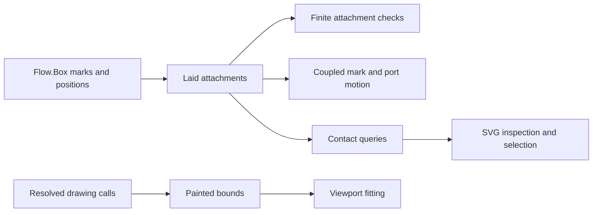

# Graph defects and styling data

Base: `26436e791` on `codex/pegs-port`.
The production connector construction stays fixed.

## Data and ownership

`PortAttachment` in `tools/Tools/View/Graph.lean` relates a placed point key to its mark key.
`Laid.attachments` retains that finite relation after layout.
`Flow.layout` in `tools/Tools/View/Flow.lean` derives the relation from the existing `Flow.Box.marks` positions.
It includes each mark's central point.
Supported layouts attach each point to at most one mark.
The checker refuses unresolved points, unresolved marks, duplicate attachments, and node attachments.
Arbitrary unchecked data uses deterministic first-match lookup.

`Laid.routingWidth` retains the lane span independently of the canvas width.
`Laid.routeWidth` uses that span, or the existing width when the field is absent.
Extending the painted canvas must not move return lanes.

The relation is view metadata, not another program representation.
It supports coupled motion, contact inspection, selection, and later styling.
The renderer remains the owner of connector geometry.

`GraphContact.collect` in `tools/Tools/View/GraphContact.lean` exposes logical contacts and their declared surfaces.
`GraphContact.degrees` counts directed route occurrences at each explicit mark.
Parallel route occurrences contribute separately.
`GraphContact.junction` distinguishes forks, joins, through points, and mixed junctions by those counts.
The counts concern structural incidence, not machine execution.
Contact occurrence identities belong to one layout snapshot.
They promise no identity across arbitrary route reordering.

## Placement before proof

Concept: `initial-algebras-folds`, concept 7 in `docs/core/semantics.md`.
Required property: agreement between a finite checker and its stated rendering observation.
Question: the proposed `view-graph-renderability-check` under decisions row 334 (3).
Role: finite-check characterization, consumed by checked layout and graph exporters.
Reach: named keys, explicit point-to-mark attachments, and the displayed geometry.
Limits: no program typing, scheduler causality, liveness, or text-ink measurement follows.
Requirement served: R14, through view navigation and rendering explanations.

`GraphCheck.laid_iff` in `tools/Tools/View/GraphCheck.lean` continues to characterize the checker as its finite tests expand.
No separate theorem restates that finite-check observation.
Each motion, separation, and painted-bound slice records its own stronger observation before proving it.

`KeyMap.get?_firstBy` characterizes first-occurrence lookup for a finite list.
Its consumers are the placed-point, route, and attachment indices.
`GraphAttachment.Index.findMark_of` and `GraphAttachment.Index.findAttachment_of` instantiate that observation for contact metadata.
Their role is a helper of the proposed rendering-check question above.
Their hypotheses require only decidable keys and hashing; duplicate keys use the first occurrence.
These laws establish lookup agreement, not geometric validity or program meaning.

## Controls

The motion controls include kept, added, and removed ports attached to moving marks.
The canvas controls include self-loops, back lanes, large styles, and growth overshoot.
The contact controls use keys containing separators and no naming convention.
The inspector consumes explicit contact records when supplied.
Legacy SVG-only fixtures retain a clearly limited fallback.
