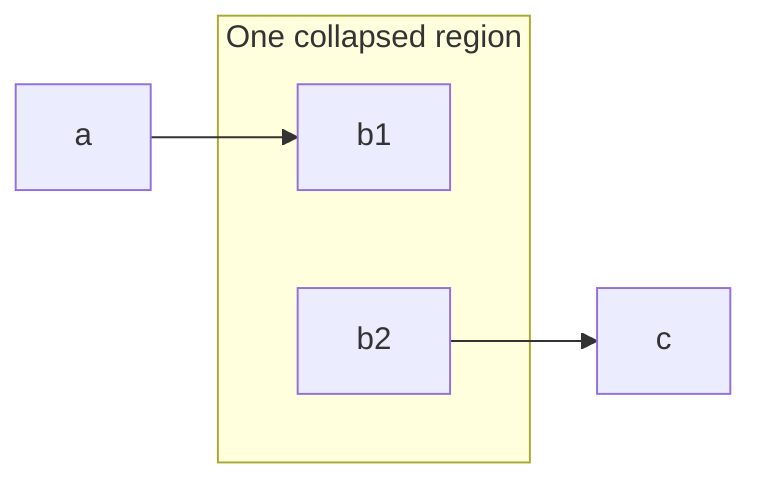
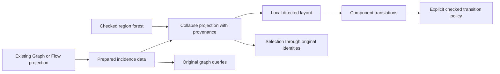

# Graph hierarchy, simplification, and packing

Recommend a checked region forest beside the existing directed multigraph.
Collapse regions as a view projection with exact edge provenance.
Keep reachability queries on the original named edge collection.
Pack independent components after resolving their local drawings.
Keep the production connector construction fixed.

Base: `5cd537aef9838da43d4f9377d033028bddf7403a`.
Branch: `codex/graph-hierarchy-research`.
Worktree: `C:/Users/kokok/Dev/lean4-effect4-graph-separation`.
Evidence kind: primary-source research and source inspection.
This note changes no Lean source and runs no layout benchmark.
The owner requests both larger node counts and richer compound nodes.

## Terms and source boundary

A directed multigraph keeps each edge identity, including parallel edges and loops.
A compound graph adds parent-child containment to that graph.
A region forest records ordered containment with at most one parent per region.
Laminar membership means two region member sets are disjoint, or one contains the other.
Provenance records the original edge occurrences represented by one visible object.
A view quotient maps original vertices to visible representatives without changing the source graph.
A strongly connected component, or SCC, contains mutually reachable vertices.
Condensation contracts SCCs and retains directed edges between distinct components.

These meanings concern graph views.
They establish no scheduler event, Effect program judgment, or runtime causal order.
`Eff` remains the program syntax.
`Flow` remains its existing structural view fold.

## What the current source supplies

| Declaration and path | Available data | Limit for hierarchy work |
| --- | --- | --- |
| `Graph`, `GNode`, `GEdge` in `tools/Tools/View/Graph.lean` | Ordered nodes, keyed directed edge occurrences, endpoint positions | No containment or edge-kind field |
| `Region`, `Laid` in `tools/Tools/View/Graph.lean` | Painted region rectangles beside placed items and routes | A rectangle does not establish membership or immediate parenthood |
| `Flow.region`, `Flow.loop`, `Flow.par` in `tools/Tools/View/Flow.lean` | Structural nesting and branching distinctions | A generic quotient must retain their producer metadata |
| `Flow.RegionFrame` in `tools/Tools/View/Flow.lean` | Item positions and inner frame keys | `Flow.framed` records all descendant frame keys, not only immediate children |
| `Flow.Edge` in `tools/Tools/View/Flow.lean` | Endpoint positions, padding, drawing flag, share | Edge identity is an occurrence in a supplied snapshot |
| `Flow.EdgeOccurrence`, `Flow.occurrenceEndpoints` in `tools/Tools/View/FlowPath.lean` | Original parallel occurrences for path explanations | Positions do not remain identities after arbitrary edge-list replacement |
| `Flow.ReachTable.reaches_iff` in `tools/Tools/View/FlowReach.lean` | Exact reachability for the supplied bounded edge list | The caller chooses that edge list and its observation |
| `GraphCheck.input`, `GraphCheck.laid` in `tools/Tools/View/GraphCheck.lean` | Existing located finite rendering tests | Neither checks a region forest or collapse provenance |
| `GraphMotion.prepare` in `tools/Tools/View/GraphMotion.lean` | Prepared motion and an explicit separation policy | Endpoint checking does not establish arbitrary moving-curve clearance |

Store region membership before layout removes the structural nesting.
Do not infer membership from rectangle intersection or key spelling.
Derive immediate parents from the structural fold or validated containment data.
Keep overlapping annotations separate from a laminar region forest.

## Primary-source comparison

### Directed layered layout

Gansner, Koutsofios, North, and Vo describe ranking, within-rank ordering, coordinate assignment, and spline construction.
Their input includes loops, multiedges, node sizes, separation constraints, and edge weights.
Their aesthetic objectives compete, so the method uses heuristics rather than a universal optimum.
Source: [A Technique for Drawing Directed Graphs](https://graphviz.org/documentation/TSE93.pdf).

Sugiyama, Tagawa, and Toda supply the original layered-layout framework that ELK documents.
ELK separates layer assignment, crossing reduction, and coordinate assignment.
Source: [ELK Layered](https://eclipse.dev/elk/reference/algorithms/org-eclipse-elk-layered.html).
The original paper's publisher endpoint fails during this research run.
This note takes no additional claim from its unread full text.

Brandes and Köpf assign horizontal coordinates after the layering and within-layer order are supplied.
Their stated linear-time bound counts dummy vertices and edge segments in the proper layered graph.
It does not bound the entire layout pipeline.
Source: [Fast and Simple Horizontal Coordinate Assignment](https://kim246.wwwdns.kim.uni-konstanz.de/publications/bk-fshca-01.pdf).

Brandes, Walter, and Zink identify two flaws in the original coordinate algorithm.
Their correction retains its asymptotic running time.
Source: [Erratum: Fast and Simple Horizontal Coordinate Assignment](https://arxiv.org/abs/2008.01252).
Compare any deeper implementation against that corrected algorithm.
The current local coordinate code receives no new correctness claim from this citation.

Recommendation: retain directed ranks, stable order, separated boxes, and explicit ports as the primary drawing objectives.
Treat crossing count, edge length, symmetry, and drawing stability as separately measured objectives.
A smaller area alone can obscure causal distinctions or nested groups.
This recommendation follows the competing objectives in Gansner's method.

### Compound handling and ports

ELK Layered supports ports, multiedges, loops, compound nodes, clusters, and cross-hierarchy edges.
Its arbitrary port-constraint support specifically names orthogonal routing.
Do not transfer that guarantee to our organic cubic renderer.
Source: [ELK Layered features](https://eclipse.dev/elk/reference/algorithms/org-eclipse-elk-layered.html).

ELK's `INCLUDE_CHILDREN` lays out multiple hierarchy levels in one run.
`SEPARATE_CHILDREN` starts separate runs at compound nodes.
The default root behavior separates children.
Cross-hierarchy layout requires the appropriate hierarchy setting.
Source: [Hierarchy Handling](https://eclipse.dev/elk/reference/options/org-eclipse-elk-hierarchyHandling.html).

ELK's JSON format distinguishes nodes, ports, labels, edges, and routed edge sections.
Nodes contain children, while edges may refer across the hierarchy.
Its extended edges can express multiple sources and targets, but many algorithms do not support those hyperedges.
Source: [ELK JSON graph format](https://eclipse.dev/elk/documentation/tooldevelopers/graphdatastructure/jsonformat.html).

Recommendation: separate containment from incidence and keep boundary ports explicit.
Use the graph model as a reference for a future differential specimen.
Do not add ELK as a production dependency in this slice.
Do not convert a fork operation into unrelated pairwise operations merely because an external format supports them.

Graphviz assumes clusters form a strict hierarchy, although ordinary subgraphs can overlap.
Source: [DOT subgraphs and clusters](https://graphviz.org/doc/info/lang.html).
Its local cluster layout integrates each cluster as a unit within its parent.
Nested clusters are supported.
Source: [clusterrank](https://graphviz.org/docs/attrs/clusterrank/).
Its `compound` option uses `lhead` and `ltail` for cluster edge clipping.
Source: [compound](https://graphviz.org/docs/attrs/compound/).
These mechanisms support separate containment and boundary-routing APIs.
They do not infer our region membership or Effect operation identities.

### Packing and hierarchy overviews

Graphviz can lay out connected components separately and then pack them.
Its `pack` margin controls space around each component.
Source: [pack](https://graphviz.org/docs/attrs/pack/).

Graphviz's graph-level packing uses each component's bounding rectangle.
Node-level packing permits interleaving between components.
Array packing supports input-order placement and alignment controls.
Source: [packMode](https://graphviz.org/docs/attr-types/packMode/).
Recommendation: use graph-level rectangular packing first, with deterministic input order.
It gives a simpler component-selection and motion boundary than interleaved packing.

D3 hierarchy supplies a parent and ordered children for each node.
Its hierarchy links connect parents to children.
They are not the dependency edges of a directed multigraph.
Source: [D3 hierarchy](https://d3js.org/d3-hierarchy/hierarchy).

D3 treemap allocates nested rectangular area according to node values.
Its default squarified tiling seeks readable aspect ratios.
Its resquarify update retains prior node adjacencies under its stated layout conditions.
That stability can sacrifice later shape quality.
Source: [D3 treemap and resquarify](https://d3js.org/d3-hierarchy/treemap).

D3 pack represents containment with circles.
Leaf areas support quantitative comparison, while enclosing circles include wasted space.
Its default fitted padding is approximate.
Source: [D3 pack](https://d3js.org/d3-hierarchy/pack).

Recommendation: reserve treemap or pack for a hierarchy overview with an explicit size metric.
Use fixed-size rectangle packing for independent node or component drawings.
Use layered layout for directed edges inside or across those components.
Neither D3 hierarchy layout substitutes for compound directed-edge routing.

## One collapse contract

The following contract is a proposal with a concrete interaction consumer.
It is not a landed theorem or a new program representation.

The input contains one checked graph snapshot, one checked region forest, and one collapsed-region list.
Each vertex belongs directly to at most one region.
Each region has at most one parent.
Each edge retains its source identity, endpoint positions, and caller-supplied semantic class.
Classes distinguish views that must not merge, such as dependency, wait, return, and layout-only constraints.
The current `GEdge` needs a metadata adapter rather than an invented Effect interpretation.

Normalize the collapsed-region list to an antichain of outermost collapsed regions.
Map each hidden vertex to its outermost collapsed ancestor.
Map each remaining vertex to itself.
Tag visible identities as either original-node keys or region keys.
Do not construct those identities by ambiguous string concatenation.
Let `q` name the resulting representative map.

For each original edge occurrence `e`, record exactly one destination:

- If `q(source e) = q(target e)`, retain `e` in that representative's internal-edge provenance.
- Otherwise, retain `e` in a visible boundary-edge bundle with those two representatives.

Each bundle contains a nonempty ordered list of original occurrences.
Every listed occurrence has the bundle's representative endpoints and semantic class.
Every original occurrence appears exactly once across internal records and visible bundles.
Order each bundle by the original edge order.
Retain original endpoint keys for boundary-port inspection.
Retain loops in internal provenance even when their overview glyph is hidden.

Parallel edges remain separate by default.
An explicit bundling mode may group equal visible endpoints only within one semantic class.
The displayed multiplicity comes from the retained occurrence list.
Expand or inspect a bundle through its provenance rather than inventing one source edge.
Keep a snapshot identifier beside positional occurrences.
Use unique source edge keys for interaction that survives a checked snapshot replacement.

An expansion recomputes the projection from the retained original graph and hierarchy.
It does not attempt to reconstruct the source graph from an aggregated drawing.
The original source remains available throughout collapse and expansion.

### The reachability boundary

Arbitrary collapse does not establish original reachability from visible paths.
Consider a region containing disconnected vertices `b1` and `b2`.
The only original edges are `a → b1` and `b2 → c`.
Collapse displays `a → Region → c`, although the original graph has no path from `a` to `c`.
This is a finite mathematical counterexample, not an executed Lean probe.

Offer separate queries for original reachability and visible adjacency.
A visible path explanation must either lift through compatible original endpoints or report that its lift fails.
Boundary provenance alone does not supply the missing internal path.
Do not label the quotient's transitive closure as the original graph's causal order.

## SCC condensation and reduction

Tarjan gives an SCC algorithm with time and space bounded linearly in vertices and edges.
That statement concerns its stated graph representation and algorithm.
It is not a measured bound for a future Lean implementation.
Source: [Depth-First Search and Linear Graph Algorithms](https://epubs.siam.org/doi/10.1137/0201010).

SCC contraction differs from arbitrary region collapse because each component is mutually reachable.
This permits paths between consecutive boundary edges to connect through their component.
The resulting component graph has no directed cycle between distinct components.
These are derived mathematical conditions for a future condensation consumer.
Retain all internal edges and all cross-component parallel occurrences in provenance.
Compute SCCs for the explicitly named edge collection that the query uses.
Changing from dependency edges to rendered edges changes that collection and its observation.

Aho, Garey, and Ullman define transitive reduction through equal directed reachability and minimal arc count.
Their account distinguishes cyclic graphs from the acyclic case.
Source: [The Transitive Reduction of a Directed Graph](https://epubs.siam.org/doi/10.1137/0201008).

Recommendation: provide reduction only as an optional DAG reachability overlay first.
Keep the original edge graph available and retain removed-edge explanations.
For each hidden relation edge, store an alternative path in the retained relation graph.
Do not remove a wait, control edge, return, or effect distinction from the underlying data.
Equal reachability does not establish equal edge multiplicity, path counts, weights, labels, or program meaning.
A pair of parallel edges alone already separates multiplicity from reachability.
Named semantic classes can require separate overlays or forbid reduction entirely.

## Bounded APIs and staged operations

The names below are proposed interfaces, not new declarations.
Each preparation result contains first-order data and explicit lookup indices.
Its consumers pass indices as data rather than hiding tables before returned closures.

| Proposed API | Input and result | Immediate consumer |
| --- | --- | --- |
| `Hierarchy.check` | Region keys, immediate parents, direct vertex membership; located refusal or checked forest | Compound selection and region navigation |
| `Hierarchy.project` | Checked graph, forest, collapsed-region list, class policy; visible representatives and exact provenance | Collapse, expansion, boundary-edge inspection |
| `GraphIndex.prepare` | One named snapshot; incoming and outgoing edge occurrences, key indices | Reach queries, components, crossing scores |
| `Condensation.prepare` | A named edge collection; component map and provenance bundles | Cycle overview and acyclic ranking |
| `ReachOverlay.reduce` | Checked DAG relation; retained relations and alternative-path explanations | Optional reduced overview |
| `Packing.prepare` | Ordered component drawings, measured envelopes, gap and row policy; translations and fitted bounds | Larger canvases and component navigation |

Implement forest checks and collapse provenance before selecting a new layout algorithm.
Implement packing independently of directed ranking and connector construction.
Add SCC condensation only when the cycle-overview consumer requests it.
Add reduction only when its reachability-overlay consumer can expose hidden edges.

For interaction, retain selections in original identities across view projections.
A collapsed-region selection denotes its member set explicitly.
A bundle selection exposes its ordered original edges and their classes.
Choose stable boundary-port order from the original node and edge order.
Reroute only affected boundary edges when a local region changes.
Treat order swaps as changes that require the existing explicit separation policy.
Do not infer continuous clearance from a finite sample list.

## Existing ownership and performance seams

The kit owns integer envelopes through `IBox`, `Boxed.boxAll`, and their move laws in `Whatwg/Svg/Scene/Extent.lean`.
Reuse those envelopes for packing and translate resolved calls as one component.
`GraphBounds.viewport` in `tools/Tools/View/GraphBounds.lean` retains the routing coordinates separately from its canvas shift.
Keep that separation when packing several components.
Translate places, marks, regions, contact records, and resolved drawings together.
Keep keys and provenance unchanged under that translation.

The kit owns ordered trees in `Whatwg/Svg/Scene/Tree.lean`.
`Tree.Edit` in `Whatwg/Svg/Scene/Tree/Edit.lean` supplies edit laws for its own leaf-span placement.
Those laws do not establish compound graph layout or arbitrary edge routing.
The kit's `Layers` in `Whatwg/Svg/Scene/Layers.lean` supplies conditional rank semantics for a serving order.
It does not establish a fast table or horizontal coordinate assignment.
`AGraph.Rel` in `Whatwg/Svg/Scene/Order.lean` forgets multiplicity because it records membership predicates.
Do not use that relation as the sole owner of provenance bundles.

Effect4 owns the program fold, semantic edge-class adapter, and editor selection identities.
Generic checked forest and provenance operations can move to a graph owner after the first real consumer exists.
Their proposed bounded data contains no `Eff`, `Flow`, machine state, or stored Lean function.
The reusable kit can own this finite graph-view data through an application adapter.
Generic integer packing belongs beside the kit's integer envelope operations.
Keep a single owner for each algorithm and retain thin adapters at application boundaries.

`Graph.orders` in `tools/Tools/View/Graph.lean` still filters the link list for each neighbor query.
`Graph.preds` in the same file scans every edge for each ranked vertex.
`Graph.rankStep` appends accumulated lists, while rank lookup reads those lists by position.
`Graph.orders` filters all items for each rank and appends accumulated rank lists during sweeps.
`Graph.layout` repeats item and link construction and first-key searches.
`Graph.barycentre` in `tools/Tools/View/GraphOrdering.lean` still scans rank orders for positions.
Its cached score improves repeated comparison work but does not remove those scans.
Prepare incoming and outgoing occurrence buckets and per-rank positions once per ordering pass.
Prepare rank buckets, stable key indices, and incident edge occurrences once per snapshot.
Keep the list-based result as the comparison specification.
`Flow.assignTable` in `tools/Tools/View/Flow.lean` already supplies a retained sparse height index.
Reuse its data-passing pattern rather than adding another closure-backed table.

Measure original nodes, edge occurrences, dummy points, labels, and prepared geometry separately.
Long edges add one dummy point per intermediate rank in the current general graph layout.
Node count alone therefore understates layout work.
Benchmark redraw, collapse projection, and layout preparation separately from SVG serialization.
Add spatial culling after projection using resolved geometry envelopes.
Retain edges whose envelopes intersect the viewport even when both endpoints lie outside it.
Report missing text metrics rather than claiming text-ink culling from box geometry.
Packing and projection timings do not establish full `Graph.layout` performance at larger node counts.
No higher-node-count performance result is established by this note.

## Placement before future proof

Concept: `initial-algebras-folds`, concept 7 in `docs/core/semantics.md`.
Requirement: R14's graph navigation, inspection, and live authoring.
Question: propose finite hierarchy, provenance, and packing observations when their consumers land.
Role: checker characterization and exact view-observation helpers.
Reach: one named finite graph snapshot, valid endpoints, unique checked identities, and checked forest data.
Limits: no Effect typing, runtime causality, scheduler liveness, optimal aesthetics, or universal curve-clearance claim follows.
Unlock: checked collapse, explanatory selection, component navigation, and bounded redraw preparation.

The first consumer needs the edge partition contract, not a theorem about all program behavior.
The packing consumer needs envelope containment and separation under its named margin policy.
The condensation consumer needs directed reachability on its exact supplied edge collection.
Declare those properties with their consumers before proof work starts.
This note creates no planned goal and changes no semantics registry status.

## Required controls for the first implementation

Use nested, disjoint, empty, and overlapping region inputs.
Refuse missing parents, parent cycles, duplicate region identities, and conflicting direct membership.
Use original node and region keys that spell the same string.
Use loops and parallel edges with different classes and equal endpoint representatives.
Check the exact edge partition across visible bundles and internal provenance.
Check collapse, expansion, and nested collapse-list normalization against the retained source graph.
Use the disconnected-region counterexample before claiming original reachability from quotient paths.
Use SCCs with several boundary ports and retained internal loops.
Use reduction controls with parallel edges, weights, and protected semantic classes.
Check packing against full resolved geometry and report unmeasured text separately.
Check dynamic selection identities when an edge moves between visible and internal provenance.

## Research receipt

The note is the only changed file in this slice.
The browser reads the linked primary papers and official documentation.
The source inspection reads the declarations named above at the base commit.
The research helper starts, then stops when the coordinator reclaims its worker slot.
No helper result supplies a claim in this note.
The slice runs no Lean build, proof audit, or production renderer.
The tracked note receives the repository language and whitespace checks before commit.
