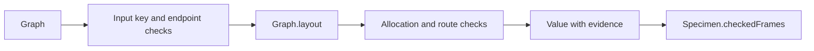

# Graph library admission and preparation

The production connector construction stays fixed during this slice.
The graph service joins input checks, layout, and allocation checks behind one call.
Preparation moves repeated motion and ordering work outside their inner loops.

Base: `d6285ddf8ab54ef7d5fc3bb32a23831173e45afe`.

## Admission placement

Concept: `initial-algebras-folds`, concept 7 in `docs/core/semantics.md`.
Required property served: agreement between a finite checker and its named observation.
Question: `view-graph-renderability-check`, proposed under decisions row 334 (3).
Role: decidability of the finite input and allocation observations.
Requirement: R14, through the specimen producer and graph driver.

`GraphCheck.Checked` in `tools/Tools/View/GraphCheck.lean` carries the evidence returned by `GraphLayout.checked` in `tools/Tools/View/GraphLayout.lean`.
Its `input_ok` field observes nonempty, distinct node keys and edge keys, with endpoints inside the node array.
Distinct edges may share endpoints.
The producer computes `Graph.layout` from `tools/Tools/View/Graph.lean` once.
Its `allocation_ok` field observes the existing `GraphCheck.LaidOK` checks.
The constructor consumes `GraphCheck.input_iff` and `GraphCheck.laid_iff` from `tools/Tools/View/GraphCheck.lean`.
`Specimen.checkedFrames` in `tools/Tools/View/Specimen.lean` consumes the admitted value.

## Scope and limits

The evidence concerns finite rendering data.
It establishes no program typing, scheduler behaviour, or graph relation to machine execution.
The allocation observation excludes connector ink, text, marks, and collision freedom during motion.
The evidence does not identify a particular layout algorithm.
This keeps the checker independent of text measurement and permits other layout producers.
Input admission does not imply layout admission.
A generated point key can collide with a supplied node key.
The second check reports that collision as a located refusal.
Neither check repairs identities or silently removes parallel edges.

## Controls

The retained probe exercises empty graphs, distinct parallel edges, repeated edge keys, empty edge keys, and out-of-range endpoints.
It also exercises generated point collisions and the specimen producer.
The probe records finite evidence, not a general layout theorem.
The audit checks `Tools.View.GraphCheck` at `[propext, Quot.sound]`.
The producer inherits the existing `String.length` dependency of `Graph.boxWidth` in `tools/Tools/View/Graph.lean`.
The receipt records the rendering audit separately.
