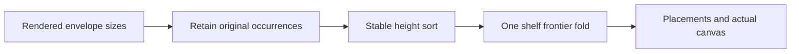

# Independent graph rectangle packing

The packing input contains rectangle sizes supplied by a caller.
The caller obtains each size from its resolved rendered envelope.
The packer inspects no graph, node name, text, route or program.

The output retains each original array occurrence before sorting.
Equal heights retain the original occurrence order.
Packing moves independent components and changes no connected-node routing.

## API and policy

`GraphPacking` lives in `tools/Tools/View/GraphPacking.lean`.
`Size` records natural width and height.
`Options` records a target width and a nonnegative gap.
`Placement` records an original occurrence, rectangle, shelf and oversize flag.
`Packed` records placements, canvas, shelf count, item area and oversize count.

The stable sort orders heights from greatest to least.
One pass places each rectangle on the current shelf when it fits.
Otherwise it opens the next shelf below the current shelf's maximum height and gap.
An oversized rectangle occupies its own shelf and expands the actual canvas width.
The next rectangle opens another shelf after an oversized rectangle.
Zero dimensions remain valid empty rectangles with their occurrence identities.
The actual canvas reaches the placed rectangles, without unused target-width padding.

## Placement before proof work

| Field | Placement |
| --- | --- |
| Concept | `initial-algebras-folds`, concept 7 in `docs/core/semantics.md` |
| Required property | A fold over rectangle sizes constructs a contained and separated tool layout |
| Question and role | `pack_inside` and `pack_disjoint`, tool laws under decisions row 334 (3) |
| Helpers and consumers | The shelf-frontier invariant serves both laws; the coordinator's compound graph gallery consumes the packing result |
| Exact observation | `IBox.Inside` for each returned rectangle and pairwise `IBox.Disjoint` for the returned rectangle list |
| Fragment and hypotheses | Every finite array of natural sizes, target width and natural gap; oversize rectangles expand the canvas |
| Scope limit | No optimality, font metric, semantic graph relation or changed connector geometry |
| Requirement | R14's live authoring view, without an Effect judgment or registry claim |

The helper invariant records each placed rectangle behind the current horizontal or vertical frontier.
The frontier supplies separation from the next rectangle without a pairwise runtime scan.
The proof checks that each placement step retains the invariant.
The identity observation records original array occurrences before the stable sort.
`pack_occurrences` records the returned occurrences as a permutation of the original positions.
Its proof serves the gallery's lookup of the original component and adds no geometry claim.

## Validation

Build the new module with three Lean threads.
Audit the module with `#axiom_audit` under `[propext, Quot.sound]`.
Run finite pairwise controls on small cases, including oversize rectangles and zero dimensions.
Measure input counts 100, 1000 and 10000 with consumed placement digests.
Report those measurements as Lean driver measurements, without an optimality or renderer-latency claim.
