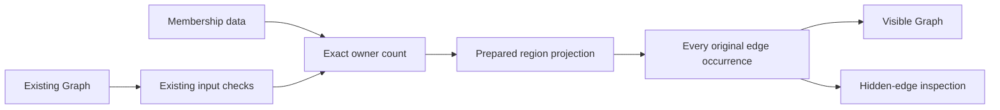

# Graph region view adapter plan

Base: `5cd537aef9838da43d4f9377d033028bddf7403a`.
Branch: `codex/graph-regions-view`.
The slice adds one production Graph adapter and one standalone finite probe.
The GraphRegions owner supplies the forest checker and occurrence projection.
The adapter changes no program syntax, connector construction, or hierarchy ownership.

## Data and consumer

`GraphRegionsView.prepare` accepts an existing `Graph`, membership data, selected regions, and optional ordinal region labels.
It checks the existing graph input before checking the membership owner count.
It then calls `GraphRegions.prepare` and `GraphRegions.project`.
The result retains the original graph, prepared projection, every original edge record, and the visible graph.
The compound-graph generator consumes the visible graph and its exact source provenance.

Visible node keys use `node:` before the original node key.
Visible region keys use `region:` before the region key.
The two prefixes give distinct namespaces even when source strings match.
Visible original edges keep their original keys.
Hidden edge records stay available for selection and expansion.
Uncollapsed self-loops remain visible.
Parallel edge occurrences remain separate.
Region labels use caller data or the declared region key.
No representation stores a callback or another program.

## Placement before proof

Concept: `initial-algebras-folds`, concept 7 in `docs/core/semantics.md`.
Requirement: R14's compound graph navigation and selection.
Question: the proposed finite collapse-provenance observation in the graph-hierarchy research note.
Role: an adapter helper and finite producer controls.
Reach: one supplied Graph snapshot and a membership owner array of exactly its node count.
Limits: no arbitrary quotient-path lifting, runtime causality, program typing, or layout performance claim follows.
Consumer: the compound-graph generator and its visible-edge provenance inspection.

`GraphRegionsView.ownerCount_iff` characterizes the adapter's new Boolean size check.
It observes exact array size, not validity of the forest or original graph.
The adapter consumes that check before passing positional endpoints to the prepared projection.
The GraphRegions owner remains responsible for stronger forest and occurrence laws.
The adapter's result is retained view data, not a new certificate of rendered geometry.

## Controls and checks

Use unchanged node labels and custom region labels.
Use missing ordinal region labels and an empty collapsed region.
Use source keys that already contain the two prefixes.
Use an uncollapsed self-loop and parallel edges with different original identities.
Keep a region's hidden loop and internal edge records in the projection.
Refuse short and long membership owner arrays.
Check source-refusal precedence before the size-refusal phase.
Check the visible graph through the existing input checker.
Build the adapter and run its standalone probe with bounded Lean workers.
Run the strict declaration audit over the adapter and its GraphRegions dependency.
Run the language and whitespace checks before each explicit-path commit.
