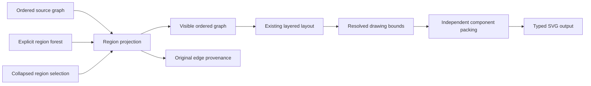

# Graph scale and compound nodes

Keep source adjacency separate from displayed adjacency.
A collapsed region can join disconnected boundary paths in its displayed node.
No collapse operation changes the program or claims its relational meaning.

## Scope

A region is an explicit group with at most one parent.
The region forest is laminar: groups are nested or disjoint.
A projection maps original node occurrences to visible node occurrences.
Edge provenance records an original edge occurrence and both original endpoints.
A shelf is one horizontal row of allocated component rectangles.

The source graph remains `Graph` in `tools/Tools/View/Graph.lean`.
`Eff` remains the program representation.
The new operations consume view data.

## Slices

- Research compares compound graphs, reachability reductions, coordinate assignment, and independent component packing.
- Region projection retains every original edge occurrence, including hidden internal edges and parallel boundary edges.
- Rectangle packing retains each component occurrence and uses the SVG kit's integer boxes.
- The gallery exercises region selection and packing through production drawing and checked SVG output.

The packing input includes resolved geometry bounds and a caller margin.
Text ink remains unmeasured, as `GraphBounds.viewport` in `tools/Tools/View/GraphBounds.lean` reports.
Packing moves independent drawings together.
It does not reroute edges between independently packed drawings.

## Proof placement

Concept: `initial-algebras-folds`, concept 7 in `docs/core/semantics.md`.
Required property: the observation of a view operation agrees with its explicit data contract.
Question role: tool laws under decisions row 334 (3) and row 336 (8).
Consumers: the region projection, packing API, and finite gallery controls.
Reach: view adjacency, occurrence provenance, rectangle containment, and rectangle separation under each named hypothesis.
Limits: no machine judgment, original-path reflection through arbitrary regions, optimal packing, or text clearance follows.
Requirement: R14 view authoring.

The lane plans place each theorem before its statement or proof.
No core registry claim changes in this view slice.

## Validation

Run each lane's narrow build and module axiom gate.
Run finite controls for invalid region references, nested selections, hidden internal edges, duplicate dimensions, and oversize rectangles.
Measure projection and packing separately at increasing input counts.
Do not report those measurements as full graph layout or browser frame rates.
Inspect production SVG overviews and node connection crops in the browser.

## Further work

`Graph.ranks` scans edges for each node in `tools/Tools/View/Graph.lean`.
The layout also repeats item and link preparation.
Indexed incidence and rank buckets need agreement observations before replacing those paths.
Compound layout needs boundary ports and cross-region routing before claiming compound edge clearance.
Primary-source recommendations belong in the research note.
