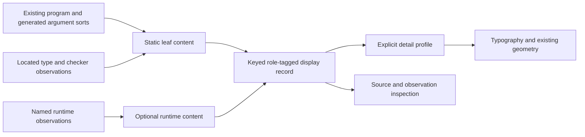

# Graph leaf content and visual meaning

Recommend structured leaf content before additional decorative styling.
Give operations, operands, types, runtime results, and runtime states different named roles.
Keep a small graphical vocabulary and retain exact textual operation identity.
Derive every semantic role from source data or a named runtime observation.
Treat typography choices as hypotheses for reader tasks, not mathematical theorems.

Base: `f25c74f3e2c6acd2bf4ad85c7cbd205dcc8952e0`.
Branch: `codex/graph-semiotics`.
Worktree: `C:/Users/kokok/Dev/lean4-effect4-graph-separation`.
Evidence kind: local literature inspection and primary-text research.
The slice changes no production source and runs no comprehension experiment.
The coordinator requests no additional research agent for this slice.

## Terms

A semantic role identifies the fact that content represents.
A visual variable changes position, size, shape, contrast, hue, orientation, or texture.
Secondary notation supplies grouping or emphasis outside the formal program syntax.
A display profile chooses which details appear at one scale.
Provenance links displayed content to its original source occurrence or runtime observation.
Static content describes syntax or a checked judgment.
Runtime content describes an identified state or recorded event of one run.

## Local sources and their evidence

The initial local search includes ignored research paths in both repositories and the coordinator's worktree.
These exact paths supply useful project context:

| Local path | Useful content | Evidence boundary |
| --- | --- | --- |
| `C:/Users/kokok/Dev/lean4-effect4/docs/research/2026-10-09-visual-language-theory.md` | Fold-derived channels, graph layout, typography, motion | Its literature section explicitly says citations are recalled rather than read |
| `C:/Users/kokok/Dev/lean4-effect4/docs/research/2026-10-12-visual-semantics/README.md` | Picture algebras, constructor marks, types, values, fibers | Its closing section reports search-summary evidence for several sources |
| `C:/Users/kokok/Dev/lean4-effect4/docs/design/design-language.md` | Assigned visual variables and program/run distinctions | Several references use secondary summaries or failed PDF retrievals |
| `C:/Users/kokok/Dev/lean4-effect4/docs/design/string-diagrams-notes.md` | Typed wires, composition, explicit discard | A project interpretation, not a theorem about current Graph routes |
| `C:/Users/kokok/.codex/worktrees/pegs-port/lean4-effect4/docs/research/2026-10-13-tube-language/semiotics.md` | Existing glyph meanings and proposed notation review | A project analysis with recalled literature entries |
| `C:/Users/kokok/Dev/lean4-effect4/vendor/papers/program-graphs/README.md` | Original-paper index, including Lamport | The indexed Lamport PDF is absent in the searched local trees |
| `C:/Users/kokok/Dev/lean4-whatwg-svg/docs/research/2026-10-11-svg-theory/texts/ullrich-demoura-2022-beyond-notations-arxiv-2001.10490.pdf` | Original Lean notation and macro paper | Its abstract and introduction are locally readable |

The original local Lean paper distinguishes syntax extensions, macro expansion, and elaboration.
It addresses hygienic identifiers and reusable abstractions.
It does not establish a preferred graph glyph, typeface, or color mapping.
Source: Ullrich and de Moura, [Beyond Notations](https://doi.org/10.46298/LMCS-18(2:1)2022), and the local PDF above.

The local search finds no original Moody, cognitive-dimensions, or Cleveland–McGill PDF.
The remaining primary texts therefore come from their linked online originals or original-paper mirrors.
No project note supplies primary evidence for a comprehension claim below.

## What the primary literature establishes

### Notation supports tasks

Iverson identifies suggestivity, economy, subordinate detail, and formal reasoning as important notation characteristics.
He connects notation to executable examples and algebraic manipulation.
Source: [Notation as a Tool of Thought](https://www.jsoftware.com/papers/tot1.htm).
Application: make operand details and operation composition inspectable at the same source keys.
This is a design inference, not a claim that APL notation directly solves graph layout.

Larkin and Simon distinguish informational content from the computational work of using a representation.
Their analysis separates search, recognition, and inference.
Locational grouping can reduce search when a task uses information near one location.
Source: [Why a Diagram is Sometimes Worth Ten Thousand Words](https://iiif.library.cmu.edu/file/Simon_box00068_fld05250_bdl0001_doc0001/Simon_box00068_fld05250_bdl0001_doc0001.pdf).
Application: place an operation's operands, type information, and recorded result near its operation label.
Proximity does not establish a new dependency or program judgment.

Green and Blackwell treat role expressiveness, hidden dependencies, visibility, viscosity, and secondary notation as interacting design dimensions.
Their original tutorial does not prescribe one universally best notation.
Source: [Green and Blackwell's original tutorial](https://www.cl.cam.ac.uk/~afb21/CognitiveDimensions/CDtutorial.pdf).
Application: expose which fields are operands and provide explicit dependency inspection.
Keep styling metadata derived so an edit does not leave explanatory labels stale.
Measure how much interaction a local inspection or edit requires.

### Semiotic clarity does not require a glyph for every constructor

Moody's paper states a one-to-one semiotic-clarity principle for constructs and graphical symbols.
It also permits symbol deficit to control graphical complexity and assigns some detail to text.
It identifies tradeoffs among discriminability, graphic economy, and cognitive fit.
Its discussion says semiotic clarity itself lacks empirical validation.
Source: [The Physics of Notations, published-text mirror](https://paperzz.com/doc/8712891/the-%E2%80%9Cphysics%E2%80%9D-of-notations--toward-a-scientific-basis-for), [publisher DOI](https://doi.org/10.1109/TSE.2009.67).
The browser cannot read the publisher endpoint in this run.
The cited mirror serves the paper's published text, not a secondary review.

The local visual-semantics proposal overstates this point when it promotes a total injective constructor-to-glyph table as semiotic clarity.
A total table can check declared coverage.
It cannot establish reader discriminability, semantic transparency, or suitability for a task.
Different display profiles can intentionally omit graphical details while exposing their exact text.
Do not create a separate decorative glyph for every operation merely to satisfy an injective table.
Document the graphics-text boundary and each intentional omission.

### Quantities and nominal roles need different observations

Cleveland and McGill study elementary graphical-perception judgments through theory and experiments.
Their experiments concern quantitative decoding rather than programming-language correctness.
Source: [Graphical Perception, original-paper scan](https://faculty.washington.edu/aragon/classes/hcde411/w13/readings/cleveland84.pdf).
The scan's title and publication metadata are readable.
This run does not extract its full scanned experimental tables.
No numerical accuracy ranking from that scan supports this note.

Application: show exact counts as numerals and quantities with a named scale.
Keep nominal identities in text and keys rather than assigning an unbounded hue per identity.
Use redundant text or shape when hue conveys a role.
These mappings require task evaluation in our graph viewer.

## Current content and its limits

`Program.ownText` in `tools/Tools/View/Program.lean` joins a constructor name with non-child argument text.
`Program.argText` in the same file reads the argument sorts already supplied by the generated layer.
The current line retains an address, but its flattened text does not retain separate operand typography roles.
Use those structured arguments before flattening.
Do not recover operand roles by parsing the displayed string.

`GNode` in `tools/Tools/View/Graph.lean` has `key`, `line1`, `line2`, and `lit`.
Those fields do not say whether the second line is an operand, a type, a result, or a runtime state.
The GraphRegions gallery also uses that line for member counts.
One unconditional second-line style therefore has no unique semantic interpretation.

`Run.stateText` in `tools/Tools/View/Run.lean` classifies observed fiber state with an explicit precedence.
`Run.fiberGraph` draws fibers and recorded fork or waiter relations.
Those are different objects from static operation occurrences.
The run view currently lights recorded fork sites rather than claiming each running fiber's current source address.
Do not attach a running badge to a static operation from a fiber's running flag alone.

`Exit` in `src/Effect4/Machine/Exit.lean` distinguishes a success value from a failure cause.
`Reason` in `src/Effect4/Machine/Cause.lean` distinguishes typed failure, defect, and interruption.
Keep those distinctions in expanded result content.
A static `fail` operation is not evidence that a run has failed.
A frontier or unanswered host choice is not a failure reason.

## Concrete proposed role mapping

The table is an application proposal.
It describes content provenance and suggested redundant visual variables.
It establishes no aesthetic optimum or universal comprehension result.

| Role | Data owner and required observation | Proposed text and visual variables | Reading to exclude |
| --- | --- | --- | --- |
| Operation | Generated constructor or `NativeOp` at an original program address | Prominent exact operation name, stable head position, small family marker | Runtime completion inferred from the operation name |
| Operand expression | Typed `ArgF` argument or addressed `Term` | Named argument rows, code/value face, delimiters retained, expandable expression | An expression shown as its already evaluated value |
| Binder or reference | Binding metadata and exact source address or declared name | Monospace identity, role label, explicit selection link to binding | A name match that invents a binding relation |
| Inferred type | The checked source address's type information | Explicit `type` label, separate text row, secondary contrast with readable minimum | A type presented as a runtime value |
| Expected type or environment requirement | The named typing or row-table judgment | Explicit `expects` or `requires` label, linked provenance | An inferred type or installed service asserted from a requirement alone |
| Runtime success result | Identified run observation carrying `Exit.success value` | `success` label, value inspection row, separate result compartment | A static `succeed` operand presented as an observed result |
| Runtime failure cause | `Exit.failure` and its ordered `Reason` data | Text for fail, die, or interrupt, existing distinct marks, expandable cause list | One generic error symbol that loses reason kind or recorded interruptor |
| Editor refusal | Located checker refusal and its source address | `refused` label, located reason, separate inspector facet | A runtime failure or an unanswered host choice |
| Environment contents | Identified source context or one run's store observation | Labeled adjacent panel with service or binding identities | Region background treated as proof of installed runtime state |
| Static structural edge | Named Flow or Graph producer relation | Continuous connector, direction where needed, inspectable relation label | A data value moving along a wire without a value-flow observation |
| Runtime causal edge | Recorded events with an explicit causal relation | Event identities and direction, separate trace context | Layout order treated as happened-before |
| Control region | Structural owner and explicit membership | Enclosure or labeled bracket, stable member selection, collapse count | Overlapping boxes inferred as membership |
| Runtime state | Named fiber or cell observation in one run | Explicit state word, redundant texture or marker, run identity in inspection | Running, parked, and exited treated as a scalar intensity |
| Selection or focus | Viewer interaction state | Separate outline or focus marker | Selection changing failure, completion, or semantic type |
| Collapsed region | Prepared membership and retained edge provenance | Region name, member count, explicit collapse affordance | A visible path treated as an original path |

Use a prominent operation head and compact named operand rows as the first leaf profile.
Reserve monospace for source identifiers, literals, expressions, and exact values.
Use a consistent readable label face for explanatory role words.
Keep addresses and types inspectable when the overview omits them.
Do not encode mandatory distinctions only by smaller or lower-contrast text.
Define an explicit unknown or unobserved result state.
Show no success or failure badge when the view lacks a runtime observation.

Separate content roles from semantic classes of operations.
A family marker can group related operations without erasing their exact textual identities.
Classification must come from generated metadata or an explicit reviewed table.
Punctuation and argument count do not determine effect semantics.
An operation with two syntax children does not necessarily run two computations concurrently.

## Edges, ordering, and motion

Lamport defines happened-before over actual events and communication, then distinguishes it from chosen consistent total orders.
Source: [Time, Clocks, and the Ordering of Events in a Distributed System](https://lamport.azurewebsites.net/pubs/time-clocks.pdf).
The local paper index exists, but its indexed original PDF is absent in this checkout.
The research therefore reads Lamport's own online paper.

`Graph.ranks` in `tools/Tools/View/Graph.lean` ranks edges selected by the caller's node order.
That layout rank alone does not measure runtime span, simultaneous fibers, or happened-before.
`Flow.layout` in `tools/Tools/View/Flow.lean` records structural layout constraints.
Its static branches do not establish which alternatives execute or which race entrant wins.
The 10-09 note's broader shape interpretations require separate, named event observations.

Connector width currently depends on layout share and the organic style.
Label that observation before readers infer value volume, probability, throughput, or execution frequency from width.
Curved continuity can aid following a connector without changing the relation it represents.
Smoothness and mathematical relation correctness remain separate checks.

Keep generated reveal motion labeled as display motion.
Use runtime state motion only when recorded before/after observations supply its meaning.
Keep source occurrence identity, runtime allocation identity, and displayed representative identity distinct.
Expand a collapsed region through its stored members and edge provenance.
Arbitrary collapse can create quotient-only paths through disconnected members.
The original graph remains the owner of original path queries.

## Small architecture slice

Introduce a first-order leaf-content record beside the current Graph adapter when a producer and renderer consume it.
It contains an operation identity, keyed role-tagged fields, and separately optional runtime observations.
It stores no Lean function or second program syntax.
The generated layer supplies static field roles.
The run producer supplies runtime fields through an explicit attachment relation.
The renderer selects a display profile after semantic content is already prepared.

The first adapter can continue emitting the existing two text lines for compatibility.
The richer renderer can then consume the same prepared content without reparsing text.
Keep role declarations separate from font-family and palette tokens.
Style changes must not change source identity, role identity, or observation provenance.
Keep the existing graph and program owners.

## Evidence to request before broader styling

Use tasks that match the proposed roles.
Ask a reader to identify an operation and its operands at normal panel width.
Ask the reader to distinguish an operand expression from a recorded result.
Ask the reader to locate a binding and inspect a type disagreement.
Ask the reader to distinguish typed failure, defect, interruption, refusal, and live frontier.
Ask the reader to inspect a collapsed edge's original occurrences.
Compare task accuracy and interaction count across the current and proposed profiles.
Record the exact specimens, fonts, zoom, theme, and panel size.
Check monochrome and reduced-motion observations separately.

Before those measurements, keep comprehension claims as design hypotheses.
Finite metadata checks can establish coverage, source lookup, role provenance, and identity retention.
They cannot establish perceived clarity or beauty.
Any later proof needs a named consumer and placement under R14's view-navigation observation.
This note introduces no new proof statement or semantics registry status.

## Receipt

The slice owns only `docs/research/2026-10-13-graph-semiotics-research.md`.
The local search checks both original repositories and the coordinator's research tree.
The local PDF read uses text extraction on the original Lean notation paper.
Primary web readings supply absent visual-notation and causal-order originals.
The scan limitation and publisher retrieval failure remain explicit above.
No secondary summary substitutes for an unread experimental result.
The repository language and whitespace checks run before the explicit-path commit.
Both checks report no finding.
No production edit, Lean build, dependency update, or push occurs.
