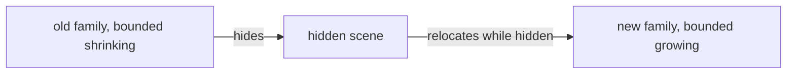

# 2026-10-13 graph separation plan

Status: design and proof placement, not a production policy ruling.
Base: `26436e79195664380bf7861c307395e093e91e48`.
Branch: `codex/graph-separation`.

The producer must hide the whole scene during relocation, including its routes, marks and regions.
Hiding only node boxes does not hide the drawing.

## Fence

The slice owns `tools/Tools/View/GraphSeparation.lean`, `tools/view/GraphSeparationProbe.lean`, and this plan and receipt.
It changes no `Graph`, `Motion`, `GraphMotion`, library root, test root or coordinator file.
The carrier is the kit's `IBox`; the module introduces no graph or program representation.

## API

`firstOverlap` reports the first pair of allocated box occurrences that fails `IBox.Disjoint`.
`checkClear` observes its absence.
`firstFrameOverlap` reports the first failing supplied frame and pair.
This finite profile establishes no absence of collisions between supplied moments.

`movingEnvelope` contains every box whose origin stays between the endpoint origins and whose dimensions do not exceed their maxima.
It expands the maximum endpoint width and height over the interval of origins.
The ordinary endpoint hull can miss a target width used before movement ends.
`firstSweptOverlap` compares these conservative envelopes.
It can report false positives; an overshooting origin or size lies outside its premise.

`FallbackPhase` has three constructors: `old grow`, `hidden`, and `new grow`.
`fallback` shrinks at old positions, hides during relocation, then grows at new positions.
Its per-mille factors stay between zero and the rest size.
`envelopes` selects one endpoint family's allocated boxes, or no boxes while hidden.
The integration must keep every visible node inside its selected envelope.
The module claims nothing about routes or painted stroke margins.

## Placement before proofs

- Concept: `initial-algebras-folds`, concept 7; property: a finite checker agrees with its named box-separation observation.
- Question: proposed tool observation `graph-transition-box-separation`, role decidability, under row 334 (3).
  Consumers: `GraphMotion.prepare` and the driver's transition policy metadata.
- Reach: finite box occurrence lists, kit `IBox.Disjoint`, supplied frame profiles and bounded movement envelopes.
- Does not establish: between-sample clearance, unrestricted easing, connector simplicity, scheduler behavior or semantic dependency.
- Unlocks: R14 edit previews that select a conservative explicit transition policy.

The helpers `firstAgainst_none_iff` and `firstOverlapFrom_none_iff` serve `checkClear_iff`.
`firstFrameOverlap_none_iff` transfers that observation to a supplied finite profile.
`movingEnvelope_contains` supplies the integration's geometric premise without assuming a particular easing implementation.
`fallback_growth_le`, `fallback_endpoint_family`, and `fallback_clear` serve the explicit relocation policy.
The last law assumes both endpoint envelope families already pass the separation judgment.
No proof describes arbitrary all-input motion as collision-free.

The phase order moves no box while it is visible.
It establishes no route-separation claim.

## Verification

Build `Tools.View.GraphSeparation` with `LEAN_NUM_THREADS=3`.
Compile and run `tools/view/GraphSeparationProbe.lean`.
Audit the module and probe with `#axiom_audit` at `[propext, Quot.sound]`.
Controls cover swaps, safe translations, touching boxes, maximum-size envelopes, false positives and unsupported overshoot.
The receipt records exact results and the integration boundary.
