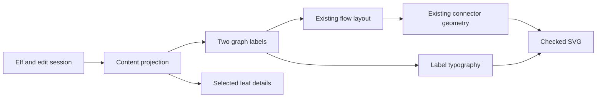

# Graph leaf typography study

The study separates source content, label presentation, and graph geometry.
`Eff` remains the program representation.
`GraphContent` projects constructor arguments and typing observations from existing program data.
It stores no child program.

## Reading task

The overview identifies operations and their structural connections.
The selected leaf reveals ordered arguments, its typing observation, and its source address.
An argument expression is not an evaluated runtime value.
A displayed type is not a completed execution result.
A typing refusal stays distinct from a program failure.

The study compares the existing two lines with separated operation and argument lines.
A second detail mode shows the typed observation below the operation.
The inspector retains full text when the graph label truncates.
An absent observation is explicit.

## Ownership

The graph keeps its existing box dimensions and connection rules.
The text painter accepts row faces and clips each row to its allocated room.
The default painter retains existing cell labels.
The study uses the vendored fonts and records browser checks as host evidence.
No font measurement becomes a theorem about rendered glyphs.

## Evidence

The content lane checks address and text agreement on the existing flow specimens.
The research lane reads local semiotic references and traces claims to primary literature.
The typography lane checks the pinned SVG library and both output paths.
The gallery compares real program projections in dark, paper, and monochrome views.
The browser checks graph overviews, selected leaves, long labels, and a narrow viewport.

## Limits

The specimens include programs that fail the typing checker.
Their structural graph remains inspectable, with the refusal visible.
The study defines no runtime status encoding or workload scale.
Detailed node height and compound boundary routing remain separate layout questions.

## Proof placement

This slice adds passive content and styling data with finite controls.
It makes no new program judgment or equal-observation claim.
Any additional tool law needs placement under concept 7 and R14 before its statement.
