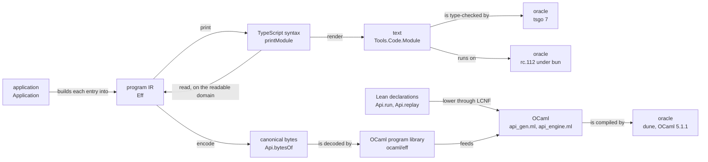
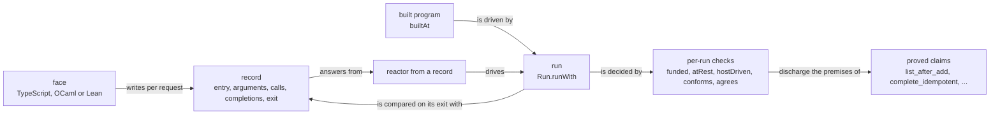

# 2026-10-13 The TypeScript and LCNF routes end to end: their evidence, and one vertical slice

A read-only scout note. Base: branch `refactor/phase1-phase3` at `38a784c86`. No `lake build`,
no `make` and no host run took place. Every finding is reading unless its line names another
evidence word (`docs/core/controlled-english.md` §3.8).

## The one thing to know first

The to-do application is proved and run in Lean only. No route has carried it to a target. Its
printed TypeScript has never met tsgo 7 or rc.112, and the generated OCaml engine has never replayed
it. The seat CLAIMS receipt states this (`docs/research/2026-10-13-seat-claims-receipt.md`,
section "Evidence").

The tree already holds the piece that carries the to-do's theorems to a real run. `agrees` and
`conforms` (`src/Effect4/Laws/Program/Validated.lean`) decide, on one recorded run, the premises
of `agrees_hostRun` and `conforms_sat`. So the smallest real slice records each face's host
answers, and Lean decides those premises run by run.

## Question

The owner, 2026-10-13: the team has spent its time on authoring and proofs and "really still
hasn't gotten into the lowering stuff much". The owner wants the big picture as a vertical slice:
build something real, end to end, and verified where it counts. This note answers five parts.

1. Which routes exist, with their declarations and `make` targets.
2. What each route proves, what an outside oracle checks, and what neither covers.
3. What a real application needs end to end, on the to-do application.
4. How much of the printer's conformance backlog blocks shipping printed code.
5. The smallest vertical slice, its steps, files, evidence and cost.

## What was read

| Source | What it gave |
| --- | --- |
| `Makefile`, the `check-*` rules and `build_imports` | each gate's command and inputs |
| `scripts/check-conform.py`, `scripts/check-host-protocol.py` | the compiler checkpoint; the keyed lane's scenario list |
| `docs/core/lcnf-route.md`, `ocaml/README.md`, `ocaml/STANDARDS.md`, `ocaml/gen/roots.json` | the LCNF route, its roots and its owed items |
| `ocaml/engine/e4_engine.mli`, `ocaml/engine/test/scenarios/test_scenarios.ml`, `ocaml/engine/test/test_diff.ml` | what the engine runs and compares |
| `src/Effect4/Codegen/Print.lean`, `src/Effect4/Codegen/PrintLeaf.lean`, `src/Effect4/Codegen/Checked.lean`, `tools/Tools/Code/Module.lean`, `tools/Drivers/Emit.lean` | the printer, the emission and the shipped-module tool |
| `src/Effect4/Laws/Codegen/*`, `src/Effect4/Laws/Api/ModuleReadable.lean` | the printer's laws |
| `harness/truth/result.md`, `harness/truth/prelude.ts`, `harness/truth/session/*` | the truth lane, the prelude, the keyed lane |
| `Test/Dogfood/Scenario/Todo.lean`, `Test/Dogfood/Scenario/Todo/Claims.lean`, `Test/Dogfood/Scenario/Todo/Tree.lean`, `src/Effect4/Program/Authoring/Application.lean` | the to-do application and its claims |
| `src/Effect4/Run/Basic.lean`, `src/Effect4/Run/Live.lean`, `src/Effect4/Laws/Api/HostDrive.lean`, `src/Effect4/Laws/Program/Validated.lean` | the host drive and the per-run checks |
| `docs/research/2026-10-09-js-semantics-audit.md`, `docs/research/2026-10-13-backlog-deep-dive/README.md` | the printer's hazards; the lowering backlog |
| `docs/core/system-map.md` §8, `docs/core/semantics.md` §2.10, `docs/core/decisions.md` rows 28, 29, 31, 108, 254, 263, 307, 373, 375 | requirements, concept 10, rulings |

## 1. The routes

A route here is a named stage from a program, or from the machine that runs it, to a target
(the dictionary's lowering). Two routes leave Lean, and they translate different things.

- **The TypeScript route prints the program.** `Eff` becomes TypeScript syntax, then text.
- **The LCNF route lowers the machine.** Lean declarations become OCaml. A program stays data,
  read from its canonical bytes.

The diagram shows which value each stage takes and gives. It claims no agreement between stages.

| Route | Input to output | Declarations and files | Status |
| --- | --- | --- | --- |
| Print | `Eff` to TypeScript syntax | `printT` (`src/Effect4/Codegen/Templates.lean`); `printModule` (`src/Effect4/Codegen/Print.lean`); `printTyped` (`src/Effect4/Codegen/PrintTyped.lean`) | exists, with laws |
| Emit | a checked program to a module with a receipt | `Api.emitModule`, `ModuleEmission` (`src/Effect4/Codegen/Checked.lean`); its docstring: "supplies no imports" | exists |
| Shipped module | a module laid out at 120 columns, with exact imports | `Tools.Code.Module` (`tools/Tools/Code/Module.lean`); driver `tools/Drivers/Emit.lean`, named by no `make` target | tool code |
| Read | TypeScript syntax to `Eff` | `readEff`, `readModule` (`src/Effect4/Codegen/Read.lean`); `ts/eff/read.ts`, a hand port over oxc | exists, with laws for Lean's |
| Run on rc.112 | printed text under bun | `harness/truth/run-truth.ts`; `harness/truth/session/run-keyed.ts` | tested lanes |
| LCNF | Lean declarations to OCaml | `translateClosure` (`src/OCaml5/Lcnf/Translate.lean`); `builtins` (`src/OCaml5/Lcnf/Builtins.lean`); roots in `ocaml/gen/roots.json` | exists, no theorem |
| OCaml program library | canonical bytes to OCaml values | `ocaml/eff`, generated by `src/OCaml5/Tools/EffGen.lean`, not from LCNF | exists |
| OCaml engine | the generated machine over a decision tape | `E4_engine` (`ocaml/engine/e4_engine.mli`) | exists; answers no host call |
| Lean, compiled | the machine as Lean's native code | the batteries load it natively (row 327) | runs batteries only |
| C player | the view's frames | `tools/view/play.c` (row 363 (5)) | runs no program |
| LCNF to TypeScript | the machine to TypeScript | `docs/core/lcnf-route.md` §4; rows 29 and 31; DI-88 | not started |

The `make` targets that test a route against an outside implementation:

| Target | What runs | Oracle |
| --- | --- | --- |
| `check-target` | the truth modules' answer, error and requirement types; the row types; the assignability vectors | tsgo 7 |
| `check-ts-reader` | `ts/eff/read.ts` on the corpus and the truth modules, against Lean's reader | Lean's reader |
| `check-corpus` | each corpus program printed, type-checked and run, against the machine | tsgo 7, rc.112 |
| `check-tsdiag` | the corpus under tsgo, against `Api.explain` | tsgo 7 |
| `check-truth` | the truth programs printed and run under bun, against the machine | rc.112 |
| `check-host-protocol` | the keyed lane: five scenarios' printed modules under a scripted host; Lean replays each recording | tsgo 7, rc.112 |
| `check-schema-codec`, `check-schema-ts` | `Ty.encode` against `Schema.toCodecJson`; the Schema generation | rc.112 |
| `check-compiler` | the normalization closure, lowered, compiled by `ocamlopt` and run; three emitted-code mutations | OCaml 5.1.1 |
| `check-native` | Lean's native data layout, reflected | none: it runs no program |
| `check-ocaml` | dune build and tests of `eff`, `gen`, `clock` and `engine`, and `gen-check.sh` | OCaml 5.1.1 and Lean's fixtures |

## 2. What each route proves, checks or leaves open

### 2.1 The TypeScript route

Every printer law is a statement about syntax trees. Each docstring says it does not establish
that tsgo accepts the module or how rc.112 runs it.

| Evidence | Statement | Where |
| --- | --- | --- |
| proved | the reader gives a readable program back from its print | `read_print` (`src/Effect4/Laws/Codegen/ReadPrint.lean`) |
| proved | what the reader accepts is a print | `read_exact` (`src/Effect4/Laws/Codegen/Read.lean`) |
| proved | a readable program prints | `src/Effect4/Laws/Codegen/PrintReadable.lean` |
| proved | a module with a definition block reads back | `readModule_printModule_defs`, `printModule_roundTrip` (`src/Effect4/Laws/Api/ModuleReadable.lean`) |
| proved | the typed print erases to the print, and reads back after the erasure | `printTyped_eq_print`, `eraseJoinArgs_printTyped`, `readTyped_printTyped` (`src/Effect4/Laws/Codegen/PrintTyped.lean`) |
| proved | an emitted module passes the reading boundary | `ModuleEmission.admit` (`src/Effect4/Laws/Codegen/Admit.lean`); `emitModule_erasure` (`src/Effect4/Laws/Codegen/Checked.lean`) |
| proved | the house print is a fold, and the layout flattens to it | `render_eq_expr`, `flat_fold_expr` (`tools/Tools/Code/TypeScript.lean`) |
| proved | the Schema bridge and the JSON codec are exact | `ofSchema_exact` (`src/Effect4/Schema/Bridge.lean`); `decode_iff` (`src/Effect4/Laws/Schema/Codec.lean`) |
| tested | the truth programs agree with rc.112 | `harness/truth/result.md`, last line: "PASS: 81 programs agree on exits, schedules and sync exits; 12 signed divergence(s)" |
| tested | the corpus, its types and its diagnostics agree, outside a listed set | `harness/truth/corpus-known-differences.md`; `generated/tsdiag-agreement.tsv` |
| tested | the target-order model agrees with tsgo on recorded pairs | `src/Effect4/Laws/Codegen/TargetOrder.lean`; `generated/assignability.tsv` |
| tested | the prelude's atoms agree with `NativeAtom` on self-test cases | `harness/truth/prelude.ts`, `selfTestCases` |
| neither | that the text parses to the printed tree | no Lean reader of text exists (J9); the house prints with no precedence (J1) |
| neither | a refusal outside the profile on the TypeScript face | no lane records one (row 322 (4)) |
| neither | the schedule of a host call | Lean parks each call and rc.112 answers inline: a signed divergence (row 343) |

### 2.2 The LCNF route

| Evidence | Statement | Where |
| --- | --- | --- |
| proved, of the Lean definitions only | the frame machine and the reference machine agree at every row table; M7 on its fragment | `run_eq_ref_table` (`src/Effect4/Laws/Program/Table/Agreement.lean`); `m7_proved` (`src/Effect4/Laws/Program/Typed/Commands/Clauses/All.lean`) |
| none | that the OCaml code means what the Lean definitions mean | `src/OCaml5` declares no theorem; row 28 is open |
| tested | the normalization closure, compiled, agrees with fixtures; three mutations fail | `make check-compiler` (`scripts/check-conform.py`) |
| tested | five scenario fixtures replay on the generated `api_replay`, view by view, on the Fast and Ref instances | lane S, `ocaml/engine/test/scenarios/test_scenarios.ml` |
| tested | three OCaml engines agree with each other over three corpora | `ocaml/engine/test/test_diff.ml` |
| neither | the corpus against Lean's recorded runs | `test_diff.ml`: "reported, not gated" |
| neither | the LCNF evaluators against compiled Lean on 20,387 vectors | produced once; no target runs it (`docs/core/lcnf-route.md` §3) |
| neither | an OCaml host that answers a parked call | owed (`ocaml/README.md`, "Owed"); DM7 and HC-7 come after the share (row 373 (2)) |

Row 373 (4) rules the claim for the first share. The Lean definitions carry the theorems, the
LCNF route carries rule coverage and gated differentials, and the trust boundary is named. The
target is a proved stage law at `Api.replay`, which stays on the plan.

## 3. The to-do application, end to end

The owner named the to-do application the centre of the dogfooding (row 307 (8)). The evidence
supports that choice. It has data, host rows, typed failures, four entries, declared protocols,
a reference model and five claims. The routing scenario is its nearest neighbour. Routing
already runs on the three scenario lanes: the faces battery, the keyed lane and lane S.

| Step | Today | Evidence | Where it breaks |
| --- | --- | --- | --- |
| Author | `Todo`, `NotFound`, `SqlError`, `EmptyTitle`; rows `TodoRepo`; entries `add`, `list`, `complete`, `remove`; `application` | reading (`Test/Dogfood/Scenario/Todo.lean`) | `eq` has no type at two Booleans, so `sameFlag` spells it |
| Check | each request builds at the guarded types | tested (`#guard` in `Todo.lean`) | — |
| Claims | `complete_failure_escapes`, `complete_answers_requested`, `list_after_add`, `complete_idempotent` | proved | `add_empty_calls_nothing` and `serves` rest on the planned goal `request_leads` (`src/Effect4/Laws/Run/CallTree.lean`) |
| Run in Lean | scripted runs, and runs driven by the reference model `repository` | tested (`runsOf`, `Todo/Claims.lean`) | — |
| Print | each request prints and reads back, as `main`, at a literal argument | tested (`printedOf`, `Todo.lean` §5) | the four entries never print as one module |
| Export names | — | reading (`Todo.lean`, module docstring) | the module printer refuses `add`, because a module imports the atom `add` |
| tsgo 7 | never run on a to-do module | reading (the CLAIMS receipt) | not on any lane |
| rc.112 | never run | reading | not on the keyed lane's list (`SCENARIOS`, `scripts/check-host-protocol.py`) |
| Host rows in TypeScript | a printed call is `TodoRepo.insert(a0)`, a free name (`printRow`, `src/Effect4/Codegen/PrintLeaf.lean`) | reading | only a harness header binds it (`scenarioRows`, `harness/truth/session/keyed-bindings.ts`); `Tools.Code.Module`'s allowed origins hold no row namespace, so its reading boundary would refuse the module as `unbound` (reading, not run) |
| Prelude | the printed module imports atoms and helpers from `harness/truth/` | reading | no package; `prelude.ts` also loads sqlite, the key-value store and reactivity |
| Inputs | — | reading | row 373 (11) rules decoding by the printed Schema; not landed |
| Real SQLite | the package rows `Sql.open`, `unsafe`, `Sql.close` cross JSON-text cells (`src/Effect4/Program/Packages/SqliteBun.lean`) | tested on the truth lane (`pSqlite`) | decoding a row set into a record inside a program is open (row 123); the to-do uses abstract rows instead |
| OCaml replay | — | reading | not in lane S's fixtures (`committed`, `Test/Dogfood/Scenario/Lowered.lean`) |
| OCaml host | — | reading | no host loop answers a parked call; no driver runs an application |
| HTTP | — | reading | none |

## 4. The printer's conformance backlog and shipping

The JavaScript audit (`docs/research/2026-10-09-js-semantics-audit.md`) places J1 to J9 as laws.
None is proved. ECMA-262 is vendored (`vendor/ecma262-es2026/`, slice J9's input). A finite probe
found none of the hazards in the eight corpus modules, so the audit calls them latent.

| Item | What | Blocks the slice | Blocks a universal claim about printed text |
| --- | --- | --- | --- |
| J1 | precedence from ECMA-262's grammar | no: the shipped bytes are type-checked and run | yes: a conditional or lambda as a callee changes meaning silently |
| J2 | a statement's first token, automatic semicolons | no | yes |
| J3 | `eval`, `arguments`; reserved members | no: program variables print as `a0`, `a1` | yes |
| J4 | integer-like keys enumerate first | no: the to-do's records have word keys | yes, for records and schemas |
| J5 | readable numbers | no: the to-do has naturals only | yes, for floats |
| J6 | control characters in strings | no: titles arrive as inputs, not literals | yes |
| J7 | empty type arguments | no | yes |
| J8 | source maps | no | no; it serves a person debugging the shipped file |
| J9 | a Lean reader of the printed text | no | yes: it is the credential |
| F2 | the layout differs from the house print only in whitespace | no, if the gates run on the shipped bytes | yes, while the gates read the house print and a person ships the layout |

So the backlog blocks no first slice. The condition is that tsgo and bun run the exact bytes a
person ships. J1 comes first after the slice, because the module becomes a file people read and
edit. `E4-PRINT-CE-001` (row 346) can still refuse a union of pairs at tsgo. The to-do's errors
are unions of pairs, and no lane has checked them.

## 5. The gaps, ranked by how much they block a real application

1. **No application module.** The printer prints one request at a time, as `main` at literal
   arguments. No module exports the four entries as functions of their inputs: the
   application's slice 13 (`docs/research/2026-10-07-packet-application-claims.md` §4.7). The
   export name `add` is refused. Inputs are not decoded (row 373 (11), ruled, not landed).
2. **Host rows have no binding in an emitted module.** A row prints as a call of a free
   namespace. Only the keyed lane's header binds it, typed by `bindingsType`
   (`harness/truth/session/Keyed.lean`), a harness function. A person has no printed interface
   to implement, and the TypeScript face admits no host answer at run time.
3. **The runtime prelude lives in the harness.** `Api.emitModule` supplies no imports.
   `tools/Drivers/Emit.lean` copies four prelude files, and no `make` target runs it.
4. **OCaml answers no host call, and the LCNF stage has no law.** The engine replays decision
   tapes. No host loop, no application driver and no path from an OCaml run back to Lean exist.
   Row 28 is open, and the vector differential runs nowhere.
5. **The to-do has met no outside oracle.** No lane type-checks, runs or replays it. The cost is
   hours, and it shows the to-do's own print defects before anything builds on them.
6. **SQL is outside the language.** The repository is a host adapter, and only its answers can
   be checked. Decoding a row set into a record is row 123.
7. **The printer's conformance laws are unproved.** Section 4: no block for a slice whose shipped
   bytes are the checked bytes.

## 6. The proposed slice: the to-do application on three faces

### 6.1 The verification design

Each face runs the to-do against a host and keeps one record per request. A record holds the
entry, its arguments, each host call's row and request, the host's completion, and the exit. Lean then checks each record
with code that exists today:

1. Rebuild the request's program: `builtAt name args` (`Test/Dogfood/Scenario/Todo.lean`).
2. Drive it with `Run.runWith` (`src/Effect4/Run/Basic.lean`) and a reactor that answers from
   the record. The reactor refuses a call whose row or request differs from the record's.
3. Compare the exit with the face's exit.
4. Decide `funded` and `atRest` (`src/Effect4/Run/Tape.lean`) and `hostDriven`
   (`src/Effect4/Laws/Api/SessionMeaning.lean`) on the run.
5. Decide `conforms application.protocols` and `agrees repository start`
   (`src/Effect4/Laws/Program/Validated.lean`), threading the model's state across requests.

Where every check passes, the proved claims hold of Lean's run of that record. `conforms_sat`
and `agrees_hostRun` turn the decided premises into the claims' premises. The application record
already grades these premises `validated`: a decision on one run's journal
(`Test/Dogfood/Application.lean`). The diagram shows the order of the checks. It claims nothing
about a run that no check read.

### 6.2 The steps, in order

| Step | What | Files | Evidence it adds | Cost |
| --- | --- | --- | --- | --- |
| V1 | Put the to-do on the existing lanes, as routing is | `harness/truth/session/Keyed.lean` (a `Wire` over `Test.Dogfood.Scenario.Todo.scenario`); `scripts/check-host-protocol.py` (`SCENARIOS`); `Test/Dogfood/Scenario/Tape.lean` (`taken`); `Test/Dogfood/Scenario/Lowered.lean` (`committed`); `ocaml/engine/test/scenarios/todo.txt` (written by `write.lean`) | tested: tsgo 7 accepts each printed request; rc.112 performs each named run; Lean replays each recording; the generated `api_replay` shows Lean's view at each position | S |
| V2 | The application as one module: each entry an exported arrow from its parameter | `src/Effect4/Program/Authoring/Application.lean` (the entries as a definition block); `src/Effect4/Api.lean` (one emission entry for an application); `Test/Dogfood/Scenario/Todo.lean` (rename `add`, or qualify the prelude's import) | proved: the module reads back, an instance of `readModule_printModule_defs`; `ModuleEmission.admit` | M |
| V3 | The runtime surface, from Lean data | `src/Effect4/Codegen/` (a new module: the rows' bindings interface, moved from `bindingsType`; the inputs' and answers' Schemas); `tools/Tools/Code/Module.lean` (imports a host module and the prelude package); `ts/prelude/` (the generated atoms, records, tuples and control, without sqlite) | tested: tsgo 7 checks a host adapter against the printed interface; proved in Lean: Schema and codec exactness; tested: the Schemas against rc.112 (`check-schema-codec`) | M |
| V4 | A real host and the per-run check | `apps/todo/` (the emitted module, a hand `TodoRepo` over `@effect/sql-sqlite-bun`, a Bun server, a recorder); `tools/Drivers/` (the checker of §6.1, importing the law graph) | tested: SQLite answers; decided per run: §6.1's checks; red control: an adapter that forgets a write fails `agrees`, as the `forgetful` reactor does today | M |
| V5 | OCaml, natively | `ocaml/engine/e4_host.ml` and `.mli` (evaluate; at a parked call ask a reactor, apply the answer, flush; write the record); `ocaml/app/todo/` (reads the built programs' bytes and the row table; a repository) | tested: OCaml runs the to-do; decided per run: §6.1's checks on the OCaml record, unchanged | M; L if the repository is `repository` lowered through LCNF |
| V6, after | The stage law | lower `Run.runWith` through LCNF (DM7, HC-7); wire the vector differential to a target; prove the LCNF stage on its closure (row 28) | would make `runWith_denotes` a statement about the code OCaml runs | L |

V1 comes first because it costs hours and exercises the to-do's own print against tsgo before V2
builds on it. V4 is the step the owner asked for: a running application whose claims hold of the
runs that people make. V5 reuses V4's checker unchanged, so the third face costs a host loop.

### 6.3 What the slice proves, decides, tests and leaves open

| Kind | Content |
| --- | --- |
| proved, once, for every run | the to-do's four proved claims; `agrees_hostRun`, `conforms_sat`; `denoteRows_eq_session_host`; `replay_at_call_instance` (`src/Effect4/Laws/Api/Live.lean`); the module round trip; the Schema and codec exactness |
| proved modulo a planned goal | `add_empty_calls_nothing` and `serves`, through `request_leads` |
| decided per run, exact for that run | the record replays to the face's exit; funded, at rest, driven by a host; conforms to the protocols; agrees with the model |
| tested, finite | tsgo 7 accepts the module and the adapter; rc.112 and OCaml run the requests; lane S's views; SQLite's answers |
| assumed | rc.112, bun, SQLite, OCaml 5.1.1 and the LCNF route behave on unrecorded runs as on recorded ones |
| unchecked | the text against the printed tree (J1, J9); the prelude's atoms past their self-test cases; the HTTP glue; progress: no claim says that a request finishes |

What the slice does not establish:

- A decided premise holds of one recorded run. It says nothing of a run that no check read.
- The face agrees with Lean's run on the exit and the calls only. Its schedule, fibers and
  timing stay unobserved.
- `list_after_add` and `complete_idempotent` hold under the reference model. They hold of the
  SQLite runs only where `agrees` decides that SQLite answered as the model does.
- The host boundary stays where `docs/core/host-boundary.md` puts it. The adapter is host code.

## 7. The placement of the slice's obligations

`AGENTS.md` asks five fields before an obligation is worked. The slice adds no new theorem until
V6. One statement is optional in V2.

| Field | V2's optional statement: an exported entry is its applied program |
| --- | --- |
| Concept | `translation-simulation` (`docs/core/semantics.md` §2.10) |
| Question | a planned goal under PROC-6's inlining law (STATE's authoring line); consumer: a claim about the module as a whole |
| Reach | the application's block, each definition at a value of its parameter type, the empty requirement row |
| Does not establish | that tsgo or rc.112 agree; V4's per-run check needs no such law, because Lean rebuilds `builtAt` from the record |
| Unlocks | R8 (faces as named connections) for a module with several exports |

V4's checker is a tool over existing theorems. Its consumer is R6's open part "the public typed
guarantee for programs using host services" (row 99), at one application and per run.

## 8. Questions for the owner

1. **Host rows in a shipped module** (representation). Option A: a printed bindings interface and
   an import from a host module, the keyed lane's spelling. Option B: each row namespace an
   Effect service, so the requirement column names it. B is Effect's idiom and changes printed
   types and R5's open parts. The recommendation is A for the slice, and B after a ruling.
2. **The OCaml repository** (representation). A hand OCaml host, or `repository` lowered through
   LCNF. The second keeps the rule that OCaml is made from LCNF. It is also the definition
   the claims quantify over, at the cost of a new root and a moved generated file.
3. **Where the application lives** (domain). `apps/todo/` beside `ocaml/` and `ts/`, or under
   `Test/Dogfood/`. A shipped example wants the first.

## What this does not establish

- Nothing here ran. The `unbound` refusal of an emitted to-do module is a reading of
  `allowedOrigins` (`tools/Tools/Code/Module.lean`), not a run.
- The costs are estimates by reading, with S as hours, M as about a day and L as several days.
- The ranking weighs one goal, a running application. Another goal, such as the share's Lean
  audience, ranks J9 and row 28 higher.
- The gate markers under `.lake/check` were not read as a status: `make status` measures that.
