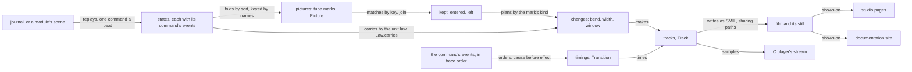
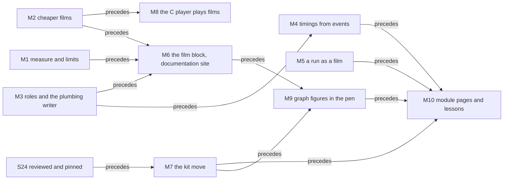

# 2026-10-13 Motion everywhere: one pipeline from a run to a film

Status: research note (history, not authority). Base: `10d1a7d7b` on `refactor/phase1-phase3`.
Seat MOTION wrote it from its brief (`docs/research/2026-10-13-seat-motion-plan-brief.md`). It
plans work and changes no code.

**The one thing to know first.** Only the Queue's plumbing, places and timings belong to the
Queue. The tube, the pen, the keyed match, the unit law and the film writer already take any
program. Three pieces are missing: a fold from machine states to tubes, a role table per module,
and timings read from the trace. For the docs, cost comes first. The crotch's sampled search holds
about two thirds of the generation's samples. S24's blend, now committed in the kit's worktree,
needs no search. Path data holds 89.5% of the large Queue film's animation bytes. Wave 1 (M1, M2,
M3) measures the cost, reduces it, and frees the plumbing from the Queue.

## Question

How does every construct of a program, and every figure of the docs, get a picture and a film
from the Queue's parts?

## Words this note uses

The dictionary (`docs/core/controlled-english.md` §3) has no entry for the view's words. Seven of
its words mean something else there, so this note uses the words below.

| Word here | Meaning | The word it avoids, and why |
| --- | --- | --- |
| picture | one drawing of one moment, as SVG | — |
| film | pictures played one beat each, each step written as SMIL `animate` elements (`film`, `tools/Tools/View/Tube/Motion.lean`) | — |
| still | a film's last picture, shown in its place to a reader who prefers reduced motion (`filmFigure`, `tools/Tools/View/Tube/Sheet.lean`) | — |
| step of a film | the change from one picture to the next, one beat long (`Picture.step`) | the machine's step is `driveStep`'s |
| beat | the time of one machine command or decision in a film (row 367 (10)) | — |
| moment | one sample of a step; a change is sampled at 21 (`MOMENTS`) | "frame": the dictionary's frame is the machine's |
| keyed match | the kit's `join` of two pictures by key: what enters, what is kept, what leaves; d3 calls it a data join | "join": the dictionary's join is a type's least upper bound |
| junction | two bodies that meet as one solid, a tee or a wye (the pen's `Join`) | "join", as above |
| contents state | what the inside of a body shows: units, a promise, a level; `fills.html` calls it a "fill" | "fill": the dictionary's fill puts a program at an address |
| paint order | the pen's order of drawing: bodies, interiors, partings, contents, hollows (`BODIES` to `HOLLOWS`) | "layer": the dictionary's layer builds services |
| staff | the line of one fiber in the score of a run | "lane": the dictionary's lane is a check pipeline |
| picture writer | a module or driver that writes pictures | "producer": the dictionary's producer writes a generated group |
| size limit, time limit | a bound on a page's bytes or on its writing time | "budget": the dictionary's budget is fuel |

## What was read or run (each with its evidence word)

Each item names its evidence word first.

- **Reading.** The brief, and the tube language's notes in
  `docs/research/2026-10-13-tube-language/`: `README.md`, `glyphs.md`, `semiotics.md`,
  `algorithms.md`, the two kit briefs and `gemini-fills-prompt.md`.
- **Reading.** Gemini's note on contents states, `fills.md` in the same folder. The coordinator
  committed it at `360f58acc`, byte for byte the version read here (finite probe: `cmp`).
- **Reading.** Every module of `tools/Tools/View/Tube/` in full, and `Glyph.lean`. The headers of
  the other view modules, of `tools/Tools/Document/` and of `tools/Tools/Site.lean`. The drivers
  `tools/Drivers/View.lean` and `tools/Drivers/GlyphSheet.lean`, and the script `tools/view/v`.
- **Reading.** The kit at its pin `eac9121` (`.lake/packages/whatwg/`): the tube modules of
  `Whatwg/Svg/Geometry/`, the headers of every module of `Whatwg/Svg/Scene/`, and the writers
  `Whatwg/Html/Node/SvgSmil.lean` and `SvgMotion.lean`.
- **Reading.** The kit's S24 design note: §5.17 of `docs/SVG-PACKAGE-PLAN.md` in the kit's
  worktree `~/Dev/lean4-whatwg-svg`, at `3d4a3f1`. Then the headers of S24's modules as committed
  there by 08:43 (`a135fcc` to `2b3bda5`): `Tube/Blend`, `Coalesce`, `Bulge`, `Route`, `Comb` and
  `SvgInspect`. They are not reviewed, and Effect4 does not pin them.
- **Reading.** The design notes of 2026-10-09 to 2026-10-12 that the brief names; decisions rows
  336, 337, 354 and 360 to 370; `docs/core/semantics.md` §2; `docs/core/machine-state.md`; and
  `docs/STATE.md`.
- **Reading.** The machine's data: `RunMachine`, `RunEvent` and `RunDecision`
  (`src/Effect4/Machine/Fibers.lean`), `FrameEvent` (`src/Effect4/Machine/Frames.lean`) and
  `FrameMove` (`src/Effect4/Laws/Program/FrameMoves.lean`). The cells and models of the composed
  modules under `src/Effect4/Library/`.
- **Reading.** The native operations (`NativeOp`, `src/Effect4/Program/Native.lean`), the scope
  and timer modules of `src/Effect4/Machine/`, the host session and its protocol, and the run
  (`src/Effect4/Run/Basic.lean`).
- **Reading.** The forms table of `src/Effect4/Codegen/Forms.lean`, and the P1 battery's
  `timeoutForm` (`Test/Dogfood/P1HttpCache.lean`).
- **Reading.** The prototypes `physics.html`, `fills.html` and `ratios.html` in
  `tools/view/out/proto/`.
- **Finite probes, 2026-10-13.** Byte counts by `wc -c` and `du`. Counts of elements and of
  attribute bytes per figure, by a Python script that §6 describes. The built `view-pages`
  executable, timed three times and sampled once, writing into the scratchpad.
- **A host run, judged by eye.** Headless Chrome over `fills.html`, `ratios.html`,
  `tube-glyphs.html` and the documentation site's R1 plan page. No check reads the captures.
- **Tested, in one browser.** A probe page in the scratchpad, captured by headless Chrome at 500,
  1000 and 2500 ms of virtual time, its shapes found from the pixels. §6.4 gives the three results.

## 1. The census of pictures

**The universe** is every source of the tree that writes SVG or a drawing stream. A search for
`SvgNode`, `<svg` and `.svg"` under `src/`, `tools/` and `Test/` finds `tools/Tools/View/`,
`tools/Tools/Document/` and `tools/Tools/Architecture.lean` (finite probe). The C painter in
`tools/view/` replays the streams. Outside the tree stand three more writers: the coordinator's
prototypes, the PC seat's probes and the owner's video script.

**Freshness.** The tree at the base. The four tube and glyph pages were rebuilt at 07:50, and the
`view-pages` executable of 07:50 writes them byte for byte again (finite probe: `cmp`). The
documentation site in `.lake/gen/site/` was built at 01:28; its figures use no tube.

| Picture writer | What it draws | From what data | Pen | Motion today | Size | Time |
| --- | --- | --- | --- | --- | --- | --- |
| `Tools.View.Tube.Sheet`, page `tubes.html` (`v -V tubes`) | plates of the one body; a queue's three strategies; three morph films; the Queue at capacities 2 and 13 | hand-built tubes; the Queue's markings (`Queue.run`, from `CellSheet.Scene.run`) | the tube pen (`Tube.Draw`, `Tube.Outline`) | five SMIL films with stills; units carried by the physics law; swells; surges | 4,463,336 bytes; the capacity-13 film alone 3,125,636 | the four pages of `view-pages` together: 23.7 s to 28.0 s |
| `Tools.View.Tube.GlyphPage` (+ `Glyphs`), page `tube-glyphs.html` | the 37 marks as figures of tubes; six films of a run's morphs; every sort's constructors | `Glyph.table` and `Glyph.sorts` | the tube pen | six SMIL films with stills | 674,937 bytes | as above |
| `Tools.View.GlyphSheet`, page `glyphs.html` | the 37 marks in the earlier drawing; every sort's constructors | `Glyph.table` | marks on a 24 px grid in `currentColor` | none | 115,912 bytes | as above |
| `Tools.View.Cell` + `CellSheet`, page `cells.html` | the Queue's cell drawn by its type, command by command | the Queue's step terms evaluated by `evalTerm` | the kit's layout and the view's device calls | none | 45,339 bytes | as above |
| `Tools.View.Build` + `Program` + `Page` + `Flow` (`v NAME`) | a program built top-down: its lines, types, flow and TypeScript | edit-session requests (`Tools.Session`) | device calls (`Tools.View.Picture`) to SVG and to C streams | a flipbook: 19 in-between pictures a step (`Tools.View.Motion`), stepped by a script or by `play` | pFork's entry: 121 SVG and 121 streams, 3.9 MB | 16 s for pFork's entry, its first picture at 10 s (reading: the designer workflow note §3.1) |
| `Tools.View.Run` (`v -r NAME`) | a run: the program with its fork sites lit, and the graph of fibers | `Run.controlOnce` over the run's checked host session | as above | as above | pFork's entry: 41 SVG, 1.1 MB | not measured |
| `Tools.View.Specimen` + `Graph` + `Place` (`v -g`) | a graph built one edge at a time | letters | as above | as above | 161 SVG, 4.8 MB | not measured |
| `Tools.View.FlowSpecimen` (`v -F`) | each case of a program's own graph | small programs | as above | as above | 145 SVG with PNGs, 19 MB | not measured |
| `Tools.View.Live` + `Inc` + `Retained` (`v -w`, `v -c`) | each edit answered by a patch | edit-session requests | patch rows for C's retained store (`tools/view/scene.h`) | moves by patch (`apply_diff`), in the C window | streams only | not measured |
| `Tools.Document.Figure` + `Html` + `Site` (`make site`) | each plan page's open spine and its reach by concept; the specimen's figure | `Block.graph`: nodes with a status word, edges | `Graph.layout`, `Organic` strokes, device calls to SVG | none | the R1 open figure 19,808 bytes; the largest page 204,919 | seconds for a shell edit (reading: row 363 (6)) |
| `Tools.Document` Markdown fold | the same figures as Mermaid text | `Block.graph` | none | none | text | — |
| `Tools.Architecture` + `ProofGraphView.js` | the architecture map and the proof graph | the import graph and the semantics report | d3-dag from a CDN | none | 1,716,513 bytes, written 2026-10-07 | not measured |
| prototypes, `tools/view/out/proto/` (outside the tree) | the physics, the contents states, the ratios, the joints, the inspection pages | written by hand | hand SVG and a script | `physics.html` moves by a script's animation loop | from 9,996 bytes (`fills.html`) to 20,158,437 (`inspect-tubes.html`) | — |
| the PC seat's probes, `tools/view/out/probes/` | the kit's motion beside five stills | the kit's workshop | the kit | CSS keyframes | up to 86,847 bytes | — |
| `tools/view/make_videos.py` (untracked, the owner's) | MP4 films of the view's builds and runs | `v`'s PNG pictures | ffmpeg | video | 18 files, 4.1 MB | — |

What the census shows, each by reading the sources named in the table:

1. **Two pens.** The tube pen draws only the two studio pages `tubes.html` and `tube-glyphs.html`.
   Every other picture of the tree, the documentation site's included, uses the older device
   calls.
2. **Three kinds of motion.** The tube pages write SMIL films. The build and run views write a
   flipbook of whole pictures. The live loop moves objects by patches in C.
3. **The documentation site moves nothing.** Its figures are graphs whose nodes are boxes with a
   status word. Row 354 (2) asks for status by shape, and no figure draws it yet.
4. **One writer draws a run.** `Tools.View.Run` draws fibers and their edges as boxes. No writer
   draws a run's stores, its trace as a score, or a composed module other than the Queue.
5. **The Queue's film is the one costly picture.** Its capacity-13 film holds 1,450 `animate`
   elements and 70% of `tubes.html`'s bytes (finite probe; §6 breaks it down).

## 2. The census of constructs

**The universe.** Six groups, each read at the base:

- the machine's state, `RunMachine` with its fibers, races and `Stores`
  (`src/Effect4/Machine/Fibers.lean`, `docs/core/machine-state.md` §1);
- the composed modules under `src/Effect4/Library/`;
- the host session and its protocol (`src/Effect4/Api/HostSession.lean`,
  `src/Effect4/Api/HostProtocol.lean`);
- two compositions written in a battery, the timeout and the retry schedule
  (`timeoutForm`, `Test/Dogfood/P1HttpCache.lean`);
- the program and its construction, whose 18 sorts `Glyph.sorts` lists with a mark for each
  constructor (`problems` is empty, `tools/Tools/View/Glyph.lean`);
- the ten concepts of `docs/core/semantics.md` §2.

**Exclusions.** Schema values (`Representation`), the OCaml estate, and the proof's ghost state
apart from the typed world.

**What a picture can read.** The trace has 21 kinds of event (`RunEvent`), the tape 8 kinds of
decision (`RunDecision`) and a frame 7 kinds of event (`FrameEvent`). No event records a ref's
write or a deferred's completion (reading). Of the finalizers, only a fiber's link to a scope
(`scopeLinked`) and a finalizer's run are recorded. So a picture of the stores compares two
states, and the events order the changes. This agrees with `docs/core/machine-state.md` §3: in
the machine the state is the truth, and the trace is derived.

**`FrameMove` is no data.** It is a proposition of the law graph that classifies one evaluation
(`src/Effect4/Laws/Program/FrameMoves.lean`). A film reads the frame events and the states. A
compiled continuation names its program point (`EffName.cont`, `Point`,
`src/Effect4/Program/Compile.lean`), so a frame's place in the program's picture is known
(reading).

### 2.1 A run: the machine

| Construct | Tree name | States a reader tells apart | Changes, by what makes each |
| --- | --- | --- | --- |
| a fiber | `RunFiber` | not started; running; queued as a task; parked on a token (for a fiber, a race, all of several fibers, a host call, a sleep, a deferred); interrupt held; finalizing with its exit; exited with a success or a cause | `forked`, `started`, `scheduledTask`, `ranTask`, `yieldInjected`, `parkedOn`, `resumedWith`, `interruptRecorded`, `interruptDeferred`, `finalizerProgram`, `exited` |
| a fiber's frames | `FrameFiber`, `Prim` | the stack of frames, innermost first; the current code; interruptible or not; a deferred interrupt | `FrameEvent`: `pushed`, `popped`, `ranContAll` (a failure's walk passes a frame), `ranFinalizer`, `substituted`, `deferred`, `yielded` |
| a scope | `Scope`, `ScopeState` | empty; open with none, one or many finalizers; closing, its closed bit set before cleanup; closed with its exit | `scopeMake`; a finalizer registered; `scopeLinked`; close; finalizers run in reverse order of registration |
| a deferred | the promise store (`Machine/Stores.lean`), `Ty.deferredOf` | owed with no waiter; owed with waiters; kept with a value; kept with a failure | `deferredMakeOf`; `deferredAwait` (a waiter parks); `deferredSucceed`, `deferredFail` (the first completion wins); the wake that resumes its waiters; `deferredPoll`, `deferredIsDone` (reads) |
| a cell | the ref heap, `Ty.refOf` | its value | `refMake`; `refGet`; `refSet` and the read-and-write family (`refModifyWith` and its siblings), each one atomic step |
| the clock | `Machine/Timer.lean` | now; the sleeps, by deadline then registration; an advance in progress | `sleep` (0 is a yield); `clockNow`; a sleep cancelled; `RunDecision.advance` fires each due sleep in order |
| a dispatcher | `Dispatcher`, `armed` | its tasks in order; armed or not | `scheduledTask`, `ranTask`; decisions `fire`, `flush`, `evaluate`, `yieldVerdict` |
| an await of fibers (a join) | `Eff.awaitFiber`, `ActionTerm.awaitAll`, `ParkKind.join` | waiting on one fiber or on several; settled by their exits | `parkedOn`, `observerFired` (one leg for each exit), `resumedWith` |
| a race | `Race` | started; entrants forked one by one; settled by the first exit (first success or first exit); losers interrupted | `raceStarted`, `raceLaunched`, `raceSettled`, `childrenInterrupted` |
| an interrupt and a mask | the frame's flags | interruptible or not; an interrupt held over an uninterruptible span; delivered | `interruptRecorded`, `interruptDeferred`, `FrameEvent.deferred`; decisions `interruptFrom`, `installMiddleware` |
| a context and its layers | `Context`, the layer memo world | the services by key; a layer built once and shared, or fresh | `contextSet`; a provide; a build; a service read |
| an exit and its cause | `Exit`, `Cause` | a success with its value; a failure, its reasons in order (`×` a typed failure, `#` a defect, `⊣` an interrupt) | `exited`, `callback`, `observerFired` |
| a run's outcome | `Api.Outcome`, `FrontierReason`, `Stuck` | finished; a live frontier (a command budget, a compile budget, a host answer, a timer, a decision owed); a halt | the run's last command |
| the fork ledger | `ForkRecord` | one record a fork, with its source site | it only grows |
| the trace and the journal | `RunMachine.trace`, `Command` | the events so far; the run commands so far, the journal's cut | each command appends |

### 2.2 The composed modules

| Module | Its cell (fields) | States a reader tells apart | Changes |
| --- | --- | --- | --- |
| Queue (`Library/Queue/`) | `msgs`, `cap`, `takers`, `offers` | empty; holding fewer than `cap`; full; full with offers waiting; empty with takers waiting | `offer` taken in; `offer` waits; `offer` handed to a waiting taker; `take`; `take` waits; a `take` that lets a waiting offer in; `poll`; `size` (a read) |
| Semaphore (`Library/Semaphore/`) | `permits`, `taken`, `waiters` (need, stamp), `next` | permits free and taken; waiters, oldest first | `take` with enough free; `take` waits; `release`, whose walk wakes each waiter that fits; a waiter withdrawn on an interrupt |
| Pool (`Library/Pool/`) | `items` (borrowed or not), `available`, `waiters`, `closing`, `next` | items idle and borrowed; waiters; closing; drained | `make` acquires every item; `use`: a lease, its body, its return and a wake; `close` waits for every return; the items' finalizers then run |
| Latch (`Library/Latch/`) | `open`, `waiters`, `pending`, `scheduled` | open or closed; waiters; a batch posted | `awaitLatch` (enrols, or answers at once when open); `wake true` (open); `wake false` (release); `flush` resumes the batch in order; `close`; `withdraw` |
| Ref (`Library/Ref.lean`) | the value | the value | `make`, `get`, `set`, `update`, `modify` and their siblings |
| SynchronizedRef | a Ref and a Semaphore of one permit | the value; the permit held or free | `make`; `get`; `modify` under the permit |
| PubSub, capacity one (`Library/PubSub/`) | `publisherIndex`, `remaining`, `subscribers` (cursor), `value` | no value; one value, read by some subscribers and owed to the rest | `subscribe`, `tryPublish` (refused while a value is owed), `poll`, `unsubscribe`, `slide`; its waiting and delivery are open |
| PartitionedSemaphore | `capacity`, `available`, `waiting` | counts only | its waiting and delivery are open |
| Pull, Channel, Stream (`Library/Pull/`, `Channel/`, `Stream/`) | a source's open, pull and close rows; the cursor (`acc`, `ended`) | opened; a chunk pulled; ended with a leftover; closed | a pull answers a chunk or the end; a channel maps each whole batch; the consumer gathers each chunk |
| the waiting wrapper (`Library/Waiting.lean`) | a request's identity and its hint, two deferreds | waiting on a hint; woken | a posted helper (a detached fork) resolves a hint; the waiter tries its step again |

### 2.3 The host, and two compositions

| Construct | Tree name | States a reader tells apart | Changes |
| --- | --- | --- | --- |
| the host session | `Session`, `HostProtocol.State` | idle; awaiting an async answer; parked; terminated | `submit`, `answer`, `advanceClock`, `cancel`, `schedule` (the protocol's edges) |
| a call | `BoundCall`, `ReplySlot`, `RetiredCall` | active; a reply received and not applied; consumed; retired | a call bound; a reply's receipt, which runs nothing; its application, which resumes the fiber; a stale call retired |
| a timeout | `timeoutForm` (a battery's) | the attempt running against a sleep | the first exit settles: the attempt's, or the sleep's failure |
| a retry schedule | the P1 battery's loop | an attempt; a sleep of `base · 2^k`; given up | each retryable failure sleeps, then tries the attempt again |

`timeout`, `retry` and `delay` stand in the dual-call dispatch table (`duals`,
`src/Effect4/Codegen/Forms.lean`), which records unsupported heads too. No form of `all` expands
them, so no constructor holds them. Their pictures are the pictures of what a program writes for
them.

### 2.4 The program and its construction

| Construct | Tree name | States | Changes |
| --- | --- | --- | --- |
| a program | `Eff`, `Stmt`, `ActionTerm`, `LayerTerm`, `CauseTerm` | static: one mark per constructor | none in a run; its edit session changes it |
| a sketch in an edit session | `EditSession`, `Sketch` | each address typed, refused, or not reached; holes | a fill; an omit; an undo |
| a value | `Store.Val` at a `Ty` | drawn by its type (`Tools.View.Cell`) | a write of the cell that holds it |

### 2.5 The ten concepts

Each concept page of the documentation site would draw one construct and one change. This
table proposes them.

| Concept | Construct to draw | The change a film would show |
| --- | --- | --- |
| `store-typing` | the typed world: fibers, deferreds, cells and tokens | the world extended by an allocation |
| `residual-program-typing` | a residual program with its bracket markers | none: a still |
| `scope-lifetime-finalization` | a scope and its finalizers | a close: the finalizers run in reverse order |
| `reactive-scheduling` | a run: fibers, dispatchers, decisions | one decision after another, a beat each |
| `exact-codecs` | a value and its JSON image | a round trip: write, then read back |
| `subtyping-algebra` | the order of types, `CTy` | none: a still |
| `initial-algebras-folds` | a program's tree | a fold: each node's answer computed from its children's |
| `context-requirements` | a requirement row and the layers that provide it | a provide: the services arrive in the region |
| `host-session-protocol` | the protocol's automaton and a call | a call, its reply's receipt, then its application |
| `translation-simulation` | two runs related step by step | both runs advance in lock step |

## 3. One pipeline from a run to a film

Sections 1 and 2 are findings. Sections 3 to 7 are proposals, not rulings, and section 8 asks
the owner.

**The rule.** A film is a function of states, never a drawing written by hand for one film. Each
pipeline stage below is a function in Lean with a law or a check. The diagram shows the order of
the stages; it claims no law by itself.

### 3.1 The stages

| Stage | In, out | Today | What it owes |
| --- | --- | --- | --- |
| 1. States | a journal, or a module's scene, to a list of states with each command's events | general for runs (`Run.controlOnce`, `tools/Tools/View/Run.lean`); the Queue's scene is the tool's (`CellSheet.Scene`) | the replay law `journal_replays` (proved); a scene evaluates the module's own step terms, as `CellSheet` does |
| 2. Pictures | a state to tube marks with keys | the Queue's hand plumbing (`Tube.Queue.picture`); the 37 static figures (`Glyphs.Figure.picture`) | distinct keys in a picture (the kit's `Step` premise, a check); every tube keeps the bend law (a guard, as `figure_ok` is); every mark in its room (a guard, as `inCell` is) |
| 3. Keyed match | two pictures to kept, entered and left marks | general: `Picture.step` over the kit's `join` | `step_ok`: every moment of a step keeps the bend law, for the stroke pen's tracks (proved) |
| 4. Changes | each mark's bend, width and window, through a pose where given; a unit's carry | general: `tracksOf`, `Picture.carry`, `swellOf`; the physics law takes any line of tubes (`Physics.Law.carries`) | the end law `Track.at_done` (proved); a carry ends at the next picture's slot (a guard on one input, tested) |
| 5. Timings | a command's events to each change's delay and duration | the Queue's alone: `timingOf` in `Queue.picture` orders the changes by hand (`STAGGER`, `OPENING`, `IMPACT`) | cause before effect: the kit's `Motion.Respects`, kept by delays, slots and sequences (`Motion.delayed_respects`, `Motion.slotted_respects`, `Motion.andThen_respects`, proved in the kit) |
| 6. Film | tracks to SVG with SMIL, its still | general: `Tube.Motion.film`, `Sheet.filmFigure`; the kit's `SvgSmil` since S23 | the content model at each write (tested); the still is the last picture, by construction |
| 7. Outputs | a film to a page, a stream or a video | the studio pages only | the documentation site's checks (`Site.check`, the content model); for C, a differential like `v -c` (proposed) |

### 3.2 What is general, and what is the Queue's alone

Every module of `tools/Tools/View/Tube/` but two is general (reading):

| Module | What it holds | General or the Queue's | Where it moves |
| --- | --- | --- | --- |
| `Trig`, `Form` | the tube, the bend law, the mix and its laws | general | the kit's `Geometry/Tube.lean` (S23) |
| `Outline` | bodies, stretches, crotches, forks, partings | general | the kit's `Tube/Body`, `Stretch`, `Dock`, `Parting` (S23); the blend (S24) |
| `Draw` | the pen, the amount, the marks, the paint order, `still` | general | the paint order and the casing to the kit's `Svg.cased` and `Svg.casedByUse` (S23); the proportion and the marks stay, the house's look |
| `Motion` | changes, tracks, steps, `film` | general | the kit's `Tube/Motion.lean` and `SvgSmil` (S23) |
| `Physics` | the unit law over any line of tubes and any list of units | general | stays |
| `Glyphs`, `GlyphPage` | the figures by kind, `step_ok`, `morph_ok`; `complete` and `flow` | general | stays |
| `Marking` | the Queue's cell, read by its field names | the Queue's | a role table in `Library/Queue/View.lean` (row 367 (5)) |
| `Queue` | the Queue's layout, places, picture, timings and run | the Queue's | a general plumbing writer, read by roles |
| `Sheet` | the studio page `tubes.html` | a page | stays |

The scene of the Queue's film is the tool's (`CellSheet.Scene`). Row 367 (5) puts a module's
scenes in the module's own `View.lean`.

Three things block a film of any other program:

1. **No fold draws a machine state in tubes.** Stage 2 exists for the Queue's cell and for
   static marks. Nothing draws a fiber, its frames, a scope, a deferred or the clock as tubes.
2. **No module declares its roles.** Row 367 (5) rules a role per field (buffer, waiters,
   capacity, phase) in the module's `View.lean`. No such file exists, so `Marking` hard-codes
   the Queue's names.
3. **Timing is written by hand.** The events of a command already give the order of its causes.
   No stage reads them.

**Keys.** The Queue keys a unit by its message's value (`m{msg}@…`). Two equal messages would
share a key, and the keyed match would pair them wrongly. A general writer keys a unit by a name:
a request's identity, a fiber, a token, a handle's numeral, an address. A buffered message has no
name, so the writer keys it by its order of arrival, since a FIFO buffer keeps that order.

### 3.3 The machine's moves and logs, as pictures

A film reads states and events, so each move of `FrameMove` shows as the change it leaves in the
frame and the events it records. The table proposes each move's picture.

| Move (`FrameMove`) | What the frame shows after it | Its picture in a film |
| --- | --- | --- |
| `answer` | a new current code | the fiber's unit carries the new value |
| `push` | a park's cancel frame on the stack | the cancel frame's sealed vessel (`hollowDot`, as the glyph table draws `Prim.asyncFinalizer`) grows on the chain |
| `step` | the frame machine's step and its frame events | the events' pictures, in order |
| `finish` | the pop's retained state and the exit | the fiber's staff ends at its exit bar |
| `pop` | an exit meets the stack | the value is carried into the innermost hole, which then shrinks |
| `mask`, `unmask` | the restoring frame | the rail grows over the span, or ends |
| `pendingFailure` | the loop's top meets a deferred interrupt | the held surge lands at the rail's end |

The five logs of `docs/core/machine-state.md` §3 each have one role:

| Log | Its role in a film |
| --- | --- |
| the decision tape | a bar line across every staff for each decision, its verb above (`Glyph.table`'s rows for `RunDecision`) |
| the host's answers | units that arrive from the world at a call's port |
| the event trace | the order of the changes inside a beat, and the marks on each fiber's staff |
| the host session's ledger | each call's state: active, its reply received, consumed, retired |
| the run's journal | the beats: one command, one beat (row 367 (10)) |

## 4. The mapping

Each construct and change of §2 takes a figure, a contents state and a motion. The figures are
the families of `Tube.Glyphs` (`tools/Tools/View/Tube/Glyphs.lean`). The contents states are the
seven of `fills.html`, read with the verdicts of `fills.md` §6:

- units for every countable thing, permits and pool items included;
- a level only for a continuous quantity, such as a stream's progress or a sleep's elapsed share;
- open drawn by a square end or an open hook, never a dashed line;
- failed drawn by a cross or a shear, never by an air gap.

Every row is a proposal for the owner.

**The motions.** The brief names six. Three more already exist: grow, shrink and keep.

| Motion | What moves | Today | In the kit |
| --- | --- | --- | --- |
| grow | a tube from its root to its length, in length and width at once | a mark entered from `hidden` (`GlyphPage.hidden`) | `Tube.root` (S23) |
| shrink | a tube back to its root | the same, reversed | the same |
| morph | a kept tube's pieces by the intrinsic mix, through a pose where given | `Stroke.bend` | `Change.bend` (S23) |
| carry | a unit along a line of tubes, by the unit law | `Picture.carry`, `Law.carries` | none |
| swell | a body's width round a carried unit, or round a surge | `swellOf`, `Event` | `Change.swell` (S23); a swell as a bulb, `Join.bulb` (S24) |
| parting | an air gap that opens in a body, or closes and fuses its ends | `plugOf`, `partCubics` | `Tube.parting` (S23) |
| blend | a junction's notch, closed by a G2 corner or a rolling ball, as a branch grows from a body | `crotch`, `fork` | `Notch.blendIn`, `Join.fork`, `Join.wye` (S24, in the kit's worktree) |
| coalescence | two units that fuse into one of their joint area | none | `Coalesce.film`, its neck at equal steps on `keyTimes` (S24, in the kit's worktree) |
| keep | a promise kept: a hollow's inside leaves, and its rim stays as the unit | `hollowAt`'s two keys | none |

### 4.1 A run

| Construct | Change | Figure | Contents | Motion |
| --- | --- | --- | --- | --- |
| a fiber | it exists | a staff: a thin pipe along the score's time, its unit on a ring at its start (`enter`) | units | — |
| a fiber | `forked` | the child's staff starts an air gap below the parent's (`arrow`) | the child's unit | grow; no blend while a fork shares no fluid (`glyphs.md` question 3) |
| a fiber | `parkedOn` | a vessel that a pipe enters, on the staff (`hollowBox`) | promised | grow |
| a fiber | `resumedWith` | the answer comes down the vessel's pipe | promised to units | carry, then keep |
| a fiber | `yieldInjected`, a task queued | the staff parted for a turn (`rest`) | — | parting, then fused |
| a fiber | `interruptRecorded` | a surge along the staff (`blockedArrow`) | — | swell, carried |
| a fiber | `interruptDeferred` | the surge held at a rail's start (`rail`) | — | the swell stands |
| a fiber | the interrupt delivered | the surge lands: a stop across the staff, which ends an air gap short | — | the stop grows |
| a fiber | `finalizerProgram` | its finalizers' sealed vessels (`hollowDot`) | promised to units | keep, one after another |
| a fiber | `exited` | an exit bar (`exitBar`), then the value or the reasons (`reasons`: `×`, `#`, `⊣`) | units, or failed | the bar grows down the staff |
| a fiber | awaited (`observerFired`) | a header carrying the exit, each waiter's tap an air gap below (`spider`) | a copy in each tap | carry down each tap, in registration order |
| a frame | `pushed` | a vessel on the chain of frames, at its program point (`hole`) | empty | grow |
| a frame | `popped` | the value enters the innermost vessel, which then shrinks | empty to units | carry, then shrink |
| a frame | `ranContAll` | the failure passes the vessel to the next | failed | carry |
| a scope | opened | its first hook (`openBracket`) | open (an open hook) | grow |
| a scope | a finalizer registered | a sealed vessel inside the hooks (`hollowDot`) | promised | grow |
| a scope | closed | the second hook first, then each finalizer, last registered first (`bracket`) | promised to units | grow, then keep in reverse order |
| a scope | closed by a failure | the closed hooks, the exit's reasons after them | failed | as above |
| a deferred | made | a sealed vessel of one unit (`hollowDot`) | promised | grow |
| a deferred | awaited | a waiter's tap an air gap below it | — | grow |
| a deferred | kept | the answer enters, the hollow keeps; a copy goes down each tap | promised to units | carry, keep, carry |
| a deferred | failed | the vessel holds the cause | failed | keep |
| a cell | its value | its handle's tag (`tag`) beside the value drawn by its type (`Tools.View.Cell`) | units | — |
| a cell | written | the old value's units leave through the tag's collar, the new ones enter | units | carry out, carry in, in one beat |
| the clock | now | a staff along the score's top, its cursor | a level: the time elapsed | — |
| the clock | a sleep | a vessel on the sleeper's staff, tied to its deadline on the clock's staff | promised | grow |
| the clock | `advance` | the cursor moves; each due sleep keeps, deadline first | promised to units | carry, keep in order |
| a dispatcher | `scheduledTask` | a task's vessel enters the dispatcher's line, its unit hollow (`hollowBox`) | promised | carry in |
| a dispatcher | `ranTask` | the front task's unit keeps (`filledBox`) and leaves for its fiber's staff; the rest move up | promised to units | keep, then carry, staggered |
| an await | the awaited exits arrive | each exit comes down its leg of the waiter's header (`spider`); the waiter's hollow keeps when the last arrives | promised to units | carry, then keep |
| a race | `raceStarted`, `raceLaunched` | a header that waits for the first exit; each entrant's staff starts (`spider`, `arrow`) | — | grow |
| a race | `raceSettled` | the first exit reaches the header; each loser takes a surge and ends with `⊣` | units; failed for the losers | carry; swell |
| a context | provided | four corners round the span (`region`) | empty | grow |
| a context | a layer built | a body inside the corners takes its service | units | carry in |
| a context | a service read | a tap above it, an air gap away (`probe`) | — | none: nothing flows |
| a decision | any | a strut across every staff, its verb above (`barLine`) | none: a strut carries nothing | grow down the staffs |
| an outcome | a frontier, a halt | a fermata over the staff (`fermata`); a caesura (`caesura`) | — | grow |

### 4.2 The composed modules

A module's role table (row 367 (5)) names a role for each field of its cell. The plumbing follows
from the roles, so no module is drawn case by case.

| Role | Plumbing | Its units |
| --- | --- | --- |
| buffer, with a capacity | a vessel as long as the capacity in units, between an inlet and an outlet | the buffered values, front at the outlet |
| a count that comes back (permits, items) | a circuit: a closed loop, so what leaves comes back (`filmCircuit`) | one unit for each permit or item |
| waiters at the input | units or hollows behind a valve on the inlet | each waiting request |
| waiters at the output | hollows at the outlet's end | each waiting taker |
| phase | a valve: a parting that opens or closes | — |
| a broadcast value | a header whose taps stand an air gap below, one for each subscriber (`spider`) | a copy in each tap |

| Module | Change | Figure | Contents | Motion |
| --- | --- | --- | --- | --- |
| Queue | `offer` taken in | the unit moves down the inlet into its slot | units | carry; the body swells round it |
| Queue | `offer` waits | the unit stops at the closed valve; the inlet sags | units behind the parting | carry, stopped hard; a surge travels back; morph past rest |
| Queue | `take` | the front unit leaves to the world; the rest move up | units | carry, staggered front first |
| Queue | `take` waits | a hollow at the outlet's end | promised | grow |
| Queue | handed to a waiting taker | the unit passes through to the hollow, which keeps, then leaves | promised to units | carry, keep |
| Queue | a slot freed for a waiting offer | the valve opens and closes behind the offer, within the beat | units | parting through a pose |
| Semaphore | `take` with enough free | `n` units leave the circuit's vessel for the holder's branch | units | carry |
| Semaphore | `take` waits | `n` hollows enter the inlet's line, oldest first | promised | grow |
| Semaphore | `release` | `n` units run back round the circuit; each woken waiter's hollows keep | units | carry, keep |
| Pool | `use`: a lease | an item's unit, keyed by its stamp, runs to the borrower | units | carry |
| Pool | the return | the unit moves back; a woken waiter's hollow keeps | units | carry, keep |
| Pool | `close` | the inlet's valve parts; when every unit is home, the items' finalizers keep in reverse order | units, then promised to units | parting, then keep |
| Latch | `awaitLatch`, closed | a hollow enters the line behind the parted valve | promised | grow |
| Latch | `wake true` (open) | the valve fuses; the waiters move into the posted batch | promised | parting closes; carry |
| Latch | `wake false` (release) | the valve opens and closes within the beat; the waiters move | promised | parting through a pose; carry |
| Latch | `flush` | the batch's hollows keep, in order of enrolment | promised to units | keep, staggered |
| Latch | `close` | the valve parts | — | parting |
| PubSub | `subscribe` | a tap grows below the header, empty: it sees later values only | empty | grow |
| PubSub | `tryPublish` | the value enters the header; a copy goes down each tap | units | carry, staggered |
| PubSub | refused while a value is owed | the value stops at the header | units | carry, stopped hard |
| PubSub | `poll` | a tap's copy leaves to its reader; the last poll empties the header | units to empty | carry |
| PubSub | `unsubscribe`, `slide` | the tap shrinks; the header's value leaves by a relief | — | shrink; carry |
| Stream | a pull | a chunk of units comes from the world into the consumer | units | carry |
| Stream | gathered (`collectGain`) | the chunk's units are appended to the gathered list | units | carry; coalescence for a fold that sums |
| Stream | the end | an exit bar, the leftover after it | units | the bar grows |
| Channel | a map of a batch | the batch passes a named station (`call`, a collar each end) | units | carry through |
| SynchronizedRef | `modify` | the permit's one unit leaves its circuit; the value changes; the unit returns | units | carry, carry |
| the waiting wrapper | a posted helper | a detached child's staff grows, keeps the hint, and ends | promised to units | grow, keep, shrink |

### 4.3 The host, the compositions and the program

| Construct | Change | Figure | Contents | Motion |
| --- | --- | --- | --- | --- |
| a call | performed | a hairpin to the world (`port`): the request leaves on one leg, off the picture | promised on the other leg | carry out; grow |
| a call | the reply's receipt | the answer arrives from the world and waits behind a parted valve at the leg's mouth | units | carry in, stopped |
| a call | its application | the valve fuses; the answer reaches the hollow, which keeps; the fiber resumes | promised to units | parting closes; carry; keep |
| a call | retired, its reply stale | the answer leaves by a relief | — | carry out |
| the host session | a protocol edge | the automaton's states as vessels; a unit moves along the edge taken | units | carry |
| a timeout | the race | the attempt's staff against a sleep's vessel tied to the clock | promised | grow |
| a timeout | the sleep first | the attempt takes a surge and ends with `⊣`; the timeout's failure leaves | failed | swell; carry |
| a retry schedule | an attempt fails | the run goes once more round its loop (`loop`); the sleep between grows longer each turn | promised | carry round the loop |
| a sketch | a hole | an empty vessel on its pipe (`hole`) | empty | — |
| a sketch | a fill | the node's figure grows in the hole's place | empty to units | grow |
| a sketch | an omit | the node shrinks back to a hole | units to empty | shrink |
| a sketch | a refused address | the node's body holds the cross | failed | keep |

### 4.4 What the mapping meets in `fills.md`

- **A full queue.** `fills.md` asks whether a saturated buffer shows a full lumen or packed units
  (its question 1). This mapping keeps packed units, since each one is a message with a place.
- **Permits and items.** `fills.md` §6.2 keeps units for discrete counts. The Semaphore and Pool
  rows follow it. A level stands only for the clock's elapsed time and a stream's progress.
- **A fork.** `glyphs.md`'s question 3 stays open: an air gap now, or a junction by the blend.
- **A cancelled fiber.** `fills.md` asks whether it shows a cross or a parting (its question 3).
  This mapping draws the surge and `⊣`, the interrupt's own mark, as the glyph table does.

## 5. The docs

### 5.1 What the documentation site draws today

Thirteen of the fourteen requirement pages draw their reach by concept (`fig:concepts:Rn`). Eight
of them draw their open spine too (`fig:open:Rn`), as row 365 (2) rules. The specimen page draws
one more figure, and the concept pages draw none (finite probe: a search of the built pages).
Every figure is `Block.graph`, laid out by `Graph.layout` and drawn with `Organic` strokes as
device calls (`tools/Tools/Document/Figure.lean`). A node is a box with its label and its status
word. Nothing moves: no page holds an `animate` element.

Three things in these figures break the rules that the tube language now keeps:

- **Status by word, not by shape.** Row 354 (2) asks for a status by shape. Proved takes a solid
  mark, modulo a half mark, a planned goal a hollow, open a dashed outline, refuted a cross. The
  node shows the word.
- **Edges with corners.** An edge meets a box through a quarter-circle collar, where curvature
  jumps and a flat straight shows. Edges of one port overlap (`algorithms.md` §0).
- **A second pen.** The figures use `Organic` strokes, not the tube pen.

### 5.2 One pen for the documentation site's figures

- **A node** stays a box with its label inside, as the docs' look already draws it: the ground
  inside a line of ink. Text never stands inside a tube that carries (`fills.md` §5.2).
- **Its status** becomes a contents state, in a small sealed vessel at the node's left. Proved
  takes units, modulo a level, a planned goal a promise, open an open hook, refuted a cross. These
  are the docs' status marks, read as the tube language reads them (`fills.md` §5.1). The word
  stays beside the vessel, so no status reads by shape alone.
- **An edge** is a tube route (S24's `Tube.route`): a straight piece at each port, arcs at the bend
  law's radius, an S between. Edges that leave one port share one trunk and fork once, each
  crotch rounded by the blend (S24's `Join.fork`), as `algorithms.md` §C6 builds them.
- **An arrival** is docked by the blend and narrows toward its end (S24's `Tube.arrival`). Row 337
  (1) keeps an arrowhead for a back edge and a loop only.
- **A crossing** parts the tube below round the one above (`cutOf`), as row 354 (10) asks for
  depth.
- **The proof graph** of the architecture map is drawn by d3-dag from a CDN today. Row 363 (4)
  and the design language note's slice D6 move it into the documentation site. There it becomes
  figures in this pen, each bounded as row 365 (2) bounds a requirement's figure.

### 5.3 Stills, films and the strip

- **Every figure has its still.** The still is the picture of the document's data, with no
  motion.
- **A film only where a figure shows a change.** Four kinds of figure qualify:
  - each concept page's change (§2.5);
  - a run as a score, in the machine's guide;
  - each composed module's scenes;
  - the lessons of row 367 (11): the truth corpus's six programs on masks and interruption, with
    rc.112's verdicts beside them (row 366 (11)).
- **The plan's figures stay stills.** A film of the goals proved since the previous build is
  possible: each hollow that keeps. It is a question for the owner (§8).
- **Playback on demand.** A documentation film begins when its figure is clicked or reached by
  the Tab key (SMIL's `focusin` event), and at no other time. With no script, the Tab key is how a
  reader on a keyboard starts it. The studio's films begin half a second after load (`animate`,
  `tools/Tools/View/Tube/Motion.lean`), which row 354 (5) does not allow on a document.
- **The strip.** Below a film stands a strip of small multiples: each picture's still, with its
  step's words (row 354 (5)). A reader who prefers reduced motion sees the still in the film's
  place, and the strip (`filmCss`).
- **The words.** Each step is one sentence built from the glyph table's spoken words (`fork`,
  `park`, `resume`) on the same keys as the marks (row 367 (7)). So an agent reads the film, and
  the figure in words names each step.

### 5.4 The documentation site's plumbing

1. Add `Block.film` to `Tools.Document` (`tools/Tools/Document.lean`). It holds a key, a
   caption, its source by name and the words of each step.
2. Name the source as a module's scene or as a scenario's named run.
3. Give the HTML fold a field that writes the film, its still and its strip through the pen.
4. Give the Markdown fold a field that writes the steps in words, and the JSON fold the data.
5. Move the pen's rules (`Tube.css`) and the film's rule (`filmCss`) into
   `tools/Tools/Document/page.css`.
6. Keep the policy `script-src 'none'`: SMIL is no script (reading: the built `_headers`).
   Row 369 (2) puts a tube's change in `animate` elements, which amends the stylesheet route of
   row 366 (10) for shapes. The reduced-motion rule stays in the stylesheet.
7. Keep each film a build artifact, keyed by the digest of its source, the pen's version and the
   look. A build of the documentation site then computes only the films whose key changed.

The content model already accepts `animate` where the studio pages write it, since each page
passes `Child.check` at its write (tested at each write).

### 5.5 Graph edges as tubes (the kit's S24)

S24, committed in the kit's worktree (`a135fcc` to `2b3bda5`), builds the forms that the
documentation site needs. The laws below are as its module headers state them (reading).

| The documentation site needs | S24's form | Its law, as stated |
| --- | --- | --- |
| an edge between two ports | `Tube.route`: straights and two arcs, an S (`Tube.Port`) | it arrives on the heading it left with (`route_finishHeading`); every arc keeps the bend law (`sPieces_bends`) |
| the edges of one port | `Tube.split`, its arms at Murray's 75° or on the trunk's tangent; its notches by `Join.fork` | da Vinci's widths, whose squares add to no more than the trunk's (`splitWidth_square_le`) |
| an edge's end | `Tube.arrival`, docked by the blend (`Join.arrival`); `Tube.taper` toward the end | the blend's: each notch closed with no sampled search (`Notch.blendIn`) |
| a check of every joint | `Cubic.comb`, `Cubic.marks`, `Svg.inspect` | a list with no kink has no mark: read by the kit's battery, not stated as a law |

S24 does not claim that a route keeps out of other boxes. The layered layout routes between
ranks, so an edge passes through the points of each rank it spans (`Tools.View.Graph`). Each such
route still needs a check against the boxes it passes: a guard in the figure's writer.

## 6. Size and time limits

The brief calls these "budgets". This note writes limits, since the dictionary's budget is fuel.

### 6.1 What was measured

Each line is a finite probe on 2026-10-13, on this Mac, at the base.

| Item | Measured | How |
| --- | --- | --- |
| `tubes.html` | 4,463,336 bytes raw; 326,895 by `gzip -9`; 115,857 by `brotli -q 11` | `wc -c`, `gzip`, `brotli` |
| `tube-glyphs.html` | 674,937 raw; 102,885 by gzip; 54,624 by brotli | the same |
| the Queue's capacity-13 film | 3,125,636 raw, 70% of `tubes.html`; 1,450 `animate` elements; 25 steps | the figure script below |
| its animation bytes | 2,895,534: path data (`d`) 89.5%; the swell events 63.1%; the units 29.1% | the same |
| the Queue's capacity-2 film | 384,084 raw; 147 `animate` elements | the same |
| the glyph page's films | from 6,091 raw (the `hole` film) to 156,130 (any mark into any other) | the same |
| a still | from 397 raw (the atom's card) to 24,253 (the Queue at capacity 13) | the same |
| the largest page of the documentation site | 204,919 raw (`semantics/plan/r10`); 32,204 by gzip | `wc -c`, `gzip` |
| writing the four studio pages | 23.7 s to 28.0 s wall, timed three times; 401 MB at most resident; 22.75 s pass before the first file is written | `/usr/bin/time -l`, file times |
| loading a page in headless Chrome | 0.73 s to 1.07 s for every page, the start of Chrome included; the 4.46 MB page adds about 0.2 s | `time` around `--dump-dom`, three times each |

**The figure script** splits a page at each `figure` element. It counts the `animate` elements,
and sums the bytes of each `values` attribute by its attribute name and by the element that holds
it. The scratchpad holds it; the tree does not.

**Where the time goes.** The macOS sampler watched 21 s of one execution, every millisecond
(finite probe: `sample`). Each share below counts the samples under a function once, so shares
overlap.

| Under | Share of the samples |
| --- | --- |
| the tube-glyph page's values | 59.6% |
| the tubes page's values | 40.4% |
| films (`film`) | 76.2% |
| junction webs (`Join.web`) | 72.1% |
| a piece drawn (`Piece.draw`), 71% of it inside a crotch's or a fork's search | 69.1% |
| the crotch's search (`crotch`, `crotchAt`) | 68.6% |
| whole-number sine and cosine (`sinCos`) | 58.8% |
| stretches' outlines (`patchCubics`) | 12.2% |
| the unit law (`Physics`) | 0.3% |

So the time is the crotch's search. `crotchAt` samples the branch every pixel up to 160 px, and
each sample draws the branch's pieces again with whole-number trigonometry. The film writer
repeats the search at every moment of a step in which either tube of a junction changes
(`Join.web` inside `film`). Each still computes it once more. The physics and the Queue's own
picture are under 1%.

Two causes make it heavy (reading, with the sampler's evidence):

- **Big numbers.** The pinned toolchain keeps an `Int` beyond 2^31 as a number on the heap
  (`LEAN_MAX_SMALL_INT` is `INT_MAX` in its `lean.h`). The pen's sines carry a scale of 10^9
  (`ONE`, `tools/Tools/View/Tube/Trig.lean`), so most products allocate. The tops of the
  sampled stacks are `malloc`, `free` and GMP's `__gmpz_*`.
- **Repeated stills.** The tube-glyph page draws 227 still cards from 37 figures: 233 figures, less
  its six films. The cards take 20.3% of the samples, and each card draws its figure anew.

### 6.2 What one animation costs

Each animated attribute writes every moment's whole value. Per animated attribute, per step
(finite probe, the figure script):

| Animated attribute | Bytes a value | Values | Bytes a step |
| --- | --- | --- | --- |
| a swell's outline | 846 | 11 | 9,304 |
| a cased body's outline | 489 | 21 | 10,274 |
| a unit's centreline, while its tube sags | 178 | 21 | 3,736 |
| a scalar: a dash, its offset, a width | 3 to 10 | 21 | 71 to 207 |

A path costs 25 to 70 times a scalar. So the sampling rules below move changes from paths to
scalars, and share each path once.

### 6.3 Proposed limits

The owner rules the numbers (§8). They hold the documentation site's pages to about five times
today's largest page.

| What | Limit | Today |
| --- | --- | --- |
| a still on a documentation page | 25 KB raw | 0.4 KB to 24 KB |
| a film on a documentation page | 250 KB raw and ten beats | 6 KB to 156 KB on the glyph page; 384 KB for the capacity-2 Queue |
| a documentation page | 1 MB raw and 150 KB by brotli | 205 KB raw |
| a studio page | none: measured and reported | 4.46 MB |
| the documentation site's films, built from nothing | 30 s | none built |
| one changed scene | its own film only | — |

### 6.4 Sampling rules

Rules 1 to 5 change how a film is written or computed, and rule 4 moves a moment by at most its
bound. Rules 6 and 7 change what a figure shows, so the owner rules them. The savings are
estimates from the measured split, not measurements.

1. **Animate a path only where a tube's shape changes.** Each tube's centreline is defined once,
   with its own animation. Each unit on it is a `use` of that path, with scalar animations of its
   dash and width. This removes the units' path animations, about 540 KB of the capacity-13
   film's 2.9 MB of animation. It adds one centreline's animation a step, about 3.7 KB.
2. **Two values and a spline for a scalar change.** A change linear in its eased progress, under
   a cubic easing, takes two values and the easing's spline (`calcMode="spline"`, `keySplines`).
   An easing of stops keeps its 21 stops, as scalars.
3. **Move a swell on a straight piece by a transform.** There its outline depends on its place
   and its rise alone, so a translation carries the place. Its rise, which follows its unit's
   speed, still takes samples. A swell on a bending tube keeps its sampled outlines. S24's bulb
   (`Join.bulb`) keeps this split: a disc's place and radius. On the capacity-13 film, 163 of the
   194 swells stand on the straight vessel and outlet, with 83% of the swells' bytes. Each swell
   was classed by its outline's middle abscissa (finite probe).
4. **Choose a path change's moments by an error bound.** The browser's straight lines between two
   samples stay within 0.25 px of the mix, so a small bend takes few moments.
5. **Compute each figure's still once.** A page that shows one figure on many cards draws it once
   and reuses it. The cards take 20.3% of the generation's samples today.
6. **One unit for several, past a count.** Past the count that a reader takes in at a glance, one
   unit stands for several. The kit's `Units` does so (Isotype), and the tube note §6 proposes it.
7. **Show at most ten beats in one film of a documentation page.** A longer run is a strip of
   stills, each step a film on demand.
8. **Animate nothing that does not change.** The writer does this today (`animate`; the kit's
   `animate_still`).

**What Chrome does with rules 1 to 3** (tested: a probe page in headless Chrome, one host run).

| Rule | The probe | Measured | Expected |
| --- | --- | --- | --- |
| 1 | a `use` of a path whose `d` moves down 30 px, with its own dash offset animated | at 500 ms, the dash at x 162 to 180, y 60 to 69 | x 160 to 180, centre y 65: both animations reach the copy |
| 2 | a change of 380 px over 2 s with `keySplines="0.42 0 1 1"` | at 1000 ms, half the time, 121 px | an ease-in; a straight line gives 190 px |
| 3 | a circle moved along a path by `animateMotion` to 0.75 of it | at 500 ms, its centre at x 153.5 | 152.5 |

WebKit, the Hammerspoon viewer's engine, and Firefox are not tested. Nor is a film begun by
`focusin`.

### 6.5 Time rules

1. Find each crotch by the kit's construction from the pieces (S24's `Notch.blendIn`). It takes
   at most one square root a corner, and no sampled search. The webs are 72% of today's
   samples.
2. Keep each film a build artifact keyed by its source's digest (§5.4).
3. Report, for every figure of every page the view writes, its bytes, its animations and its
   milliseconds (slice M1).

S24's brief measured the kit's rational numbers at about 2.6 times the pen's whole numbers on a
body's outline. Outlines are 15% of today's samples (`patchCubics`, `bodyCubics`), and the search
that time rule 1 removes is about 69%. The net change is not measured.

## 7. The slices

Ten slices in four waves. The slices of one wave touch disjoint files, so they can run in
parallel; the coordinator chooses how many seats run at once. The diagram shows what each slice
waits on, and claims nothing else.

| Wave | Slices, in parallel |
| --- | --- |
| 1 | M1, M2, M3 |
| 2 | M4, M5, M6; M5 waits on nothing, and can start in wave 1 if a seat is free |
| 3 | M7 (once S24 is reviewed and pinned), M8; M7 removes the largest share of generation time, so it moves up as soon as the pin moves |
| 4 | M9, M10 |

**Placement of their laws.** Each law that these slices state is a tool's law, a test of the tool
and no registry claim (row 334 (3)). Each serves `initial-algebras-folds`, since a picture is a
fold of its state, as the view model note places the view's laws. None serves a requirement R1 to
R14. A tool's named law counts as load (row 336 (8)).

### M1. Measure and limits (wave 1)

- **Delivers.** A report for every figure of every page the view writes: its bytes, its
  `animate` elements, its path bytes and its milliseconds. The limits of §6.3, as data, with a
  refusal that names the figure, its size and its limit.
- **Files.** A new `tools/Tools/View/Tube/Measure.lean`; `tools/Drivers/GlyphSheet.lean`. The
  page values become functions the driver calls, so each figure is timed where it is computed.
  Today they are closed values, computed before `main` starts.
- **From the kit.** Nothing.
- **Check.** The report's bytes equal the written files' bytes (a finite evaluation). The red
  control: a fixture film over its limit is refused, by name.

### M2. Cheaper films (wave 1)

- **Delivers.** Sampling rules 1, 2 and 5 of §6.4. Each tube's centreline is one path, shared by
  `use`. A scalar change takes two values and a spline. Each figure's still is computed once and
  reused on every card that shows it.
- **Files.** `tools/Tools/View/Tube/Motion.lean` (the film writer);
  `tools/Tools/View/Tube/GlyphPage.lean` (the cards).
- **From the kit.** Nothing to start. The rules then move into the kit's `SvgSmil` (ask W35).
- **First, a probe outside the tree.** WebKit and Firefox each play an inherited
  `stroke-dashoffset` animated on a `use`, and a `keySplines` timing. Chrome passed this note's
  probe (§6.4).
- **Check.** At every moment of every film on the two tube pages, the new writer's values give
  the old writer's. A unit's path is its tube's centreline at that moment, and its dash values
  are equal. A finite evaluation, in a guard. The cached stills leave the tube-glyph page's bytes
  unchanged (`cmp`). The red control: a unit whose shape timing differs from its tube's is
  refused for sharing, and keeps a path of its own.

### M3. Roles and the plumbing writer (wave 1)

- **Delivers.** Row 367 (5)'s role tables, as data in each module's `View.lean`: the Queue's,
  the Semaphore's and the Latch's, with their example scenes. A general writer draws a cell's
  picture from its roles (§4.2). `Marking` and the Queue's own layout, places and run go.
- **Files.** New `src/Effect4/Library/Queue/View.lean`, `Semaphore/View.lean` and
  `Latch/View.lean`; `src/Effect4/Library.lean`'s imports, at the coordinator's anchor; a new
  `tools/Tools/View/Tube/Plumbing.lean`; `tools/Tools/View/Tube/Queue.lean`, `Marking.lean` and
  `Sheet.lean`; `tools/Tools/View/CellSheet.lean`, whose scene moves.
- **What it reaches.** A `View.lean` under `src/` enters the `Effect4` root's closure. So the slice
  owes a reading of which gates that closure feeds (`build_imports` in the `Makefile`), the LCNF
  route among them.
- **From the kit.** `Units.slots` and `Units.lane`, which exist.
- **Check.** The Queue's pictures from its roles equal today's at every command, keys renamed by
  one bijection (a finite evaluation). Every tube keeps the bend law, and keys are distinct
  (guards). The red control: a role that names a field the cell lacks is refused, with the
  field's name. A green control: two equal messages offered stay two units with two keys.

### M4. Timings from events (wave 2)

- **Delivers.** Stage 5 of §3: each change waits for the changes of its causes, in the order of
  its command's events. A FIFO line staggers by the unit law. The Queue's constants `STAGGER`,
  `OPENING` and `IMPACT` become the look's motion tokens (row 354 (1)).
- **Files.** A new `tools/Tools/View/Tube/Timing.lean`; `Plumbing.lean`;
  `tools/Tools/View/Look.lean` and the look's token files.
- **From the kit.** `Motion.Respects` and `Motion.staged` over a tube's changes (ask W34).
- **Check.** Each step of each film respects its order of causes (`Motion.Respects`, decided by
  evaluation; a guard). The red control: a step whose effect starts before its cause is refused.

### M5. A run as a film (wave 2)

- **Delivers.** Stage 2 for the machine (§4.1). A score holds a staff per fiber, a bar line per
  decision and a mark per event. Frames are vessels at their program points, beside scopes,
  deferreds and the clock. The source is any journal, first the truth corpus's programs on masks
  and interruption. One mode of `v` writes a run's film.
- **Files.** New `tools/Tools/View/Tube/Score.lean`, `Frames.lean` and `Stores.lean`;
  `tools/Drivers/View.lean`; `tools/view/v`.
- **What it does not touch.** The machine. A fiber's state is read from its flags until row
  367 (4)'s `Life` lands as a machine slice of its own.
- **From the kit.** `Strip` for the staffs' stretches of states; `Reel` over tube changes (ask W34).
- **Check.** For each corpus program, the film's last picture is the still of the run's last
  state. Keys are distinct, and every tube keeps the bend law (guards). The red control: a fold
  that gives two fibers one key is refused.

### M6. The film block on the documentation site (wave 2)

- **Delivers.** §5.3 and §5.4 with today's pen: `Block.film`, with its still, its strip and its
  words. A film plays on a click, its rules stand in the page's stylesheet, and its build is
  cached by digest. The first films are the Queue's, the Semaphore's and the Latch's scenes (M3).
- **Files.** `tools/Tools/Document.lean`; `tools/Tools/Document/Html.lean`, `Markdown.lean`,
  `Json.lean` and `page.css`; `tools/Tools/Site.lean`.
- **From the kit.** Nothing.
- **First, a probe outside the tree.** A film begun by a click and by `focusin`, in WebKit, Chrome
  and Firefox. Judged by eye, a host run.
- **Check.** The content model and `Site.check` at each write (tested). The red controls: a film
  block with no still is refused; a page over its limit is refused (M1).

### M7. The kit move (wave 3, once S24 is pinned)

- **Delivers.** The pin at S24, by the coordinator. The pen's copies of the tube, its outlines and
  its crotch search give way to the kit's tube, body, stretch, parting and blend. Ramps become
  curvature-continuous (`algorithms.md` §B3).
- **Files.** `tools/Tools/View/Tube/Trig.lean`, `Form.lean` and `Outline.lean` go;
  `Draw.lean`, `Motion.lean` and `Glyphs.lean` move to the kit's declarations.
- **From the kit.** S24: `Notch.blendIn`, `Join.fork`, `Join.wye`, `Join.bulb`, `Tube.bulge` and
  `Coalesce.film`; S23's `Svg.cased` and `Svg.casedByUse`.
- **Check.** The narrow build and `#axiom_audit` of each touched module (a module that computes
  curves may take the three ordinary axioms, row 360 (8)). `step_ok` and `morph_ok` proved again
  over the kit's tracks. M1's report before and after. The red control: a kinked fixture outline
  is marked by the kit's inspection (`Cubic.marks`).

### M8. The C player plays films (wave 3)

- **Delivers.** Row 363 (5) for films. The stream carries a film's sampled values. The C player
  reads a straight line between two samples, as SMIL's linear mode does.
- **Files.** `tools/Tools/View/Output.lean`; `tools/view/play.c` and `replay.h`.
- **From the kit.** The film as stream rows (ask W37), or an Effect4-side fold first.
- **Check.** A differential, as `v -c` is: C's poses equal the sampled values at every moment
  (tested). The red control: a stream with one row moved by a pixel fails the differential.

### M9. The documentation site's graph figures in the pen (wave 4)

- **Delivers.** §5.2: each status as a contents state; edges as S24's routes, splits and
  arrivals; crossings parted.
- **Files.** `tools/Tools/Document/Figure.lean`; `tools/Tools/View/Graph.lean`, whose routes
  give way to the kit's.
- **From the kit.** `Tube.route`, `Tube.split`, `Tube.arrival`, `Join.fork` and `Svg.inspect`.
- **Check.** The content model and the figure in words, which names every node and edge (tested
  at each write). The kit's inspection finds no kink in any figure (a finite evaluation). The red
  control: a route forced tighter than the bend law is refused.

### M10. Module pages and lessons (wave 4)

- **Delivers.** A page for each composed module, with its scenes as films. The Pool's, the
  PubSub's, the stream's and the channel's films are added (§4.2), with coalescence where a stream
  gathers by a sum. The six lessons show rc.112's verdicts, the Effect version and the run's date
  (row 366 (11)).
- **Files.** Each module's `View.lean`; the documentation site's pages, through `Tools.Document`.
- **From the kit.** `Coalesce.film` for a fold that sums.
- **Check.** Every film within its limits (M1). Each lesson names its verdict's source. The red
  control: a lesson whose run disagrees with rc.112's verdict shows the disagreement, never hides
  it.

### Asks for the kit (proposals for the requests note)

| Ask | What | For |
| --- | --- | --- |
| W34 | `Plan`, `Stage`, `Score` and `Reel` over a tube's changes, so a film of tubes keeps `Reel.at_joint`, `Motion.Respects` and `Motion.reduced` | M4, M5 |
| W35 | the SMIL writer's sharing: a centreline once, each stroke on it a `use` with scalar animations; two values and `keySplines` for a scalar change under a cubic easing | M2 |
| W36 | a stretch moved along a straight piece by a transform, with the law that it equals the stretch drawn there at the same rise | rule 3 of §6.4 |
| W37 | a film's sampled values as stream rows, with the law that a straight reading between rows is SMIL's linear reading | M8 |
| W38 | the fewest moments of a bend whose straight lines stay within a stated distance of the mix | rule 4 of §6.4 |

## 8. Questions for the owner

Each question is of meaning, domain or representation, and the recommendation follows it.
`glyphs.md`'s question 3 (is a fork an air gap or a junction) and `fills.md`'s four open questions
stay open; this note does not repeat them.

| # | Kind | Question | Recommendation |
| --- | --- | --- | --- |
| 1 | representation | Does a documentation film begin when its figure is clicked or reached by the Tab key, so a reader on a keyboard starts it with no script? | Yes, both, once M6's probe shows `focusin` in three browsers. |
| 2 | representation | Do the limits of §6.3 hold: a still of 25 KB, a film of 250 KB and ten beats, a page of 1 MB raw and 150 KB by brotli? | Yes, with M1's report beside each page. |
| 3 | domain | Does a run of more than ten beats show on a documentation page as a strip of stills, each step a film on demand? | Yes. |
| 4 | meaning | Is a buffered value with no name keyed by its order of arrival, so two equal messages stay two units? | Yes: a FIFO buffer keeps that order. |
| 5 | meaning | Do `fills.md`'s verdicts hold, so §4 draws every count as units, openness by an open hook or a square end, and failure by a cross or a shear? | Yes: they match the figures `openBracket`, `port`, `cross` and `hash`. |
| 6 | representation | Does a run's score read left to right, a beat a column, with one staff per fiber? | Yes, as the kit's `Strip` reads left as earlier. |
| 7 | representation | Does a figure's node show its status as a contents state in a small vessel beside its word? | Yes: the docs' status marks and the tube language become one sign. |
| 8 | representation | Does the C player replay a film's sampled values, or compute the tubes itself from the view compiled to C? | Replay the samples first: one fold, and the differential is a plain comparison. |
| 9 | domain | Should the plan's open-work figure play the goals proved since the previous build, each hollow keeping? | Not now: a still until M9 lands. |

## What this does not establish

- **No picture of §4 is drawn.** The mapping is a proposal that no one has seen. No reader study
  says that a reader tells the states apart.
- **No law is proved here.** Each law named is cited from the tree or the kit, or proposed. The
  laws of the slices are a tool's laws, not registry claims (row 334 (3)).
- **The numbers are finite probes.** They come from one machine, at the base. Time comes from
  three timings, and the sampler's shares are shares of samples, not of time.
- **The savings of §6.4 are estimates** from the measured split. No rule was tried.
- **Four SVG features rest on one browser, or none.** `keySplines`, a `use` that passes animated
  stroke properties to its path, and a motion along a path passed in headless Chrome. A film begun
  by `focusin` is not tested. SVG Animations is not sealed in the kit, and the probes of M2 and M6
  owe WebKit and Firefox.
- **S24 is committed in the kit's worktree, not reviewed and not pinned.** This note read its
  module headers, not its proofs, and measured none of its costs.
- **`fills.md` is Gemini's second round** (`360f58acc`), and its verdicts are proposals. No ruling
  adopts them yet.
- **§2 is a census**, read from the cells, the machine and the glyph table. It is no proof that
  the list of constructs is whole.
- **Timings from events assume** that the trace's order within one command is the order of
  causes. No theorem states it.
- **The reach.** The note serves rows 354, 365, 367, 369 and 370. It serves no requirement R1 to
  R14, and it moves no host boundary.
- **No gate ran.** No `make` target, no `lake build` and no check of the tree ran for this note.
